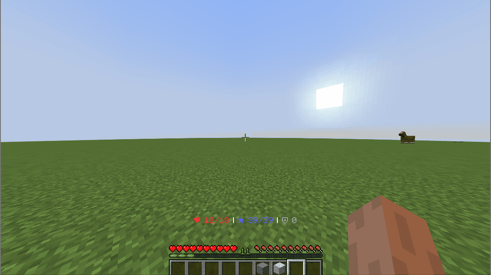
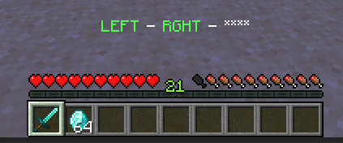
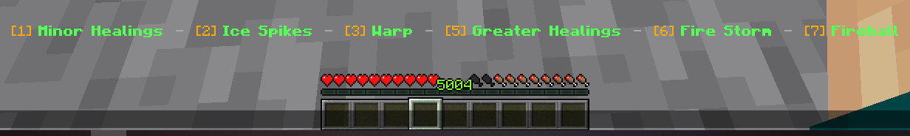

# 施放技能 {#💫-skill-casting}

确保你首先了解 [技能](intro.md)和 [技能插槽](binding.md#skill-slots)。MMOCore提供多种施放技能的方式：

- 使用最流行的组合键！
- 使用`1`至`9`热键栏（*技能栏*）
- 使用鼠标滚轮
- 使用命令

确保在编辑技能投射配置时重新启动服务器。

## 组合键 {#key-combos}

*Left-Right-Left* 等组合键可用于施放技能。玩家可以通过按任何已配置组合的第一个键来启动组合，这将暂时改变玩家的动作栏，并在那里显示其当前的组合键。一旦MMOCore识别出绑定到某个技能插槽的有效组合键，它就会投射相应的技能。



可以使用一个组合来将技能绑定到一个特定插槽。因此，有多少个技能槽就有多少个有效组合键。这意味着特定的组合键不会使两个玩家投射相同的技能（除非它们将相同的技能绑定到相同的技能插槽）。一些示例（默认配置）：

- LEFT -> RIGHT -> LEFT 将把技能投射到1st插槽上
- LEFT -> RIGHT -> RIGHT 将把技能投射到2nd插槽上
- LEFT -> RIGHT -> DROP 会将技能投射到3rd插槽上
- 等等...



### 按键绑定列表 {#keybind-list}

这些是你可以在组合内部使用的不同按键绑定。例如，你可以选择通过右键单击来启动每个组合，然后每个组合都是右键单击或左键单击的组合。  执行连击时，Bukkit单击事件被取消，这意味着执行连击时你暂时无法与任何物品/spell 交互。

|按键绑定 |评论 |
| --- | --- |
| `LEFT_CLICK` | 左键点击时 |
| `RIGHT_CLICK` | 右键点击时 |
| `DROP` | 仅在持有物品时有效 |
| `SWAP_HANDS` | 当交换主和副手物品 |
| `CROUCH` | 启用蹲伏模式时 |

### 如何使用组合键 {#how-to-use-key-combos}

前往`MMOCore/config.yml`并将`skill-casting`配置部分替换为以下代码片段：

<details markdown="1">

<summary>复制并粘贴到`config.yml`</summary>内

```yml
skill-casting:
  mode: KEY_COMBOS

  # General options
  initializer-key: SWAP_HANDS # Optional. Press to enter skill casting, otherwise any combo key will automatically have the player enter skill casting.
  quit-key: SWAP_HANDS # Optional. Press to quit skill casting. Can be the same as the 'initializer-key'
  stay-in: false # When enabled, player will remain in skill-casting after casting a skill.
  allowed-keys: # Disable some keys here, MMOCore will stop listening to them.
  - LEFT_CLICK
  - RIGHT_CLICK
  - DROP
  - SWAP_HANDS
  - CROUCH

  # Sound options
  sound:
    begin-combo: # When entering combo casting
      sound: BLOCK_END_PORTAL_FRAME_FILL
      volume: 1
      pitch: 2
    combo-key: # The click sound whenever pressing a keybind
      sound: BLOCK_LEVER_CLICK
      volume: 1
      pitch: 2
    fail-combo: # If the keybind sequence does not correspond to any preconfigured combo
      sound: BLOCK_FIRE_EXTINGUISH
      volume: 1
      pitch: 2
    fail-skill: # If you cast a skill but it fails.
      sound: BLOCK_FIRE_EXTINGUISH
      volume: 1
      pitch: 2

  # Action bar options
  action-bar:
    prefix: "&c❤ {health}/{max_health} &f|  "
    suffix: "  &f| {mana_icon} {mana}/{max_mana} &f| &7⛨ {armor}"
    is-subtitle: false #If the message is shown as a subtitle rather than in the action-bar.
    separator: ' - '
    no-key: '****'
    key-name:
      LEFT_CLICK: 'LEFT'
      RIGHT_CLICK: 'RGHT'
      DROP: 'DROP'
      SWAP_HANDS: 'SWAP'
      CROUCH: 'SHFT'

  # Edit default combos here
  combos:
    '1':
      - LEFT_CLICK
      - LEFT_CLICK
    '2':
      - LEFT_CLICK
      - SWAP_HANDS
    '3':
      - RIGHT_CLICK
      - LEFT_CLICK
    '4':
      - SWAP_HANDS
      - RIGHT_CLICK
    '5':
      - RIGHT_CLICK
      - SWAP_HANDS
    '6':
      - LEFT_CLICK
      - RIGHT_CLICK
```

</details>

`initializer-key`选项是可选的。这是玩家需要先按的键才能启动任何组合。取消设置后，按任意组合的第一个键将启动新的组合。

同样，`quit-key`是可选的。按下此键将取消当前组合。此外，如果打开`stay-in`选项，玩家可以连续施放任意数量的连击，而无需离开技能施放（动作栏保持打开状态）。

### Class-Specific组合键 {#class-specific-key-combos}

每个职业可以有不同的combo-to-slot映射。职业映射优先于插件主配置中定义的映射（见上文）。要设置class-specific组合映射，请将以下代码片段粘贴到`MMOCore/classes`文件夹下的职业配置文件中，然后根据你的喜好进行编辑：

```yml
# MMOCore/classes/<class_name>.yml
key-combos:
  '1':
    - RIGHT_CLICK 
    - LEFT_CLICK
    - RIGHT_CLICK
  '2':
    - RIGHT_CLICK 
    - RIGHT_CLICK
  '3':
    - RIGHT_CLICK
    - LEFT_CLICK
  '4':
    - RIGHT_CLICK
    - SWAP_HANDS 
  '5': 
    - RIGHT_CLICK
    - SWAP_HANDS
  '6':
    - LEFT_CLICK
    - RIGHT_CLICK
```

### 动作栏 {#action-bar}

按键组合使用玩家的动作栏来显示当前组合。要完全禁用投射动作栏，请完全删除或取消注释`action-bar`部分。在此部分中，你可以编辑动作栏的前缀和后缀以及其他格式选项。

## 技能酒吧 {#skill-bar}

这种施法方式使用动作栏。玩家按下指定按键（默认为 `F`）进入*施法模式*。此时，已绑定的技能及其剩余冷却时间会显示在动作栏中：可施放的技能为绿色，冷却中的技能为红色，魔力不足而无法施放的技能为蓝色。

在施放模式下，按`1`到`6`之间的任意键将施放绑定到该插槽的技能。



玩家再次按同一键即可退出投射模式。他们在创意时无法进入投射模式。

### 如何使用 {#how-to-use}

前往`MMOCore/config.yml`并将`skill-casting`配置部分替换为以下代码片段：

<details markdown="1">

<summary>复制并粘贴到`config.yml`</summary>内

```yml
skill-casting:
  mode: SKILL_BAR

  # General options
  open: SWAP_HANDS
  ignore-sneak: false
  use-lowest-keybinds: true

  # Messages and sounds
  message:
    enter:
      message: '&e&l☄ &a&lSKILL CASTING &e&l☄'
      action-bar: true
      duration: 20
      priority: 31
      sound: BLOCK_END_PORTAL_FRAME_FILL,1,2
    quit:
      message: '&e&l☄ &c&lSKILL CASTING &e&l☄'
      action-bar: true
      priority: 31
      sound: BLOCK_FIRE_EXTINGUISH,1,2

  # Action bar format
  action-bar:
    split: '&7 &7 - &7 '
    ready: '&6[{index}] &a&l{skill}'
    on-cooldown: '&6[{index}] &c&l{skill} &6(&c{cooldown}&6)'
    no-mana: '&6[{index}] &9&l{skill}'
    no-stamina: '&6[{index}] &9&l{skill}'
```

</details>

如果玩家在按下输入键绑定时潜行，`disable-sneak`会阻止技能栏打开。

`use-lowest-keybinds` 会让 MMOCore 为可施放技能分配最靠前的可用按键。技能槽位可以留空，也可以绑定无法主动施放的被动技能，因此第一个主动技能之前可能有空位。启用此项后，所有主动技能会“向左补位”，优先使用靠前的按键，先是 `1`，再是 `2`，以此类推。

### 技能插槽偏移 {#skill-slot-offset}

你可能会注意到屏幕截图中显示的键与`1`到`6`并不完全匹配。发生这种情况的原因是，如果你选择的热栏插槽是`2`，则技能插槽`2`、`3`、`4`以及所有后续插槽都会移动1。

如果你选择的热键栏插槽是`2`，则Minecraft客户端在按下`2`时不会向服务器发送任何数据包，从而导致MMOCore无法检测插槽交换。一般情况下，Minecraft客户端会避免向服务器发送无用的数据包。

> **信息**
>
> 如果只有6技能插槽，且玩家位于插槽`7`、`8`或`9`上，则不会有偏移。

### 动作栏 {#action-bar-1}

这种投射模式也使用动作栏。要完全禁用投射动作栏，请完全删除或取消注释`action-bar`部分。在此部分中，你可以在投射模式下编辑玩家动作栏的格式选项。

## 技能卷轴 {#skill-scroller}

玩家首先按下特定按键（默认设置为`F`）进入投射模式。从那里，他们使用鼠标滚轮浏览技能列表。当前选择的技能出现在玩家的动作栏上。然后，他们按另一个键（默认设置为`R`）来投射选定的技能。

### 如何设置 {#how-to-setup}

前往`MMOCore/config.yml`并将`skill-casting`配置部分替换为以下代码片段：

<details markdown="1">

<summary>复制并粘贴到`config.yml`</summary>内

```yml
skill-casting:
  mode: SKILL_SCROLLER

  # General options
  action-bar-format: 'CLICK TO CAST: {selected}'
  quit-on-cast: false # Should the player quit casting mode when skill is cast?
  quit-on-switch-empty-hand: false # Player quits casting mode when switching to an empty hand
  ignore-sneak: false # Ignore pressed keys when player is sneaking

  # Keybinds
  enter-key: SWAP_HANDS
  cast-key: LEFT_CLICK
  scroll-key:
    key: RIGHT_CLICK
    sneak: false # No sneak + right click
  scroll-back-key:
    key: RIGHT_CLICK
    sneak: true # Sneak + right click

  # Edit sounds here
  sound:
    enter:
      sound: BLOCK_END_PORTAL_FRAME_FILL
      volume: 1
      pitch: 2
    change:
      sound: BLOCK_LEVER_CLICK
      volume: 1
      pitch: 2
    change-back:
      sound: BLOCK_LEVER_CLICK
      volume: 1
      pitch: 1.5
    leave:
      sound: BLOCK_FIRE_EXTINGUISH
      volume: 1
      pitch: 2
```

</details>

|参数|可选|描述 |
| --- | --- | --- |
| `scroll-key` | 是的 | 可选：注释要禁用的行。设置后，鼠标滚轮不再滚动技能列表，而玩家必须按此按键绑定才能滚动技能列表。 |
| `scroll-back-key` | 是的 | 可选：注释要禁用的行。设置后，鼠标滚轮不再滚动技能列表，而玩家必须按此按键绑定才能滚动技能列表。 |
| `cast-key` |  | 你需要按下按键绑定才能投射当前选择的技能。 |
| `quit-on-cast` | 是的 | 启用后，玩家在投射选定的技能时退出投射模式。 |
| `quit-on-switch-empty-hand` | 是的 | 启用后，玩家在滚动到空的热键栏插槽时退出投射模式。 |
| `ignore-sneak` | 是的 | 启用后，蹲下时按下的按键将被忽略。 |

### 动作栏 {#action-bar-2}

这种投射模式也使用动作栏。要完全禁用投射动作栏，请完全删除或取消注释`action-bar`部分。在此部分中，你可以在投射模式下编辑玩家动作栏的格式选项。

## 使用命令 {#using-commands}

MMOCore具有用于投射技能的命令。即使技能投射被禁用，如果WorldGuard/Residence 标志阻止玩家投射技能...

以下命令将转换给定玩家的n-th可转换技能。

```cmd
/mmocore cast first <player> <slot>
```

以下命令将使给定的玩家将技能投射到其n-th技能插槽上。

```cmd
/mmocore cast specific <player> <slot>
```

例如，假设玩家有四个技能插槽和相应的技能绑定：

|插槽1|插槽2|插槽3|插槽4|
| --- | --- | --- | --- |
| - | 无源技能 | 活动技能n1 | 活动技能n2 |

`/mmocore cast first <player> 1` 会施放第 1 个可主动施放的技能，即槽位 3 中的技能。槽位 2 是被动技能，无法主动施放，因此会被忽略。`/mmocore cast first <player> 2` 会施放第 2 个可主动施放的技能，即槽位 4 中的技能。`/mmocore cast first <player> 3` 或更大的序号会报错。

`/mmocore cast specific <player> 1` 会报错，因为槽位 1 中没有可施放技能。`/mmocore cast specific <player> 2` 也会报错，因为槽位 2 是被动技能。`/mmocore cast specific <player> 3` 则会施放槽位 3 中的技能。

## 禁用技能投射 {#disable-skill-casting}

如果你不使用职业技能或者你不打算添加活动的技能，则可以通过在`config.yml`中使用以下配置语法片段来禁用技能转换。

```yml
skill-casting:
  mode: NONE
```

这将完全禁用技能投射。如果你打算根本不使用技能投射，或者只想通过命令投射技能，我们通常建议使用此选项。

## 编辑技能施放粒子效果 {#editing-the-skill-casting-particle-effect}

默认情况下，MMOCore在当前处于施放模式的玩家周围显示小螺旋粒子效果。你可以编辑所使用的粒子、大小和颜色。将以下代码片段添加到你的MMOCore职业配置文件中。

```yml
# Particles displayed around players when in casting mode.
cast-particle:
  particle: CRIT # Mandatory

  # Mandatory for colored particles (DUST) 
  #size: 2
  #color: 
  #  red:
  #  green:
  #  blue:

  # Mandatory for block-based particles (BLOCK, FALLING_DUST, DUST_PILLAR, BLOCK_CRUMBLE, BLOCK_MARKER)
  #material: DIRT
```

为了禁用技能投射粒子效果，你需要从MMOCore职业配置文件中删除/注释掉`cast-particle`配置部分。

## 技能施放超时 {#timeout-for-skill-casting}

由于MMOCore1.12.1开发构建，你可以为技能投射添加超时。如果超过 X 秒没有检测到任何活动，技能投射将立即结束。设置非常简单，只需将以下选项添加到现有的`skill-casting`配置部分即可。此选项支持所有投射模式。

```yml
skill-casting:
  # ...
  time-out: 200 # 10 seconds (in ticks)
```

如果你不打算使用技能转换超时，则不要在`skill-casting`配置部分中使用此参数。

---

原文：[💫 Skill Casting](https://docs.phoenixdevt.fr/mmocore/skills/casting) · 原文归档：2026-10-19
