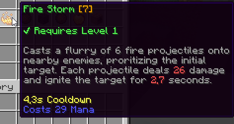

# 配置 {#🗃️-configuration}

## Class-Specific技能 {#class-specific-skills}

技能和class-specific- 给定的职业只能执行一组预定义的技能。

要定义每个职业可以使用的技能，请打开`MMOCore/classes`文件夹内的职业配置文件，然后查找`skills`配置部分。此部分下的每个条目对应于一个职业技能。

```yml
skills:

  # First skill
  FIRE_STORM:
    level: 1
    max-level: 30
    unlocked-by-default: true

    # Skill modifiers
    damage:
      base: 5.0
      per-level: 3.0
    cooldown:
      base: 5.0
      per-level: -0.1
      max: 5.0
      min: 1.0
    #....
  
  # Second skill
  POWER_MARK:
    level: 3
    max-level: 30
    unlocked-by-default: true
    needs-bound: true
    #.....
  
  # Some test passive skill
  A_PASSIVE_SKILL:
    level: 10
    max-level: 30
    trigger: TIMER # Runs on a timer
    timer: 5 # Runs once every 5 seconds
    cooldown:
      base: 5.0
      per-level: -0.1
      max: 5.0
      min: 1.0

  #..........
```

### 技能等级 {#skill-level}

`level`表示等级，此时职业自然会解锁该技能。`max-level`是职业技能的最大值等级。一旦达到，玩家就无法再[升级](intro.md#upgrading-a-skill)此技能。

### 默认解锁 {#unlocked-by-default}

`unlocked-by-default`指示此技能是否应默认解锁。默认设置为`true`。当关闭时，这个技能必须[通过使用命令、任务触发器、技能书、经验表解锁](unlocking.md)...

### 需要绑定 {#needs-binding}

另一种选择是`needs-bound`。此选项仅与被动技能相关，因为主动技能必须全部绑定。当设置为`false`时，即使未绑定，被动技能也会生效（因此不能再绑定到任何技能插槽）。

### 技能参数 {#skill-parameters}

你可能还想更改技能数值参数，以便 *Mage*职业施放的火球比 *Paladin*职业施放的火球造成更多伤害。每个技能的每个参数都可以通过将相应条目添加到职业技能配置来编辑。例如（见上文），*Fire Storm*技能的`damage`参数设置为等于5Dmg，加上每个技能等级的3Dmg 。这些技能参数不随玩家的等级缩放，而是随技能等级缩放。当技能升级为](intro.md#upgrading-a-skill)时，技能等级会增加。



## 技能文件夹 {#skill-folder}

你可能会觉得上面的配置可能缺乏必要的信息，比如它的名称、描述图标、它的用途等。

请注意，上面的配置（“职业技能”配置）不会创建技能，它们只是允许技能被某个职业使用。技能在`MythicLib/skill`文件夹内创建/定义。请参阅[此维基页面](../../mythiclib/skills/custom/mythic.md#_2-declare-it-as-a-mythiclib-skill)了解更多信息。

你在职业配置中使用的任何技能必须在`MythicLib/skill`文件夹内的某个位置注册。如果没有，MMOCore在尝试加载职业时将抛出错误。

## 无源技能 {#passive-skills}

要创建被动技能，你所要做的就是为该技能指定一个 [触发器](../../mythiclib/skills/triggers.md)。任何不带触发器的技能均被视为主动技能，而任何带有触发器的技能均被视为被动技能。触发器定义技能何时生效。

下面的职业技能是被动的技能，每次玩家攻击实体时都会触发。它使用`ATTACK`触发器。

```yml
skills:
  MY_CUSTOM_SKILL_2:
    level: 1
    max-level: 30
    trigger: ATTACK # <<==== Here
    ...
```

下面的技能是被动的技能，每5秒运行一次。它使用`TIMER`触发器，并将`timer`修改器设置为`5`。

```yml
skills:
  MY_CUSTOM_SKILL_1:
    level: 1
    max-level: 30
    trigger: TIMER # <<==== Here
    timer: 5
    ...
```

请注意，`trigger`配置选项会覆盖MythicLib技能配置中指定的`trigger`选项。如果在MythicLib中指定了触发器，但未在MMOCore职业配置中指定，则技能仍将被视为被动技能，并且它将使用MythicLib中指定的触发器。如果两者都指定，则MMOCore优先。

---

原文：[🗃️ Configuration](https://docs.phoenixdevt.fr/mmocore/skills/config) · 原文归档：2026-10-19
