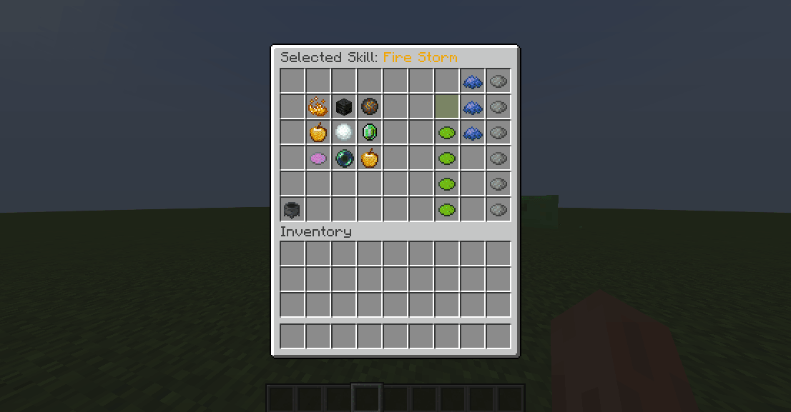
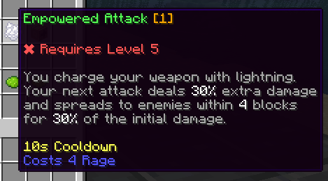
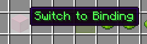
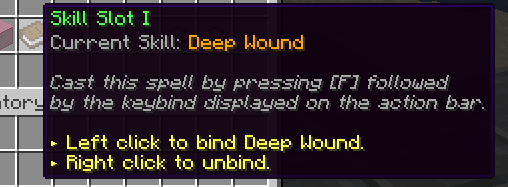
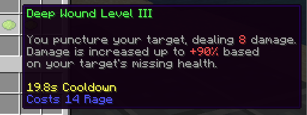
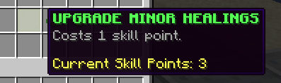

# 技能 {#🔥-skills}

技能是令人惊叹且独特的能力，玩家可以用来击败敌人或增强队友的战斗和生存能力。

技能要么是**主动要么是被动**。主动技能是指主动技能[由玩家](casting.md)施放。被动技能无法施放 - 相反，它们会在特定事件（攻击、点击、移动、其他技能...）上自动触发。

技能是class-specific。当更改职业时，玩家将“丢失”他们在技能上取得的进度并解锁新的进度。再次切换职业时，可恢复之前的进度。

## 定制技能 {#custom-skills}

MMOCore 自带 90 多种技能，也可以使用 MythicMobs、MythicLib、Fabled 等常见技能或脚本系统，创建任意数量的自定义技能。

请注意，自定义技能已在MythicLib中注册。你在MythicLib中注册的任何技能将自动转发到MMOCore和MMOItems。请阅读[此 wiki 页面](../../mythiclib/skills/intro.md)以了解如何创建和注册自定义技能。

## 概览 {#overview}

为了使用技能，玩家需要：

1. 选择 [职业](../features/classes.md)可选
2. 【解锁](unlocking.md)、技能可选
3. [将](binding.md)和技能绑定到兼容的技能插槽可选
4. 【铸](casting.md)技能

然而，MMOCore技能系统确实很宽松：

1. 默认的职业也可以有技能，所以技术上玩家不需要选择职业就能够施放技能。如果你不打算使用职业系统，你仍然可以使用MMOCore技能。
2. 当达到一定水平、完成任务、解锁技能树中的节点或几乎任何其他东西时，都可以解锁技能。技能也可以默认解锁。
3. 技能可以使用命令手动绑定，如果你不喜欢MMOCore技能绑定功能，也可以将hard-set自动绑定到技能插槽。
4. 显然，技能施放是强制性步骤，这是唯一不能跳过的步骤！

## 技能GUI {#skill-gui}

玩家可以通过使用`/skills`来打开技能GUI。此 UI 允许玩家可视化其可用的技能及其效果，升级其可用的技能并将其技能绑定到技能插槽。

## 升级技能 {#upgrading-a-skill}

升级技能**增强其功能**。玩家可以根据自己的游戏风格和想要遵循的技能路径来选择他们想要升级的技能。升级技能需要**一个 ​​技能积分**。

技能积分是玩家可以用来升级其技能的货币。一次升级需要 1 个技能点。  可以使用以下[管理命令](../general/commands.md)来授予技能积分：

```cmd
/mmocore admin skill-points give <player> <amount>
```



在GUI中，单击选择你要升级的技能。所选技能的名称显示在 UI 名称中。然后，你可以通过单击*升级技能* 按钮来升级所选的技能。物品旁边的 *升级技能* 按钮让用户可以直观地看到更高等级的技能的强度。

## 技能增益 {#skill-buffs}

技能buff 会修改某个技能修饰符的值。它可以使用[类别公式](../skills.md)]来定位一个或多个技能，并且只能定位1修饰符。技能增益只能通过 [技能插槽](binding.md#skill-slots)和 [触发器](../misc/triggers.md)（以及每个扩展，技能树）授予。

```yml
triggers: 
  # -10% cooldown to ALL skills
- 'skill_buff{formula="true";modifier="cooldown";amount=-10;type=RELATIVE}'
  # +20 Flat damage to skill with name FIRE_STORM
- 'skill_buff{formula="<FIRE_STORM>";modifier="damage";amount=20;type=FLAT}'
  # 20 Flat damage to skills with category MY_OWN_CATEGORY
- 'skill_buff{formula="<MY_OWN_CATEGORY>";modifier="damage";amount=20;type="FLAT"}'
```

请注意，针对技能类别或特定技能名称的语法是相同的。

## 编辑技能GUI {#editing-the-skill-gui}

可以通过修改`gui/skill-view.yml`配置文件来编辑技能GUI。

> **提示**
>
> 我们建议在阅读本节其余部分时使用侧面的文本编辑器打开此文件。

首先，请参考[这个wiki页面](../../mythiclib/misc/ui-syntax.md)来了解一般的MMOCoreUI语法。

### 物品功能 {#item-functions}

`next`和`previous`函数用于分页。

`skill`是为玩家可用的每个技能显示的物品。它的描述有点复杂：

- 仅当玩家已解锁技能时，才会显示以`{unlocked}`开头的行
- 仅当玩家尚未解锁技能时，才会显示以`{locked}`开头的行
- 当玩家达到最大技能等级时，会显示以`{max_level}`开头的行
- `{lore}`只需复制并粘贴整个技能描述



`switch`是从绑定模式切换到升级模式时单击的物品



`skill-slot`为绑定方式使用的物品



`skill-level`是物品，用于告诉玩家如果选定的技能具有更高等级，它会如何表现



`upgrade`是要升级选定的技能时点击的物品



---

原文：[🔥 Skills](https://docs.phoenixdevt.fr/mmocore/skills/intro) · 原文归档：2026-10-19
