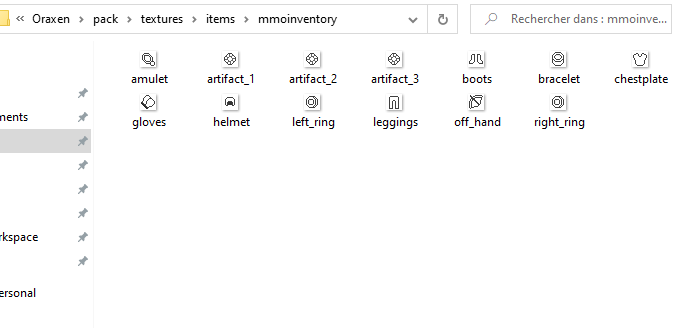
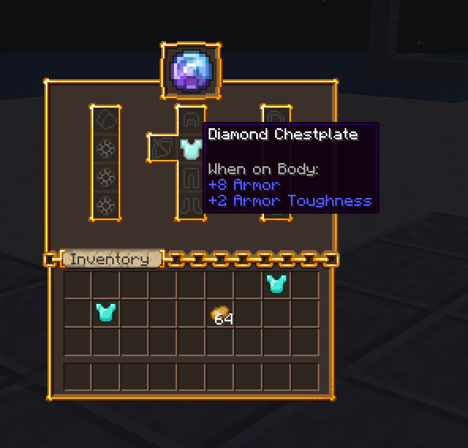

# Oraxen {#💎-oraxen}

本页介绍了MMOInventory和 [Oraxen](https://oraxen.com/)之间的built-in兼容性功能。请注意，这并不意味着不支持其他物品插件，它只是意味着Oraxen有一些独有的功能。

## 自定义纹理 {#custom-textures}

MMOInventory1.6.5引入本机Oraxen支持。由于MMOInventory需要使用自定义资源包，因此MMOInventory将在启动时检测Oraxen并将所需的物品注入其注册表中。你**必须**做的唯一一件事是将所有物品纹理放入一个特定文件夹中，即`Oraxen/pack/textures/items/mmoinventory`。你的纹理必须是 .PNG 文件，并且名称必须遵循`lower_case_format`。你的`slots.yml`配置和Oraxen纹理文件夹之间必须有完美的ONE-TO-ONE匹配！如果有任何错误，Oraxen可能会输出纹理错误。默认MMOInventory`slots.yml`配置的示例：



如果你在`Oraxen/items/`文件夹中看到名为`mmoinventory-hook.yml`的文件，请**不要**触摸它！它由MMOInventory自动生成，并通过在资源包中注册物品来处理所有Oraxen兼容性内容。

## 自定义GUI纹理 {#custom-gui-textures}

使用Oraxen你还可以设置字形，让你向物品栏添加自定义纹理。要使用字形，请记住你可以使用 PAPI占位符`%oraxen_<glyph_id>%`。使用自定义GUI纹理时，还要确保从`items.yml`配置部分中删除填充物品配置部分。



在物品栏名称中使用Oraxen字形非常容易。前往`language.yml`配置文件：

```yml
inventory-name:
    self: '&f%oraxen_shift_16%%oraxen_shift_2%%oraxen_mmoinv_default%'
```

如果你以前从未听说过自定义表情符号/GUI纹理/图标，但对之前的屏幕截图感到兴奋，那么你绝对应该了解更多相关信息。Oraxen基本上自动使用自定义物品/GUI/emoji 纹理。

---

原文：[💎 Oraxen](https://docs.phoenixdevt.fr/mmoinventory/compatibility/oraxen) · 原文归档：2026-10-19
