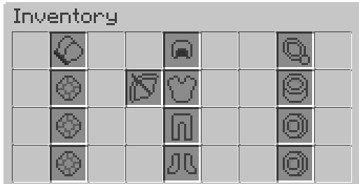

# 常见问题 {#🤔-faq}

**[此MythicLibwiki 页面](../mythiclib/faq.md)** 上记录了更常见的错误和问题，也请考虑检查它。

## 有安装指南吗 {#is-there-an-installation-guide}

提供了安装指南 [此处](install.md)。

## 支持MySQL吗？ {#is-mysql-supported}

是的，你可以在主插件配置文件中启用MySQL。查找以下几行：

```yml
mysql:
  enabled: false
  host: localhost
  port: 3306
  database: minecraft
  user: mmolover
  pass: ILoveAria
  ....
```

## 怎样才能在按E键时打开它？ {#how-do-i-make-it-open-when-i-press-e}

你可以使用 [MythicKeys](https://www.spigotmc.org/resources/mythickeysplugin-custom-keybinds-api.98893/)来完成此操作，这需要客户端 mod。如果没有客户端模组，你就无法做到这一点，因为没有**方法（在原版Spigot中）检查玩家是否打开了他的制作物品栏，因为它都是客户端。客户端 mod 允许你发送正确的数据包，以便服务器检测玩家何时打开他的物品栏。

这曾经可以在Spigot1.12下使用高级数据包实现，但这些在非传统版本中已被删除。

你可以做的是使用另一个插件，使 2x2 制作网格在单击时执行`/mmoinventory`命令，这可能是一个不错的原版替代方案。其他一些替代方法是使用物品，你可以将其放置在物品栏的某个静态插槽中，右键单击时打开物品栏（主配置文件中有一个选项可以执行此操作）。

## MMOInventory有auto-elytra装备吗？ {#does-mmoinventory-have-auto-elytra-equip}

在最近的开发版本中，是的！

## MMOInventory自动使用图腾吗？ {#does-mmoinventory-auto-use-totems}

不。

## 放置在各自插槽中的MMOItems不应用其属性。 {#mmoitems-placed-in-their-respective-slots-don-t-apply-their-stats}

确保`MMOItems/item-types.yml`中相应的物品类型的子类型/父类型设置为`ACCESSORY`，这是**强制**让MMOItems注册物品中的属性放置在自定义物品栏GUI中。如果你尝试在催化剂插槽中装备催化剂物品，你会成功，但不会获得任何属性，因为在自定义物品栏插槽中装备催化剂时不会应用其属性！这是MMOItems制作方式的限制。

同样，可以装备未满足等级限制的物品，但不会应用其属性（除非你使用`milevel{}`插槽限制）。

## 有背包槽或安装槽吗？ {#is-there-a-backpack-slot-or-a-mount-slot}

不。

## 有武器插槽吗？ {#is-there-a-weapon-slot}

不，因为这个功能与其他插件（如MMOItems）一起出现问题的速度非常快。它曾经是旧的物品栏插件（例如 RPGInventory）中的一个东西，但我们决定不实现它。

## 我的GUI看起来很奇怪 {#my-gui-looks-weird}

从1.21.8开始，此问题不再相关，因为 *scale* 参数不能再用于掩盖原版物品栏网格图案。请参阅[此维基页面](features/custom-inventory-texture.md)了解更多详细信息。



正如主插件资源页面上所解释的，默认的MMOInventory资源包使用自定义纹理钻石锄头来显示灰色填充物物品，以填充Minecraft默认的物品栏网格图案。为了隐藏该网格图案，你必须将物品的大小调整为大约110%，但所需的百分比有时可能会有所不同。编辑你的资源包并找到（默认情况下）位于`/assets/minecraft/models/item/slots/fill.json`的相应模型。

使用`scale`json 部分，你可以将其更改为更高的值，以隐藏物品栏网格图案中的微小1-pixel-wide框架。然后调整`1.1`值，使网格图案完全隐藏。请小心，如果将其设置得太高，填充物物品将穿过物品方形插槽。

```json
{
  "parent": "item/handheld",
  "textures": {
    "layer0": "items/slots/fill"
  },
  "display": {
    "gui": {
      "rotation": [ 0, 0, 0 ],
      "translation": [ 0, 0, 0 ],
      "scale": [ 1.1, 1.1, 1.1 ]
    }
  }
}
```

## 是否与Oraxen、ItemsAdder、Nexo兼容？ {#is-it-compatible-with-oraxen-itemsadder-nexo}

**MMOInventory与Oraxen、ItemsAdder和Nexo完全兼容。**MMOInventory具有一些额外的built-in兼容性功能 [与Oraxen](compatibility/oraxen.md)。

---

原文：[🤔 FAQ](https://docs.phoenixdevt.fr/mmoinventory/faq) · 原文归档：2026-10-19
