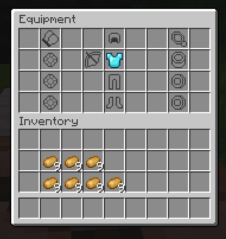
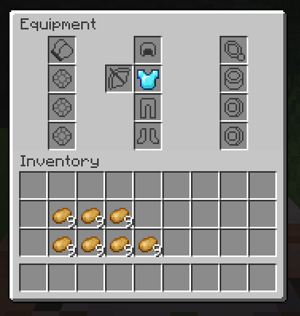
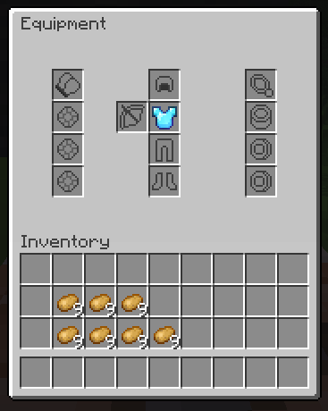
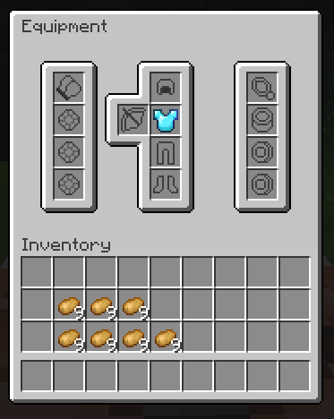

# 物品栏贴图 {#🎨-inventory-textures}

本页介绍如何将自定义纹理应用到MMOInventory中的任何玩家物品栏。

## 问题 {#the-problem}

下面的屏幕截图显示了自定义物品栏的非常简单的设置。正如你所看到的，原版网格图案非常难看，我们想隐藏它。



## 使用自定义字体 {#using-custom-fonts}

默认情况下，MMOInventory现在使用自定义字体来处理物品栏纹理。在本教程中，我们考虑物品栏，其配置存储在`MMOInventory/inventory/default_mmoinventory.yml`中。

```yml
ui_layout:
  # .....
  name:
    self: "&f%mythiclib_space_-17%\u40E0%mythiclib_space_-169%<#3F3F3F>Equipment"
    other: "&f%mythiclib_space_-17%\u40E0%mythiclib_space_-169%<#3F3F3F>Equipment of {name}"
```

注意，有两个名称，一个用于打开自己的物品栏，另一个用于打开另一个玩家的物品栏。另请注意：

- `\u40E0`是默认MMOInventory资源包引入的自定义字体字符。
- `%mythiclib_space_-17%`是由MythicLib引入的占位符，它插入了17负空格。
- `<#3F3F3F>`是物品栏名称的默认Minecraft字体颜色（从1.21.8开始）。

MMOInventory配有**四个ready-to-use物品栏纹理**。选择你最喜欢的一个！你将在下面找到包含所有built-in物品栏纹理的表格。

|纹理|行数|代码|截图|
| --- | --- | --- | --- |
| 经典（Classic） | 4 | `\u40E0` |  |
| 经典（Classic） | 6 | `\u40E1` |  |
| 增强（Enhanced） | 6 | `\u40E2` |  |
| Oraxen | 5 | `\u40E3` |  |

## 1.20.x 及以下版本 {#_1-20-x-and-below}

在1.20.x 及以下版本中，曾经有一种使用物品型号的 *display.gui.scale* 参数的解决方法。当使用灰色均匀纹理作为“填充”纹理时，你可以将*scale*参数设置为类似1.1（110%表观纹理大小）的值，这将导致物品纹理溢出并覆盖原版物品栏网格图案。

<details markdown="1">

<summary>旧型号文件</summary>

作为参考，这是用于填充纹理的模型文件。请注意，`item/fill`纹理是灰色均匀纹理，颜色代码为`#C6C6C6`（原版物品栏背景颜色，从1.21.8开始）。

```json
{
  "parent": "item/handheld",
  "textures": {
    "layer0": "mmoinventory:item/fill"
  },
  "display":{
    "gui": {
        "rotation": [ 0, 0, 0 ],
        "translation": [ 0, 0, 0 ],
        "scale": [ 1.1, 1.1, 1.1 ]
    }
  }
}
```

</details>

这在最近的版本（1.21及更高版本）中不再有效。虽然比例参数仍然存在，但纹理溢出机制已修补。在最近的版本中，我们建议使用自定义字体来完全覆盖原版物品栏纹理。好消息，这非常容易做到，你还可以使用它来完全自定义物品栏GUI的外观。

---

原文：[🎨 Inventory Textures](https://docs.phoenixdevt.fr/mmoinventory/features/custom-inventory-texture) · 原文归档：2026-10-19
