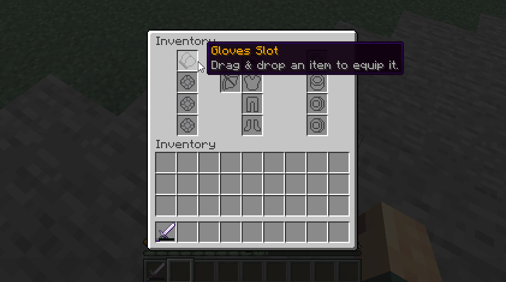

# 自定义物品栏 {#🎒-custom-inventories}

MMOInventory允许你使用特定的物品插槽创建无限数量的自定义物品栏。



## 介绍 {#introduction}

在这些物品栏、玩家中可以将其物品拖放到相应的插槽中。如果物品是一个环，则应将其放置在*环*插槽之一内。 **来自MMOItems的任何物品放置在定制物品栏中都将向玩家提供其属性。**

请注意这些定制物品栏也有护甲插槽。这些插槽直接连接到玩家护甲插槽，因此在那里放置一个新的胸甲将立即让玩家装备该胸甲。

## 基本配置 {#basic-configuration}

每个物品栏在`MMOInventory/inventory`文件夹内都有自己的配置文件。下面你将找到默认MMOInventory物品栏的配置文件的开头。

```yml
# Do NOT change this! Choose one and stick to it.
#.........
id: mmoinventory1_legacy

# Toggle on/off for temporary disabling this inventory.
enabled: true

# Either 'custom' for custom inventories or 'vanilla' for the vanilla inventory.
# There can be only one vanilla inventory at a time!
type: custom

# Should items from this custom inventory be dropped on death.
# This option is only for custom inventories, as vanilla inventory
# is already supported by the keepInventory world flag.
drop_on_death: false

#........
```

你可以通过打开或关闭此配置文件中的`enabled`参数来轻松启用/禁用自定义物品栏。`id`是MMOInventory用来保存玩家数据的一小段文本，因此你需要选择一个并且不再更改它。

`drop_on_death`定义当玩家死亡时，此自定义物品栏内部的物品是否应该掉落。

`type`必须设置为`vanilla`或`custom`。暂时留给`custom`。如果你想了解如何将原版玩家的物品栏用作MMOInventory物品栏，请参阅[此 wiki 页面](vanilla-inventory.md)。

## 打开命令 {#open-command}

对于每个自定义物品栏，你可以定义玩家可用于打开此物品栏的命令。你可以编辑命令名称、权限和别名。如果执行命令时出现任何错误，你还可以翻译发送到玩家的消息。

将`enabled`设置为`false`以禁用此功能。

```yml
# Command to be used in order to open the custom inventory.
# This option is only for custom inventories.
open_command:
  enabled: true
  name: 'custominv'
  permission: 'custom_inv.open.mmoinventory_default'
  aliases: [ mmoinv, rpginv, rpginventory ]

  output:
    player-command: '&cThis command is only for players.'
    specify-player: '&cPlease specify a player.'
    wrong-player: '&cCould not find the player called {arg}.'
    not-enough-perms: '&cYou don''t have enough permissions.'
```

确保在编辑这些命令时**重新启动**（或重新加载）服务器，因为使用`/mmoprofiles reload`重新加载插件通常是不够的，并且你可能会遇到幽灵命令（一旦注册，就很难从Bukkit命令注册表中取消注册命令）。

## 物品栏按钮 {#inventory-button}

你还可以在玩家'物品栏中放置一个永久按钮/图标，单击该按钮/图标可以打开物品栏。你可以编辑该按钮的槽位、材质等。

将`enabled`设置为`false`以禁用此功能。

```yml
# Adds a static item to players' inventories to open this custom inventory.
# Requires a server reload when changed.
inventory_button:
  enabled: false
  slot: 9
  item:
    material: CHEST
    name: '&6Custom Inventory'
    lore:
      - ''
      - '&eClick to open.'
    # custom_model_data: 1
    # skull_texture: eyJ0ZXh0dXJlcyI6e...
```

## 物品栏插槽 {#inventory-slots}

你可以在此处定义玩家将与哪些插槽交互：戒指插槽、护身符插槽、护甲插槽等...请注意，插槽类型没有限制，因为你始终可以为MMOItems物品类型创建一个特定插槽，并且可以创建任意数量的自定义MMOItems物品类型如你所愿。

<details markdown="1">

<summary>一些示例</summary>

```yml
slots:

  # Vanilla slot type
  OFF_HAND:
    type: off_hand
    material: GOLD_NUGGET
    custom_model_data_string: 'off_hand'
    name: "&6Off Hand Slot"
    slot: 12
    lore:
      - Drag & drop an item to equip it.

  # Ring slot (custom slot)
  LEFT_RING:
    type: accessory
    material: GOLD_NUGGET
    custom_model_data_string: "ring1"
    name: "&6Left Ring Slot"
    slot: 34
    restrictions:
      - "mmoitemstype{type=RING}"
    lore:
      - Drag & drop an item to equip it.

  # Amulet slot (custom slot)
  AMULET:
    type: accessory
    material: DIAMOND_HOE
    durability: 5
    name: '&6Amulet Slot'
    slot: 10
    restrictions:
    - 'mmoitemstype{type=AMULET}'
    lore:
    - Drag & drop an item to equip it.

  # Artifact slot (custom slot)
  ARTIFACT:
    type: accessory
    material: DIAMOND_HOE
    durability: 10
    name: '&6Artifact Slot'
    slot: 11
    restrictions:
    - 'mmoitemstype{type=ARTIFACT}'
    - 'unique{enabled=true}'
    lore:
    - Drag & drop an item to equip it.
```

</details>

有多种类型的插槽可供使用。

|插槽类型 |描述 |
| --- | --- |
| `helmet` | 原版头盔护甲插槽 |
| `chestplate` | 原版胸甲护甲插槽 |
| `leggings` | 原版打底裤护甲槽 |
| `boots` | 原版靴子护甲插槽 |
| `off_hand` | 原版关闭/左手插槽 |
| `accessory` | **任何自定义插槽都使用此** |
| `elytra` | 鞘翅槽。了解更多信息 [此 wiki 页面](elytra-slot.md) |
| `fill` | 填料物品 |

“自定义”插槽是指MMOInventory引入的插槽，与任何原版玩家物品栏插槽没有对应关系。戒指、护身符、神器......都是自定义插槽，因此应使用`accessory`插槽类型。

## 时段限制 {#slot-restrictions}

插槽限制是你可以添加到任何自定义插槽的条件，玩家必须满足这些条件才能将物品放置在特定插槽上。

| 限制 | 用途 |
| --- | --- |
| `milevel{}` | 使用时，玩家无法放置无法在自定义插槽 (MMOItems) 中使用的物品 |
| `mitype{type=RING}` | 将插槽限制为特定的MMOItems物品类型 |
| `unique` | 无法将两次相同的 MMOItem 放入两个不同的插槽中 |
| `class{name="Warrior,Mage,..."}` | 将插槽限制为某个职业 |
| `level{min=10}` | 低等级玩家不能使用此插槽 |
| `perm{perm=some.perm.node}` | 玩家不能使用此插槽，除非他们有一个权限 |

上述职业和等级插槽限制支持的所有RPG插件的列表可在 [此 wiki 页面](../compatibility/rpg.md)上找到。

最重要的插槽限制是`mitype`，因为你应该使用它来将插槽限制为某种MMOItems物品类型。为了创建*Ring*插槽，你可以简单地使用`mitype`插槽限制，并将`type`参数设置为`RING`（`RING`是默认RingMMOItems物品类型的ID）。

## 物品栏物品 {#inventory-items}

这项新功能允许你添加物品，单击时执行 [MythicLib脚本](../../mythiclib/scripts/intro.md)。这些物品不对应于任何插槽，玩家不能将任何物品拖放到它们上面。

```yml
items:

  INFO:
    material: SPRUCE_HANGING_SIGN
    name: "&6Information"
    slot: 5
    lore:
      - ''
      - '&f ⌛ &7Level &f%mmocore_level%'
      - '&f %mythiclib_space_1%❣%mythiclib_space_1% &7Class: &f%mmocore_class%'
      - '&f ☄ &7Gold: &f%vault_eco_balance%'
      - ''
      - '&7Health: &f%mythiclib_stat_max_health%'
      - '&7Defense: &f%mythiclib_stat_defense%'
      - '&7Attack: &f%mythiclib_stat_attack_damage%'
    on_click:
      - 'command{format="p";from_console=false}'
  
  CLOSE:
    item: BARRIER
    name: "&cClose"
    slot: 35
    lore:
      - "&7Click to close this inventory."
    on_click:
      - 'close_inventory{}'
```

### 玩家信息物品 {#player-info-item}

以下语法片段可用于创建显示基本玩家信息的物品。点击后，通过`/p`打开MMOCore玩家信息页面。

```yml
# Static items, not slots. Players can click
# on them but not move them around.
items:
  INFO:
    #item: GOLD_NUGGET
    #custom_model_data_string: "info"
    material: SPRUCE_HANGING_SIGN
    name: "&6Information"
    slot: 5
    lore:
      - ''
      - '&f ⌛ &7Level &f%mmocore_level%'
      - '&f %mythiclib_space_1%❣%mythiclib_space_1% &7Class: &f%mmocore_class%'
      - '&f ☄ &7Coins: &f%vault_eco_balance%'
      - ''
      - '&7Health: &f%mythiclib_stat_max_health%'
      - '&7Defense: &f%mythiclib_stat_defense%'
      - '&7Attack: &f%mythiclib_stat_attack_damage%'
    on_click:
      - 'sudo{format="p"}'
```

### 关闭物品栏 {#close-inventory}

以下配置片段可用于创建物品，单击时会关闭物品栏。

```yml
items:
  CLOSE:
    item: BARRIER
    name: "&cClose"
    slot: 35
    lore:
      - "&7Click to close this inventory."
    on_click:
      - 'close_inventory{}'
```

---

原文：[🎒 Custom Inventories](https://docs.phoenixdevt.fr/mmoinventory/features/custom-inventory) · 原文归档：2026-10-19
