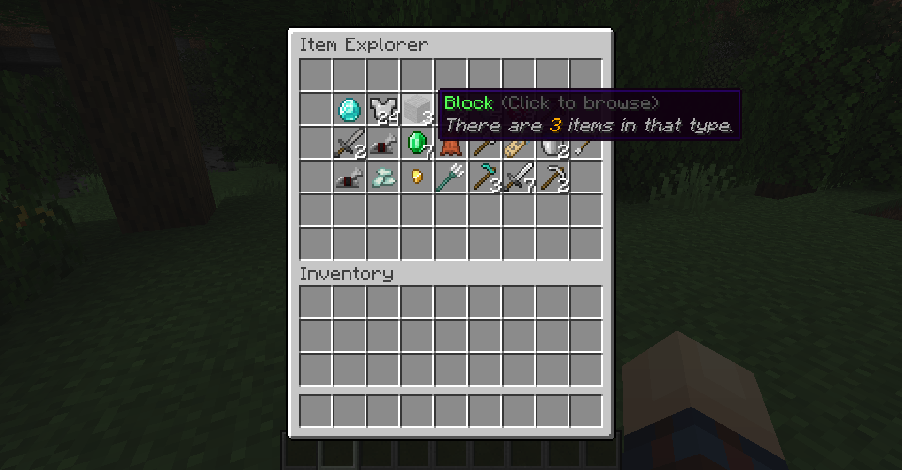
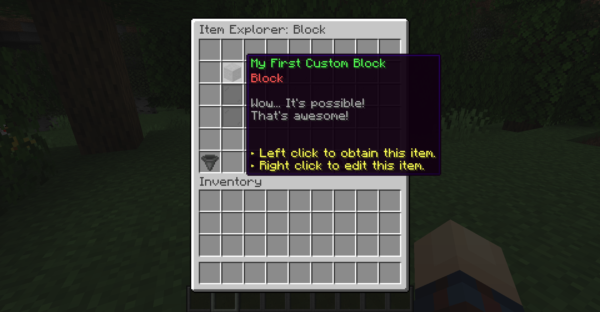
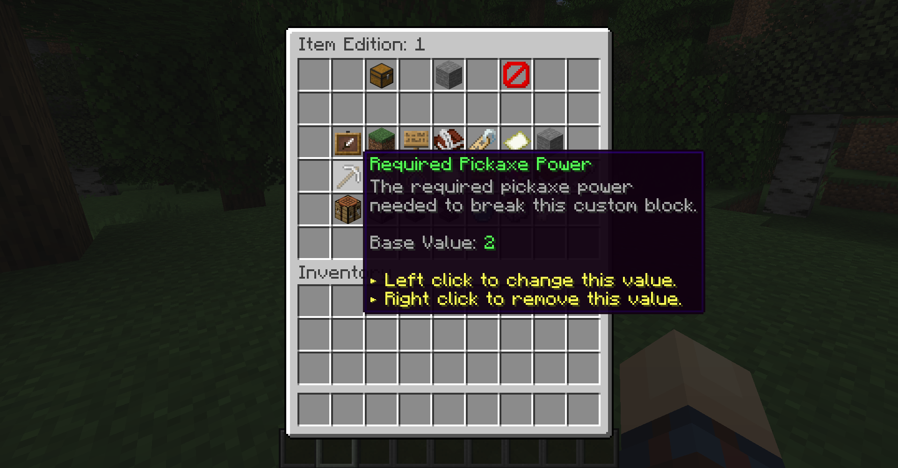
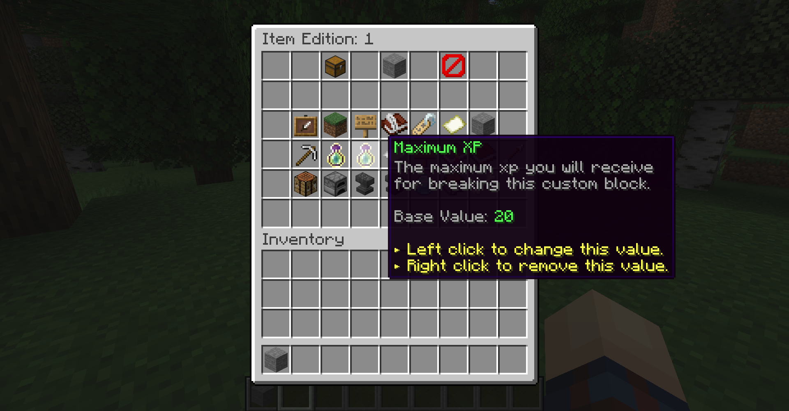
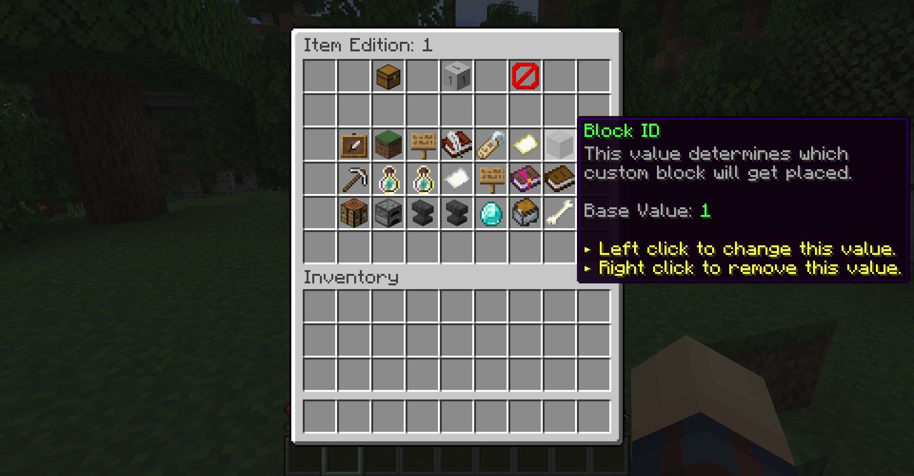
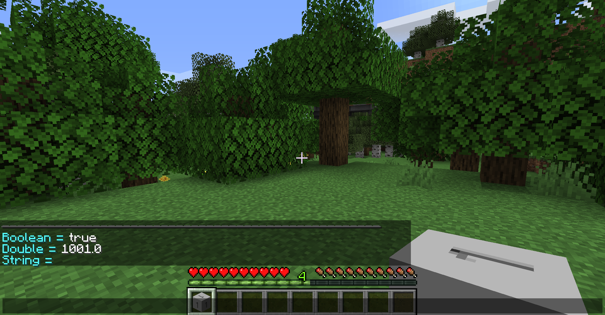
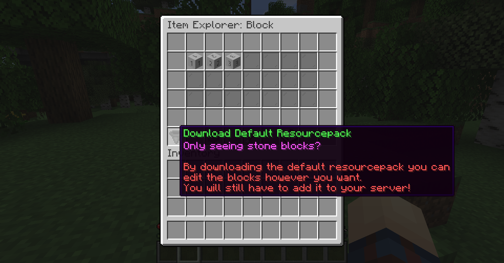
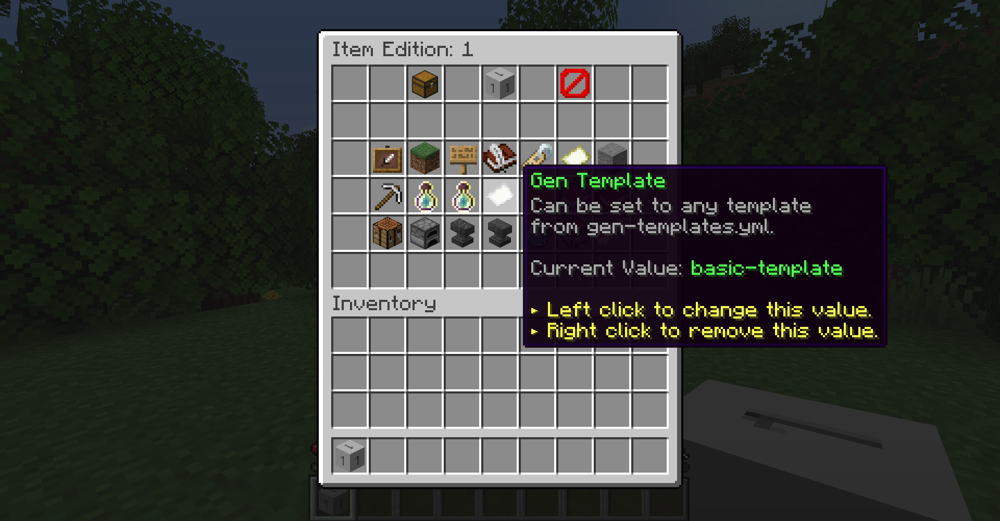

# 自定义方块（归档）

使用MMOItems5+ 你可以实现具有自定义纹理的块。你甚至可以让它们生成并使用[世界生成模板](../../phoenix/archive/dead-link.md)] 定义它们的稀有程度，使用玩家破坏它的工具进行配置，使用MMOItems掉落表决定它会掠夺什么，并将随机数量的 exp 绑定到它。

## 创建和编辑自定义块 {#creating-and-editing-a-custom-block}

你可以使用`/mi browse blocks`浏览当前的自定义块。当使用物品浏览器时，你可以使用GUI右下角的小物品指示器切换到块浏览器。就像使用物品浏览器一样，你可以右键单击自定义块来编辑它们。





这是来自`blocks.yml`的配置模板

```
1:
    display-name: "&aMy First Custom Block"
    lore:
    - "&7Wow... It's possible!"
    - "&7That's awesome!"
```

## 镐力 {#pickaxe-power}

`required-power`定义了工具必须具有的镐功率才能打破该块。如果设置为3，则玩家必须使用`Pickaxe Power`高于3的 MMOItem 工具。



默认情况下，原版镐的pre-defined镐功率如下：

```
WOOD_PICKAXE = 5
STONE_PICKAXE = 10
GOLDEN_PICKAXE = 15
IRON_PICKAXE = 20
DIAMOND_PICKAXE = 25
NETHERITE_PICKAXE = 30
```

## 方块破坏 XP {#block-break-xp}

如果添加了`min-xp`和`max-xp`，则破坏自定义块会滚动在`min-xp`和`max-xp`之间选择的随机数量的 exp，并在块上生成一个 exp 球，就像普通矿石一样。



## 自定义纹理 {#custom-texture}

如果你知道资源包和自定义模型数据的工作原理，则可以通过定义`Custom Model Data`到`block-id`来对自定义块进行纹理化。 

`block-id`并不绝对意味着物品中的`CustomModelData`标签。如果物品的`block-id`为`300`，则其`CustomModelData`将变为`1300`。这是因为MMOItems会将`1000`添加到分配的`block-id`作为其`CustomModelData`。一个有用的命令是`/mi debug checktag CustomModelData`来查看你当前持有的块中的标签值。



游戏中的块浏览器GUI中还包含下载示例纹理包的链接。 

## 世界一代 {#world-generation}

自定义块可以包含在世界生成中，因为它具有`block-id`。要在世界生成中包含自定义块，你需要将`Gen Template`添加到你的块中，以便在你的世界中加载新块时将注册它。你可以查看[世界生成模板](../../phoenix/archive/dead-link.md)指南，以获取有关设置/自定义生成的更多信息。 

---

原文：[Phoenix Wiki](https://docs.phoenixdevt.fr/archive/new-custom-blocks) · 原文归档：2026-10-19
