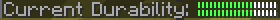
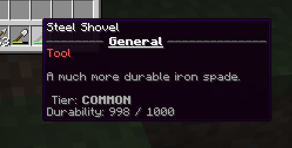

# 自定义耐久度 {#🔨-custom-durability}

> **提示**
>
> Minecraft 从 1.20.6 开始提供了修改物品最大原版耐久度的标签。建议使用它，替代自定义耐久度！

自定义耐久度可以让物品拥有指定的使用次数。相比之下，1.20.5 以前的原版耐久度系统，同一类物品的最大使用次数始终相同。

所有物品都有*最大自定义耐久度（Max Custom Durability）*属性，决定物品在**损坏**或**变为无法使用**前可使用的次数。*损坏时消失（Lost when Broken）*选项决定耐久度降到 0 时，物品是否消失。

耐久度显示在原版物品耐久条上，也可以通过 PAPI 占位符显示玩家手持物品的耐久度。物品只能使用带修复功能的消耗品进行修复。

## 1.20.5+耐久度 {#_1-20-5-durability}

Minecraft 1.20.5 加入了修改物品最大原版耐久度的标签，近期的 MMOItems 构建已完整支持。建议改用此系统：MMOItems 最初加入自定义耐久度，主要是因为原版无法修改物品最大耐久度；既然这一限制已经解除，就不再需要依赖 MMOItems 的自定义耐久度。

这仍无法让苹果、方块等原本没有耐久条的物品显示耐久条。如果确实需要耐久条，可以改用镐、锹等带耐久度的工具，再通过资源包更换其贴图。

**建议改用原版耐久度，因为它通常与其他插件的功能兼容得更好，而且 MMOItems 已完整支持。**

## 耐久度占位符 {#durability-placeholders}

这些占位符**无法用于物品描述**！它们可用于记分板、界面或其他支持 PlaceholderAPI 的地方。

- **%mmoitems_durability%** 返回玩家所持有的物品剩余的使用量。
- **%mmoitems_durability_max%** 返回物品最大值耐久度。 
- **%mmoitems_durability_ratio%** 返回物品的耐久度比率（从0%到100%）。 
- **%mmoitems_durability_bar_square%** 返回物品耐久度作为进度条。 
- **%mmoitems_durability_bar_diamond%** 返回耐久度条形，但使用的字符是菱形。 
- **%mmoitems_durability_bar_thin%** 返回更薄的耐久度条。 

## 在物品描述中显示耐久度 {#durability-in-item-lore}

也可以在物品描述中显示耐久度。先检查 `lore-format.yml`，如果还没有以下配置行，就将其加入：

```yml
lore-format:
  # ...
  - '#durability#'
```

修改 `stats.yml` 中的以下配置行，可以改变自定义耐久度在物品描述中的显示方式。如果尚不存在，就将其加入文件：

```yml
durability: '&7Durability: {current} / {max}'
```



---

原文：[🔨 Custom Durability](https://docs.phoenixdevt.fr/mmoitems/features/custom-durability) · 原文归档：2026-10-19
