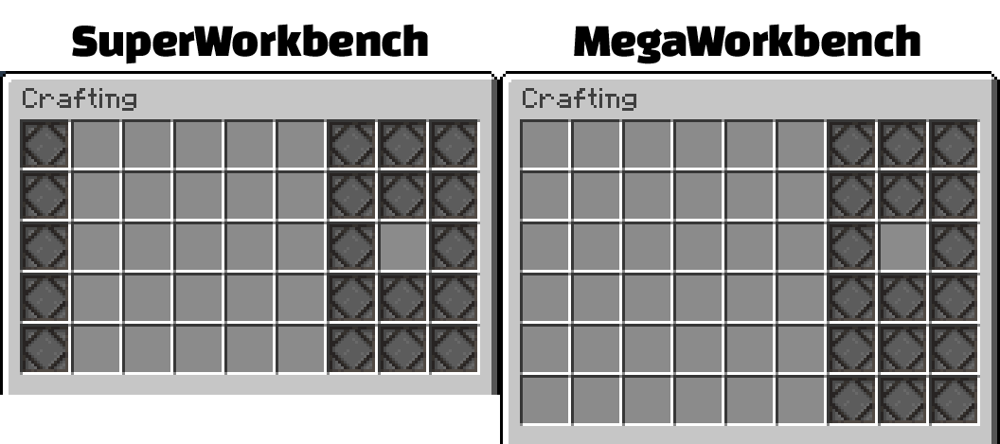

# 合成配方 {#🥘-crafting-recipes}

MMOItems 支持注册自定义配方，通过工作台、熔炉甚至营火合成 MMOItems 物品。同一物品可以在相同或不同的合成类型下拥有多个配方。例如，希望玩家通过熔炉、烟熏炉和营火中的任意一种方式烹饪 Gourmet Steak，就分别为这三种合成类型创建配方。配方支持原版物品和 MMOItems 物品。如果自定义配方与原版配方相同，例如用石头合成石质按钮，会覆盖对应的原版配方。每次新建或修改配方后，都必须执行 /mi reload recipes。

你可以将9不同的制作类型分配给物品，每种类型对应于制作块或命令。

创建可合成物品的初始步骤与其他 MMOItem 相同，先定义属性、名称和描述等内容。随后在 base 下添加 crafting，再在其中添加合成类型。目前有 9 种类型：smithing、supershaped、smoker、furnace、shaped、megashaped、campfire、shapeless、blast。名称对应各自的合成方式。

**强烈建议使用GUI物品编辑器，因为它使这些配方的可视化变得更加容易。**

```yml
#This is an unfinished item that doesn't have an actual recipe linked to it, just a crafting type.
SMOKERRECIPE:
  base:
    name: Smoker
    material: WATER_BUCKET
    crafting:
      smoker: #This is what defines your crafting type.
```

如果你想将多个配方分配给单个制作类型，你可以这样做：

```yml
SMOKERMULTIPLERECIPES:
  base:
    name: Smoker
    material: WATER_BUCKET
    crafting:
      smoker: #This is what defines your crafting type.
        '1': #This lets MMOItems know that there are multiple recipes registered to the crafting type (smoker in this case).
          input: #explained later
        '2':
          input:
```

如果要为不同的合成类型分别设置多个配方，只需在 crafting 下再添加一个合成类型。

```yml
SMOKERANDFURNACERECIPE:
  base:
    name: Smoker
    material: WATER_BUCKET
    crafting:
      smoker: #This is what defines your crafting type.
        '1': #This lets MMOItems know that there are multiple recipes registered to the crafting type (smoker in this case).
          input: #explained later
        '2':
          input:
      furnace:
        '1': 
          input:
```

## 锻造台配方 {#smithing-table-recipes}

Smithing table recipes are the way you would want to upgrade your物品. To set an物品's recipe under a smithing table, set the crafting type as smithing.锻造台配方有多种选​​择。

input are what物品the玩家must **"input"** or insert into the slots. You can define these物品as eitherMMOItemsor原版物品.在它的底部，它看起来像这样。

```yml
SMITHINGTABLERECIPE:
  base:
    name: Smithing Table
    material: WATER_BUCKET
    crafting:
      smithing:
          input: m EXAMPLE_MMOITEM_TYPE EXAMPLE_MMOITEM_ID 1.0..|v STONE - 1.0..
                 #The m defines this item as an mmoitem. The v defines it as a vanilla item.
```

input also determines which slot the物品go into. The slot on the left corresponds to the first input and the slot on the right corresponds to the second input. TheGUIis highly recommended for this as it makes viewing the recipe much easier.

**drop-gems：** 使任何插入 MMOItem 的宝石都会被丢弃，从而在玩家制作物品时可恢复。可以是true或false。

**升级：** 指示用作成分的MMOItems上可能存在的任何升级（物品升级时看到的 +X）会发生什么情况。 You have several options: ADDITIVE, MAXIMUM, EVEN, MINIMUM and NONE. ADDITIVE adds the upgrade levels up, so a +1物品and a +3物品will return a +4物品. MAXIMUM将给予更高的升级等级。 So a +1物品and a +3物品will return a +3物品. EVEN 将平均升级等级。 So a +1物品and a +3物品will return a +2物品.最低将给出较低的升级等级。 So a +1物品and a +3物品will return a +1物品. NONE 不保留任何升级等级。

**附魔：** 指示当你制作物品时，成分上的任何附魔会发生什么。它具有与升级相同的选项，并且执行完全相同的操作。

**输出：**决定了制作物品时不会消耗哪些成分（就像蛋糕配方中的一桶牛奶变成了空桶）。它的定义方式与输入相同。不过，此处的物品不必与输入中的相同，也可以完全不同。

**数量** 定义此配方将创建多少个物品。

这就是完整的配置应该是什么样的。

```yml
SMITHINGTABLERECIPE:
  base:
    name: Smithing Table
    material: WATER_BUCKET
    crafting:
      smithing:
          input: m EXAMPLE_TYPE EXAMPLE_ID 1.0..|v STONE - 1.0..
          drop-gems: true
          upgrades: ADDITIVE
          enchantments: ADDITIVE
          output: v diamond - 1.0..|v AIR - 1..
          amount: 10
```

这个配方在左边的插槽中放置一个 MMOItem，在右边的插槽中放置一个石块，并且会掉落宝石并添加成分的升级和附魔。它还将输出物品的10，并将在工艺上返回1钻石。

## 熔炉/高炉/烟熏炉/篝火配方 {#furnace-blast-furnace-smoker-campfire-recipes}

这四种工艺类型具有相同的选项和相同的总体思路。你将原料插入任何矿石/食物的位置并添加燃料。对于篝火，只需右键单击手中有原料的篝火即可。

从本质上讲，这些制作类型将如下所示：

```yml
COOKINGRECIPE:
  base:
    name: COOKING RECIPES
    material: WATER_BUCKET
    crafting:
      campfire: #This would be for a campfire, replace with furnace/smoker/blast as needed
        input: []
```

这些是合成配方可用的选项。

**输入：** 不需要，应设置为`[]`。

**隐藏：**指示物品是否应该从玩家的配方书中隐藏，即使他们已经解锁了它。使用 MMOItem 配方书，即将推出？可以是true或false。

**物品：** 指示成分是什么。对 mmoiite 使用 mMMOITEM_TYPEMMOITEM_IDAMOUNT 或对原版物品使用 vVANILLA_IDAMOUNT 。

**经验：** 指示配方应该给你多少经验。

**时间：**决定了烹饪/闻香原料所需的时间。

完整的配置如下所示：

```yml
COOKINGRECIPE:
  base:
    name: Cooking Recipe
    material: WATER_BUCKET
    crafting:
      smoker:
          input: []
          hidden: true
          item: v STONE_BRICKS - 1.0..
          exp: 10.0
          time: 10.0
```

本例中，在烟熏炉中烧制一块石砖会获得 10 点经验，耗时 10 刻（tick）。

## 成形/超级成形/巨型成形/无成形配方 {#shaped-super-shaped-mega-shaped-shapeless-recipes}



形状、超级形状和巨型形状配方都共享相同的选项。但是，形状配方可以从配方书中隐藏。形状仅仅意味着成分必须处于特定的布局中才能使物品能够制作，有点像只能以一种方式制作石镐。超级形状和巨型形状是相同的东西，但更大。你可以通过分别执行 /superworkbench 或 /swb 和 /megaworkbench 或 /mwb 来访问这些工作表。 Super Shaped 是 5x5 网格，Mega Shaped 是 6x6 网格。

所有形状的配方都有以下选项：

输入：指示必须将哪些成分放置在哪个槽中才能制作物品。

这是正常形状的配方的样子：

```yml
SHAPEDRECIPE:
  base:
    name: Shaped
    material: WATER_BUCKET
    crafting:
      shaped:
        '1':
          input:
          - v stone - 1.0..|v AIR 0 1..|v AIR 0 1..
          - v AIR 0 1..|v AIR 0 1..|v AIR 0 1..
          - v AIR 0 1..|v AIR 0 1..|v stone - 1.0..
```

另一种查看方式是这样的：

```yml
SHAPEDRECIPE:
  base:
    name: Shaped
    material: WATER_BUCKET
    crafting:
      shaped:
        '1':
          input:
          - Slot 1|Slot 2|Slot 3
          - Slot 4|Slot 5|Slot 6
          - Slot 7|Slot 8|slot 9
```

Super Shaped 和 Mega Shaped 的配方输入方式相同，只是行数和列数更多，以对应更大的合成网格。空槽位需要填写 v AIR 0 1..。

**输出：**与输入完全相同的布局，只不过它规定了在制作物品时不会消耗物品的内容。如果你愿意，你还可以使用它为玩家提供新的“降级”成分。

隐藏指示物品是否将从配方中隐藏。

无形状合成配方与有形状配方完全相同，只是确切的布局并不重要。

---

原文：[🥘 Crafting Recipes](https://docs.phoenixdevt.fr/mmoitems/features/custom-recipes) · 原文归档：2026-10-19
