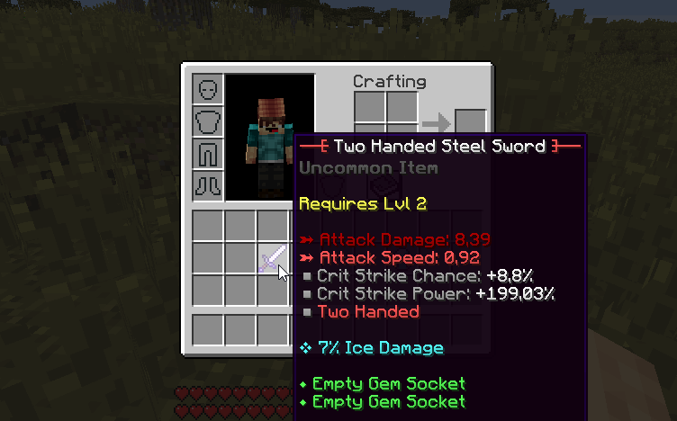
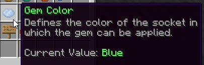
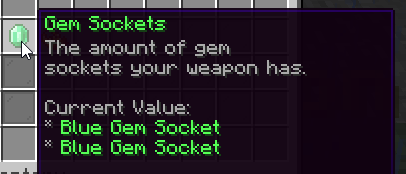
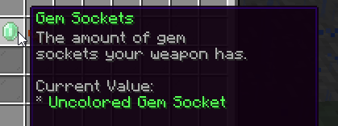
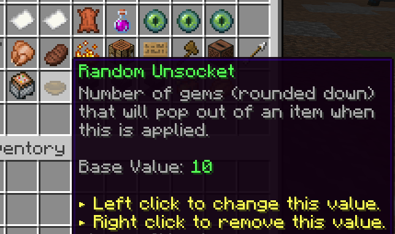

# 宝石 {#💎-gem-stones}

你可以使用`GEM_STONE`物品类型创建宝石。宝石是特殊的物品，你可以将其拖放到其他物品上，为它们提供额外的属性。你要应用宝石的物品必须至少有一个空的宝石插槽。物品限制（权限/职业/等级）适用于宝石应用，就像常规物品一样。

此外，你可以给 gem 赋予**物品类型限制**，这样它只能应用于一定数量的物品。这样，如果你有一颗宝石，它应该通过锐化刀刃对武器造成额外伤害，那么你可以将其制作成不能应用于盔甲上，这没有多大意义，因为你到底为什么要尝试锐化护甲。

宝石也可以将能力应用到你的武器上。 *即将推出：药水和粒子效果。*

将宝石应用到另一个物品上有时会失败。如果宝石没有成功应用，宝石将会丢失，并且物品将不会获得额外的属性。不过宝石插槽不会被使用。



## 插座颜色 {#socket-colors}

每颗宝石和宝石插槽都有一种颜色。你只能将彩色宝石镶嵌到相同颜色的宝石插槽上。宝石颜色可以使用版本GUI进行编辑，并且*尚未*显示在描述标签上。

你可以使用`Displayed Type`选项在物品上显示宝石颜色。例如，如果你的宝石是蓝色宝石，请将显示的类型选项设置为`Blue Gem Stone`。默认情况下，物品类型是红色描述标签，显示在物品名称的正下方。你还可以使用不同的材料来显示宝石颜色，例如蓝色宝石使用蓝色钻石。最后但并非最不重要的一点是，你还可以使用物品描述(`Can be applied onto blue sockets.`)。

套接字名称区分大小写。如果你的物品有`Blue`宝石插槽，请确保你的宝石颜色为`Blue`。





## 未着色插座 {#uncoloured-sockets}

没有宝石颜色的宝石可以应用到任何宝石插槽上。同样，无色宝石插槽可以容纳任何宝石。未指定宝石颜色的宝石（在物品版本菜单中）被视为无色。要设置未着色的 gem 套接字，请确保输入套接字颜色与主插件配置中的字符串设置完全相同：

```yml
gem-sockets:
  # Define the text you need to enter in the
  # item gem sockets if you want to create an
  # uncolored gem socket i.e a socket for any type of gem.
  uncolored: 'Uncolored'
```



如果你不想使用宝石颜色系统，只需创建带有未着色插槽的物品，并且在创建宝石时不要指定宝石颜色。此外，你还可以更改 *stats.yml* 中的`gem-socket`显示，这样它就不会显示任何宝石颜色。

## 移除宝石 {#removing-gemstones}

要从物品中移除宝石，必须创建具有 *Random Unsocket* 选项的消耗品。将此选项设置为`1`将从物品中删除1随机宝石。要删除物品上的所有宝石，只需将该值设置为更高的值即可。



为了防止消耗品意外被吃掉而不是应用于物品，你可以启用`inedible`选项。这样，消耗品仅在拖放到玩家物品栏内的物品上时才起作用。

```yml
GEMSTONE_REMOVER:
  base:
    material: FLINT
    random-unsocket: 1.0
    inedible: true # This option prevents the consumable from being eaten.
```

---

原文：[💎 Gem Stones](https://docs.phoenixdevt.fr/mmoitems/features/gem-stones) · 原文归档：2026-10-19
