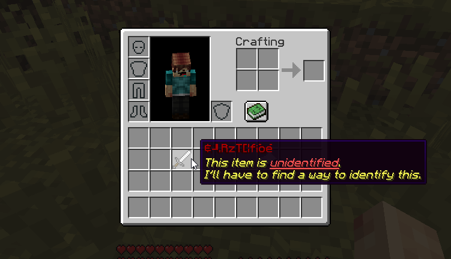

# 物品鉴定 {#🔮-identification}

方块或怪物（或任何战利品表）有时可能会掉落**身份不明的物品**。这些物品的数据完全隐藏，需要玩家识别才能使用。玩家对未识别的物品的唯一实际信息是物品材料、类型、物品等级范围（或多或少的3等级）和层。

消耗品可以使用特殊属性来识别物品。如果消耗品的“可以识别”选项已打开，则可以将它们拖放到物品上以识别它们。物品身份通过聊天消息和音效确认。



## 命令 {#commands}

以下命令可识别/取消识别你手中持有的物品。

```cmd
/mi item identify
/mi item unidentify
```

## 翻译 {#translation}

你可以更改未识别的物品在`item-types.yml`配置文件中的查看方式。每个物品类型对于未识别的物品都有不同的模板：

```yml
DAGGER:
  # ...
  unident-item:
    name: '&f#prefix#Unidentified Dagger'
    lore:
    - '&7This item is unidentified. I must'
    - '&7find a way to identify it!'
    - '{tier}'
    - '{tier}&8Item Info:'
    - '{range}&8- &7Lvl Range: &e#range#'
    - '{tier}&8- &7Item Tier: #prefix##tier#'
```

---

原文：[🔮 Identification](https://docs.phoenixdevt.fr/mmoitems/features/identification) · 原文归档：2026-10-19
