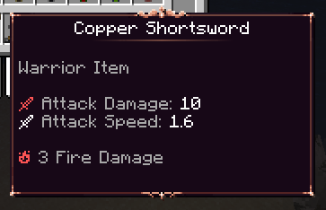
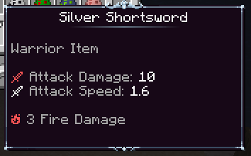
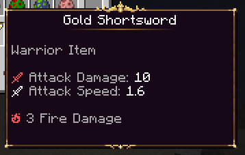
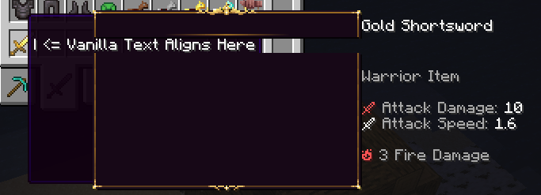
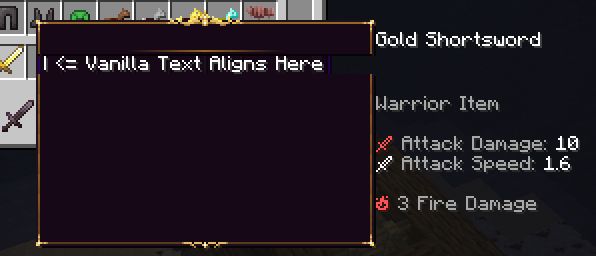
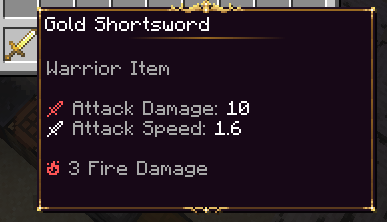
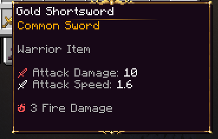
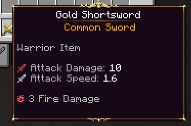
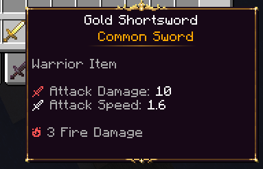

# 物品提示框 {#🖼️-item-tooltips}

当将物品悬停在任何物品栏内时，玩家会看到工具提示。虽然原版Minecraft确实具有修改任何物品的工具提示纹理的选项，但此功能非常有限（仅限颜色）。尽管也可以在不使用专用MMOItems功能的情况下手动设置自定义工具提示，但MMOItems使其更加系统化且更加容易。

特定的工具提示可以绑定到物品、层、物品类型甚至物品修饰器。直接绑定到物品和修饰符的特定工具提示优先于物品品质授予的工具提示，并且物品品质的工具提示也优先于物品类型的工具提示。

## 一般原则和示例 {#general-principle-examples}

工具提示完全基于自定义字体以及[负空格字体包](https://github.com/AmberWat/NegativeSpaceFont)。MMOItems在物品显示名称和描述中注入自定义字体，以给人工具提示背景纹理的印象。



MMOItems提供了三个示例工具提示配置（见上文）。这些工具提示使用 [MMOItems默认资源包](https://gitlab.com/phoenix-dvpmt/mmoitems-default-resource-pack)中的纹理，因此请确保事先下载它并将其安装在服务器上。安装此资源包后，给自己以下物品（这些都是剑）：`TOOLTIP_COPPER_SWORD`、`TOOLTIP_SILVER_SWORD`和`TOOLTIP_GOLD_SWORD`。

## 如何创建自定义工具提示 {#how-to-create-custom-tooltips}

转到主MMOItems文件夹中的`/tooltips`文件夹。所有工具提示配置都应放置在此文件夹中。一个YAML文件可能包含多个工具提示配置，你可以将子文件夹内的配置分组以形成有组织的文件夹层次结构。

为MMOItems创建自定义工具提示分为三个步骤：

- 遵循与使用自定义字体相关的一些限制来绘制实际的工具提示纹理，
- 将这些纹理绑定到随机 unicode 字符
- 设置MMOItems配置文件。

在我们的教程中，我们将使用以下物品（位于`item/sword.yml`配置文件内）。

```yml
GOLD_SWORD:
  base:
    material: GOLDEN_SWORD
    name: Gold Shortsword
    attack-damage: 10.0
    attack-speed: 1.6
    tooltip: GOLD # This is where you give your item a tooltip
    element:
      fire:
        damage: 3.0
    required-class:
    - Warrior
```

## 1/ 纹理 {#_1-textures}

创建自定义工具提示的第一步是绘制工具提示纹理。工具提示纹理分为三种不同的纹理：

- `top`纹理，通常包括物品显示名称以及可选的物品类型和层，
- `middle`纹理，一个非常简单的图案，对于物品描述中的每一条额外线，都会获得一次copy-n-pasted，
- `bottom`纹理，它是工具提示纹理的底部。

你可以在下面找到默认`gold`工具提示的工具提示纹理。 **确保你的纹理最多为255像素宽！​​* 这是使用自定义字体时唯一的主要限制。


生成物品时，MMOItems会在物品显示名称的开头注入`top`纹理。然后，它在每个描述行的开头注入`middle`纹理（最后一行除外）。最后描述行改为接收`bottom`纹理。负空间字体在这里至关重要，因为MMOItems使用它们来对齐文本和纹理。

你可能已经意识到，这些纹理的宽度是静态的。与扩展到物品最长的描述行的原版工具提示不同，自定义工具提示纹理不会扩展。你需要为工具提示设置hard-pick的宽度，并确保描述线条不会被剪掉。这是当前工具提示系统的已知限制（稍后可能会扩展以支持多种工具提示宽度）。

## 2/ 资源包配置 {#_2-resource-pack-configs}

在资源包中安装工具提示纹理。对于本教程，我们假设它们位于文件夹`assets/tooltip_tutorial/textures/gold/`内。

首先确保你的服务器资源包包含[负空格字体包](https://github.com/AmberWat/NegativeSpaceFont)。然后，前往`assets/minecraft/font/default.json`配置并将以下条目添加到字体映射中。

```json
{
    "providers": [
        {
            "type": "bitmap",
            "file": "tooltip_tutorial:gold/top.png",
            "ascent": 17,
            "height": 21,
            "chars": ["\u4070"]
        },
        {
            "type": "bitmap",
            "file": "tooltip_tutorial:gold/middle.png",
            "ascent": 8,
            "height": 10,
            "chars": ["\u4071"]
        },
        {
            "type": "bitmap",
            "file": "tooltip_tutorial:gold/bottom.png",
            "ascent": 8,
            "height": 17,
            "chars": ["\u4072"]
        },
    ]
}
```

与自定义字体一样，每个纹理有一个条目。

- `file`参数对应于纹理的路径。在这里，我们为纹理/资源选择的命名空间是`tooltip_tutorial`，但它可以是你想要的任何名称。
- 确保`height`参数与纹理文件的高度（以像素为单位）完全匹配，否则in-game工具提示纹理将看起来非常奇怪。
- `ascent`参数必须是fine-tunedin-game以确保工具提示中没有间隙。首先将其设置为高度的一半，重新加载资源包in-game并更正它。
- `chars`字段是你选择 unicode 字符的位置。获取一些你尚未使用的 unicode 字符并将其存储在某处，因为我们稍后在设置MMOItems配置时将需要它。

## 3/MMOItems配置 {#_3-mmoitems-configs}

你将在下面找到默认MMOItems配置文件中包含的三个工具提示配置之一。这些可以在`tooltips/example_tooltips.yml`配置文件中找到。

```yml
gold:
  top:  "{-41sp}\u4070{-166sp}"
  middle: "{-41sp}\u4071{-166sp}"
  bottom: "{-41sp}\u4072"
  align_texture: 0 # Optional
  align_text: 0 # Optional
  center_top:
    display_name: true
    span: 161
    default_char_size: 5
    lore_lines: 1
    char_size: [f4, i1, k4, l2, t3, I3, "'1", ' 3', ',1', '(3', ')3']
    regex: "[a-zA-Z0-9 ',()+]"
```

### 纹理 {#textures}

`top`、`middle`和`bottom`是你指定用于三个纹理的 unicode 字符的位置。这些选项是将注入到物品中的实际字符串。这些字符串支持自定义颜色、基于non-player的 PAPI占位符和built-in`{<value>sp}`正/负空间占位符，你可以使用它们来对齐三个纹理。

### 对齐纹理和文本 {#align-texture-and-text}

<details markdown="1">

<summary>Step-by-step对齐工具提示纹理的教程</summary>

首先，填写纹理 unicode 字符。将`debug: true`添加到工具提示配置中，这将有助于可视化文本在物品描述中自然对齐的位置（请参见下面的屏幕截图）。

```yml
gold:
  debug: true
  top: "\u4070"
  middle: "\u4071"
  bottom: "\u4072"
```



第一步是将工具提示的左侧与原版工具提示的左侧对齐。我测量到两个工具提示左侧之间有41px。这可以通过在工具提示纹理 unicode **之前**添加值-41的负空格字体来纠正。就我而言，三个纹理恰好自然对齐，但你可能需要为三个纹理使用不同的对齐值。

```yml
gold:
  debug: true
  top: "{-41sp}\u4070"
  middle: "{-41sp}\u4071"
  bottom: "{-41sp}\u4072"
```



现在，原版和自定义工具提示左侧完美对齐。我们现在需要将描述文本与调试栏`| <= Vanilla Text Aligns Here`最左边的像素对齐。你可以通过测量调试栏和描述文本最左侧像素之间的像素数来做到这一点。同样，3工具提示纹理的对齐值可能有所不同，但我的恰好一致。我测量了166像素。同样，可以通过在工具提示纹理 unicode **之后**添加负字体来纠正此问题。

```yml
gold:
  top:  "{-41sp}\u4070{-166sp}"
  middle: "{-41sp}\u4071{-166sp}"
  bottom: "{-41sp}\u4072"
```

繁荣！这是关闭`debug`选项后物品的外观in-game。



</details>

`align_texture`为整数；它可以同时用于horizontal-shift所有工具提示纹理。通常，你希望首先将其留给0，使用负空间对齐所有三个纹理，然后才将它们一次性全部向左（负值）或向右（正值）移动。

`align_text`为整数；它可以同时用于horizontal-shift所有描述行和物品名称。这通常用于解释比其他纹理“更厚”的工具提示纹理。就像上面的选项一样，你通常希望将其保留为0，使用负空间对齐所有描述行，然后才使用此选项一次将它们全部移动。在我们的例子中，我们的工具提示纹理与原版工具提示一样“厚”，因此无需使用non-zero值。

### 显示物品类型和等级 {#displaying-item-type-and-tier}

现在假设你要在物品名称下方显示物品类型和层。将以下语法块复制并粘贴到工具提示配置中：

```yml
gold:
  # ...
  lore_header:
  - '&6{tier} {type}'
```

这具有在物品生成期间在物品描述的开头插入一定数量的行的效果。`{tier}`返回物品品质，`{type}`返回物品类型。`{tier}`将始终返回non-empty值：如果物品没有层，则此占位符将返回主MMOItems配置文件中`default-tier-name`选项中指定的值。默认情况下，该值设置为`Common`，这解释了你在以下屏幕截图中看到的内容。



### 使工具提示标题居中 {#centering-the-tooltip-header}

物品名称、层和类型看起来非常好，但假设你希望物品名称和第一行描述水平居中。这可以使用一些字符串和正确的配置来实现。

```yml
gold:
  # ...
  center_top:
    display_name: true
    lore_lines: 1
    span: 161
    default_char_size: 5
    char_size: [f4, i1, k4, l2, t3, I3, "'1", ' 3', ',1', '(3', ')3']
    regex: "[a-zA-Z0-9 ',()+]"
```

如果要将物品显示名称居中，请将`display_name`设置为true。否则，MMOItems将仅格式化前 N 行描述。

`lore_lines`对应于你想要居中的行数。在这里，我们希望将此值设置为1，因为我们需要将描述标头（我们在上一节中添加的）居中。默认情况下，它设置为0，在这种情况下，MMOItems将仅将物品名称居中（如果`display_name`已打开）。

#### 技术部分... {#the-technical-part}

在转向其他选项之前，你需要了解MMOItems如何设法使文本居中。这在原版Minecraft中是不可能的，但是可以通过使用positive-space字体将任何文本偏移适量的像素来实现。假设你的工具提示宽度为`tooltip_width`像素，并且你希望将长度为`text_length`的文本居中。你可以通过将文本向右偏移以下量来做到这一点：

```
offset_to_center = (tooltip_width - text_length) / 2
```

这正是MMOItems所做的计算。为此，它需要两个值：**文本长度**和**工具提示宽度**。你必须提供工具提示宽度（以像素为单位）。你可以在 Photoshop 或任何其他图像编辑软件中测量它。它是in-game字符串中最左边字符的最左边像素与要显示文本的最右边像素之间的像素数。

文本的长度更难计算。人们可能希望它就像将字符数乘以每个字符的像素数一样简单。不幸的是，并非所有字符都是生而平等的 - 有些字符更宽，有些字符使用的像素更少。实际上，字符的宽度是client-side属性，并且还取决于字体（使用的资源包）。因此，如果你计划使用居中的工具提示标题，**请确保物品名称中使用的字体包含在服务器资源包中**，以确保所有玩家使用相同的字体包。

MMOItems需要计算任何字符串的长度（以像素为单位）。为此，它需要知道字体大小，即任何字符的宽度。事实证明，使用默认资源包时，大多数字符的宽度为5，这就是为什么`default_char_size`设置为5。但是，也有一些例外情况，如`char_size`数组中所示。以下是一些示例：

- 小写`f`仅4px宽
- 小写`i`为1px宽，而大写`I`为3px
- 空格字符``恰好是3px

如果你打算使用默认的Minecraft字体，则无需担心这些，因为我们已经为你测量了其中的大部分字体。如果你计划为服务器资源包使用不同的字体，则必须打开图像编辑软件，并计算你计划在物品名称中使用的任何字符的像素。

最后，`regex`是计算给定行宽度时应考虑的字符的正则表达式。如果在描述行中找到一个字符并且与该正则表达式不匹配，它将被忽略。 **这通常用于避免计算自定义字体和颜色代码中使用的 unicode 字符。** 在这里做一个正则表达式教程将非常out-of-scope，所以如果你不知道的话请在线查找。默认值设置为包括*小写和大写罗马文字、逗号、+ 和括号（升级物品时使用）和空格*。

> **信息**
>
> 如果我们找到更好的方法/不那么混乱的方法来实现此选项，将来可能会更改此选项

这是我们的物品目前的样子！我们已成功将显示名称和第一行描述居中。



### 使工具提示顶部更大 {#making-the-tooltip-top-larger}

到目前为止，我们的工具提示看起来相当不错，但你可能仍然想做一件事。截至目前，你可能想要增加工具提示标题的大小。你要做的第一件事是为工具提示绘制新纹理。这是新纹理，它将占据物品名称等级以及第一条描述行。我们的新纹理现在为42px高。


确保更新资源包配置以考虑新工具提示`top`纹理的高度。我必须将`height`从21增加到42，并将`ascent`从17增加到18，以进行非常小的1px调整。

```json
{
    "providers": [
        {
            "type": "bitmap",
            "file": "tooltip_tutorial:gold/top.png",
            "ascent": 18,
            "height": 42,
            "chars": ["\u4070"]
        },
        ...
    ]
}
```

现在，对工具提示配置使用以下语法。`ignore_first`选项告诉MMOItems跳过前两条描述线的`middle`纹理的渲染，这些线现在被更大的工具提示`top`纹理“覆盖”！

```yml
gold:
  # ...
  ignore_first: 2
```

这是我们物品的最终外观。相当不错！



## 将工具提示绑定到物品、修饰符、层、类型 {#binding-tooltips-to-items-modifiers-tiers-types}

将特定的工具提示绑定到特定的物品非常简单。单击物品版本 UI 中的 *Tooltip* 选项后直接输入工具提示ID，或者使用以下语法。此选项优先于类型和tier-level工具提示。

```yml
SOME_ITEM:
  # ...
  tooltip: GOLD # Forces the tooltip to GOLD
```

同样，你可以使用以下语法让修饰符应用工具提示（就像它们提供任何其他属性/物品选项一样）。此选项具有最高优先级，因为在生成物品时的基本物品数据之后会考虑修饰符。下面是一个修改器示例，它在使用ID`GOLD`应用工具提示时将前缀 *Golden* 添加到物品。

```yml
GOLDEN:
  chance: 0.1
  prefix:
    format: '&6Golden'
    priority: 1
  stats:
    # ...
    tooltip: GOLD # Forces the tooltip to GOLD
```

将工具提示绑定到物品品质也非常简单。这是`Rare`物品品质的默认配置。此选项优先于type-speficic工具提示，但不高于物品或modifier-level工具提示。

```yml
RARE:
  name: '&6Rare'
  # ...
  tooltip: GOLD # Sets default tooltips of Rare items to GOLD
```

使用以下语法将工具提示绑定到物品类型也非常简单。这是`Sword`物品类型的默认配置文件。该选项的优先级最低。

```yml
SWORD:
  name: Sword
  # ...
  tooltip: GOLD # Sets default tooltip of swords to GOLD
```

---

原文：[🖼️ Item Tooltips](https://docs.phoenixdevt.fr/mmoitems/features/item-lore/tooltips) · 原文归档：2026-10-19
