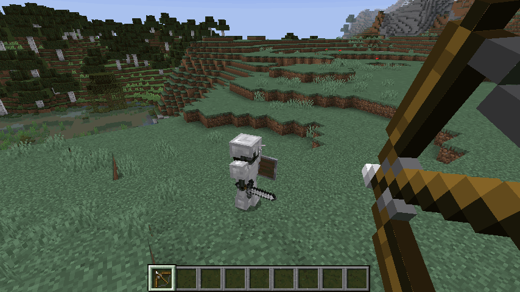
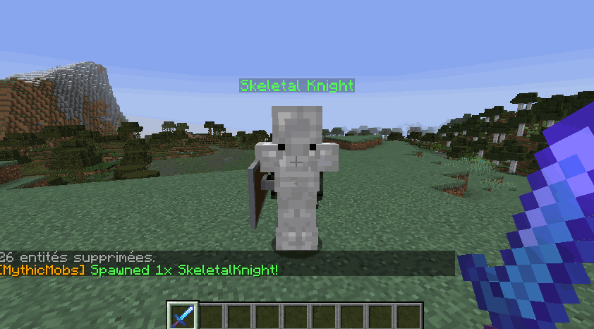

# 掉落喷散效果 {#💥-lootsplosion}

*Lootsplosion* 是我们模仿《无主之地》系列等其他游戏的效果的昵称。现在你的掉落物可以抢劫，而不是杀死小怪，并获得非常无聊的掉落物！

```yml
# Offset is the distance traveled on X and Y coordinates
# Height is the Y velocity coordinate. Lootsplosions
# only trigger with MythicMobs monsters.
lootsplosion:
    enabled: true
    color: true
    offset: .4
    height: .5
```

可在`config.yml`中进行配置，你可以更改物品飞出小怪的 X 和 Y 方差。现在，你可以杀死 Boss，并让大量发光的物品飞来让你的玩家进行掠夺！

为了启用某个 MythicMob 的 lootsplosion，你需要给他一个`Lootsplosion`变量。该值可以是任何值，例如1。这个技能在生物产生后立即将变量应用于它：`setvariable{var=Lootsplosion;scope=target;value=1} @self ~onSpawn`



Lootsplosion 与MMOItems等级完全兼容。当使用MythicMobs掉落表掉落 **分层**物品时，掉落的物品将留下一条粒子痕迹，其颜色取决于其等级！添加到MMOItems的提示和发光系统，你将获得美丽的水滴！



为了使物品具有 lootsplosion 粒子，你需要做的就是在物品品质MMOItems配置文件中设置物品品质颜色，如下所示：

```yml
RARE:
    name: '&6&lRARE'
    unidentification:
        ...
    item-glow:
        color: 'ORANGE'
```

在此示例中，稀有的物品在MythicMobs上被掠夺时将显示橙色粒子效果。

---

原文：[💥 Lootsplosion](https://docs.phoenixdevt.fr/mmoitems/features/lootsplosion) · 原文归档：2026-10-19
