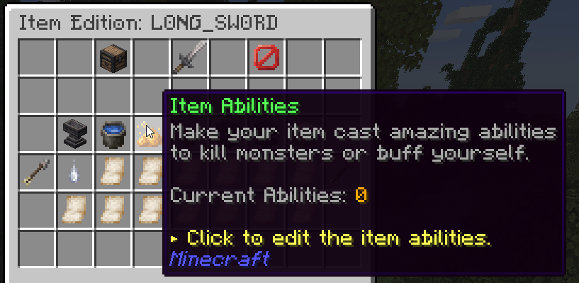

# 技能与能力 {#💫-skills-abilities}

技能的能力是独特的，可以绑定到物品上，让他们感觉更独特。可配置性的一个重要功能是能力触发/施放模式i.e施放该能力所需执行的操作。自MMOItems6.6.2起，这些能力触发器与MMOCore共享；完整列表可以在[此处](../../mythiclib/skills/triggers.md)找到。



使用正确的技能触发器，你可以在玩家杀死实体或你发射的箭落在地面上时施放技能。

**破坏性**技能可以造成**物理**或**魔法**伤害。根据其类型，能力伤害可以通过特定的物品属性来增加，无论是`Physical Damage`还是`Magical Damage`。物理能力对应于使用物品或武器的能力，例如 *Circular Slash* 或 *物品Throw*。魔法能力对应于元素/魔法能力，如*火弩箭*、*火彗星*...

## 使用MythicMobs为MMOItems添加功能 {#adding-abilities-to-mmoitems-using-mythicmobs}

自MMOItems6.7起，自定义技能在MythicLib内处理。请参阅[MythicLibwiki](../../mythiclib/skills/custom/mythic.md)。

## 能力触发 {#ability-triggers}

能力触发器定义了能力的施放方式。你可以在 [MythicLibwiki](../../mythiclib/skills/triggers.md)中找到它们。

## 编辑能力 {#editing-an-ability}

进入`MMOItems/skills`文件夹并找到与你要编辑的能力相对应的 YML 文件。例如，让我们考虑`arcane-rift.yml`

```yml
name: Arcane Rift
modifier:
  duration:
    name: Duration
    default-value: 1.5
  damage:
    name: Damage
    default-value: 5.0
  mana:
    name: Mana
    default-value: 0.0
  stamina:
    name: Stamina
    default-value: 0.0
  cooldown:
    name: Cooldown
    default-value: 10.0
  timer:
    name: Timer
    default-value: 0.0
  amplifier:
    name: Amplifier
    default-value: 2.0
  speed:
    name: Speed
    default-value: 1.0
```

你可以编辑技能名称，即绑定技能到物品时物品描述中显示的名称。你还可以修改每个能力修饰符的名称和默认值。当向物品添加能力时，如果物品编辑器GUI中没有指定，则MMOItems将考虑的数值。

---

原文：[💫 Skills & Abilities](https://docs.phoenixdevt.fr/mmoitems/features/skills) · 原文归档：2026-10-19
