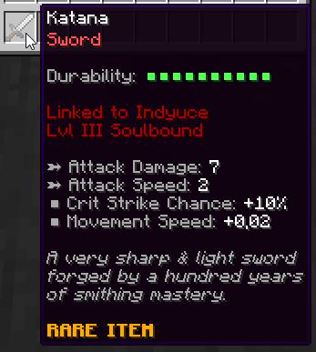
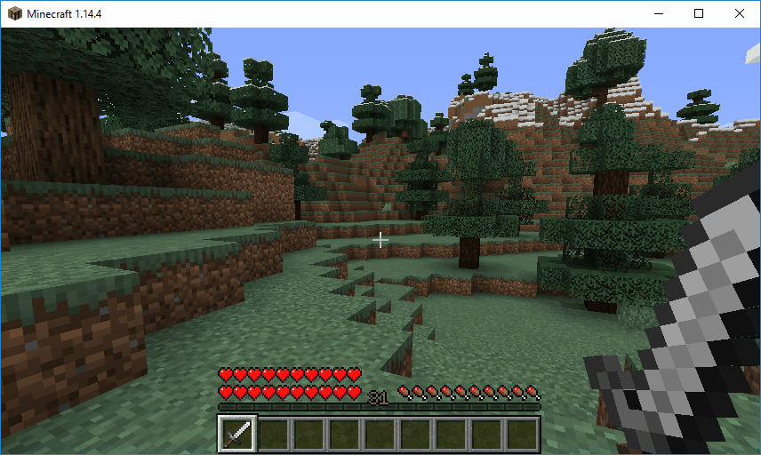
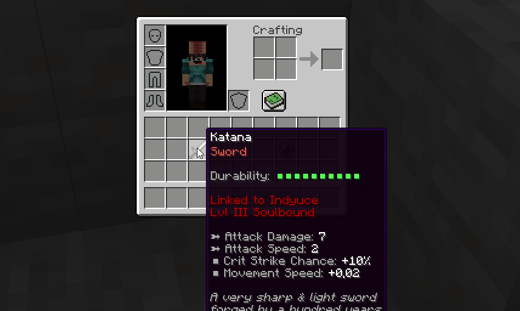

# 灵魂绑定 {#🔮-soulbound}

玩家可以 *soul-bind*物品为自己。一旦绑定，物品将无法被除所有者之外的任何其他玩家使用；任何其他尝试使用它的玩家都会受到即时伤害。 Soulbounds显示在物品描述内部，并且可以使用特定的消耗品物品来实现和破坏。

灵魂绑定物品的其他可切换选项包括：

- 即使未打开 keepInventory，灵魂绑定物品也会保持死亡状态。
- 灵魂绑定物品无法从所有者的物品栏上取下（无法将其放入箱子、分配器...）

### 灵魂绑定等级 {#soulbound-level}

灵魂绑定有等级。灵魂绑定的等级由用于灵魂绑定物品的消耗品决定。如果你将 III 级灵魂绑定消耗品用于物品，则前者将被授予 III 级灵魂绑定。等级越高，魂缚就越难打破。为了打破 N 级灵魂束缚，你需要一个灵魂绑定的打破能力为 N 的消耗品。

此外，较高的灵魂绑定物品将对尝试与灵魂绑定物品交互的外部玩家造成更多伤害。

### 打破灵魂束缚 {#breaking-a-soulbind}

为了破解灵魂绑定，玩家必须在其上应用特定的消耗品。此消耗品的灵魂绑定等级必须高于或等于灵魂绑定武器/护甲等级。摧毁灵魂绑定有时可能会失败，具体取决于灵魂绑定的破坏几率。当未能销毁灵魂绑定时，消耗品就会丢失，就像失败的灵魂绑定创建一样。

---

原文：[🔮 Soulbound](https://docs.phoenixdevt.fr/mmoitems/features/soulbound) · 原文归档：2026-10-19
