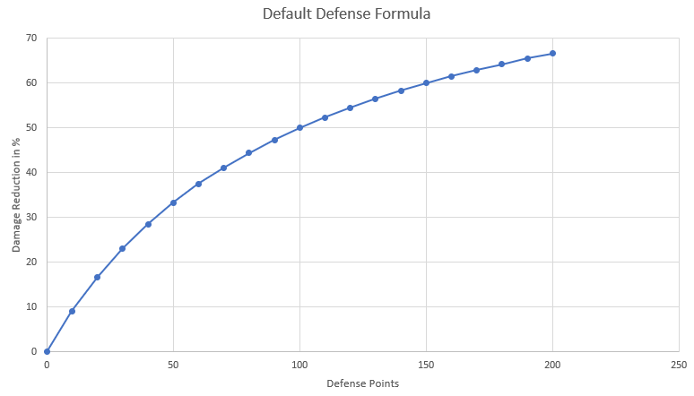
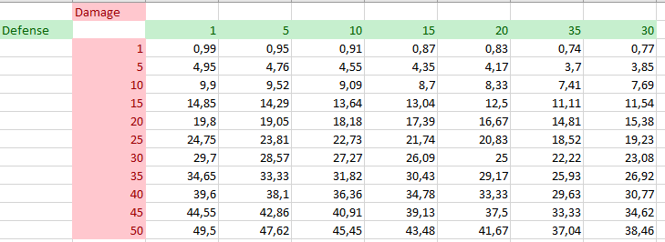
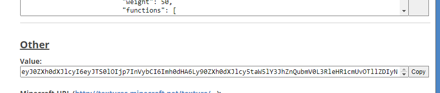
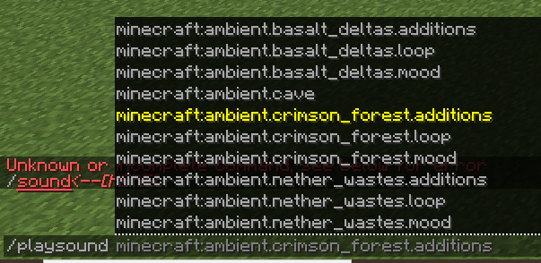

# 物品属性 {#item-stats}

版本菜单 (`/mi edit`) 让你了解可以向物品添加哪些属性以及如何配置它们。虽然大多数都是不言自明的，但以下是有关最复杂的物品选项的一些规格。此列表不包含你可以在MMOItems中找到的每个物品属性或选项，但请务必阅读 wiki 的其余部分，因为它包含有关其他物品选项的信息。  如果你不想使用版本菜单，物品示例将帮助你手动创建物品。

> **提示**
>
> 使用 CTRL+F 查找物品属性。

## 数值属性 {#numerical-stats}

数字属性代表物品上可用的属性的80%。它们是属性，由单个数字定义：攻击伤害、攻击速度、暴击机会...请参阅[此 wiki 页面](numerical-stats.md)。

## 材质，耐久度 {#material-durability}

你的物品材料及其耐久度/数据。 **示例：**INK_SACK和1耐久度对应于玫瑰红色（对于1.8-1.12）。使用ROSE_RED代替1.13。所有材料都可以在 [SpigotJavadocs](https://hub.spigotmc.org/javadocs/spigot/org/bukkit/Material.html)] 中找到。请注意，这些材质名称对应于最新的Spigot版本，因此100%与 <1.14不兼容，尤其是 Legacy。

## 显示名称 {#display-name}

物品显示名称。使用“&”作为颜色代码。 **完全支持遵循 MiniMessage 格式的十六进制颜色代码**（例如：`<#FFFFFF>`或`<HEXFFFFFF>`）。生成物品时，修饰符中的名称前缀/后缀将添加到基本物品名称中。

```yml
TEST_ITEM:
  base:
    name: '&fSteel Sword'
```

占位符可用于物品显示名称。欲了解更多信息，请参阅[此wiki页面](../item-lore/name-placeholders.md)。

## 定制描述 {#custom-lore}

需要明确的是，即使不使用此选项，物品也确实有描述。此选项仅在物品描述的末尾添加一些自定义行。你可以使用它来获得武器的小型RPG类型描述。

你还可以使用此选项来显示物品的能力。由于默认显示能力的方式无法真正配置，因此我们为能力修饰符添加了**描述占位符**，以便你可以使用此选项。例如，使用`{ability_fireball_damage}`将返回火球术技能伤害。

一般格式为`{ability_<ability-_name>_<modifier_name>}`。如果能力修饰符发生某种变化（例如由于另一个插件），这些占位符会更新。

## 染料颜色 {#dye-color}

此参数仅适用于皮革护甲件。 RGB (red-green-blue)

```yml
TEST_ITEM:
  base:
    material: LEATHER_CHESTPLATE
    dye-color: 100 100 100
```

## 结界 {#enchantments}

结界由结界类型和等级定义。使用这种格式：

```yml
enchants:
  efficiency:
    base: 1
    # There is no Efficiency 1.3, but that means that every
    # 10 levels, the item will have an extra efficiency
    # enchant level! Stats like this are rounded to the nearest integer.
    scale: .1
  # That format still works because an enchant level is a numeric value
  sharpness: 10
```

## 物品权限 {#item-permissions}

任何玩家都必须具有权限列表才能使用此物品。你可以使用相应的绕过权限来绕过该物品限制。

## 攻击伤害,攻击速度 {#attack-damage-attack-speed}

武器造成的伤害量以及速度（以命中/秒为单位）。这些属性基于原版基础属性修饰符。

当同时挥舞两个物品时，这些属性具有特定的行为。虽然物品包括副手催化剂等配件可以增加攻击速度和副手中的伤害，但将武器放在副手中不会增加攻击速度和伤害，因为这两个属性与副手武器，你没有将其用作主要武器。

## 暴击几率& 电源 {#critical-strike-chance-power}

你的物品处理暴击的机会（以%为单位）。暴击造成250%的初始伤害（可在MythicLib配置文件中配置）。暴击伤害对应于暴击造成的初始伤害的百分比。

自MythicLib更新以来，MMOCore技能和MMOItems物品技能也可以处理暴击，并且所有暴击选项都可以在MythicLib主配置文件中编辑。

## 范围 {#range}

你的鞭子/棍子的范围。默认值为18。这里的单位并不完全是块，请将此值乘以大约。2.5获取块中的值。

## 钝功率和额定值 {#blunt-power-rating}

钝器力量对应于钝器攻击的半径。越大，你可以同时击中的敌人就越多。钝器等级对应于钝器攻击造成的伤害。以初始伤害的百分比表示。示例：钝功率 =3|直率评级 =70%|当击中实体时，3距离单位内的敌人将受到70%的初始伤害。

```yml
BLUNT_ITEM:
  base:
    material: IRON_HAMMER
    blunt-power: 3
    blunt-rating: 70
```

## 坚不可摧 {#unbreakable}

当设置为true时，武器永远不会中断。如果你计划使用 *texture by耐久度* 机制为物品提供自定义纹理，则需要此选项。

## 不可堆叠 {#unstackable}

当设置为true时，你的物品永远不会与自身堆叠。

## 护甲,护甲韧性 {#armor-armor-toughness}

你的一块护甲赋予玩家的护甲和护甲韧性量。这些属性对应于原版我的世界玩家基础属性。护甲和护甲韧性可减少受到的伤害。你可以访问官方MC wiki来了解如何根据护甲和护甲韧性计算伤害，但简单地说：护甲减少伤害，而护甲韧性减少护甲减少。这些属性在1.8中不受支持，因为相应的Minecraft基础属性已添加回1.9中。

## 防御 {#defense}

这个属性决定了玩家的防御值，可以是任意正数。任何物品类型都可以指定为属性。处理防御伤害减免的公式可以在 mmolibconfig.yml中编辑。

如果你对默认防御公式感到好奇，下面的图表显示了伤害减少百分比与防御点的函数关系：



现在的表格显示了特定数量的传入伤害所造成的伤害量以及防御点：



## 移动速度 {#movement-speed}

物品为持有人/佩戴者提供的移动速度。我的世界默认移动速度为0.2。如果将物品附加移动速度设置为0.02，则该速度将为 +10%移动速度。

## 两只手 {#two-handed}

如果玩家同时持有两个物品，其中一个是双手，那么他的速度会显着减慢。使用特定的配置选项，你可以使玩家在持有两个重物品时无法使用任何物品。

## 永久药水效果 {#permanent-potion-effects}

它的格式实际上与消耗品药水效果相同（见上文），但由于只要玩家持有物品就应该应用这些药水效果，因此你不必指定效果持续时间。`level`配置部分也消失了，因为没有它它会更干净。

```yml
perm-effects:
  speed:
    base: 1
    scale: 1
  # That format works too
  haste: 3
```

## 物品冷却时间 {#item-cooldown}

延迟玩家必须在使用消耗品或运行物品中的所有命令之前等待。在MMOItemsLegacy 中，命令都可以有不同的冷却时间，而消耗品有一个名为`Consume Cooldown`的选项，它与`Item Cooldown`类似。

## 工具选项 {#tool-options}

**自动熔炼：** 当打开时，你的工具会自动熔炼开采的铁矿石和金矿石。 **弹跳裂缝：** 当打开时，你的工具会在第一个块后面挖掘额外的块。

## 物品元素属性 {#item-elemental-stats}

```yml
element:
  fire:
    defense: 
      base: 10
      scale: 3
    # That format still works!
    damage: 10
  water:
    defense: 50
```

## 物品命令 {#item-commands}

右键单击物品时执行的命令列表。命令可能有冷却时间和延迟，之后会自动投射。你可以使用此选项创建e.g消耗品，它使用 /spawn 命令将你传送回家。 **警告**：命令冷却时间与消耗品冷却时间不同，因此你需要确保它们相同，否则消耗品可能会在不转换命令的情况下被消耗。你可以安装 PAPI玩家扩展（ /papi ecloud download玩家）并使用%player_name%占位符获取命令发送者名称。

```yml
TEST_ITEM:
  base:
    material: PAPER
    name: '&rScroll of Cowardness'
    commands:
      '1':
        command: spawn
        cooldown: 10
        delay: 1
```

## 箭头粒子 {#arrow-particles}

此选项可用于显示弓发射的箭周围的粒子。粒子可以完全配置（类型、速度、颜色）。

```yml
MARKING_BOW:
  base:
    material: BOW
    arrow-particles:
      particle: SMOKE_NORMAL
      amount: 3
      speed: 0.05
```

## 装备优先 {#equip-priority}

为护甲棋子指定一个优先级，那么当你手上有一个MMO物品护甲的时候，如果该物品的装备优先级高于或等于当前装备的护甲的装备优先级，它就会为你热插拔盔甲。

```yml
DIAMOND_CHESTPLATE:
  base:
    material: DIAMOND_CHESTPLATE
    tier: COMMON
    unbreakable: true
    equip-priority: 4.0
```

可以通过编辑`auto-equip-feature: false`在Config.yml中完全禁用或启用此功能：

## 所需等级 {#required-level}

武器/物品需要使用的等级。此限制完全支持RPG核心插件等级。

## 必需副职业等级 {#required-profession-level}

这个属性决定玩家是否可以使用物品，具体取决于所需的副职业等级。需要MMOCore。

## 骷髅纹理（仅适用于玩家头） {#skull-texture-for-player-heads-only}

用于定制头部的头骨纹理。对于1.13，使用PLAYER_HEAD材料得到玩家头部物品。旧用户必须将SKULL_ITEM与3的耐久度一起使用。由于自定义纹理头骨的特定问题，属性的配置格式相当奇怪。

```yml
SKULL_ITEM:
  base:
    skull-texture: 'eyJ0ZXh0dXJlcyI6eyJTS0lOIjp7InVybCI6Imh0dHA6Ly90ZXh0dXJlcy5taW5lY3JhZnQubmV0L3RleHR1cmUvOTdlMmY0OTQyNDNhY2FkM2Y0ODQ0YmM1YWUyZDVmZDUzZTY5MjczMzA0YzlkYmY1YmQxMzA5NDlmYTEzMjk4ZiJ9fX0='
```

你可以在Minecraft头部或类似头部数据库上找到头骨纹理值。例如，导航到[此页面](https://minecraft-heads.com/custom-heads/food-drinks/49818-hamburger-on-a-plate)的底部以查找头骨值，如下所示：



## 宝石插座 {#gem-sockets}

物品上有宝石插槽，你可以在上面放置宝石。宝石提高你的物品属性。每一颗绑定的宝石都占据一个宝石插槽。更多信息请参见[此维基页面](../gem-stones.md)。

## 禁用交互 {#disable-interactions}

启用后，此选项将禁用right-clicking/放置物品时可能发生的任何事件。它阻止方块放置和物品使用（雪球、可可种子、树苗......）。

## 不可食用并禁用右键消耗 {#inedible-disable-right-click-consume}

Inedible 完全禁用right-click物品事件。

禁用右键单击消耗只会阻止你的物品在右键单击时被消耗。你仍然可以吃它，但它不会被消耗掉。

## 物品颗粒 {#item-particles}

持有/佩戴物品时会显示一些颗粒。物品粒子效果由3事物定义：粒子图案及其图案修改器，以及效果中使用的实际粒子。

**粒子模式**定义了粒子的行为方式、形成的形状等。例如，选择螺旋粒子模式将使粒子在你周围形成一个上下移动的圆圈。

**粒子**是粒子效果中使用的实际粒子。例如，选择带有螺旋的红石将在你周围形成红石粒子螺旋。你可以看到可用粒子的列表[此处为](https://hub.spigotmc.org/javadocs/spigot/org/bukkit/Particle.html)，但请注意，其中一些粒子不适用于MMOItems。

然后，你可以通过更改**粒子修改器**来稍微调整粒子效果，例如，可以更改螺旋的基础y-offset、其半径、高度、显示速度...

有些粒子是**可着色**e.g红石粒子。这意味着你可以编辑它们的颜色以使粒子效果更加独特。可以通过输入三种颜色等级来设置颜色：红色、绿色和蓝色 (RGB)。

```yml
FIRE_GREATLANCE:
  base:
    material: BLAZE_ROD
    # this displays two flame rings that slowly swirl around the player
    item-particles:
      type: DOUBLE_RINGS
      particle: FLAME
      radius: 1.3
      rotation-speed: 0.4
```

以下是可用粒子类型的列表：OFFSET、FIREFLIES、VORTEX、GALAXY、DOUBLE_RINGS、HELIX、AURA。

## 步枪属性 {#musket-stats}

有两种主要的物品属性你可以用来定制步枪。步枪是特殊射程武器，在right-clicked时发射子弹。击退物品属性定义了击退每当他发射步枪时应用于玩家。因此它必须是一个正值。后坐力定义了射击精度e.g当设置为5时，射击将在光标周围随机进行5°。

## 琵琶属性 {#lute-stats}

鲁特琴的型号为武器，右键单击时会发出音乐投射物。鲁特琴有不同的攻击效果（使用版本GUI编辑任何鲁特琴攻击效果时会提示所有可用效果的列表），这些效果定义了射弹的外观。你还可以更改攻击时播放的声音。注意 当重量设置为任何严格大于0的值时，投射物的轨迹会随着时间的推移而稍微向下倾斜，就像被重力拉下来一样。

## 自定义物品声音 {#custom-item-sounds}

自定义物品声音是在使用物品执行特定操作时播放的声音，例如攻击实体，右键单击物品，拿起物品... **警告**，这些声音不对应于Spigotjavadocs 声音名称，它们对应于原版声音名称，例如`entity.zombie.attack_iron_door`（而不是`ENTITY_ZOMBIE_ATTACK_IRON_DOOR`）。

你还可以使用服务器资源包中的声音。你可以在线找到 **默认** 声音列表，例如在此 [pastebin](https://pastebin.com/gLMhUyis)上，甚至使用`/sound`自动命令完成器。



---

原文：[Item Stats](https://docs.phoenixdevt.fr/mmoitems/features/stats/stats) · 原文归档：2026-10-19
