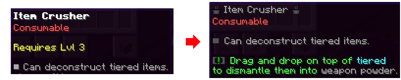
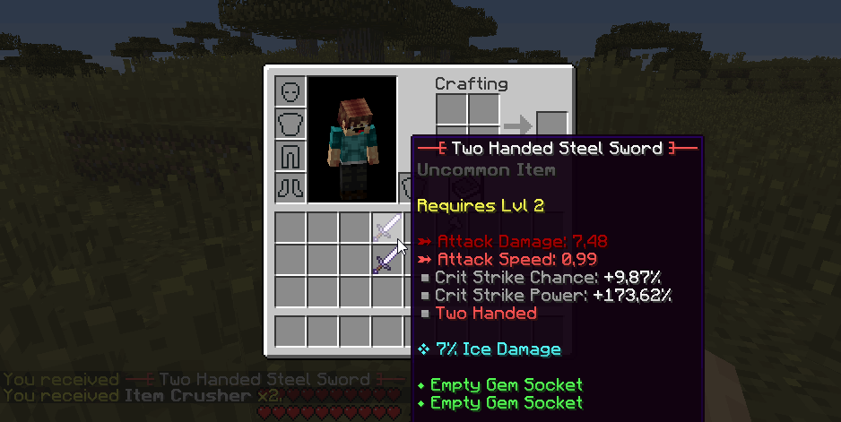
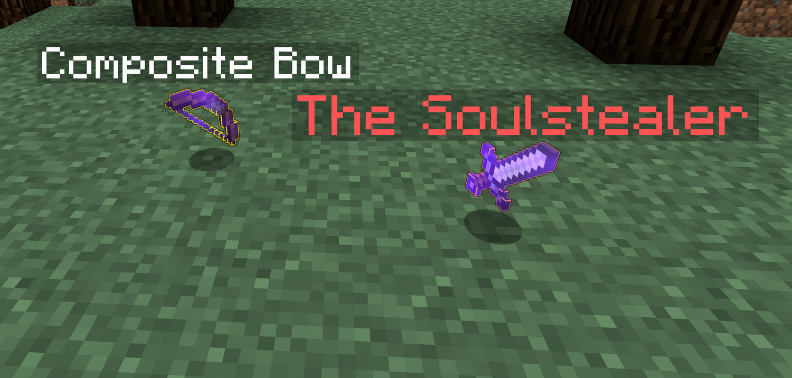
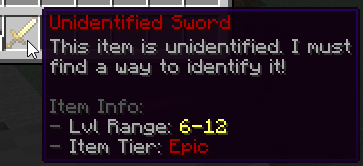

# 物品品质 {#💍-item-tiers}

物品品质用于定义物品稀有度（常见、稀有、传奇...）。它们定义了物品生成时的修改器容量，这直接影响物品可以拥有的修改器数量。它们还定义了解构物品时掉落的战利品，以及一些显示选项，例如物品发光和物品提示。

默认等级为*垃圾、常见、罕见、稀有、非常稀有、传奇、神话、史诗、魔法和独特*。你可以在主插件文件夹中的`tiers.yml`配置文件中编辑层。

## 物品分解 {#item-deconstruction}

具有等级（常见、稀有、传奇...）的物品可以**解构**。解构一个物品会将物品转化为另一个物品，通常材料玩家可以在高级工作台上用来制作其他物品。解构另一个物品得到的物品玩家完全取决于物品品质。玩家可能会掉落其他武器，甚至是可用于制作其他武器的材料。



此功能实际上允许玩家摆脱它们无法使用的物品，因为它们在使用其他资源时不满足要求（因为解构物品需要消耗品）。

该掉落表的行为与怪物/方块掉落表完全相同，请参阅[**此维基页面**](../items/drop-tables.md)以了解如何设置它们。

```yml
RARE:
  name: '&6&lRARE'
  # ...
  deconstruct-item:
    success:
      coef: 1
      items:
        MATERIAL:
          RARE_WEAPON_ESSENCE: 100,1-1,0
    lose:
      coef: 3
      items:
        MATERIAL:
          WEAPON_POWDER: 100,1-1,0
```

### 如何分解和物品 {#how-to-deconstruct-an-item}

玩家可以通过将特定的消耗品拖放到物品上来实现分解和物品。此消耗品必须打开 *Can分解* 选项。他们将听到升级声音并收到一条消息，表明他们的物品已成功解构。

正如 GIF 所示，解构物品实际上有时会产生不同的掉落物，这意味着在解构分层的物品时，你可能会比其他物品更难获得物品。



## 物品发光和提示 {#item-glow-hints}

物品提示和物品发光是取决于物品品质的两个功能。 **物品提示** 可让你在物品掉落到地面时显示物品名称，而 **物品发光** 使你的物品在掉落时发出发光效果（类似于*发光*药水效果）。

```yml
RARE:
    name: '&6&lRARE'
    # ...
    item-glow:
        hint: true    # Enable the display of the item name when dropped
        color: 'GRAY' # Item glow color, see the list of available colors in the config file
```

由于这些选项取决于物品品质，因此你可以为每一层设置不同的发光颜色和提示选项！我们建议你仅对高等级物品使用物品提示和发光功能，以便玩家可以轻松发现地面上的稀有战利品。物品提示使玩家无需拿起物品名称即可看到它，而物品发光使物品更容易在黑暗区域中被发现。



你可以通过在层配置文件中切换`item-glow.hint`选项来启用物品提示。删除此配置部分或将其留给`false`以禁用它。

`item-glow.color`选项允许你设置物品发光颜色。将其保留为空以禁用物品品质的物品发光。你可以使用配置文件中提供的链接访问颜色列表。

## 身份不明物品 {#unidentified-items}

物品品质还为未识别的物品定义了一些显示选项，如以下配置模板所示：

```yml
EPIC:
    name: '&4&lEPIC'
    # ...
    unidentification:
        name: 'Epic'
        range: 6
        prefix: '&4'
```

物品品质没有定义未识别的物品模式（物品类型定义，请参阅此 [wiki 部分](types.md#custom-item-types)）。`name`选项对应于未识别的物品描述中显示的层名称。`range`选项对应于未识别的物品等级范围，仅当物品具有*所需等级*选项时才显示。

电平范围为玩家提供额外信息，并让他了解武器的大致电平。由于他还可以看到物品品质，因此他可以决定是否要识别物品。`prefix`选项用于向未识别的物品显示名称和物品描述中显示的层名称添加颜色前缀。



## 修改器容量（物品一代） {#modifier-capacity-item-generation}

> **提示**
>
> 确保你首先了解 [物品模板](../items/templates.md)和 [物品修饰器](../items/modifiers.md)。

这是默认item-tiers.yml的示例，我们将对其进行分解以了解如何为物品品质设置修改器容量。

```yml
UNCOMMON:
  name: '&a&lUNCOMMON'
  # ...
  generation:
    chance: 0.15       # 15% chance to be of this tier when generating a random item
    capacity:
      base: 6        # Base capacity
      scale: 1       # Scales on the item level, +1 per level
      spread: .1     # Adds randomness, +/- 10%
      max-spread: .3 # Limits randomness to max +/- 30%
```

`generation.chance`选项决定了在生成随机物品时选择你的物品品质的机会。例如，如果设置为0.15，则你的物品在生成时将有15%机会成为 *Uncommon* 层。

`generation.capacity`配置部分定义了层修改器容量，其工作方式类似于常规的[数字属性公式](stats/stats.md)。公式如下：`capacity = <base> + <item_level> * <scale>`，向其中添加 +/-`<spread>`% 偏移量，最大偏移量为`<max-spread>`%。

例如，使用上面配置片段中的容量公式，假设我们正在生成等级12物品:`average-capacity = 6 + 0.1 * 12 = 7.2`。由于存在30%最大价差，因此容量最终值将在`70% * 7.2 = 5.04`和`130% * 7.2 = 9.36`之间随机选取，平均为 +/-10%偏移量（相对于7.2的平均值）。

---

原文：[💍 Item Tiers](https://docs.phoenixdevt.fr/mmoitems/features/tiers) · 原文归档：2026-10-19
