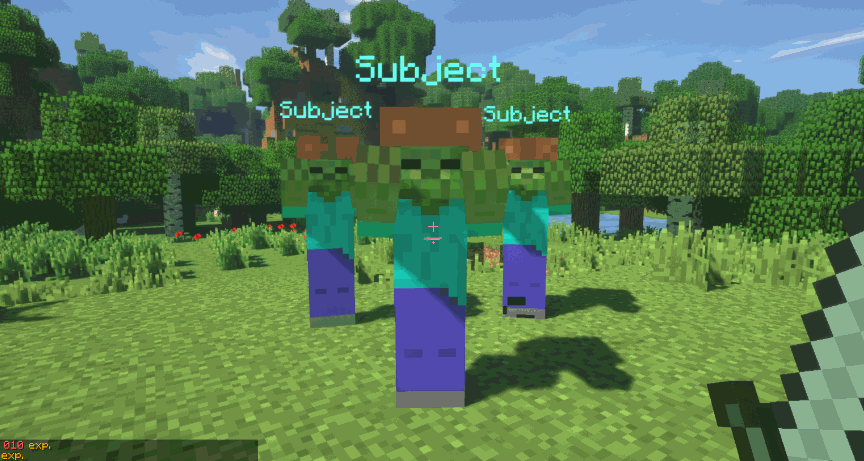
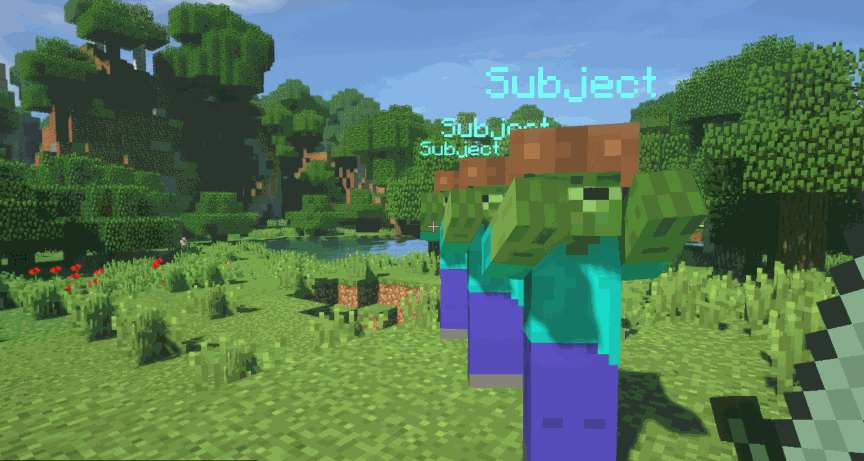
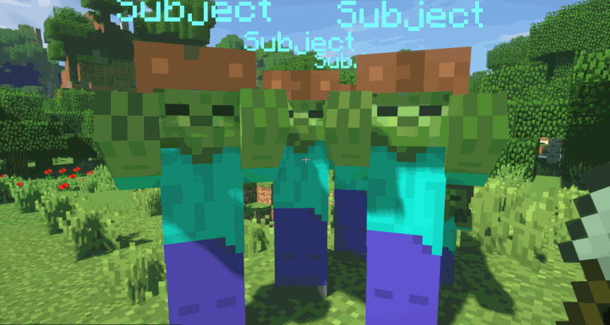

# 物品类型 {#🛠️-item-types}

在MMOItems中，所有物品都分为称为 *物品类型* 的类别。物品根据其类型可能有不同的行为。它们是广泛的类别，指示你的物品是否打算用作武器、用作玩家可以消耗的物品、用作可以应用于另一个物品的物品、配件...

默认情况下，物品的类型显示在物品工具提示的最顶部。

## Hard-Coded物品类型 {#hard-coded-item-types}

大多数MMOItems功能（如宝石、物品识别、消耗品...）都依赖于hard-coded物品类型。虽然MMOItems确实包含hard-coded内容，但你可以将全新的物品类型注册到MMOItems并修改其属性。

|物品类型 |描述 |
| --- | --- |
| 剑、匕首、锤子 | 用于武器的硬编码物品类型。物品 |
| 弓 | `BOW`物品类型应用于材质设置为`BOW`或`CROSSBOW`的任何物品。近战攻击被禁用，物品攻击伤害适用于物品发射的箭。属性就像五线谱一样适用（见下文）。 |
| 员工 | 员工应用于**自定义范围武器类型**。属性仅适用于主手，除非它们具有right-click效果，在这种情况下weapon-specific属性-攻击伤害、on-hit效果 - 当保存在副手中时，也适用于武器攻击期间。 |
| 催化剂 | 物品和`CATALYST`物品类型是配件，当固定在主机或副手中时，它们会将属性赋予玩家。物品和`MAIN_CATALYST`类型仅在固定在主手中时应用其属性。物品和`OFF_CATALYST`类型仅在固定在副手中时应用其属性。 |
| 配件 | 配件为物品类型，在使用MMOInventory时，放置在配件槽中时应用其属性。 |
| 工具 | 工具具有用于采矿和破坏块的额外硬编码选项，例如*自动熔炼*（自动熔炼矿石）和*弹跳裂纹*（一次破坏多个块）。由于工具被视为近战武器，因此属性仅适用于主手。 |
| 物品皮肤 | 物品皮肤可以应用到物品上以更改其材质、自定义模型数据、头骨纹理、皮革护甲颜色... |
| 护甲 | `ARMOR`是任何护甲的硬编码物品类型。属性仅适用于佩戴在护甲插槽中时。 |
| 宝石 | [宝石](gem-stones.md)可以应用到物品上，以获得额外的属性。 |
| 消耗品 | 消耗品可以被玩家消耗（吃掉）以恢复生命值，魔力...获得临时增益，运行命令...属性仅适用于主手。 |
| 杂项 | 还要别的吗。属性仅适用于主手。 |

通过在`item-types`配置文件中切换以下选项，可以禁用对物品浏览器隐藏的任何hard-coded物品类型：

```yml
SOME_ITEM_TYPE:
  hide-in-game: true
```

## 定制物品类型 {#custom-item-types}

可以在`item-types`配置文件中修改现有的物品类型。此配置文件中的每个部分对应于一种物品类型；你可以根据需要编写任意数量的新配置部分，以便注册新的物品类型。物品类型的数量没有限制。添加或修改任何物品类型后，不要忘记使用`/mi reload`重新加载MMOItems。新的物品类型应立即出现在物品浏览器 (`/mi browse`) 中。

这是一般语法：

```yml
LONG_SWORD:
  display: 'IRON_SWORD:0'
  name: 'Long Sword'
  parent: 'SWORD'
  unident-item:
    model: 0 # (Optional) 1.14 Custom Model Data
    material: WOODEN_SWORD # (Optional) Change the item material
    item-model: # (Optional) 1.20.2+ Item Model name-spaced key

    name: '&f#prefix#Unidentified Long Sword'
    lore:
    - '&7This item is unidentified. I must'
    - '&7find a way to identify it!'
    - '{tier}'
    - '{tier}&8Item Info:'
    - '{range}&8- &7Lvl Range: &e#range#'
    - '{tier}&8- &7Item Tier: #prefix##tier#'
  
  disable-melee-attacks: false # Are melee attacks allowed with your type // is it ranged or melee?
  attack-cooldown-key: "staff"
  on-left-click: slashing_weapon_attack_effect               
  on-right-click: slashing_weapon_attack_effect_right_click  
  on-attack: slashing_weapon_on_hit_effect                   # Called when damaging entities
  on-entity-interact: slashing_weapon_special_attack         # Called when right-clicking entities
```

### ID/名称/显示 {#id-name-display}

`display`部分对应于物品类型的物品浏览器中使用的图标。`name`对应于物品工具提示上将看到的字符串标记玩家。最后，`LONG_SWORD`是类型ID，你将在运行命令时将其用作物品类型的引用。

### 父类型 {#parent-type}

每个自定义物品类型都有一个**父类型**。父类型定义了属性和物品可以具有的内容。如果父类型设置为`CONSUMABLE`，你的物品类型将从所有物品选项继承，而属性从消耗品物品类型继承。同样，你的物品类型继承自父类型给出的属性应用程序规则。如果父类型为`SWORD`，则任何物品的属性将仅适用于主手。

具有多个父项的类型也可用于在物品工具提示中显示不同的物品类型。类型仅在名称/工具提示上有所不同是完全可以的：玩家将在物品工具提示中看到不同的内容，你可以使用它们在配置文件和物品浏览器中组织物品。

### 身份不明的物品模板 {#unidentified-item-template}

`unident-item`配置部分确定来自该物品类型的未识别物品的外观。你可以编辑其显示材质、名称和描述（名称和描述均支持提供的占位符）。`#prefix#`返回未识别的物品品质的颜色前缀。`#tier#`返回未识别的物品品质的显示名称。`#range#`是未识别的物品的等级范围，这也取决于其物品品质。

仅当未识别的物品具有层时，才会显示以`{tier}`开头的行。同样，以`{range}`开头的行仅在物品具有与 *所需等级*属性关联的某些数据时显示。


### 行动 {#actions}

这些选项适用于定制武器。它们定义了你的武器对于近战和远程武器的作用。

| header | 描述 |
| --- | --- |
| `on-left-click` | 技能左键单击物品时进行投射。受武器约束，例如魔力成本、攻击速度... |
| `on-right-click` | 技能左键单击物品时进行投射。受武器约束，例如魔力成本、攻击速度... |
| `on-attack` | 技能攻击实体时施放（支持近战和远程攻击）。 |
| `on-entity-interact` | 技能右键单击​​实体时进行投射。 |

以下将在右键单击时施展内置MythicLib能力`FIREBOLT`：

```yml
on-right-click: FIREBOLT
```

以下将在攻击实体时投射名为`FireBolt`的MythicMobs脚本：

```yml
on-attack:
  mythicmobs-skill-id: FireBolt

  extra-skills:
    FireBolt:
      Skills:
      - 'projectile{onTick=FireBolt-Tick;onHit=FireBolt-Hit;v=8;i=1;hR=1;vR=1;hnp=true} @targetLocation'
    FireBolt-Tick:
      Skills:
      - 'effect:particles{p=flame;amount=20;speed=0;hS=0.2;vS=0.2} @origin'
    FireBolt-Hit:
      Skills:
      - 'damage{a=10}'
```

你可以使用此选项投射在MythicLib中注册的任何技能，包括内置技能、使用 MythicLibs 创建的技能、MythicMobs...你可以找到有关如何创建/注册自定义技能的信息 [通过MythicLibwiki](../../mythiclib/skills/intro.md)。

`on-attack`和`on-entity-interact`不受武器约束，这些技能/脚本将在每次损坏实体或每次与实体交互时触发。

但是，`on-left-click`和`on-right-click`受武器约束。这些脚本仅在检查以下武器使用限制后才会进行转换：

- 玩家有足够的资源（魔力/耐力/...）
- 物品有足够的耐久度
- 物品实际上是可用的（玩家有正确的职业，等级，权限...）

### 攻击冷却时间密钥 {#attack-cooldown-key}

大多数远程武器（如法杖、魔杖、鞭子）都有与使用物品（执行攻击）相关的冷却时间，而这个冷却时间通常只是攻击速度的反转。2.5的攻击速度意味着你可以每秒攻击1/2.5。

两个相同型号的物品具有相同的物品冷却时间。如果你使用魔杖进行远程攻击并快速切换到另一根魔杖，则第二根魔杖将位于冷却时间上，并且该冷却时间将在两个物品之间共享。

具有相同攻击冷却时间密钥的两种类型共享物品冷却时间。如果类型`WAND`和`STAFF`都具有`MAGIC`作为攻击冷却时间密钥，则物品将共享冷却时间。这可能是平衡物品游戏玩法的重要工具。

## Built-in物品类型 {#built-in-item-types}

以下 wiki 部分显示了与MMOItems捆绑在一起的默认物品类型。你不需要使用这些物品类型；事实上，如果你不希望它们显示在物品浏览器中，你甚至可以删除它们。

钝击、刺击和斜击武器是built-in近战武器类型。此类物品具有on-hit效果，通常会将造成的一小部分伤害传播给附近的敌人。这些行为**不**硬编码到MMOItems中，它们是使用 MythicLibs/MythicMobs技能/scripts 实现的。这意味着你可以通过编辑`MythicLib/script/mmoitems_types.yml`配置文件中的脚本来根据你的喜好完全微调它们。此配置文件包含与物品类型相对应的所有built-in软编码on-hit攻击效果。

法杖、步枪、魔杖...均为built-in系列武器类型。他们的右键/左键单击攻击效果也是使用 MythicLibs/MythicMobs脚本实现的，你可以在同一配置文件中编辑这些脚本。

<details markdown="1">

<summary>斩击武器</summary>

 挥砍武器在初始目标后面的圆锥体中造成AoE伤害。砍伐武器包括剑、巨剑、武士刀、斧头、巨斧、戟。



</details>

<details markdown="1">

<summary>穿孔武器</summary>

 与挥砍武器类似，刺穿武器会对初始目标后面的圆锥体中的近战攻击造成AoE伤害。锥体的角度越尖锐，但损伤传播率越高。穿刺类武器包括刺剑、匕首、长矛、长矛。



</details>

<details markdown="1">

<summary>钝头武器</summary>

 与横扫之刃类似，钝器武器在近战攻击中造成AoE伤害和击退伤害。钝器武器包括锤子、巨锤、手套、鲁特琴、法杖、巨杖。护手还带有默认的right-click能力，可将击退应用于目标实体。



</details>

<details markdown="1">

<summary>鞭子和火枪</summary>

 鞭子的射程为武器，具有特殊的攻击效果。它们对玩家摄像机方向上第一个击中的敌人造成伤害。步枪是带有额外物品选项的枪支。你可以通过攻击速度配置它们的后坐力（射击时它们围绕玩家的相机方向移动多少）、击退、重新加载时间...
</details>

<details markdown="1">

<summary>弩</summary>

`CROSSBOW`物品类型是在 Crossbows 实现到原版Minecraft之前添加的物品类型。右键单击十字弓可发射一支箭。物品攻击速度指示你可以发射箭的频率。

</details>

<details markdown="1">

<summary>魔杖和法杖</summary>

 法师/法师的魔杖和法杖是武器。它们的射程通常为武器，具有特殊的“烟雾”攻击效果。魔杖和法杖有一些内置的攻击效果，以下是详尽的列表：
</details>

---

原文：[🛠️ Item Types](https://docs.phoenixdevt.fr/mmoitems/features/types) · 原文归档：2026-10-19
