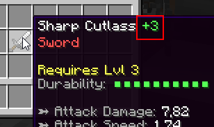

# 物品升级 {#🔨-item-upgrades}

物品升级是为你的物品添加一些进度的一种方式。当成功升级物品时，其物品属性会增加，这本质上使物品变得更好。玩家可以使用正确的消耗品或使用工作站**升级配方**来升级其物品。

升级后，物品获得一级。等级显示在物品显示名称旁边。显示名称后缀可以在主插件配置文件（*item-upgrading.name-suffix*）中更改。确保你的物品有自定义显示名称，否则后缀将不会显示。



为了拥有一个有效的物品升级系统，需要设置一些3的东西：首先，你需要设置升级模板，该模板指示成功升级物品时属性增加的内容（增加多少）。然后，你需要为要升级的物品设置一些额外的升级选项。最后一步是设置升级消耗品或 [升级配方](../stations/upgrading-recipes.md)。

## 设置升级模板 {#setting-up-the-upgrading-template}

升级模板可以在 **upgrade-templates.yml** 配置文件中设置。此步骤非常简单，但可能需要一些时间来平衡升级设置的配置。打开你的模板配置文件：

```yml
# Template ID, only used as reference. This is the
# text you need to enter in the edition GUI in order
# to setup item upgrading for a specific item.
weapon-default:

  # Every time the item is upgraded, its attack damage
  # is increased by 3% (relative to the current value)
  attack-damage: 3%
  
  # Every time it is upgraded, it gets +2% absolute 
  # critical strike chance (independent of current val.)
  critical-strike-chance: 2
  
  pve-damage: 1%

armor-template-example:
  armor: 3%
  armor-toughness: 2%
  block-rating: 5%
  dodge-rating: 5%
  parry-rating: 5%

another-example:
  attack-damage: 0.5%    
  critical-strike-chance: 0.1%
  critical-strike-power: 0.2%
```

该配置文件中的每个配置部分都对应一个**升级模板**。你可以添加任意数量的模板，甚至可以为每个物品添加一个模板（尽管多个物品可能具有相同的升级模板）。设置完成后，你将能够将这些模板绑定到特定的物品以确定它们在升级时的行为方式。让我们尝试逐步阅读配置的内容。

**weapon-template-example:** 这是武器的升级模板示例。每次物品升级，武器都会获得当前攻击伤害的3%*（意味着他当前的攻击伤害将乘以1.03）*，因为输入以`%`结尾。每次物品升级，武器也会获得2%暴击几率（与当前的暴击几率无关，但由于暴击几率以％为单位，物品仍然获得2%暴击几率）以及1%PvE损坏，相对于其当前的攻击速度。

**armor-default:** 升级后，使用此升级模板的物品将获得3%护甲、2%韧性、5%格挡、闪避和招架等级（相对于其当前的属性），因为存在`%`。

---

升级模板中指定的`%`与属性本身没有任何关系。这只意味着物品升级时获得的属性值是相对于之前的物品的属性值而言的。例如，对于8Atk。伤害剑，获得3%攻击伤害（相对）与获得3攻击伤害（绝对）不同。

让我们看另一个例子。假设我们有一把正在升级10攻击伤害** 的 **剑，绑定到 **weapon-default** 升级模板。因此，这把剑将获得3%的当前伤害，因此最终它将拥有`10 + (3% * 10) = 10 + 10 * 0.03 = 10.3 Atk. Damage`，以及2%暴击几率，因为它之前没有任何暴击几率，并且每次升级获得的暴击几率与当前的属性值无关。该剑没有任何PvE伤害，因此相对于其当前值获得1%PvE伤害不会增加PvE伤害，因为0的1%仍然是0。

> **信息**
>
> 目前，物品升级仅适用于数字属性，如暴击率、攻击伤害、护甲、PvE伤害等。

## 设置消耗品的升级选项 {#setting-up-the-upgrading-options-for-the-consumable}

玩家可以使用消耗品来升级物品。如果是这样，你需要指定两个选项：**升级参考**（我们稍后会讨论）和**升级机会**。你可以在版本菜单中配置这两个选项。

## 设置武器/护甲/... 的升级选项 {#setting-up-the-upgrading-options-for-the-weapon-armor}

任何物品，包括盔甲、武器等都可以升级，但是你需要设置一些选项才能升级物品。就像消耗品一样，武器/盔甲也有升级机会。武器和消耗品堆栈的升级机会i.e`total-upgrade-chance = <item-upgrade-chance> * <consumable-upgrade-chance>`。如果两个物品都有40%升级机会，则总升级机会为`40% * 40% = 16%`。当物品没有100%升级机会时，你可以启用一个额外的选项，使 **物品在升级失败时中断。**

以下是使用`another-example`升级模板的物品示例。

```yml
EXAMPLE_ITEM:
  base:

    # Base item options
    material: IRON_SWORD
    name: §eDefault Sword

    # Definition of item upgrading
    upgrade:
      workbench: true # True means you can't upgrade it unless you are using a crafting station
      template: another-example # Upgrade template ID
      max: 100 # Max amount of upgrades
      success: 70.0 # Chance of upgrade success
      destroy: false # Destroys when failing to upgrade

    # Some other item options
    attack-damage: 20.0
    critical-strike-chance: 2.0
    critical-strike-power: 5.0
    unbreakable: true
```

物品还可能有**最大升级次数**，这意味着一旦物品达到特定等级，就无法再升级。如果你不希望特定的物品通过升级获得太多 OP，那么这是一个重要的选项。物品也可以仅通过合成站和升级配方进行升级。

不要忘记使用GUI版本中的相应选项将升级模板绑定到你的物品！前面描述的选项也可以使用物品版本GUI进行设置。

## 升级参考 {#upgrade-reference}

该选项可用于升级消耗品和可升级物品。该选项可用于将特定升级消耗品限制为特定物品。升级参考是一段文本，不会显示在描述中，但 MI 使用它来检查消耗品是否与给定的物品兼容进行升级。

如果两个参考匹配，则消耗品可用于升级物品。如果第一个物品有non-null参考，而另一个没有参考，则它们不兼容。任何具有通用升级参考号`all`的物品都与任何其他物品兼容。

## 配置文件 {#config-file}

你可以修改主 MI 配置文件 (`MMOItems/config.yml`)，以调整属性更改在任何升级的物品的物品描述中的显示方式。以下是你需要查看并可能修改的部分：

```yml
item-upgrading:

  # Display name suffix for upgraded items.
  name-suffix: '&f &e(+#lvl#)'

  # Whether to display in Item Name or Lore
  # Disable if item renaming is available to players.
  # If set to 'false', remember to include
  # %upgrade_level% in your item lore.
  display-in-name: true

  # How stat changes are formatted
  # in the stat suffix.
  stat-change-suffix: ' &8(<p>#stat#&8)'
  stat-change-positive: '&a'
  stat-change-negative: '&c'

  # Whether or not to display which
  # stats are changed in the lore.
  # EXPERIMENTAL FEATURE
  display-stat-changes: false
```

`<p>`代表`stat-change-negative`和`stat-change-positive`。你可以完全删除它，或者如果你想更改它所在的位置，也可以！

## 升级配方 {#upgrading-recipes}

使用合成站你可以创建合成配方，这要求玩家具有特定成分并满足某些条件。当使用玩家这样的配方时可以升级他们的装备。请查看此 [wiki 页面](../stations/upgrading-recipes.md)以获取更多信息。

以下是实现这些升级方案之一的合成站的示例

```yml
name: 'UPGRADE (#page#/#max#)'
max-queue-size: 10
#.............

# Recipes
recipes:
  dnck1: # Some upgrading recipe
    item:
      type: SWORD
      id: EXAMPLE
    crafting-time: 0
    ingredients:      
    - mmoitem{type=MATERIAL,id=UPGRADESTONE,amount=1}
```

上面的成分列表中使用了消耗品（必须放入`material.yml`配置文件中）。这基本上是一个物品，仅用作合成站升级配方的成分。

```yml
UPGRADESTONE:
  base:
    material: HEART_OF_THE_SEA
    name: '&eUpgrade Stone'
    lore:
    - '&7&oUse it to upgrade your gear'
    disable-crafting: true
    disable-smelting: true
    disable-smithing: true
    disable-enchanting: true
    disable-repairing: true
```

---

原文：[🔨 Item Upgrades](https://docs.phoenixdevt.fr/mmoitems/features/upgrading) · 原文归档：2026-10-19
