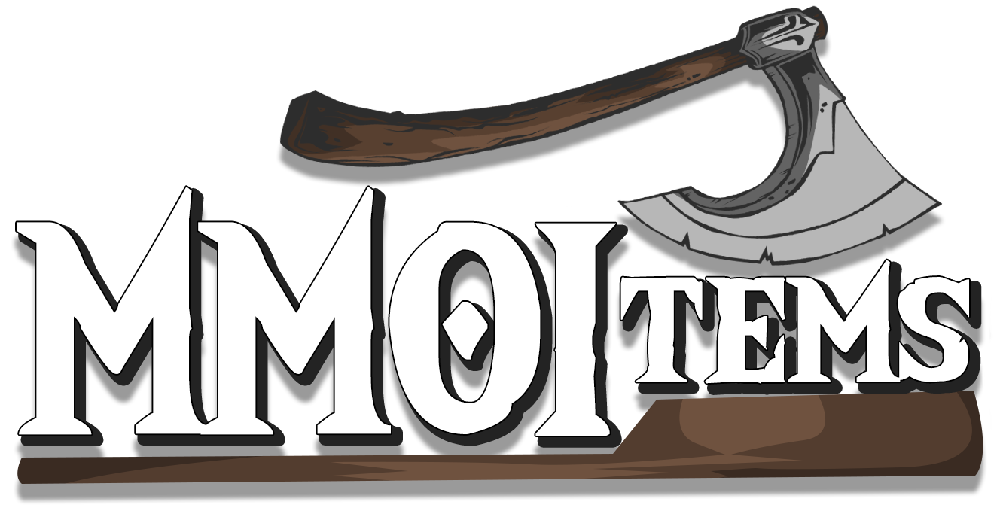

# 首页 {#🏠-home}

MMOItems 面向 RPG 服务器，可创建自定义武器、物品、盔甲和消耗品，并为它们设置独特的属性、显示效果和技能。它完整兼容 ItemsAdder、Nexo、Oraxen 等常用资源包管理插件，也能使用 MythicMobs 的技能。功能还包括物品鉴定、物品品质、套装、重铸、合成站和灵魂绑定等。

> **提示**
>
> 从 [Polymart](https://polymart.org/product/3413/mmoitems)或 [Spigot](https://www.spigotmc.org/resources/39267/)] 获取MMOItems

MMOItems 自 2021 年 11 月起开放源码。其许可较为宽松：购买插件后，可以自行修改和编译，以适应服务器的具体需求。

有疑问时，可以加入 [Discord](https://phoenixdevt.fr/discord)，向工作人员或社区求助。Wiki 会尽量保持更新；发现错字或过时内容时，也欢迎反馈。

当你准备好安装MMOItems时，导航到下一页！

---

原文：[🏠 Home](https://docs.phoenixdevt.fr/mmoitems/) · 原文归档：2026-10-19
