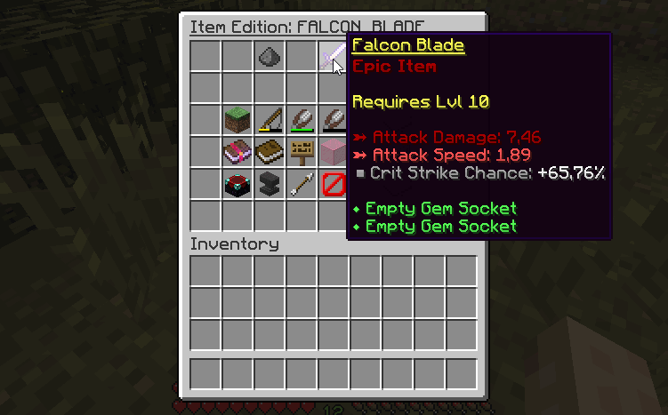

# 创建物品 {#🖌️-create-an-item}

此 wiki 页面介绍了可用于在MMOItems中创建物品的两种方法。

## 物品版GUI {#item-edition-gui}

物品编辑器允许你直接创建和编辑物品in-game，而无需篡改配置文件。这是一种强大的easy-to-understand方法，尽管我们建议高级用户直接进行手动配置文件编辑，如果你知道所有属性的格式如何，速度会快得多。



1. 打开游戏并通过以下命令创建物品：`/mi create <ITEM_TYPE> <YOUR_ITEM_ID>`
   1. 可以使用 /mi list type 查看全部可用物品类型，例如 Sword、Axe、Tool 等。
   2. 物品ID将在每个命令/配置文件中用于识别物品。它应该类似于STEEL_DAGGER以使配置设置更清晰。
2. 执行创建命令后，版本菜单应该打开。如果关闭它，你仍然可以使用以下命令访问它：`/mi edit <ITEM_TYPE> <YOUR_ITEM_ID>`
   1. 在物品栏的5th插槽上，你可以看到你的物品及其当前的属性。你可以点击宝箱物品将其添加到你的物品栏中。
   2. 每个其他物品都对应于你可以编辑的物品属性。有关如何编辑它们的说明直接显示in-game。
   3. 添加完你想要的所有属性后，即可获得你的物品并享受乐趣！

## 手动配置编辑 {#manual-config-editing}

高级用户应考虑使用此方法，因为如果你已经知道要使用的物品选项以及如何格式化它们，它会更快。

1. 打开`/MMOItems/item`文件夹。
2. 选择你的物品类型并使用你喜欢的文本编辑器打开相应的 YML 文件。
3. 你可以从以下配置片段开始：

```yml
YOUR_ITEM_ID:
  base:
    material: YOUR_ITEM_MATERIAL
```

4. 可用材料的列表可以在 [Spigotjavadocs](https://hub.spigotmc.org/javadocs/spigot/org/bukkit/Material.html)] 中找到。物品材质是首先要添加的，因为它是物品需要能够生成的唯一实际选项。
5. 根据需要添加尽可能多的物品选项（能力、攻击伤害....）。你可以在[此 wiki 页面](../features/stats/stats.md)上查看“所有”可用的物品选项（以及如何配置它们）。
6. 保存文件并回到 Minecraft。执行 /mi reload，让 MMOItems 加载刚加入配置的物品，再执行 `/mi give <ITEM_TYPE> <YOUR_ITEM_ID>` 获取物品。

---

原文：[🖌️ Create An Item](https://docs.phoenixdevt.fr/mmoitems/items/creation) · 原文归档：2026-10-19
