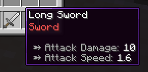
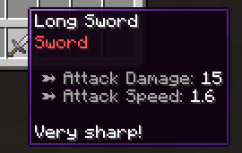

# 物品修饰器 {#🏷️-item-modifiers}

> **提示**
>
> 请务必先阅读[本页](templates.md)。MMOItems物品生成系统相当复杂，需要一些时间才能完全理解。

## 示例 {#example}

物品修饰器是MMOItems随机战利品生成系统的 **MVP。从概念上讲，物品始终附带其标准物品属性集。以下面的物品为例 - 一把长剑 - 它具有10攻击力伤害和1.6攻击速度。这些是它的默认值属性，这意味着如果物品没有修饰符、层或任何附加的东西，它只会有这些属性。

```yml
LONG_SWORD:
  base:
    material: IRON_SWORD
    name: '&fLong Sword'
    attack-damage: 10
    attack-speed: 1.6
```



现在想象一下当时的20%，在生成此物品时现在应用以下`Sharp`修饰符。此修改器提供的属性将与基础物品属性叠加。 Atk 伤害现在为`10 + 5 = 15`并且物品现在有额外的描述。

```yml
sharp_modifier:
  chance: 0.2 # 20% chance to be selected
  stats: # additional stats provided
    attack-damage: 5
    lore:
    - 'Very sharp!'
```



这意味着同一个物品可以有多个版本，具有不同的稀有度，或多或少添加了强大的属性。

## 将物品修饰器添加到物品 {#adding-item-modifiers-to-items}

在本教程中，我们将考虑一个示例物品*长剑* ，它具有两个潜在的物品修饰器、*Sharp*（增加 +5Atk 伤害）和 *Fiery*（增加on-hit燃烧能力）。

以下配置片段可以放置在`/MMOItems/items/sword.yml`配置文件中。

```yml
LONG_SWORD:

  # Base item stats
  base:
    material: IRON_SWORD
    name: '&fLong Sword'
    attack-damage: 10
    attack-speed: 1.6

  # Modifiers which have a chance to be rolled
  modifiers:

    # First modifier, Sharp
    sharp:
      chance: 0.1 # 10% chance to apply
      stats:
        attack-damage: 3
        lore:
        - '&7Much sharper!'

    # Second modifier, Fiery
    fiery:
      chance: 0.05 # 5% chance to apply
      stats:
        ability:
          on-hit:
            type: burn
            mode: on_hit
```

让我们分解一下这个配置片段。我们在`base`配置部分下仍然有基本的物品属性。如果没有应用修饰符，这些是生成的物品将具有的属性。

接下来是`modifiers`配置部分，其中有两个内部部分，每个修改器一个（`sharp`和`fiery`）。你需要在此处定义生成的物品可能具有的所有修饰符。修饰符由以下属性定义：**掷骰率**、**权重**、**物品属性** 和 **前缀或后缀**。

## 修正掷骰几率 {#modifier-roll-chance}

每个修改器都有一个滚动机会，即修改器将应用于生成的物品的机会。在我们的示例中，*Sharp* 修改器有10%的机会被应用，*Fiery* 修改器有5%的机会被应用。这意味着，如果你生成100*长剑*，则平均10将具有 *Sharp* 修饰符，而5将具有 *Fiery* 修饰符。

这是迄今为止使用修饰符实现随机性的最简单、最直接的方法。

```yml
LONG_SWORD:
  # ...
  modifiers:
    # ...
    sharp:
      # ...
      chance: 0.1 # 10% chance to apply
```

## 物品属性列表 {#list-of-item-stats}

如果应用修改器，这些是属性将添加到物品。这里使用的格式与在 [物品模板](templates.md)中定义基本物品属性的格式完全相同。你可以将任何属性、物品选项、能力...添加到修饰符`stats`部分。

```yml
LONG_SWORD:
  # ...
  modifiers:
    # ...
    sharp:
      # ...
      stats:
        attack-damage: 10
        ability:
          on-hit:
            type: poison
            type: on-hit
        attack-speed: -0.1
        lore:
        - 'Lore line 1'
        - 'Lore line 2'
        custom-model-data: 10
```

## 前缀和后缀 {#prefixes-suffixes}

修饰符还可以具有前缀和/或后缀，当选择修饰符时，这些前缀和/或后缀会自动应用于物品名称。在物品名称之前添加前缀，在之后添加后缀。你可以为单个修饰符定义前缀和后缀。

前缀和后缀完全是可选的，你可以使用完全没有前缀或后缀的修饰符。

```yml
LONG_SWORD:
  # ...
  modifiers:
    # ...
    sharp:
      # ...
      prefix: '&fSharp'       # Optional
      suffix: '&7of the Bear' # Optional
```

以下语法允许通过为每个前缀/后缀设置优先级来限制物品名称上显示的前缀/后缀的数量。 **仅显示具有最高优先级的前缀/后缀。**

- 如果一个前缀/后缀的优先级高于另一个前缀/后缀，则仅显示高优先级的前缀/后缀。
- 如果多个前缀/后缀的优先级相同，且没有其他优先级更高的前缀/后缀，则全部显示。

默认优先级为0，因此1将隐藏优先级为0（或无优先级）的所有前缀/后缀，2将隐藏优先级为1和0的所有前缀/后缀等。

```yml
LONG_SWORD:
  # ...
  modifiers:
    # ...
    sharp:
      # ...
      prefix:
        format: '&fSharp'
        priority: 3 # integer expected
```

## 改性剂重量和容量 {#modifier-weight-capacity}

滚动机会系统的问题在于它不允许你控制物品可以拥有多少个修饰符。具有10修饰符和50%滚动机会的物品仍然可以（尽管不太可能）应用最多10修饰符，这不太适合游戏平衡。

为了解决这个问题，MMOItems使用了**修改器容量**系统。每个物品都有一个由其物品品质决定的修饰符容量（请参阅[此 wiki 部分](../features/tiers.md#modifier-capacity-item-generation)以了解如何为物品设置修饰符容量）。

- 每个修改器都有一个权重，即该修改器应用于物品时将消耗的容量。
- 物品只能接收总重量小于或等于其修饰符容量的修饰符。
- 仅当修饰符成功滚动且物品有足够的剩余修饰符容量来接收修饰符时，才会应用修饰符。

### 一个例子 {#an-example}

在以下示例中，*Long Sword* 有两个修改器：权重为3的 *Sharp* 和权重为2的 *Fiery*。

- 如果物品的修改器容量至少为5，则它可以接收两个修改器作为`capacity > 3 + 2 = 5`
- 如果物品的修改器容量介于3和5() 之间，则它只能接收这些修改器之一，*Sharp* 或 *Fiery*。
- 如果物品的修饰符容量介于2和3之间，则它只能接收 *Sharp* 修饰符。
- 如果物品的修改器容量小于2，则它无法接收任何修改器。

```yml
LONG_SWORD:
  # ...
  modifiers:
    sharp:
      # ...
      weight: 3.0
    fiery:
      # ...
      weight: 2.0
```

该修正权重系统与翻滚机会系统相加！如果物品的修改器容量为5，**它可以接收两个修改器，但并不意味着它总是接收两个**。每个修饰符仍然有自己的掷骰机会，因此物品可能会收到两者之一、两者或根本没有。

在物品生成期间，MMOItems迭代整个修饰符列表，并且对于每个修饰符：

1. 掷骰子修正几率。如果掷骰失败，则会跳至下一个修改器。
2. 检查物品是否有足够的剩余修改器容量。如果没有，它会跳到下一个修饰符。
3. 将修饰符（属性和前缀/后缀）应用于物品，
4. 通过修饰符减少物品的剩余修饰符容量。
5. 返回到步骤1，直到处理完所有修改器。

### 使用案例 {#use-case}

权重仅限制物品可以拥有的修饰符数量，并不能保证物品具有一定数量的修饰符。因此，你可以使用权重来平衡物品和大量修饰符，并确保它们不能同时拥有太多over-powered修饰符。

## 公共修饰符 {#public-modifiers}

公共修饰符是可以用作快捷方式的修饰符，以便减少在物品配置文件中一遍又一遍地重新定义相同修饰符的时间。例如，如果你的游戏中有多个剑，并且你希望所有剑都能够滚动 *Sharp* 修改器，你可以将此修改器定义为公共修改器一次，然后在所有剑物品配置中引用它。

前往`/modifiers`文件夹并创建一个新的YAML配置文件（可以具有任何名称）。该文件夹可以包含任意数量的配置文件和子文件夹，MMOItems将加载它们全部。每个配置文件都可以包含任意数量的公共修饰符。

以下是公共修饰符配置文件的示例：

```yml
# Gives on-hit poison to target
toxic:
  prefix: '&2Toxic'
  stats:
    ability:
      on-hit:
        type: poison
        type: on-hit
    lore:
    - 'Ouch-- so hot!!'

# Gives max mana
arcane:
  suffix: 'of the Arcane'
  stats:
    max-mana:
      base: 6
      scale: 1
      spread: .1
      max-spread: .3

of_accuracy:
  #prefix: '&bAccurate'
  suffix: 'of Accuracy'
  stats:
    critical-strike-chance:
      base: 9
      spread: .1
      max-spread: .3
    weapon-damage:
      base: 12
      spread: .1
      max-spread: .3
```

然后，你可以在物品配置文件中引用这些公共修饰符，如下所示：

```yml
KATANA:
  base: # ...
  modifiers:
    toxic:
      weight: 2.5 # Can still be edited
      chance: .1  # Can still be edited
      # No need to provide anything else!
    of_accuracy:
      # ...
```

正如你所看到的，你仍然可以编辑滚动机会和修改权重，将其fine-tuned更改为你正在处理的物品，但你**不再需要重新定义属性、前缀和后缀**。

## 修饰符组 (MI6.9.5+) {#modifier-groups-mi-6-9-5}

> **提示**
>
> 我们建议在继续本节之前先熟悉修改器系统逻辑，因为它开始变得有点技术性！

改性剂基团大大增加了改性剂系统的灵活性。它们使你可以更好地控制物品应具有的修饰符数量。一旦你了解了修饰符组的工作原理，随机战利品的可能性是无限的！

### 概览 {#overview}

修饰符组是修饰符（公共或私有）的集合，可以用作单个修饰符。当滚动修改器组（应用于物品）时，它将滚动其集合中的所有修改器。

除了使配置多个修改器变得更容易之外，修改器组还允许你**设置将从组应用的修改器的最小和最大数量**。

### 配置 {#configuration}

以下语法片段定义了一个公共修饰符组，可以粘贴到位于`/modifiers`文件夹中的任何 YML 配置文件中。

```yml
sword_modifiers:
  min: 1    # Optional
  max: 3    # Optional
  chance: 1 # Default 1.0
  weight: 1 # Default 0.0

  modifiers:
    sharp: 0.8     # 80% chance to be applied
    toxic: 0.05    # 5% chance to be applied
    fiery: 0.05    # 5% chance to be applied
    accurate: 0.05 # 5% chance to be applied
    arcane: 0.05   # 5% chance to be applied
```

该修饰符组包含三个“sub-modifiers”：`toxic`、`sharp`和`fiery`。

`min`和`max`选项保证这些修饰符中的至少1将应用于物品，并且这些修饰符中的至多3将应用于物品。这两个选项都是可选的，如果你只指定`min`选项，那么所有修改器都可以同时滚动（只要物品有足够的修改器容量）。

然后，你可以在物品配置中引用此修饰符组，如以下配置片段所示。`sword_modifiers`组有30%的机会被滚动，并且滚动后的权重为1。修饰符组有自己的滚动机会和权重，就像简单的修饰符一样。

```yml
# items/sword.yml
KATANA:
  base: # ...
  modifiers:
    some_modifier: # ...
    another_modifier: # ...
    sword_modifiers:
      chance: 0.3 # Default 1.0
      weight: 1   # Default 0.0
      min: 1              # Optional, overrides original value
      max: 2              # Optional, overrides original value
```

### 笔记 {#note}

当生成物品时，MMOItems首先尝试滚动组中的所有修改器，并在达到最大修改器数量时停止。如果物品用完修改器容量，或者所有修改器已处理完毕，它将在达到最大值之前停止。

然后，如果尚未达到修饰符的最小数量，它将从该组中随机采样并应用修饰符（根据其滚动几率），直到达到最小值。如果物品在达到最小值之前用完修饰符容量，它将停止，并且物品的修饰符将少于最小值。

请注意，使用修饰符权重时，不能保证该组达到修饰符的最小数量，特别是如果物品的修饰符容量较低！

<details markdown="1">

<summary>附加说明</summary>

 这个修饰符分配问题实际上是一个非常复杂的组合优化问题，找到一个工作/最佳解决方案根本不是小事。MMOItems使用的算法是一种贪婪启发式算法，但在实践中仍然相当不错！
</details>

## 物品属性随层扩展 {#item-stats-which-scale-with-the-tier}

以下示例显示了修饰符组的一个非常好的用例。在经典的MMOItems中，物品属性值通常与物品等级成比例。但是，你可能希望属性与物品品质一起缩放。例如，你可能希望 *Rare*物品始终具有 +10%暴击几率，而 *Legendary*物品始终具有 +20%暴击几率。

虽然这可以通过经典的修改器规则实现，但使用修改器组可以更轻松地设置和管理。

```yml
critical_strike_group:
  min: 1
  max: 1
  modifiers:
    mod_common:
      chance: 0.8
      stats:
        tier: COMMON
        critical-strike-chance: 5
    mod_uncommon:
      chance: 0.16
      stats:
        tier: UNCOMMON
        critical-strike-chance: 10
    mod_rare:
      chance: 0.04
      stats:
        tier: RARE
        critical-strike-chance: 15
```

使用最小值和最大值设置为1的修改器组可以保证这些修改器之一将应用于物品。机会值确保*普通*修饰符滚动到当时的80%，*不常见*修饰符滚动到当时的16%，*稀有*修饰符滚动到当时的4%。

每个修饰符对应一层。与常规物品生成（其中物品品质是随机选取的）不同，修改器负责设置物品品质，这意味着物品品质将由从该组中滚动的修改器确定。同时，物品还将获得 *暴击几率* 奖励，这取决于滚动的修改器，因此也取决于物品品质。

按照此结构，你可以选择向每个修改器添加更多属性，从而使属性与物品品质一起缩放。

## 修饰符作为“节点” {#modifiers-as-nodes}

> **提示**
>
> 同样，我们建议在继续本节之前先熟悉修饰符组逻辑。

修饰符类似于tree-like结构中的节点。无论何时要求你提供修饰符，你都可以交替提供简单修饰符或修饰符组。你可以在其他修饰符组内使用修饰符组。修饰符组有自己的滚动变化和权重，就像简单的修饰符一样。

所有修改器或修改器组都是简单的节点，修改器节点同时具有`stats`部分（修改器部分）和`modifiers`部分（组部分）。这意味着你可以拥有一个提供属性并同时滚动多个sub-modifiers的修改器。修饰符组有自己的滚动机会和权重，就像简单的修饰符一样。

这是一个语法片段，说明了前面的要点。

```yml
LONG_SWORD:
    base: ...
    modifiers:
      first_modifier:            # Private definition of modifier, inside of template definition.
        weight: 2.5
        prefix: '&fSharp'
        stats:
          attack-damage: 3
          lore:
          - '&7Much sharper!'
      example_modifier_group:    # Private definition of group, inside of template definition.
        min: 1                   # Optional
        max: 3                   # Optional
        chance: 1                # Default 1
        weight: 1                # Default 0
        stats:                   # Extra stats provided by the group itself
          attack-speed: 1
          lore:
          - 'This is getting confusing'
        modifiers:
          bleed: 1               # Reference to public modifier
          blunt: 10              # Reference to public modifier
          fiery:                 # Private definition of modifier, inside of private
            weight: 5            # group definition, inside of template definition.
            prefix:
              format: '&cFiery'
              priority: 1
            stats:
              ability:
                on-hit:
                  type: burn
                  mode: on_hit
          modifier_group:        # Using a group inside of a group.
            min: 1
            max: 2
            modifiers:
              water: 1
              fire: 1
              earth: 1

KATANA:
  base: ...
  modifiers:
    public_modifier_group: {}    # Simplest reference to public modifier group
```

---

原文：[🏷️ Item Modifiers](https://docs.phoenixdevt.fr/mmoitems/items/modifiers) · 原文归档：2026-10-19
