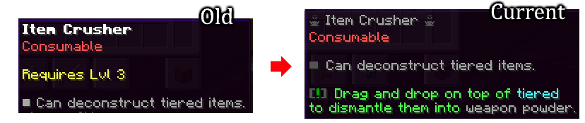
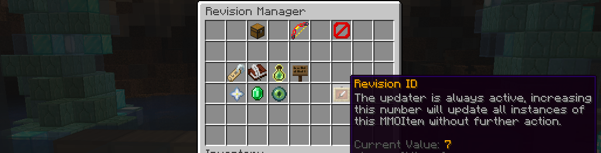

# 物品更新与修订版本 {#🔄-item-updates-revision}

当通过战利品表或命令生成物品时，其属性数据将写入NBT标签。  它们的属性数据的90%现在独立于配置中写入的内容，这样，如果你稍后修改物品，它不会“自动”更新已生成的此物品的实例。

*修订版ID* 系统或 *RevID* 允许更新生成的物品以再次匹配其配置。更新物品时，MMOItems会“重新生成”它，就好像它是通过`/mi give`命令新鲜获得的一样，具有最新的描述格式和与模板相同的属性：



## RevID属性 {#the-revid-stat}

当你在编辑器中增加此数字时，世界上此物品的所有副本都将更新以匹配模板：



一旦物品版本ID增加，该物品的每个生成实例现在都被视为“过时”并将被更新。你可以多次递增修订版ID。

### 笔记 {#note}

MMOItems在登录时更新玩家的物品栏中的每个物品。任何物品点击（在非创意物品栏中）都会触发物品更新检查。

## 高级配置 {#advanced-configuration}

此版本系统有很多选项，你可以在主MMOItems配置文件的`item-revision`部分中进行调整。

```yml
item-revision:
  keep-data:
    display-name: true
    enchantments: true
    soulbound: true
    gems: true
    upgrades: true
    lore: false
    kept-lore-prefix: '&7'
    external-sh: true
    reroll: false
    modifications: true
    skins: true
    tier: true

  drop-extra-gems: true
```

有些选项具有更复杂的机制，但其余选项是self-explanatory。

### 重新滚动 RNG属性`reroll` {#reroll-rng-stats-reroll}

此选项有一些非常复杂的行为，即使你指定了false，属性也可能会重新滚动，这是可取的。重要的是要了解所有数字属性都是 RNG - 即使你没有指定价差，它们也只有100%具有相同值的机会。

假设这是*启用*，那么物品的所有数字属性都将被重新滚动。

假设这是*禁用*，那么每个数字属性将计算在当前均值和价差设置下再次生成它的概率，如果太罕见，那么即使禁用此选项，它也会更新/重新滚动：

1. 如果新值的范围为0并且已更改，则旧值将丢失，因为生成的值将是0%。
2. 如果从物品中完全删除该值，则旧值将丢失。
3. 如果值的分布发生变化，使得旧值极其罕见（4200中的1），则旧值将会丢失。
4. 如果最大点差值已更改，并且旧值超出此范围，则旧值将被限制为最大点差。

正如你所看到的，如果这个物品在新的条件下无法获得，RNG将会重新滚动，这是生命值的游戏设计。

### 保持结界`enchantments` {#keep-enchantments-enchantments}

物品的旧附魔将与模板中的附魔进行比较，以决定是否保留或更新附魔：

1. 任何比模板差的旧附魔都会更新为更好的值
2. 如果旧的附魔比模板的附魔更好，只要它在原版我的世界中可以获得，它就会被保留。
3. 如果模板启用了`disable-enchanting`和`disable-repairing`属性，则不会保留旧的结界*即使启用此选项*，所有结界都将更新以匹配模板。

如你所见，目标是为物品附魔的玩家不会失去其附魔，但如果在模板中更新物品以具有更好的附魔，则这些玩家将获得更好的附魔。本质上，尝试记住玩家放入物品中的结界，并再次应用它们（如果玩家仍然可以应用它们）。

### 保留宝石`gemstones`、`drop-extra-gems` {#keep-gemstones-gemstones-drop-extra-gems}

请务必注意`drop-extra-gems`选项，如果任何宝石因 RevID 更新程序而被删除，则将此选项设置为true将导致它们被返还给玩家/ 如果物品栏已满，则它们会掉落在附近。此选项对于所有物品修订操作是全局的（请参阅下一节有关更多 RevID 系统应用程序的信息）。

如果此选项被“禁用”，则物品中的所有旧宝石都将被删除（如果启用了`drop-extra-gems`选项，则将被删除）。

如果这个选项被*启用*，旧的宝石仍然有可能被删除：

1. 如果模板的宝石插槽被移除或数量减少，不合适的宝石将被删除
2. 如果宝石插槽的颜色发生变化，不再适合的宝石将被删除

### 保留名称`display-name` {#keep-name-display-name}

如果启用此功能，则无论模板当前有什么，都将保留物品的旧名称。

### 保留灵魂绑定`soulbound` {#keep-soulbound-soulbound}

如果旧的物品是灵魂绑定，则此灵魂绑定将被保留。

### 持续升级`upgrades` {#keep-upgrades-upgrades}

旧物品的升级等级将保留，但如果物品模板不再有升级模板，升级将会失败。如果物品的最大升级等级减少，额外的升级等级将会丢失。

### 保留描述`lore`、`kept-lore-prefix` {#keep-lore-lore-kept-lore-prefix}

从旧的物品开始，所有以`kept-lore-prefix`（通常是颜色代码）开头的描述行都将被保留。请注意，如果模板有任何以此前缀开头的描述，这可能会导致重复的描述，每次更新物品时都会保留它。

### 保留外部 SH`external-sh` {#keep-external-sh-external-sh}

外部属性历史数据由third-party插件添加，以修改物品的属性。启用此功能将保留所有这些数据，除了结界之外。

### 保留修改`modifications` {#keep-modifications-modifications}

如果启用此功能，所有物品修饰器将被保留，即使它们无法再获得，即使修改器权重发生变化。

### 保留皮肤`skins` {#keep-skins-skins}

如果启用此功能，则将保留 *skin-type*物品所做的更改。

### 保持等级`tier` {#keep-tier-tier}

如果旧的物品有一个层，则该层将被保留，即使模板现在具有不同的层。

## RevID系统的其他应用 {#other-applications-of-the-revid-system}

### 更新物品内的宝石 {#updating-gemstones-inside-items}

RevID 系统支持在宝石插入物品时更新宝石。当增加宝石模板的 RevID 时，这种情况不会自动发生，你必须增加父物品的 RevID 并启用 *keep gemstones* 选项。

你可以使用`item-revision.keep-gem-data`字段来指定以这种方式更新的宝石的 RevID 选项：

```yml
item-revision:
  keep-gem-data:
    display-name: true
    enchantments: true
    ...
```

## 第三方插件兼容性 {#third-party-plugin-compatibilities}

### 保留高级附魔`advanced-enchantments` {#keep-advanced-enchantments-advanced-enchantments}

物品中的所有高级附魔都将保留。

### 更新 PhatLoots 生成的战利品 {#update-phatloots-loot-as-it-generates}

PhatLoots 没有对MMOItems的特殊支持，因此几个月后，你的 MMOItem 战利品掉落可能会变得相当过时！在`item-revision.phat-loots`部分的MMOItems'config.yml中指定修订选项，以在生成这些物品时更新它们：

```yml
item-revision:
  phat-loots:
    display-name: true
    enchantments: true
    #...
```

---

原文：[🔄 Item Updates (Revision)](https://docs.phoenixdevt.fr/mmoitems/items/revision-id) · 原文归档：2026-10-19
