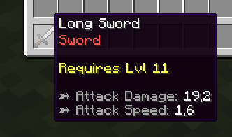
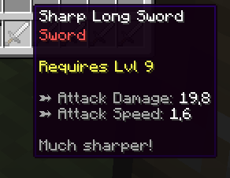
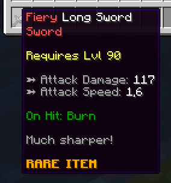
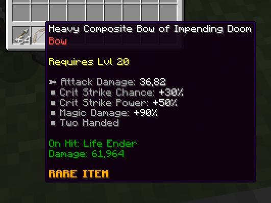

# 物品模板 {#🗡️-item-templates}

在 MMOItems 中创建物品，实际创建的是物品**模板**。物品模板由一组**默认**选项（显示名称、材质、附魔、攻击伤害等）和一组**物品修饰器**组成。给予玩家物品时，会随机选取修饰器，并将它们应用到物品的基础数据上。

该系统的设计目的是使**一个 ​​物品模板**能够生成同一物品的**多个版本/实例**。物品修饰器是物品每个版本的独特之处：残局物品实例将具有许多强大的修饰符，而新手物品实例将仅具有1-2较弱的修饰符。

物品在生成时都有一个**物品等级**，直接决定了物品属性的强度，以及**修饰符容量**，决定了物品可以拥有多少修饰符。MMOItems物品生成器挂接到MMOItems层系统上。物品品质越高，物品的修饰符越多。换句话说，物品品质决定了物品**修改器容量**。

**物品品质** 和 **物品等级** 是我们的**“随机性游标”**。它们决定了物品实例的强大程度。它们也是独立的，这意味着你可以拥有高水平的武器，几乎没有修饰符，反之，新手物品则有很多修饰符。

## 物品示例 {#item-examples}

我们将通过几个示例来了解MMOItems物品生成器的基本概念。

### 示例1 {#example-1}



这些物品使用相同的模板，这是一个名为`Long Sword`的物品。然而，右边的一个有一个`Sharp`修饰符，可以给他+3攻击力伤害，而左边的一个没有修饰符。

这两个物品具有相同的攻击速度，因为它被选择不与物品等级进行缩放。然而，攻击伤害确实随物品等级扩展：虽然第一个物品具有更高的等级，但第二个物品具有`Sharp`修饰符，因此具有更多攻击伤害。

`Sharp`修饰符为第二个物品提供`Sharp`前缀，并在物品描述中添加额外的文本行。

### 示例2 {#example-2}



右边的物品的物品等级要高得多，因此他的攻击伤害也要高得多。它还有两个修饰符：`Sharp`和`Fiery`。`Sharp`仍然提供物品+3攻击力伤害，但考虑到其等级，它几乎没有用处。`Fiery`为物品提供了漂亮的红色名称前缀和on-hit刻录能力。

第二个物品具有`Rare`物品品质，因此比non-tiered剑具有更多的修改器容量，这解释了为什么它收到两个修改器。Non-tiered物品也有改性剂容量，但要低得多。

你只能看到`Fiery`前缀，因为此修饰符具有更高的优先级（尽管你可以配置修饰符以便显示所有前缀，并且同时具有带有10后缀或前缀的有趣物品名称！）。

最后但并非最不重要的一点是，更高的等级并不总是意味着更多的修饰符 - 修改后的武器的等级比没有修饰符的等级低。

### 示例3 {#example-3}



默认的物品是一把带有一定攻击伤害和暴击几率的弓。第一个`Heavy`修改器使其成为two-handed，添加了一些攻击点和一些暴击伤害。第二个带有后缀的修饰符添加了on-hit能力。

## 示例物品 {#example-item}

这是物品模板在MMOItems配置文件中的外观。

```yml
LONG_SWORD:
  base:
    material: IRON_SWORD
    attack-damage:
      base: 10
      scale: 1
    critical-strike-chance: 30
    # More item stats here...
  modifiers:
    first-modifier:
      prefix: 'Modifier Prefix'
      stats:
        attack-damage: 3
        # More item stats here...
    second-modifier:
      suffix: 'Modifier Suffix'
      stats:
        pvp-damage: 20
        # More item stats here...
```

## 物品模板 {#item-templates}

物品模板是生成随机物品的最基本工具。它们由 **默认物品属性** 列表定义，无论如何，生成的物品都会具有该列表，以及 **物品修饰器** 列表，该列表将被随机选取并应用于生成的物品以影响其稀有性。

```yml
LONG_SWORD:
    
  # Basic template options
  option:
    tiered: true
    level-item: true
    roll-modifier-check-order: false
    capacity:
      base: 10
      scale: 3

  # Base item data
  base:
    material: IRON_SWORD
    name: '&fLong Sword'
    attack-speed: 1.6
    attack-damage:
      base: 6
      scale: 1.2
    required-level:
      base: 0
      scale: 1

  # Template modifiers
  modifiers: 
    sharp:
      chance: 0.3
      prefix: '&fSharp'
      stats:
        attack-damage: 3
        lore:
        - '&7Much sharper!'
```

对上面配置片段的一些评论：

- `base`部分对应于基础物品属性。例如，底座物品是一把铁剑，名称为`Long Sword`。默认的攻击速度是1.6，武器的攻击力伤害为6，每物品等级增加1.5点。
- `option`部分用于为模板配置一些附加选项。请参阅下一段了解更多信息。
- `modifiers`部分包含可应用于物品的所有修饰符。

物品生成模板可以在`/MMOItems/items`文件夹下找到。你可以在该文件夹中添加任意数量的 YML 配置来对模板进行排序。

## 物品模板选项 {#item-template-options}

物品模板的额外选项的一小部分列表。除了容量之外，将它们设置为`true`来启用它们

|模板选项 |描述 |
| --- | --- |
| `roll-modifier-check-order` | 生成物品时，先对物品修饰器列表进行打乱，然后再滚动它们 |
| `tiered` | 如果生成物品时未指定任何层，将为你的物品选择随机层。这说明了`/mi generate`命令，也说明了站合成配方！ |
| `level-item` | 如果在生成物品时未指定任何等级，将为你的物品选择随机的物品等级。 |
| `capacity` | `capacity`可用于将修饰符容量公式强加到物品上，而无需使用物品品质。它会覆盖默认的修改器容量公式以及生成的物品层提供的公式。 |

---

原文：[🗡️ Item Templates](https://docs.phoenixdevt.fr/mmoitems/items/templates) · 原文归档：2026-10-19
