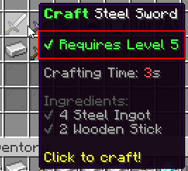

# 条件 {#✅-conditions}

就像配料一样，必须满足条件才能使用配方。与成分不同，使用合成配方时，条件不会从玩家物品栏中获取任何内容。配方条件有多种，主要有**等级**条件和**权限**条件。就像成分一样，条件存储在配方配置部分内的列表中。

```yml
# ...
recipes:
    steel-sword:
        output: 'mmoitems{type=SWORD,id=STEEL_SWORD}'
        ...
        conditions:
        - 'level{level=5,consume=true}'
        - 'permission{list="mmoitems.recipe.steel-sword,mmoitems.recipe.station.steel"}'
        - 'placeholder{placeholder="%ac_Stat_Weight%~>~1"}'
```

## 可用条件 {#available-conditions}

|状况 |用途 |描述 |
| --- | --- | --- |
| 最低等级。 | `level{level=<min>,consume=<true/false>}` | 玩家必须为 X 级或更高。`consume`是是否应该消耗这些等级。 |
| 职业 | `class{list=<Class Name>,<Class Name 2>...}` | 将配方限制为某些职业 |
| 权限 | `permission{list="<perm1>,<perm2>...";display="...";hide=false}` | 只有具有特定权限的玩家才能使用该配方。`display`是物品描述中的情况 |
| 占位符 | `placeholder{placeholder="<Placeholder>~<Comparator>~<Number>";display="...";hide=false}` | 检查玩家的占位符，然后将其与你选择的数字进行比较。比较器列表：`<`、`<=`、`>`、`>=`、`==`、`!=`。比较字符串时使用`eq`或`neq` |
| 食品 | `food{amount=<amount>}` | 这些配方消耗（并需要）X 种食物。 |
| 魔力 | `mana{amount=<amount>,format="0.#"}` | 该配方消耗（并需要） X魔力。 |
| 耐力 | `stamina{amount=<amount>,format="0.#"}` | 该配方消耗（并需要） X耐力。 |
| 钱 | `money{amount=<amount>,format="0.#"}` | 该配方需要（并且需要）XVault货币。 |
| 最低副职业等级 | `profession{profession=<profession>,level=<min>}` | 玩家必须是副职业中的 Lvl X 或更高 (MMOCore)。 |

`hide-when-locked`配方选项仅在至少满足/不满足其中一个条件时触发。如果玩家没有所有必需的成分，配方仍会显示在GUI中。配方条件显示在GUI配方物品描述的开头：



---

原文：[✅ Conditions](https://docs.phoenixdevt.fr/mmoitems/stations/conditions) · 原文归档：2026-10-19
