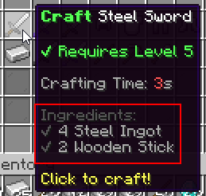

# 合成材料 {#🪵-ingredients}

关于合成配方最重要的部分是配方成分（物理物品任何玩家都必须使用配方）。每个配方都有一个玩家必须在其物品栏中包含的成分列表才能使用该配方。成分有多种类型，包括：

- 使用MMOItems生成的物品
- 具有自定义显示名称的原版物品（不是使用 MI 生成的）
- 物品来自MythicMobs/坩埚
- 物品来自Oraxen、Nexo或ItemsAdder



## 示例 {#example}

例如，假设我们要为 *Steel Sword*物品创建配方。我们想要使用MMOItems中的原版和物品：2原版棒和4锭（来自MMOItems的定制物品）：

```yml
# crafting-stations/cs_example.yml

recipes:
  steel-sword:
    output: 'mmoitems{type=SWORD,id=STEEL_SWORD}'
    #...
    ingredients:
    - 'mmoitem{type=MATERIAL,id=STEEL_INGOT,amount=4}'
    - 'vanilla{type=STICK,amount=2}'
```

## 可用成分 {#available-ingredients}

|成分|用途 |评论 |
| --- | --- | --- |
| MMOItems | `mmoitem{type=SWORD,id=TWO_HANDED_LONGSWORD,level="7..10"}` | 你可以指定物品等级的范围。使用`2..`表示*2及更高等级*，使用`..10`表示*最高等级10*。 |
| 原版物品 | `vanilla{type=DIAMOND,name="Shiny Diamond"}` | 如果设置，`name`要求物品有特定的显示名称。它只是可选的，如果未设置，则此要求将不适用。 |
| Oraxen | `oraxen{id=amethyst}` |  |
| Nexo | `nexo{id=amethyst}` |  |
| ItemsAdder | `itemsadder{id=baseball_bat}` |  |
| MythicMobs/坩埚 | `mythic{id=KingsCrown}` |  |

对于任何物品，都有一个`display=...`选项来更改成分在物品描述中的外观。在以下示例中，无论物品的名称是什么，比如 *Baseball bat*，它将在配方描述中显示为 *Very Large Baseball Bat*。

```yml
recipes:
  steel-sword:
    #...
    ingredients:
    - nexo{id=baseball_bat,display="Very Large Baseball Bat"}
```

你还可以使用`amount=...`更改任何成分的数量。 **确保你的配方没有两种相同的成分！由于合成站的设计方式，这是一个微小的限制 - 你无法获得所需的配方，例如10铁锭 +10铁锭。这些成分需要合并成一种更大的成分，即20铁锭。 ** 如果需要，你可以使用大于64的量作为一种成分，它会很好地工作。

```yml
recipes:
  steel-sword:
    #...
    ingredients:
    - vanilla{type=STICK,amount=60}
```

---

原文：[🪵 Ingredients](https://docs.phoenixdevt.fr/mmoitems/stations/ingredients) · 原文归档：2026-10-19
