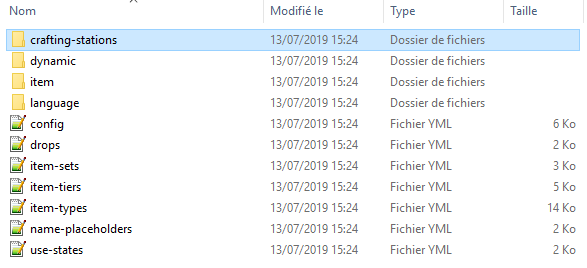
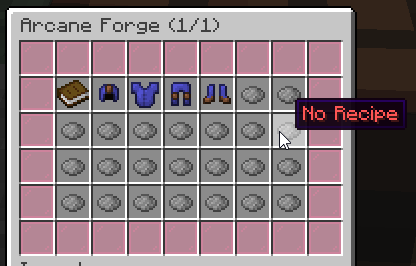
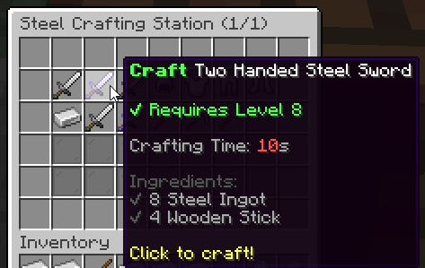

# 合成站 {#⚒️-crafting-stations}

合成站是玩家可以打开的界面，用于通过配方合成物品。配方有材料要求和条件要求：材料是实物要求，即玩家物品栏中必须持有的物品；条件则是金钱、职业、等级等非实物要求。

## 将合成站打开到玩家 {#opening-a-crafting-station-to-a-player}

### 管理命令 {#admin-command}

你可以使用`/mi stations list`检查可用的合成站列表。你可以使用以下命令使玩家打开合成站GUI：

```cmd
/mi stations open <station-id> <player>
```

我们建议管理员将此命令绑定到 NPC 或特殊块，以便在与某些实体或块交互时打开该站。由于这是一个管理命令，因此你不应该向玩家授予对此命令的访问权限。

### 玩家命令 {#player-command}

每个合成站还可以有自己的自定义打开命令。你可以找到以下示例代码，取自名为`arcane-forge`的默认合成站。这个功能非常适合easy-to-use，如果你需要为你的玩家设置特殊福利，而不需要与 NPC 或标志交互，它会很方便。

```yml
# Optional. Defines a command to open the crafting station UI.
# Remove this config section to disable.
#
# These commands have a known limitation. If you change the command
# name or remove the crafting station, you will need to restart the
# server to unregister/remove the unused/previous command, as Bukkit
# does not allow to unregister commands while the server is running.
#
# Unless it is some high-end perk, we don't recommend using this,
# using the `/mi stations open <station> <player>` command from a NPC
# usually works better from a gameplay perspective.
command:
    name: 'arcaneforge' # The command itself
    description: 'Open the arcane forge' # Command description
    usage: '/arcaneforge' # Command usage
    permission: 'mmoitems.arcane_forge' # Permission needed to use the command
    aliases: [ af, mmoitems_af ] # Command aliases
    message:
        no-perm: '&cYou don''t have enough permissions.' # Message shown when missing permission
        not-a-player: '&cThis command is for players only.' # Message shown when sender is not a player
```

然而，此功能有一个已知的限制，因为Spigot不允许在插件运行时删除命令。因此，如果你更改命令名称或删除合成站，该命令将保持挂起状态，并且在重新加载MMOItems时不会从服务器取消注册，**直到下一次服务器重新启动**。  每次运行`/mi reload`时，MMOItems将检测这些幽灵命令并在控制台中显示警告。

## 创建新的合成站 {#creating-a-new-crafting-station}

合成站保存在`/crafting-stations`文件夹内。该文件夹中的每个 YML 文件都对应一个合成站。创建合成站最简单的方法是复制与默认合成站之一相对应的 YML 配置文件，并根据需要进行更改。为了清晰和易于使用，`/crafting-stations`可以组织成子文件夹。

配置文件名将用作合成站内部ID，你需要使用该名称才能使用上面提供的管理命令向玩家打开工作站。



## 基本选项 {#basic-options}

```yml
name: 'Arcane Forge' # General name
max-queue-size: 10

recipes: ... # Recipes available at that crafting station
gui-layout: ... # GUI general layout
confirm-gui-layout: ... # General layout for the right-click "preview" GUI
```

每个合成站都需要在站配置文件中提供一些基本信息，从`name`选项开始（它不是实际的GUI名称）。`max-queue-size`选项指示玩家可以在制作队列中放置多少个物品。



## 合成站示例 {#crafting-station-example}

```yml
name: 'Steel Crafting Station (#page#/#max#)'
max-queue-size: 10
sound: ENTITY_EXPERIENCE_ORB_PICKUP

recipes:
    two-handed-steel-sword:
        output: 'mmoitem{type=GREATSWORD,id=TWO_HANDED_STEEL_SWORD}
        crafting-time: 10
        conditions:
        - 'level{level=8}'
        ingredients:
        - 'mmoitem{type=MATERIAL,id=STEEL_INGOT,amount=8}'
        - 'vanilla{type=STICK,amount=4}'
```



---

原文：[⚒️ Crafting Stations](https://docs.phoenixdevt.fr/mmoitems/stations/intro) · 原文归档：2026-10-19
