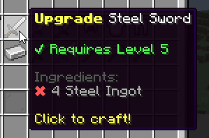

# 升级配方 {#🛠️-upgrading-recipes}

升级配方是一种特定类型的车站配方。它们允许任何玩家使用成分升级特定的物品。这些配方还支持配方条件和其他配方选项，例如`hide-when-locked`。在阅读如何设置升级配方之前，你应该考虑了解 [合成站](intro.md)。

升级配方还没有制作时间。



## 配方示例 {#recipe-example}

```yml
# crafting-stations/cs_example.yml

recipes:
    steel-sword-upgrade:
        item: # Use 'item' instead of 'output' to switch to an upgrading recipe
            type: SWORD
            id: STEEL_SWORD
        conditions:
        - 'level{level=5}'
        ingredients:
        - 'mmoitem{type=MATERIAL,id=STEEL_INGOT,amount=4}'
```

此升级配方允许玩家升级物品`Steel Sword`。升级配方**不**支持制作时间，因此它们必须都是即时的，就像你使用消耗品一样。为了使用此配方，玩家必须至少达到5等级，并且物品栏中必须有4钢锭。

与合成配方的主要语法差异是，你需要使用`item`而不是`output`（请参阅配方配置的第一行）。

玩家在使用配方时必须有他们正在尝试升级的物品（它是隐式成分，虽然没有显示在成分列表中），否则会提示错误消息。

---

原文：[🛠️ Upgrading Recipes](https://docs.phoenixdevt.fr/mmoitems/stations/upgrading-recipes) · 原文归档：2026-10-19
