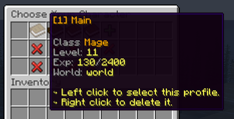

# 添加占位符 {#🏷️-adding-placeholders}

像MMOCore这样的插件实现了自定义档案占位符，例如档案类别、等级和经验。此类占位符依赖于玩家档案，因此与常规PAPI占位符相比需要一点额外的工作。



## 实施`PlaceholderProcessor` {#implement-placeholderprocessor}

`PlaceholderProcessor`接口有两种方法：

- `#getDataModule()`应该返回你的档案数据模块。
- `#processPlaceholderRequest(PlaceholderRequest)`这是该接口最重要的方法。这应该异步获取档案数据，从中提取信息并注册其占位符，并最终在`PlaceholderRequest`实例上调用`#validate()`方法。

例如，以下是`#processPlaceholderRequest`方法的MMOCore实现。

```java
void processPlaceholderRequest(PlaceholderRequest placeholderRequest) {
    final PlayerData fictiveData = new PlayerData(new MMOPlayerData(placeholderRequest.getProfile().getUniqueId()));
    MMOCore.plugin.playerDataManager.loadData(fictiveData).thenRun(() -> {
        placeholderRequest.addPlaceholder("class", fictiveData.getProfess().getName());
        placeholderRequest.addPlaceholder("level", fictiveData.getLevel());
        placeholderRequest.addPlaceholder("exp", MythicLib.plugin.getMMOConfig().decimal.format(fictiveData.getExperience()));
        placeholderRequest.addPlaceholder("exp_next_level", MythicLib.plugin.getMMOConfig().decimal.format(fictiveData.getLevelUpExperience()));
        // Skipping some of the placeholders.....

        placeholderRequest.validate();
    });
}
```

你的`#processPlaceholderRequest`应该如下所示：

- 使用`phRequest.getProfile().getUniqueId()`访问档案的UUID，
- 异步加载你的档案数据（使用异步Bukkit任务！），
- 加载数据后，使用`phRequest.addPlaceholder(String, String)`根据需要注册尽可能多的占位符。第一个参数应该是占位符键，例如`class`或`level`，第二个参数应该是占位符字符串值。如果你的档案数据模块标识符是`mmocore`，并且占位符密钥是`class`那么最终的占位符将是`mmocore_class`，
- 通知MMOProfiles你已完成使用`phRequest.validate()`注册占位符。

## 注册你的`PlaceholderProcessor`实例 {#register-your-instance-of-placeholderprocessor}

使用以下方法注册你的占位符处理器，必须在注册你的档案数据模块时完成此操作。

```java
ProfileProvider provider = /* profile provider */;
PlaceholderProcessor yourPlaceholderProcessor = /* TODO */;
provider.registerPlaceholders(yourPlaceholderProcessor);
```

---

原文：[🏷️ Adding Placeholders](https://docs.phoenixdevt.fr/mmoprofiles/api/placeholders) · 原文归档：2026-10-19
