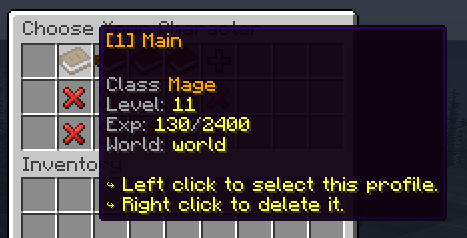
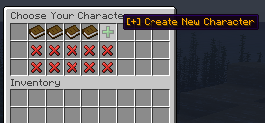

# 选择档案 {#🦾-profile-selection}

玩家登录后首先看到的是档案选择界面，其中列出已创建的全部档案及各自的基本信息。玩家可以创建、删除或选择档案；选定一个档案之前，无法退出该界面。


修改 `gui/profile-list.yml` 可完整自定义此界面。下方列出了可用于显示档案信息的全部占位符。建议使用服务器资源包改善界面外观，MMOProfiles 的界面支持这种做法。



## 创建新档案 {#creating-a-new-profile}

有空余档案栏位时，玩家可以点击绿宝石创建新档案。MMOProfiles 会要求输入名称，随后将新档案加入列表。



## 占位符 {#placeholders}

以下占位符可用于 `/MMOCore/language/gui/profile-list.yml` 中的 `items.profile.lore` 选项，对应档案列表内每个档案物品的描述。

```yml
# Default config
lore:
- ''
- '&7Class &6{mmocore_class}'
- '&7Level: &e{mmocore_level}'
- '&7Exp: &e{mmocore_exp}&7/&e{mmocore_exp_next_level}'
- '&7World: &e{world}'
- ''
- "&e↪ Left click to select this profile."
- "&e↪ Right click to delete it."
```

### 原版占位符 {#vanilla-placeholders}

|占位符|价值|
| --- | --- |
| `{profile_name}` | 档案名称 |
| `{last_time_played}` | 玩家上次使用此档案游玩的时间。 |
| `{slot}` | 档案对应的栏位 |
| `{health}` | 档案的生命值。 |
| `{level}` | 档案的等级。 |
| `{exp}` | 档案的经验。 |
| `{balance}` | 档案的余额。 |
| `{food}` | 档案的饥饿值。 |
| `{saturation}` | 档案的饱和度。 |
| `{air_level}` | 档案的氧气值。 |
| `{world}` | 选择该档案后玩家将进入的世界。 |
| `{spawn_world}` | 玩家床的重生点所在世界。 |
| `{attribute_<name>}` | 档案的原版属性值，例如 `{attribute_max_health}`。 |

### MMOCore占位符 {#mmocore-placeholders}

| Placeholder | 价值 |
| --- | --- |
| `{mmocore_class}` | MMOCore 职业名称 |
| `{mmocore_level}` | MMOCore 主职业等级 |
| `{mmocore_attribute_<name>}` | 投入指定基础属性的点数，与玩家的原版属性不同。 |
| `{mmocore_profession_<name>}` | 指定副职业的等级 |
| `{mmocore_exp}` | 玩家当前经验 |
| `{mmocore_exp_next_level}` | 升到下一级所需的经验 |

---

原文：[🦾 Profile Selection](https://docs.phoenixdevt.fr/mmoprofiles/features/profile-select) · 原文归档：2026-10-19
