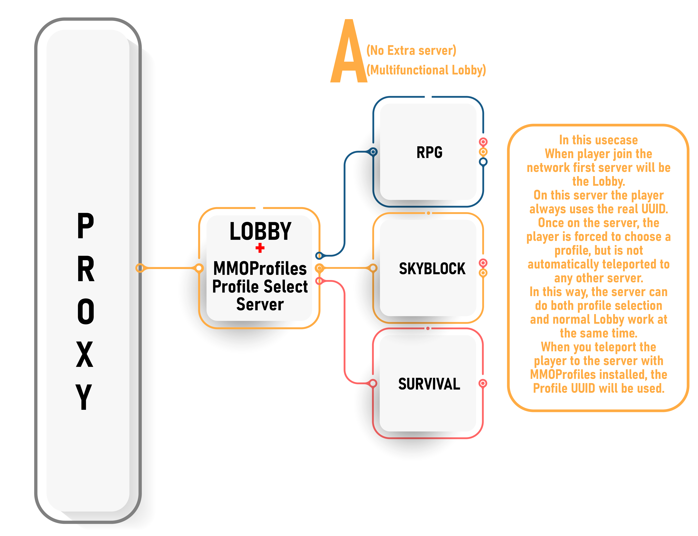
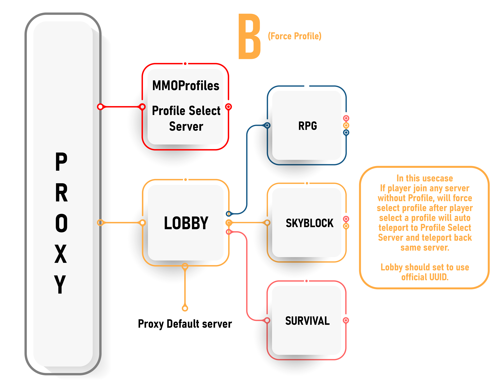
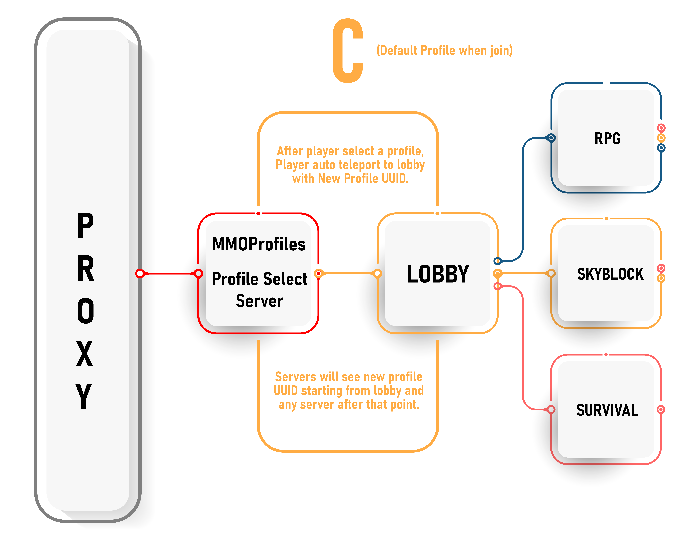
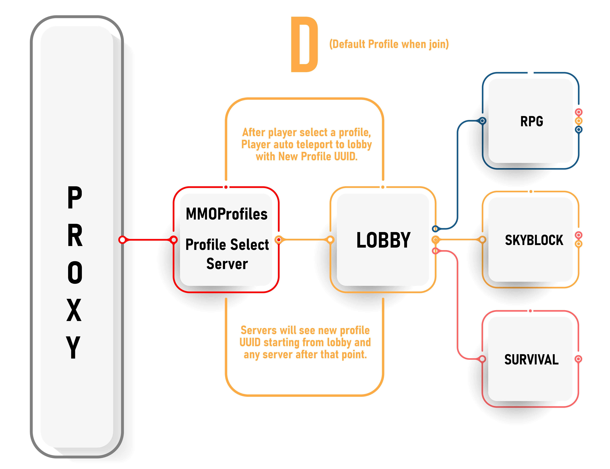

# 代理端档案 {#🫅-proxy-based-profiles}

此功能可让任意插件的任意玩家数据都按档案分别记录进度。通过代理端的处理，可以在切换服务器时切换玩家 UUID，让所有插件都将其视为另一名玩家加入服务器。

这项功能的优势是：**任何保存玩家数据的插件都能兼容 MMOProfiles，无需专门编写档案支持代码**。编写这类兼容代码通常很费工夫，详见后文。

> **信息**
>
> 过去已有一些插件实现过 *UUID Spoofing*，但其中多数现已过时。MMOProfiles 提供仍在更新的方案，并保留可配置的档案选择界面和 MMO 插件系列兼容等主要功能。

**使用此功能至少需要一台代理服务器和两台后端服务器。**

## 为什么有这样的功能呢？ {#why-such-a-feature}

要让 MMOProfiles 兼容所有插件并不容易。按档案保存数据通常要求大幅修改插件代码：插件必须先等待 MMOProfiles 提供 UUID，再使用该 UUID 查询数据库。

对 MMO 系列以外的插件来说，这很难实现。虽然已经提供了结构清楚、开放源码的档案 API，方便其他开发者接入 MMOProfiles，但无法要求所有插件都原生支持。因此，这里提供一种无需其他开发者修改代码的方案。

## 我该如何启用它？ {#how-do-i-enable-it}

以下教程默认你已了解代理服务器和 MySQL 数据库；如果没有这些基础，将难以理解后续内容。

#### 在你的Velocity代理服务器上 {#on-your-velocity-proxy-server}

- 安装最新版 [MMOProfiles](https://www.spigotmc.org/resources/mmoprofiles.109942/)。主 JAR 同时包含 Spigot 插件和 Velocity 插件。
- 安装最新版 [PacketEvents](https://modrinth.com/plugin/packetevents)，它是代理端档案选择的必需依赖。
- 在 Velocity 配置中，将 `force-key-authentication` 设为 `false`。

#### 在你的后端服务器上 {#on-your-backend-servers}

在所有需要启用代理端档案选择的后端服务器上，执行以下步骤。

- 安装最新版 MMOProfiles 和 [MythicLib](https://www.spigotmc.org/resources/mmolib-mythiclib.90306/)。如果还安装了其他 MMO 插件，也要保持它们为最新版。
- 在 MMOProfiles 配置中启用 SQL 数据存储，并让所有后端服务器连接同一个 SQL 数据库。
- 在 1.19+ 上还需要安装 [FreedomChat](https://modrinth.com/plugin/freedomchat)，用于解决聊天签名问题，避免玩家发送聊天消息时被踢出。
- 在 `server.properties` 中，将 `enforce-secure-profile` 设为 `false`。

> **信息**
>
> 代理服务器无需安装 MythicLib，后端服务器也无需安装 PacketEvents。

此功能**目前只支持 Velocity**，BungeeCord 支持仍在计划中。后端服务器仅支持 1.20.2+；1.16-1.19 的支持也在计划中，但需要适配旧版 Minecraft 协议。

## 配置文件 {#config-files}

MMOProfiles JAR 包含两个插件：一个用于 Velocity 代理端，另一个用于 Spigot/Paper 后端。因此需要配置两类文件：代理端配置，以及每个后端服务器各自的配置。

### 代理服务器配置 {#proxy-server-config}

此配置文件位于 `<velocity_root>/plugins/mmoprofiles_velocity` 下。

<details markdown="1">

<summary>完整配置片段</summary>

```yml
# Players will be kicked (from the server, NOT the network) when
# trying to join these backend servers with no profile selected.
#
# If the player is already connected to the proxy, they will not
# be kicked from the proxy, and will be redirected to another server.
kick_if_no_profile:

  # Backend servers where this option is active
  # !! Server names from the Velocity config.toml !!
  servers:
    - play

  # Message displayed to players
  kick_message: 'Please first select a profile.'

# This option is for lobby servers. Players will have their
# profile unselected when joining these backend servers.
# !! Server names from the Velocity config.toml !!
unselect_profile_on_login:
  - lobby
```

</details>

`kick_if_no_profile` 用于阻止玩家未选择档案就进入服务器，其值是服务器 ID 列表。

`unselect_profile_on_login` 可以让玩家进入大厅服务器时恢复原始 UUID，从而退出当前档案，暂时不使用该档案的物品栏、进度等数据。

### 后端服务器配置 {#backend-server-config}

此配置文件位于 `<spigot_root>/plugins/MMOProfiles` 下。

<details markdown="1">

<summary>完整配置片段</summary>

```yml
# When enabled, MMOProfiles switches to a proxy-based behaviour, enabling
# players to switch UUIDs. This tricks other plugins into thinking another
# player is joining the server, enabling profile-specific progress with
# literally ANY plugin.
#
# !! WARNING risk of data loss !!
# Please check the documentation before enabling this option to understand
# exactly what you are doing. If misconfigured, you can damage your player data.
# !! WARNING !!
proxy_based_profiles:

  # This option MUST be enabled on every Spigot server.
  enabled: false

  # Servers to where players will be sent to when choosing their profile.
  # When using this option, make sure you force profile selection.
  #
  # When option 'back_to_initial_server' is toggled on, this becomes
  # the list for temporary servers where players will be teleported
  # to have their UUID switched.
  #
  # Leave empty to NOT teleport the player automatically on profile selection.
  # This will leave the player the option to choose the server they would like
  # to play on. As soon as they switch servers (as long as the connection does
  # not fail), the selected profile will be applied.
  target_servers:
    - 'play'

  # When enabled, on profile selection, the player will be sent to the target
  # server before being sent back to the server they came from. Use this option
  # if you want players to BOTH choose their profile AND play in the same server.
  #
  # You need at least two backend servers to run MMOProfiles proxy-based profiles.
  # The player UUID switch can only happen when switching servers, this is why
  # using such a "temporary" server is necessary.
  back_to_initial_server:
    enabled: false
    delay: 10

  # This ONLY WORKS IF proxy-based profiles are enabled.
  #
  # Make sure you toggle on 'synced-data.permissions' otherwise this option is useless.
  # Make sure you have also installed a permission plugin as well as Vault, and that
  # your permission plugin supports Vault.
  #
  # This option dictates how permissions are shared between profiles.
  # Usually, you'll want to share at least admin/rank permissions in case
  # they want to create switch profiles, otherwise these will be lost.
  shared_permissions:

    # By default, you need to provide a list of all the permissions that should
    # be shared between all the different profiles (whitelist behaviour).
    # When toggling on this option, it turns into a blacklist, which means all
    # permissions are shared by default, EXCEPT for the permissions which are
    # present in the following list.
    blacklist_instead: false

    # Whitelist/blacklist of shared permissions.
    list:
      - 'mmocore.admin'
      - 'rank.vip'
      - 'rank.vip_plus'
      - 'rank.mvp'
      - 'rank.mvp_plus'
      - 'group.test'
```

</details>

下文会介绍此配置文件。

## 规格 {#specifications}

大多数群组服有两类服务器：玩家连接代理后进入的大厅服，以及选好档案后实际游玩的游戏服。

### 对于游戏服务器 {#for-play-servers}

- 将游戏服的 ID 加入 `kick_if_no_profile` 列表。玩家未选择档案就尝试进入时，会被踢出该服并转回大厅。
  - 纯 RPG 服务器通常要求玩家先选择档案再游玩，应使用此项。
  - 大厅服应关闭此项，各游戏服则应启用，具体按需求决定。

### 对于大堂服务员 {#for-lobby-servers}

- 将大厅服的 ID 加入 `unselect_profile_on_login` 列表。这样玩家每次进入大厅都会恢复原始 UUID，适合要求玩家不选档案进入的大厅。
- 可以通过 `target_servers` 指定游戏服。玩家在大厅选择档案后，会被传送到这些服务器。
  - 启用下文的 `back_to_initial_server` 时，也需要此项。此时，列表中的服务器会作为临时中转服，供 MMOProfiles 通过一次往返切服完成 UUID 切换。
- 启用 `back_to_initial_server` 后，玩家最终会留在档案选择服务器。
  - 代理端至少需要发生一次切服，才能正确切换玩家 UUID。MMOProfiles 会先将玩家送到临时中转服，再立即送回原服务器；UUID 在第二次切服时完成切换。
  - 如果希望玩家始终在同一台服务器上选择档案并游玩，可以使用临时中转服方案。玩家最多只停留几秒，因此中转服无需很高的性能。
  - 这些仅用于切换 UUID 的临时中转服无需安装 MMOProfiles。
- 大厅服应使用不同的 `server-identifier`。所有地图不同的服务器都需要设置不同的标识符。

新档案出生点通过 `new-profile-spawn-point` 设置。虽然此项填写在大厅服的 MMOProfiles 配置中，但坐标必须对应游戏服中的实际位置；新档案玩家会被传送到那里。

## 支持/测试的插件 {#supported-tested-plugins}

### 权限 {#permissions}

已测试过 LuckPerms、GroupManager 和 CorePerms。

#### [CorePerms](https://gitlab.com/ranetdev/CoreTools/-/wikis/features/coreperms)推荐 {#coreperms}

CorePerms 原生支持 MMOProfiles，是推荐的权限插件。无需额外设置，就能添加仅对当前档案生效或对玩家全部档案生效的权限和权限组。

#### [LuckPerms](https://www.spigotmc.org/resources/luckperms.28140/) {#luckperms}

原始 UUID 的权限组权限始终会应用到所有档案 UUID。使用 LuckPerms 时，各档案自身的权限会被忽略。**但这种方式对某些插件可能无效；出现这种情况时，需要直接给对应档案 UUID 添加权限。**

- 如果希望原始 UUID 的权限组权限与档案 UUID 的权限同时生效，可以使用 [**CKATEPTb**](https://github.com/CKATEPTb-minecraft) 制作的 [`MMOProfilesExtraPerms`](https://github.com/CKATEPTb-minecraft/MMOProfilesExtraPerms)。
- 如果希望给档案添加的权限立即生效，需要使用 [**call911nowplz**](https://github.com/call911nowplz) 制作的 [`MMOProfilePerms`](https://modrinth.com/plugin/mmoprofileperms)。

**LuckPerms 注意事项：**由于玩家 UUID 被切换，LuckPerms 会认为插件从数据库查询了离线玩家数据，并在控制台输出很长的错误。要关闭这些错误提示，在 `config.yml` 中将 `vault-unsafe-lookups` 设为 `true`。

#### 有问题的插件 {#problematic-plugins}

- **GroupManager：**如果另一份档案中仍有某项已删除的权限，服务器重启后它会再次出现。**不推荐使用 GroupManager。**

### 钱 (Vault) {#money-vault}

大多数经济插件需要安装 Vault 才能兼容。已测试过 CoreTools、PlayerPoints、Economy 和 XConomy。

> **警告**
>
> 如果希望全部档案共用一个余额，必须将 `synced-data.balance` 设为 `false`；保持 `true` 则每份档案都有独立余额。

#### [CoreTools](https://gitlab.com/ranetdev/CoreTools/-/wikis/features/economy)推荐 {#coretools}

CoreTools 无需特殊配置，**原生支持 MMOProfiles**。

#### [玩家积分](https://www.spigotmc.org/resources/playerpoints.80745/) {#playerpoints}

- 必须启用 `Vault` 配置选项。
- 必须启用 MySQL，并让所有服务器连接同一个数据库。

#### [经济型](https://www.spigotmc.org/resources/economy.87053/) {#economy}

- 将 `StartingBalance` 设为 `0`。
- 必须启用 MySQL，并让所有服务器连接同一个数据库。

#### [XConomy](https://www.spigotmc.org/resources/xconomy.75669/) {#xconomy}

- 仅在 `synced-data.balance` 为 `true` 时有效。
- 将 `UUID-mode` 设为 `SemiOnline`。
- 将 `disable-cache` 设为 `true`。
- 必须启用 MySQL，并让所有服务器连接同一个 MySQL 数据库。

### 任务插件 {#quest-plugins}

以下是已测试并确认可正常配合使用的任务插件。需要启用 MySQL，并让所有服务器连接同一个数据库。

- [任务创造者](https://www.spigotmc.org/resources/questcreator-new-sqlite-support-and-data-conversion.38734/)
- [BetonQuest](https://www.spigotmc.org/resources/betonquest-all-your-adventure-supplies-versatile-quests-in-depth-conversations.2117/)
- [任务](https://www.spigotmc.org/resources/quests.3711/)
- [BeautyQuests](https://www.spigotmc.org/resources/beautyquests.39255/)

### 存放物品、背包 {#storing-items-backpacks}

所有服务器都要连接同一台 MySQL 服务器。

- [MMOInventory](https://www.spigotmc.org/resources/99445/)推荐
- 推荐 [CoreTools PlayerVaults](https://gitlab.com/ranetdev/CoreTools/-/wikis/features/playervaults)。CoreTools 无需特殊配置，**原生支持 MMOProfiles**。
- [矿包](https://www.spigotmc.org/resources/minepacks-backpack-plugin-mc-1-7-1-20.19286/)
- [EPIC 背包](https://www.spigotmc.org/resources/%E2%9C%85-epic-backpacks.28981/)
- [银行](https://www.spigotmc.org/resources/bank-1-20-sale-20-off.3556/)

### 空中封锁 {#skyblock}

- [BentoBox](https://www.spigotmc.org/resources/bentobox-bskyblock-acidisland-skygrid-caveblock-aoneblock-boxed.73261/) **可正常使用。**各档案有独立岛屿。<https://www.youtube.com/watch?v=N2xzzcDeTyU>
- [Iridium Skyblock](https://www.spigotmc.org/resources/iridium-skyblock-1-13-1-20.62480/) **可正常使用。**各档案有独立岛屿。<https://www.youtube.com/watch?v=iht7P-ac-rI>
- [SuperiorSkyblock2](https://www.spigotmc.org/resources/87411/) **无法正常使用。**所有档案都会被视为同一名玩家。

### 其他 {#others}

- [塔纳种族](https://www.spigotmc.org/resources/1-13-1-20-races-of-thana%E3%83%BBcustom-gui-attributes-day-night-effects-and-more.59110/)
- [CoreTools](https://gitlab.com/phoenix-dvpmt/CoreTools/-/wikis/home) 的 [PlayerVaults](https://gitlab.com/phoenix-dvpmt/CoreTools/-/wikis/features/playervaults)、[Variables](https://gitlab.com/phoenix-dvpmt/CoreTools/-/wikis/features/variables) 和 [AuctionHouse](https://gitlab.com/phoenix-dvpmt/CoreTools/-/wikis/features/auctionhouse) 功能原生支持 MMOProfiles。

## 建议 {#recommendations}

- 将大厅服加入 `unselect_profile_on_login`，让玩家每次进入大厅都恢复原始 UUID。玩家离线时添加的权限或金钱，会在其上线后更新。
  - 如果希望玩家在大厅选择档案，但不自动传送，设置 `target_servers: []` 即可。
  - 如果不希望大厅服显示角色选择界面，可以启用 `no-gui-on-login`。
  - 玩家恢复原始 UUID 后，游戏内商店出售的金钱和权限即可顺畅地与其他档案共享。
  - 给原始 UUID 以外的档案添加 SharedPermissions 会丢失。SharedPermissions 始终只应添加到原始 UUID 上。
  - 玩家离线时，给原始 UUID 以外的 UUID 添加的 Vault 余额，必须等到对应档案被选中后，才会与其他档案共享。

## 使用示例 {#usage-examples}

**A）**多功能大厅。此方案无需额外服务器，由同一台服务器承担大厅和档案选择功能。与其他大厅方案相同，玩家传送系统需要由服主自行配置。

**大堂：**

- 设置 `target_servers: []`，取消玩家选好档案后的自动传送。
- 将大厅服务器 ID 加入 `unselect_profile_on_login`，强制玩家每次进入该服都使用真实 UUID。

**所有其他服务器：**

- 将该服务器 ID 加入 `kick_if_no_profile`，避免玩家因异常在未选择档案时进入。
- 不要将服务器 ID 加入 `unselect_profile_on_login`。
- 将其余服务器的目标服务器设为大厅。

**B）**在全部或指定服务器上强制选择档案。除大厅外，每个档案的 `back_to_initial_server` 都设为 `true`。

- `No need to install MMOProfiles on Profile Select Server.`
- 如需管理档案中的 Vault 余额和 SharedPermissions，建议在大厅安装 MMOProfiles，并关闭强制档案选择，将 `no-gui-on-login` 设为 `true`。



**C）**在进入特定服务器前选择档案，并在该服强制使用档案。

- 所有 RPG 服务器的 `back_to_initial_server` 都设为 `true`。
- 其他服务器无需安装 MMOProfiles。
- 如需管理档案中的 Vault 余额和 SharedPermissions，建议在大厅安装 MMOProfiles，并关闭强制档案选择，将 `no-gui-on-login` 设为 `true`。



**D）**玩家进入服务器时，要求整个群组服都使用档案。

- 将服务器 ID 加入 `kick_if_no_profile`，确保玩家始终选有档案。
- 必须在全部服务器上安装 MMOProfiles。



---

原文：[🫅 Proxy-Based Profiles](https://docs.phoenixdevt.fr/mmoprofiles/features/proxy-based) · 原文归档：2026-10-19
