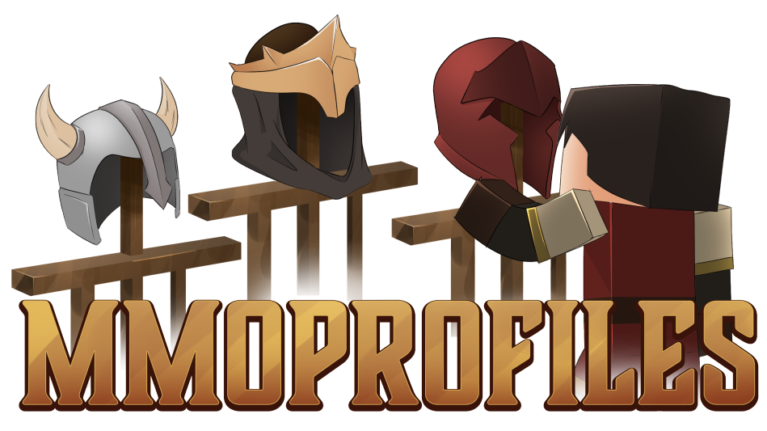

# 首页 {#🏠-home}

MMOProfiles 可让玩家拥有多个角色栏位或用户档案，各自保留独立进度。它支持玩家资源值、物品栏、位置、床的重生点、权限和末影箱等数据。

通过支持多档案数据存储，它可以与 MMOCore、MMOInventory、MMOItems 等插件配合使用。

> **提示**
>
> 在 [Polymart](https://polymart.org/product/4121/mmoprofiles)或 [SpigotMC](https://www.spigotmc.org/resources/mmoprofiles.109942/)] 上获取MMOProfiles

有疑问时，可以加入 [Discord](https://phoenixdevt.fr/discord)，向工作人员或社区求助。Wiki 会尽量保持更新；发现错字或过时内容时，也欢迎反馈。

当你准备好安装MMOProfiles时，导航到下一页！

---

原文：[🏠 Home](https://docs.phoenixdevt.fr/mmoprofiles/) · 原文归档：2026-10-19
