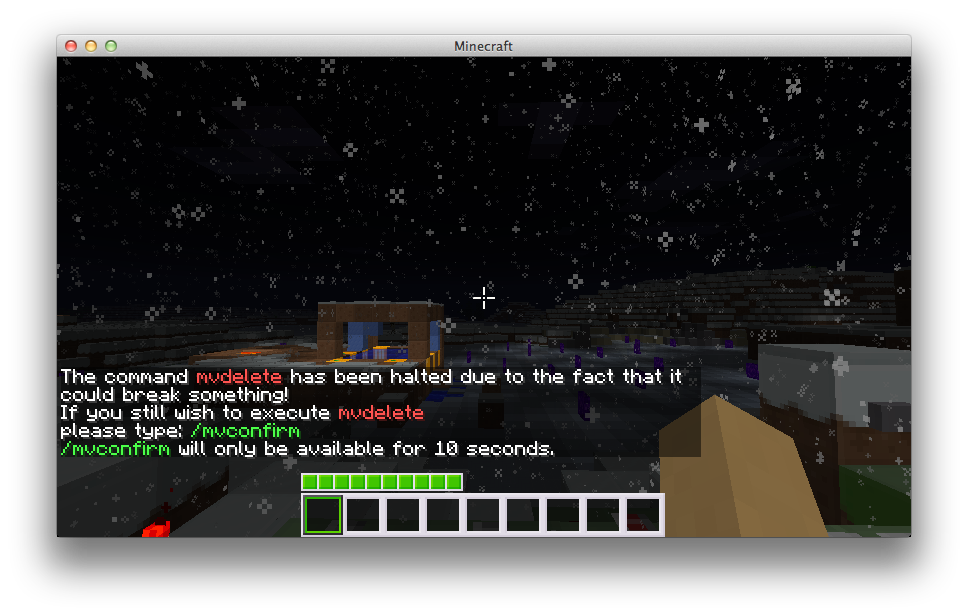
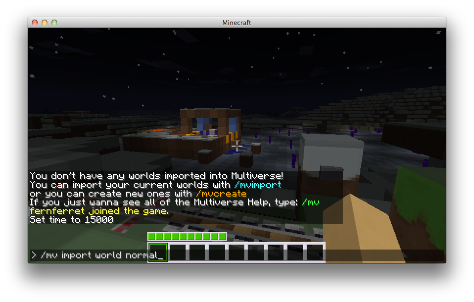
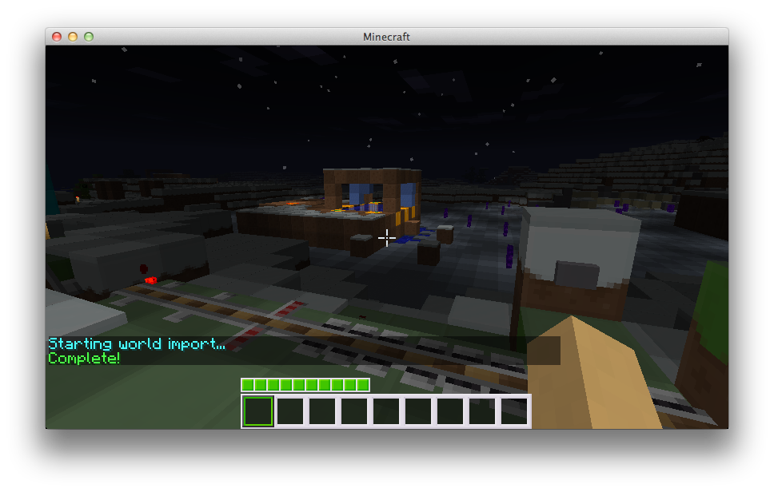

# 基础用法

<h2 id="_1">介绍</h2>

<strong>Multiverse-Core</strong> 提供世界创建功能，还可以控制生物生成、环境类型、使用自定义地形生成器等。请注意，<strong>Multiverse-Core 本身并不生成世界</strong>，而是调用 Bukkit API 创建世界。如果服务器上有其他创建世界的插件，可能发生冲突。Inception 就是一个已知例子：部分服务器能同时正常使用它和 Multiverse-Core，另一些则会遇到严重冲突。另外，世界最终仍由 Bukkit 控制；Multiverse 会尽力管理世界行为，但<strong>其他</strong>插件或 Bukkit 本身的特殊情况仍可能覆盖这些设置。Multiverse-Core 的开发者和测试人员为此提供了相应工具，帮助你快速解决这些问题。

<h2 id="_2">创建第一个世界</h2>

假设你想创建一个名为 <code>creative</code> 的世界。创建过程比较简单，命令如下：

<a href="core-fundamentals-commands-usage.md#Create-Command"><code>/mv create &lt;worldname&gt; &lt;environment&gt; --seed [seed] --generator [generatorname[:id]]</code></a>

暂时不用了解所有参数，只要记住：<strong><code>&lt;&gt;</code></strong> 内的参数为<strong>必填</strong>，<strong><code>[]</code></strong> 内的参数为<strong>可选</strong>。

本例只需执行：

<a href="core-fundamentals-commands-usage.md#Create-Command"><code>/mv create creative normal</code></a>

创建可能需要几秒钟，可以在服务器控制台查看进度。

这会创建一个名为 creative、环境类型为 <code>normal</code>（主世界）的世界。也可以指定种子，将环境改为 <code>nether</code> 或 <code>the_end</code>，或设置<a href="core-reference-custom-generator-plugins.md">生成器</a>来创建不同地形，例如 <code>-g BukkitFullOfMoon</code>。这些暂时留待后续了解。

执行命令后，世界就创建好了。

<h3 id="_3">传送到新世界</h3>

创建世界后，执行以下命令即可前往：

<pre>/mv tp creative
</pre>

现在你应该已进入新世界。如果想带上一位愿意被传送的朋友，执行：

<pre>/mv tp &lt;playername&gt; creative
</pre>

<h2 id="_4">设置新世界的出生点</h2>

如果新世界的 0, 0 位置不适合作为玩家传送或出生的位置，先步行、攀爬或挖掘到希望设置出生点的地点，然后输入：

<pre>/mv setspawn
</pre>

这样就设置好了。

<h2 id="_5">返回出生点</h2>

如果在世界中迷路，想返回出生点，执行：

<pre>/mv spawn
</pre>

这样就回到出生点了。

<h2 id="_6">修改参数</h2>

如果不希望苦力怕继续炸毁建筑，想关闭敌对生物生成，执行：

<pre>/mv entity-spawn-config modify monster set spawn false
</pre>

其他许多设置也可以修改，例如关闭动物生成和 PvP。

<h2 id="_7">清除怪物和其他实体</h2>

如果动物挡住了建筑，或有 OP 在施工地点生成了许多牛，可以执行以下命令将它们清除：

<pre>/mv purge-all-entities creative animal
</pre>

<h2 id="_8">删除世界</h2>

如果已经不再需要这个世界，可以执行以下命令将其彻底删除：

<pre>/mv delete creative
</pre>

随后有 30 秒时间输入确认命令：

_请记住：_一旦<strong>确认</strong>，世界就会被彻底删除，无法恢复。使用此命令时必须<strong>格外小心</strong>！

<pre>/mv confirm &lt;otp&gt;
</pre>
<h2 id="_9">导入现有世界</h2>

如果有来自其他服务器或从网上下载的世界，可以用以下命令将其导入 Multiverse：

<a href="core-fundamentals-commands-usage.md#Import-Command"><code>/mv import &lt;worldname&gt; &lt;environment&gt;</code></a>

将 <code>&lt;worldname&gt;</code> 替换为要导入的世界名称，<code>&lt;environment&gt;</code> 替换为<strong>环境类型</strong>。目前有 3 种：<code>normal</code>、<code>nether</code> 和 <code>the_end</code>。

“世界名称”的含义取决于服务器版本：

<ul>
<li><strong>Spigot / 较旧的 Paper</strong>：使用服务器根目录中显示的<strong>文件夹名称</strong>，例如 <code>my_world</code>。</li>
<li><strong>Paper 26.1+</strong>：世界位于 <code>&lt;level-name&gt;/dimensions/&lt;namespace&gt;/&lt;key&gt;/</code>。应传入<strong>命名空间键</strong>，例如 <code>minecraft:the_nether</code> 或 <code>myplugin:pvp_arena</code>，而不是文件夹名称。完整目录结构见<a href="core-how-to-customise-world-creation.md#Creating-worlds-with-a-namespaced-key">使用命名空间键创建世界</a>。</li>
</ul>

导入成功后，会显示如下结果：

其他世界也可以按同样的步骤导入。如果不喜欢世界的名称，<strong>不要重命名文件夹</strong>，请改用<a href="core-fundamentals-world-properties.md#Alias">Multiverse 世界别名</a>！

服务器版本

要导入的世界必须由与服务器相同的 Minecraft 版本生成。

<h2 id="_10">首次出生位置</h2>

Multiverse 可以指定玩家首次进入服务器时出生的世界。它_不必_是 <code>server.properties</code> 中设置的世界。请在 <a href="core-reference-configuration-file.md"><code>config.yml</code></a> 中设置以下 2 项，也可以在游戏中执行 <code>/mv config first-spawn-override true</code> 和 <code>/mv config first-spawn-location myworld</code>。不建议直接编辑文件，下面仅展示配置片段：

<pre>spawn:
  # Sets whether Multiverse will override the first spawn location of a world.
  # If enabled, Multiverse will set the first spawn location of a world to the spawn location of the world.
  # If disabled, it will default to server.properties settings.
  first-spawn-override: true

  # Sets the world that Multiverse will use as the location for players that first join the server.
  # This only applies if first-spawn-override is set to true.
  first-spawn-location: ""
</pre>

<h2 id="_11">登录目的地</h2>

Multiverse 可以指定玩家每次登录时出生的<a href="core-reference-destinations.md">目的地</a>，适合大厅世界等场景。要启用此功能，请在 <a href="core-reference-configuration-file.md"><code>config.yml</code></a> 中设置以下 2 项，也可以在游戏中执行 <code>/mv config enable-join-destination true</code> 和 <code>/mv config join-destination mydestination</code>。不建议直接编辑文件，下面仅展示配置片段：

<pre>spawn:
  # Enables join-destination below.
  enable-join-destination: false

  # Sets the destination that Multiverse will use to spawn players on every login
  # Set the above enable-join-destination to false to disable
  join-destination: ""
</pre>

<h2 id="_12">结语</h2>

基础操作就介绍到这里。需要了解更高级的用法时，可以在游戏中查看 <code>/mv</code> 命令以及<a href="core-fundamentals-commands-usage.md">命令参考</a>。

为便于理解，本教程使用了最完整的命令名称。输入 <code>/mv help</code> 可以查看游戏内帮助。另外，约 90% 的 Multiverse 命令<strong>可以</strong>在控制台使用；只有在控制台执行没有意义的命令不受支持，例如 <code>/mv setspawn</code>。

