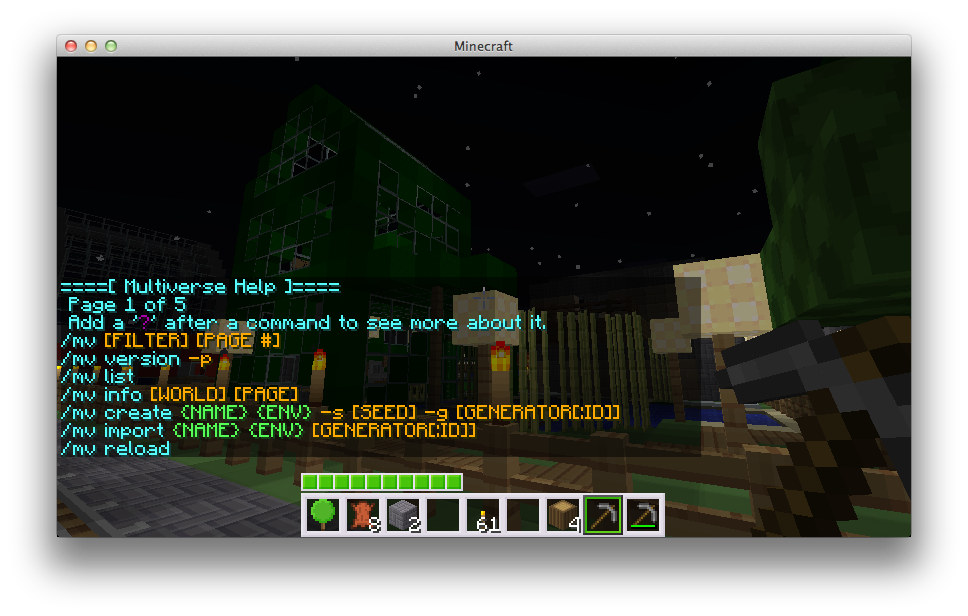
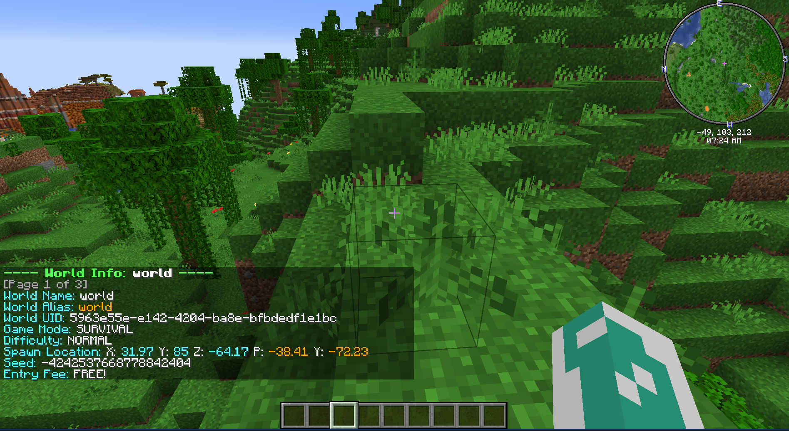
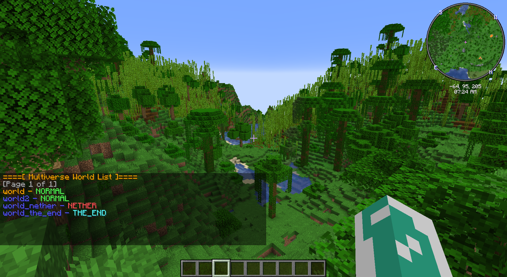
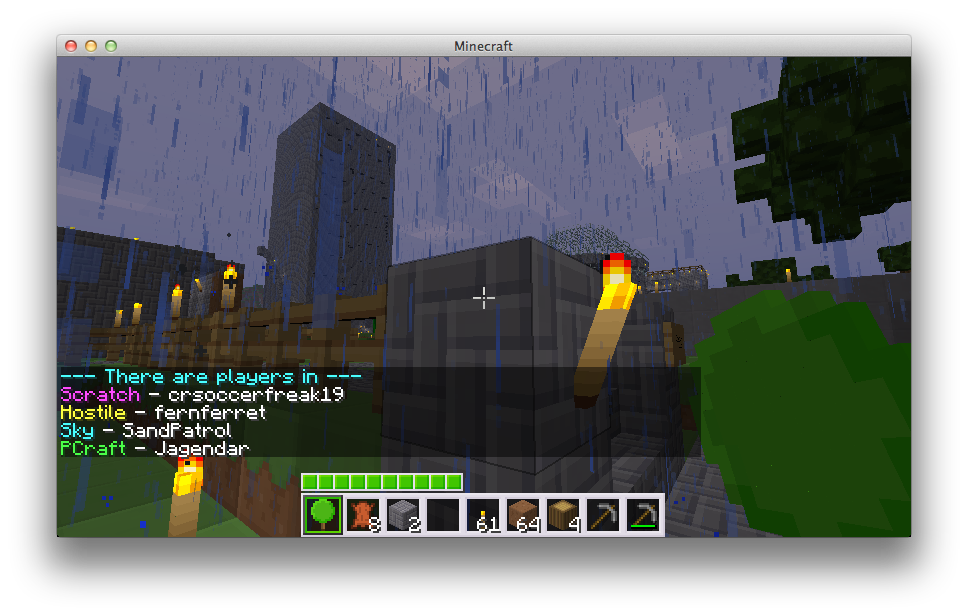

# 命令用法

如果您正在寻找 <a href="https://mvplugins.org/portals/fundamentals/commands-usage">Multiverse-Portals</a>、<a href="https://mvplugins.org/netherportals/fundamentals/commands-usage">Multiverse-NetherPortals</a> 或 <a href="https://mvplugins.org/inventories/fundamentals/commands-usage">Multiverse-Inventories</a> 命令参考，请点击链接！

<strong>正在寻找权限？</strong> 
<a href="core-reference-permissions-list.md">点击此处进入权限大列表！</a>

<h2 id="index">索引</h2>

<a href="#Introduction">介绍</a>

<ul>
<li><a href="#Anchor-Set-Command">锚点设置命令</a></li>
<li><a href="#Anchor-List-Command">锚点列表命令</a></li>
<li><a href="#Anchor-Delete-Command">锚点删除命令</a></li>
<li><a href="#Check-Command">检查命令</a></li>
<li><a href="#Clone-Command">克隆命令</a></li>
<li><a href="#Config-Command">配置命令</a></li>
<li><a href="#Confirm-Command">确认命令</a></li>
<li><a href="#Coordinate-Command">坐标命令</a></li>
<li><a href="#Create-Command">创建命令</a></li>
<li><a href="#Debug-Command">调试命令</a></li>
<li><a href="#Delete-Command">删除命令</a></li>
<li><a href="#Dumps-Command">转储命令</a></li>
<li><a href="#Entity-Spawn-Config-Info-Command">实体生成配置信息命令</a></li>
<li><a href="#Entity-Spawn-Config-Modify-Command">实体生成配置修改命令</a></li>
<li><a href="#Gamerule-List-Command">游戏规则列表命令</a></li>
<li><a href="#Gamerule-Set-Command">游戏规则设置命令</a></li>
<li><a href="#Gamerule-Reset-Command">游戏规则重置命令</a></li>
<li><a href="#Generators-Command">生成器命令</a></li>
<li><a href="#Help-Command">帮助命令</a></li>
<li><a href="#Import-Command">导入命令</a></li>
<li><a href="#Info-Command">信息命令</a></li>
<li><a href="#List-Command">列表命令</a></li>
<li><a href="#Load-Command">加载命令</a></li>
<li><a href="#Meta-Info-Command">元信息命令</a></li>
<li><a href="#Meta-Modify-Command">元修改命令</a></li>
<li><a href="#Modify-Command">修改命令</a></li>
<li><a href="#Modify-Command-(Set)">套装</a></li>
<li><a href="#Modify-Command-(Add/Remove)">添加</a></li>
<li><a href="#Modify-Command-(Add/Remove)">删除</a></li>
<li><a href="#Modify-Command-(Reset)">重置</a></li>
<li><a href="#Purge-Entities-Command">清除实体命令</a></li>
<li><a href="#Purge-All-Entities-Command">清除所有实体命令</a></li>
<li><a href="#Regen-Command">重新生成命令</a></li>
<li><a href="#Reload-Command">重新加载命令</a></li>
<li><a href="#Remove-Command">删除命令</a></li>
<li><a href="#Set-Spawn-Command">设置生成命令</a></li>
<li><a href="#Spawn-Command">生成命令</a></li>
<li><a href="#Teleport-Command">传送命令</a></li>
<li><a href="#Unload-Command">卸载命令</a></li>
<li><a href="#Who-Command">谁指挥</a></li>
<li><a href="#Who-All-Command">谁全部指挥</a></li>
<li><a href="#Version-Command">版本命令</a></li>
<li><a href="#World-Border-Add-Command">世界边界添加命令</a></li>
<li><a href="#World-Border-Center-Command">世界边境中心司令部</a></li>
<li><a href="#World-Border-Damage-Command">世界边境损害司令部</a></li>
<li><a href="#World-Border-Get-Command">世界边界获取命令</a></li>
<li><a href="#World-Border-Set-Command">世界边界设置命令</a></li>
<li><a href="#World-Border-Warning-Command">世界边境警告司令部</a></li>
</ul>

<a href="#top">↑ 返回顶部 ↑</a>

<h2 id="introduction">介绍</h2>

在Multiverse中，我们添加了一个方便的新游戏内帮助系统。要访问此帮助，只需键入 <code>/mv</code>。为了正确阅读此命令参考，我们将逐步阅读命令的 "usage"。

<h3 id="command-case">命令箱</h3>

每当阅读此 wiki 或游戏中的 <a href="#Help-Command"><code>/mv</code></a> 帮助时，您应该记住 <strong>ALL 帽</strong> 中的项目应替换为变量。小写项目的输入方式应与它们的显示方式完全一致。

<h3 id="optional-vs-required-params">可选参数与必需参数</h3>

方括号 (<code>[]</code>) 内的项目是 <strong>可选</strong>，其中 (<code>&lt;&gt;</code>) 内的项目是 <strong>必填</strong>

<h3 id="simple-command-example">简单命令示例</h3>

我们看一个简单的first:

<a href="#Info-Command"><code>/mv info [world]</code></a>

这意味着该命令有一个可选参数，即您可以键入 <a href="#Info-Command"><code>/mv info</code></a> <strong>或</strong> <a href="#Info-Command"><code>/mv info world</code></a>。显然，无论有没有参数，该命令都会执行不同的操作。您可以通过阅读此 wiki 来了解这些影响是什么。

<h3 id="complex-command-example">复杂命令示例</h3>

我们来看最复杂的例子： 
<em>注意：这是MV2中最复杂的命令，为了正确使用它，请参考 <a href="#Create-Command">创建命令</a>.</em>

<a href="#Create-Command"><code>/mv create &lt;name&gt; &lt;environment&gt; [--seed &lt;seed&gt; --generator &lt;generator[:id]&gt; --world-type &lt;worldtype&gt; --adjust-spawn --no-structures --biome &lt;biome&gt; --generator-settings &lt;json&gt;]</code></a>

首先，您会注意到有 2 个必需参数：<strong>姓名</strong> 和 <strong>环境</strong>。然后你就会看到旗帜。如果要使用 <a href="core-fundamentals-world-properties.md#Seed">种子</a>，则必须将 <code>--seed gargamel</code> 添加到命令字符串。如果您想要 <a href="core-fundamentals-world-properties.md#Generators">生成器</a>，则同样的原则适用：<code>--generator BukkitFullOfMoon</code>。标志的顺序 <em>不</em> 很重要。该命令的完整示例位于 <a href="#Create-Command">创建命令参考</a>。

<h3 id="flags">旗帜</h3>

Multiverse 中的许多命令都使用标志，这些标志可以是一两个破折号。两个破折号标志是整个单词（e.g：<code>--filter</code>），一个破折号标志是同一事物的简写版本（e.g：<code>-f</code>）。

有两个标志您会经常遇到：<code>--filter</code> 和 <code>--page</code>。它们分别用于过滤和选择分页命令的页面。仅供参考，从控制台运行时分页不适用。

<a href="#top">↑ 返回顶部 ↑</a>

<h2 id="anchor-set-command">锚点设置命令</h2>
<h3 id="description">描述</h3>

如果您有一个想要经常去的地方，则应该使用锚点。首先使用 <code>/mv anchor set &lt;name&gt;</code> 命令创建锚点，然后可以在任何采用目的地的命令中使用它。

<h3 id="usage">用途</h3>

<pre>/mv anchor set &lt;name&gt; [location]
</pre>

<ul>
<li><code>&lt;name&gt;</code>：锚点的名称。如果锚点已经存在，它的位置将被覆盖。</li>
<li><code>[location]</code>：锚点的位置。如果从控制台运行，则必须指定。</li>
</ul>
<h3 id="examples">示例</h3>
<ul>
<li><code>/mv anchor set myanchor</code> - 在您当前位置创建名为 <code>myanchor</code> 的锚点。</li>
<li><code>/mv anchor set coolanchor cool:1,2,3:10:12</code> - 在位置世界 <code>cool</code> 处创建名为 <code>coolanchor</code> 的锚点，x：1，y：2，z：3，俯仰：10，偏航：12。</li>
</ul>
<h3 id="permission">权限</h3>

<code>multiverse.core.anchor.create</code> 

锚点<code>/mvtp a:&lt;anchorname&gt;</code>的传送权限参见<a href="core-reference-destinations.md#Anchor-Destinations">锚点目的地</a>。

<a href="#top">↑ 返回顶部 ↑</a>

<h2 id="anchor-list-command">锚点列表命令</h2>
<h3 id="description_1">描述</h3>

列出所有锚点及其对应位置。

<h3 id="usage_1">用途</h3>

<pre>/mv anchor list [--page &lt;page&gt; --filter &lt;filter&gt;]
</pre>

<ul>
<li><code>--page &lt;page&gt;</code>：要显示的列表页面。默认为 1。</li>
<li><code>--filter &lt;filter&gt;</code>：应用于列表的过滤器。</li>
</ul>
<h3 id="permission_1">权限</h3>

<code>multiverse.core.anchor.list</code>

<a href="#top">↑ 返回顶部 ↑</a>

<h2 id="anchor-delete-command">锚点删除命令</h2>
<h3 id="description_2">描述</h3>

删除现有锚点。请注意，无法撤消此操作。

<h3 id="usage_2">用途</h3>

<pre>/mv anchor delete &lt;anchorname&gt;
</pre>

<ul>
<li><code>&lt;anchorname&gt;</code>：要删除的锚点的名称。如果锚点不存在，命令将失败。</li>
</ul>
<h3 id="examples_1">示例</h3>
<ul>
<li><code>/mv anchor delete coolanchor</code> - 删除名为 <code>coolanchor</code> 的锚点。</li>
</ul>
<h3 id="permission_2">权限</h3>

<code>multiverse.core.anchor.delete</code>

<a href="#top">↑ 返回顶部 ↑</a>

<h2 id="check-command">检查命令</h2>
<h3 id="description_3">描述</h3>

检查是否允许玩家传送到某个目的地。

<h3 id="usage_3">用途</h3>

<pre>/mv check &lt;destination&gt;
</pre>

<ul>
<li><code>&lt;destination&gt;</code>：要检查的目的地。</li>
</ul>
<h3 id="examples_2">示例</h3>
<ul>
<li><code>/mv check cool:1,2,3:10:12</code> - 检查是否允许玩家传送到位置世界 <code>cool</code>，x：1，y：2，z：3，俯仰：10，偏航：12。</li>
</ul>
<h3 id="permission_3">权限</h3>

<code>multiverse.core.check</code>

<a href="#top">↑ 返回顶部 ↑</a>

<h2 id="clone-command">克隆命令</h2>
<h3 id="description_4">描述</h3>

将世界目录及其所有配置复制到另一个目录。允许您将您的世界复制到另一个目录进行备份，或者出于任何您想要的原因简单地拥有两个世界。

<h3 id="usage_4">用途</h3>

<pre>/mv clone &lt;world&gt; &lt;new-world-name&gt; [--reset-world-config] [--reset-gamerules] [--reset-world-border]
</pre>

<ul>
<li><code>&lt;world&gt;</code>：要克隆的世界。它一定是一个现存的多元宇宙世界。</li>
<li><code>&lt;new-world-name&gt;</code>：新世界的名字</li>
<li><code>--reset-world-config</code>：重置与新世界相关的所有<a href="core-fundamentals-world-properties.md">世界地产</a></li>
<li><code>--reset-gamerules</code>：新世界中的所有游戏规则都将采用默认值</li>
<li><code>--reset-world-border</code>：新世界中世界边界将消失</li>
</ul>
<h3 id="examples_3">示例</h3>
<ul>
<li><code>/mv clone world world_backup</code> - 将世界 <code>world</code> 复制到 <code>world_backup</code></li>
<li><code>/mv clone myworld_nether myworld_nether_backup</code> - 将世界 <code>myworld_nether</code> 复制到 <code>myworld_nether_backup</code></li>
<li><code>/mv clone my_cloned_world my_cloned_world_now_cloned --reset_gamerules --reset_world_border --reset_world_config</code> - 将世界 <code>my_cloned_world</code> 复制到 <code>my_cloned_world_now_cloned</code> 并重置 <code>worlds.yml</code> 中的所有内容、游戏规则和世界边界</li>
</ul>
<h3 id="permission_4">权限</h3>

<code>multiverse.core.clone</code>

<a href="#top">↑ 返回顶部 ↑</a>

<h2 id="config-command">配置命令</h2>
<h3 id="description_5">描述</h3>

更改 <code>config.yml</code> 属性。请参阅 <a href="core-reference-configuration-file.md">配置文档</a> 了解更多信息。

<h3 id="usage_5">用途</h3>

<pre>/mv config &lt;property&gt; &lt;value&gt;
</pre>

<ul>
<li><code>&lt;property&gt;</code>：要更改的属性。</li>
<li><code>&lt;value&gt;</code>：要设置属性的值。</li>
</ul>
<h3 id="examples_4">示例</h3>
<ul>
<li><code>/mv config confirm-mode disable_command_blocks</code> - 将 <code>config.yml</code> 中的 <code>confirm-mode</code> 更改为 <code>disable_command_blocks</code></li>
</ul>
<h3 id="permission_5">权限</h3>

<code>multiverse.core.config</code>

<a href="#top">↑ 返回顶部 ↑</a>

<h2 id="confirm-command">确认命令</h2>
<h3 id="description_6">描述</h3>

确认一个可能毁灭生命、宇宙和一切的行为。该命令将确认请求的操作。有关使用示例，请参阅 <a href="#Delete-Command"><code>/mv delete</code></a> 命令。如果您启动服务器并输入 <code>/mv confirm</code>，则不会发生任何事情。

另请参阅：<a href="#Delete-Command">删除命令</a>

<h3 id="usage_6">用途</h3>

<pre>/mv confirm [otp]
</pre>

<ul>
<li><code>[otp]</code>：要确认的 OTP。根据 <code>config.yml</code> 中设置的 <code>confirm-mode</code>，这可能不需要。</li>
</ul>
<h3 id="examples_5">示例</h3>
<ul>
<li><code>/mv confirm 431</code> - 使用 OTP <code>431</code> 确认操作</li>
</ul>
<h3 id="permission_6">权限</h3>

<code>multiverse.core.confirm</code>

<a href="#top">↑ 返回顶部 ↑</a>

<h2 id="coordinate-command">坐标命令</h2>
<h3 id="description_7">描述</h3>

显示您或其他玩家的当前位置信息。显示大致位置 info:

<ul>
<li>世界</li>
<li><a href="core-fundamentals-world-properties.md#Alias">世界别名</a></li>
<li><a href="core-fundamentals-world-properties.md#Scale">世界规模</a></li>
<li>坐标</li>
<li>面向方向</li>
</ul>
<h3 id="usage_7">用途</h3>

<pre>/mv coordinates [player]
</pre>

<ul>
<li><code>[player]</code>：要获取位置的玩家。如果从控制台运行，则必须指定。</li>
</ul>
<h3 id="examples_6">示例</h3>
<ul>
<li><code>/mv coordinates benthecat10</code> - 显示玩家<code>benthecat10</code>的坐标</li>
</ul>
<h3 id="permission_7">权限</h3>

<code>multiverse.core.coord</code>

<a href="#top">↑ 返回顶部 ↑</a>

<h2 id="create-command">创建命令</h2>
<h3 id="description_8">描述</h3>

create 命令允许您向服务器添加新世界。每个世界都有许多可以编辑和调整的属性。有关每个设置的信息，请参阅 <a href="core-fundamentals-world-properties.md">世界地产</a> 页面。此外，您可以使用 <a href="#Modify-Command"><code>/mv modify</code></a> 命令修改世界 <strong>在游戏中</strong>。请参阅下面 <a href="core-fundamentals-world-properties.md#Seed">种子</a> 或 <a href="core-fundamentals-world-properties.md#generators">定制生成器</a> 的相应部分。

<h3 id="usage_8">用途</h3>

<pre>/mv create &lt;name&gt; &lt;environment&gt; [--seed &lt;seed&gt;] [--generator &lt;generator[:id]&gt;] [--world-type &lt;worldtype&gt;] [--no-adjust-spawn] [--no-structures] [--generate-bonus-chest] [--force-spawn-position &lt;x,y,z[:pitch:yaw]&gt;] [--biome &lt;biome&gt;] [--generator-settings &lt;json&gt;] [--properties &lt;prop1=value1,prop2=value2...&gt;]
</pre>

<ul>
<li><code>&lt;name&gt;</code>：新世界的名字。你还可以传递一个<a href="core-how-to-customise-world-creation.md#Creating-worlds-with-a-namespaced-key">命名空间键</a>（e.g.<code>myplugin:myworld</code>）来给世界一个稳定的标识符。</li>
<li><code>&lt;environment&gt;</code>：新世界的环境。必须是 <code>normal</code>、<code>nether</code> 或 <code>the_end</code> 之一。</li>
<li><code>--seed &lt;seed&gt;</code>：给予生成器的世界种子</li>
<li><code>--generator &lt;generator[:id]&gt;</code>：使用的<a href="core-reference-custom-generator-plugins.md">定制生成器</a></li>
<li><code>--world-type &lt;worldtype&gt;</code>：新世界的类型，可以是以下之一。</li>
<li><a href="https://minecraft.wiki/w/Amplified">放大的</a></li>
<li><a href="https://minecraft.wiki/w/Superflat">平坦</a></li>
<li><a href="https://minecraft.wiki/w/Large_Biomes">大生物群系</a></li>
<li>正常</li>
<li><code>--no-adjust-spawn</code>：设置 <a href="core-fundamentals-world-properties.md#Adjust-Spawn">调整生成</a> 世界属性</li>
<li><code>--no-structures</code>：设置此标志以禁用结构生成</li>
<li><code>--generate-bonus-chest</code> / <code>-c</code>：在创建时在世界生成时生成奖励箱。如果稍后重新生成世界，则会保留此设置。需要 PaperMC 1.21.5+；对 Spigot 或更旧的 Paper 版本没有影响。</li>
<li><code>--force-spawn-position &lt;x,y,z[:pitch:yaw]&gt;</code> / <code>-f</code>：强制世界生成到特定位置，而不是让 Minecraft 选择一个。俯仰和偏航可选，默认为 <code>0</code>。需要 PaperMC 26.1+；对旧服务器没有影响。</li>
<li><code>--biome &lt;biomeprovider[:id]&gt;</code>：为世界设定生物群系提供者。</li>
<li><code>--generator-settings &lt;json&gt;</code>：设置世界的生成器设置。仅适用于超平坦世界。有关格式的详细信息，请参阅 <a href="https://jd.papermc.io/paper/1.21.5/org/bukkit/WorldCreator.html#generatorSettings(java.lang.String)">PaperMC 文档</a>。</li>
<li><code>--properties &lt;prop1=value1,prop2=value2...&gt;</code>：在世界创建中自定义多个<a href="core-fundamentals-world-properties.md">世界地产</a>。示例：<code>--properties pvp=false,portal-form=none</code></li>
</ul>
<h3 id="world-name-and-environment">世界名称与环境</h3>

当你要创建一个新世界时，你必须指定一个名称和环境。您的世界名称 <strong>CANNOT</strong> 在世界名称中包含空格，请使用 <a href="core-fundamentals-world-properties.md#Alias">别名功能</a>。

您还可以传递 <strong>命名空间键</strong> (e.g.<code>myplugin:myworld</code>) 作为名称。任何包含 <code>:</code> 的名称都被视为命名空间键，并为世界提供与其文件夹名称分开的持久唯一标识符。 Paper 26.1+ 和 Spigot/旧版 Paper 之间的世界文件夹存储位置有所不同 - 有关详细信息，请参阅 <a href="core-how-to-customise-world-creation.md#Creating-worlds-with-a-namespaced-key">使用命名空间键创建世界</a>。

<h3 id="seeds">种子</h3>

您可以通过在 2 个必需参数后添加 <code>--seed SEEDNAME</code> 来创建具有自定义种子的世界。以下示例创建了著名的 <code>gargamel</code> 世界并将其命名为 <code>mountain_world</code>：

<code>/mv create mountain_world normal --seed gargamel</code>

<h3 id="world-types">世界类型</h3>

世界类型就像生成器，但被烘焙到 Minecraft 本身中！目前只有<a href="https://minecraft.wiki/w/Amplified">放大的</a>、<a href="https://minecraft.wiki/w/Superflat">平坦</a>、<a href="https://minecraft.wiki/w/Large_Biomes">大生物群系</a>和普通世界类型。要使用世界类型，只需使用 <code>--world-type</code> 标志，以下是 <a href="https://minecraft.wiki/w/Superflat">平坦</a> 世界的示例。这些仅对 <code>normal</code> 环境世界有效。
<code>/mv create flat_world normal --world-type flat</code>

<h3 id="biome">生物群系</h3>

Multiverse 内置了对单一生物群系的支持，类似于 <a href="https://minecraft.wiki/w/Single_biome">原版</a> 中的选项。旗帜为<code>--biome @single:&lt;biome&gt;</code>。有关可用生物群系的完整列表，请参阅 <a href="https://jd.papermc.io/paper/1.21.1/org/bukkit/block/Biome.html">生物群系列表</a>。

<h3 id="generators">生成器</h3>

Multiverse 支持自定义生成器。这意味着什么？我们支持任何使用 Bukkit 自定义生成器功能的插件。如果作者实现了自己的样式，但不使用自定义生成器方法 <a href="http://forums.bukkit.org/threads/22795/">此处描述</a>，则它可能无法与 MV 一起使用。我们将尽力保持 <a href="core-reference-custom-generator-plugins.md">自定义生成器插件</a> 页面的更新。

找到要使用的插件后，将该插件的 jar 复制到您的插件文件夹中。然后剩下要做的就是输入一个命令： 
（对于这个例子，我决定使用 <a href="https://github.com/Dinnerbone/BukkitFullOfMoon">BukkitFullOfMoon</a>，它将生成一个由 @Dinnerbone 制作的坑坑洼洼的月球世界）。

<code>/mv create moon normal --generator BukkitFullOfMoon</code>

上面的<code>BukkitFullOfMoon</code>是插件名称。该插件只有一个生成器，并且定义正确，因此不需要 <code>:GENID</code>。有些插件可能包含多个生成器，在这种情况下，您可以输入以下内容：（下一个是我完全编写的......）

<code>/mv create land_lake normal --generator WaterWorlds:Lakes</code>

或

<code>/mv create hell_lake normal --generator WaterWorlds:LavaLakes</code>

<h3 id="a-note-about-spaces-in-world-names">关于世界名称中空格的注释</h3>

您应该知道，如果您决定在世界名称中使用空格，那么每当人们想要使用 <a href="#Teleport-Command"><code>/mv tp</code></a>、<a href="#Modify-Command"><code>/mv modify</code></a> 或任何将世界名称作为参数的命令时，他们都必须将名称括在引号中，如下所示

<code>/mv tp "My world name with spaces"</code>

<code>/mv tp My world name with spaces</code> 将不起作用。

<h3 id="examples_7">示例</h3>
<ul>
<li><code>/mv create my_world normal</code> </li>
<li><code>/mv create my_hell nether</code> </li>
<li><code>/mv create my_cloud_world --generator SkyLandsPlus normal</code> </li>
<li><code>/mv create flat_world normal --world-type flat</code> </li>
<li><code>/mv create My-Seed-World normal --seed gargamel</code></li>
<li><code>/mv create moon normal --generator BukkitFullOfMoon</code> </li>
<li><code>/mv create custom-world-with-a-generator-and-an-ID normal --generator BukkitFullOfMoon:Dinnerbone</code> </li>
<li><code>/mv create custom-generator-world-with-seed normal --generator BukkitFullOfMoon:Dinnerbone -s gargamel</code></li>
<li><code>/mv create example normal --generator "BananaGen:hilly,tscale=35.0,terrainheight=15.0,notorches"</code></li>
<li><code>/mv create adventure_world normal --properties gamemode=adventure,portal-form=none</code></li>
<li><code>/mv create survival normal --generate-bonus-chest</code> — 在生成时创建一个带有奖励宝箱的世界</li>
<li><code>/mv create my_world normal --force-spawn-position 0,64,0</code> — 强制生成 X=0 Y=64 Z=0</li>
<li><code>/mv create myplugin:pvp_arena normal</code> — 使用命名空间键 <code>myplugin:pvp_arena</code> 创建一个世界</li>
</ul>
<h3 id="permission_8">权限</h3>

<code>multiverse.core.create</code>

<a href="#top">↑ 返回顶部 ↑</a>

<h2 id="debug-command">调试命令</h2>
<h3 id="description_9">描述</h3>

提供有关插件在控制台中执行的操作的详细信息。对于权限问题或目的地问题很有帮助。

0 - 关闭 
1 - Fine 
2 - 更细 
3 - 最好（所有细节）

<h3 id="usage_9">用途</h3>

<pre>/mv debug [level]
</pre>

<ul>
<li><code>[level]</code> - 0、1、2 或 3</li>
</ul>
<h3 id="examples_8">示例</h3>
<ul>
<li><code>/mv debug</code> - 获取当前调试级别</li>
<li><code>/mv debug 0</code> - 关闭调试模式</li>
<li><code>/mv debug 3</code> - 将调试模式打开到级别 3</li>
</ul>
<h3 id="permission_9">权限</h3>

<code>multiverse.core.debug</code>

<a href="#top">↑ 返回顶部 ↑</a>

<h2 id="delete-command">删除命令</h2>
<h3 id="description_10">描述</h3>

从 Bukkit 服务器卸载世界，将其从 MV configs <strong>和</strong> <em>DELETES</em> 世界文件夹中删除。该命令将破坏生命、宇宙以及与您作为参数传递的世界相关的一切。因此，该命令需要 <a href="#Confirm-Command"><code>/mv confirm</code></a>。

您现在有 30 秒的时间输入正确的 OTP <a href="#Confirm-Command"><code>/mv confirm [otp]</code></a>，否则世界将被删除 <strong>不</strong>。

<h3 id="usage_10">用途</h3>

<pre>/mv delete &lt;world&gt; [--remove-players [destination]]
</pre>

<ul>
<li><code>--remove-players [destination]</code> / <code>-r</code> - 在删除之前从世界中删除玩家。如果未指定此标志并且玩家仍在世界中，则命令将出错。您可以选择提供 <a href="core-reference-destinations.md">目的地</a> 来将玩家发送到而不是默认世界（e.g、<code>--remove-players lobby</code> 或 <code>--remove-players e:hub:0,64,0</code>）。</li>
</ul>
<h3 id="examples_9">示例</h3>
<ul>
<li><code>/mv delete myworld</code> - 删除世界 <code>myworld</code></li>
<li><code>/mv delete myworld --remove-players</code> - 删除 <code>myworld</code> 并将玩家发送到默认世界</li>
<li><code>/mv delete myworld --remove-players lobby</code> - 删除<code>myworld</code>并将玩家发送到世界<code>lobby</code></li>
</ul>
<h3 id="permission_10">权限</h3>

<code>multiverse.core.delete</code>

<a href="#top">↑ 返回顶部 ↑</a>

<h2 id="dumps-command">转储命令</h2>
<h3 id="description_11">描述</h3>

将服务器日志和配置文件输出到粘贴服务以方便共享。这个主要是用来支撑的。请发送您的支持票中生成的链接。

<h3 id="usage_11">用途</h3>

<pre>/mv dumps [--logs &lt;mclogs | append&gt;] [--upload &lt;pastesdev | pastegg&gt;] [--paranoid]
</pre>

<ul>
<li><code>--logs</code> - 用于转储完整服务器日志的粘贴服务。默认值为 <code>mclogs</code>。</li>
<li><code>--upload</code> - 用于配置的粘贴服务。默认为 <code>pastesdev</code>。</li>
<li><code>--paranoid</code> - 不上传完整服务器日志</li>
</ul>
<h3 id="permission_11">权限</h3>

<code>multiverse.core.dumps</code>

<a href="#top">↑ 返回顶部 ↑</a>

<h2 id="entity-spawn-config-info-command">实体生成配置信息命令</h2>
<h3 id="description_12">描述</h3>

列出特定世界的实体生成配置。这使用 SpawnCategory。

category: 的类型
- 怪物：eg: 女巫、僵尸、苦力怕等
- 动物：eg: 鸻、牛、乌龟等。
- WATER_ANIMAL：eg: 鱿鱼或海豚。
- WATER_AMBIENT：eg: 鳕鱼、河豚、热带鱼、鲑鱼等。
- WATER_UNDERGROUND_CREATURE：eg: 发光鱿鱼。
- 环境：eg: 蝙蝠。
- 蝾螈
- 其他：eg: 盔甲架、船等。

<h3 id="usage_12">用途</h3>

<pre>/mv entity-spawn-config info [world] [--page &lt;page&gt;] [--filter &lt;filter&gt;]
</pre>

<h3 id="examples_10">示例</h3>
<ul>
<li><code>/mv entity-spawn-config info myworld --page 2</code></li>
</ul>
<h3 id="permission_12">权限</h3>

<code>multiverse.core.entityspawnconfig.info</code>

<a href="#top">↑ 返回顶部 ↑</a>

<h2 id="entity-spawn-config-modify-command">实体生成配置修改命令</h2>
<h3 id="description_13">描述</h3>

修改特定世界的实体生成配置。当前属性 are:

<ul>
<li><code>spawn</code> - 布尔值：是否应该生成此类别的实体。</li>
<li><code>tick-rate</code> - 数字：尝试生成该类别的实体之间有多少个刻度。</li>
<li><code>spawn-limit</code> - 数字：该类别可以同时生成多少个实体。</li>
<li><code>exceptions</code> - 数组：不应生成此类别的实体类型列表。或者，如果 <code>spawn</code> 属性设置为 <code>false</code>，则应生成此类别的实体类型列表。</li>
</ul>

category:的类型

<ul>
<li>怪物：eg: 女巫、僵尸、苦力怕等</li>
<li>动物：eg: 黾、牛、乌龟等</li>
<li>WATER_ANIMAL：eg: 鱿鱼或海豚。</li>
<li>WATER_AMBIENT：eg: 鳕鱼、河豚、热带鱼、鲑鱼等。</li>
<li>WATER_UNDERGROUND_CREATURE：eg: 发光鱿鱼。</li>
<li>环境：eg: 蝙蝠。</li>
<li>蝾螈：eg: 蝾螈。</li>
<li>其他：eg: 盔甲架、船等</li>
</ul>
<h3 id="usage_13">用途</h3>

<pre>/mv entity-spawn-config modify [world] &lt;spawn-category&gt; &lt;set|add|reset|remove&gt; &lt;property&gt; [value]
</pre>

<h3 id="examples_11">示例</h3>
<ul>
<li><code>/mv entity-spawn-config modify myworld monster set spawn false</code> - 禁用怪物生成</li>
<li><code>/mv entity-spawn-config modify myworld animal set spawn-limit 10</code> - 将动物生成限制设置为 10</li>
<li><code>/mv entity-spawn-config modify myworld misc add exceptions armor_stand</code> - 将实体类型 <code>armor_stand</code> 添加到例外列表</li>
</ul>
<h3 id="permission_13">权限</h3>

<code>multiverse.core.entityspawnconfig.modify</code>

<a href="#top">↑ 返回顶部 ↑</a>

<h2 id="gamerule-list-command">游戏规则列表命令</h2>
<h3 id="description_14">描述</h3>

列出为特定世界配置的普通游戏规则值。有关每个游戏规则的作用的更多信息，请参阅 <a href="https://minecraft.wiki/w/Game_rule">https://minecraft.wiki/w/Game_rule</a>。

<h3 id="usage_14">用途</h3>

<pre>/mv gamerule list [world] [--page &lt;number&gt;] [--filter &lt;string&gt;]
</pre>

<ul>
<li><code>[world]</code> - 世界名称</li>
<li><code>--page</code> - 页码</li>
<li><code>--filter</code> - 过滤器字符串</li>
</ul>
<h3 id="examples_12">示例</h3>
<ul>
<li><code>/mv gamerule list</code> </li>
<li><code>/mv gamerule list world1 --page 2 --filter do</code></li>
</ul>
<h3 id="permission_14">权限</h3>

<code>multiverse.core.gamerule.list</code>

<a href="#top">↑ 返回顶部 ↑</a>

<h2 id="gamerule-set-command">游戏规则设置命令</h2>
<h3 id="description_15">描述</h3>

设定世界原版游戏规则值。要获取全球可用游戏规则的完整列表，请使用 <a href="#Gamerule-List-Command"><code>/mv gamerule list</code></a>。有关每个游戏规则的作用的更多信息，请参阅 <a href="https://minecraft.wiki/w/Game_rule">https://minecraft.wiki/w/Game_rule</a>。

<h3 id="usage_15">用途</h3>

<pre>/mv gamerule set &lt;gamerule&gt; &lt;value&gt; [world]
</pre>

<h3 id="examples_13">示例</h3>
<ul>
<li><code>/mv gamerule set doDaylightCycle false world1</code> - 将 world1 的 doDaylightCycle 游戏规则设置为 false</li>
</ul>
<h3 id="permission_15">权限</h3>

<code>multiverse.core.gamerule.set</code>

<a href="#top">↑ 返回顶部 ↑</a>

<h2 id="gamerule-reset-command">游戏规则重置命令</h2>
<h3 id="description_16">描述</h3>

将世界的原版游戏规则值重置为其默认值。有关每个游戏规则的作用的更多信息，请参阅 <a href="https://minecraft.wiki/w/Game_rule">https://minecraft.wiki/w/Game_rule</a>。

<h3 id="usage_16">用途</h3>

<pre>/mv gamerule reset &lt;gamerule&gt; [world]
</pre>

<h3 id="examples_14">示例</h3>
<ul>
<li><code>/mv gamerule reset doDaylightCycle world1</code> - 将 world1 的 doDaylightCycle 游戏规则重置为其默认值</li>
</ul>
<h3 id="permission_16">权限</h3>

<code>multiverse.core.gamerule.set</code>

<a href="#top">↑ 返回顶部 ↑</a>

<h2 id="generators-command">生成器命令</h2>
<h3 id="description_17">描述</h3>

显示已加载生成器的列表。

<h3 id="usage_17">用途</h3>

<pre>/mv generators [--page &lt;page&gt;] [--filter &lt;filter&gt;]
</pre>

<h3 id="permission_17">权限</h3>

<code>multiverse.core.generator</code>

<a href="#top">↑ 返回顶部 ↑</a>

<h2 id="help-command">帮助命令</h2>
<h3 id="description_18">描述</h3>

显示 Multiverse 的游戏内帮助菜单。这只会显示用户有权访问的命令。使用可选的整数参数来指示您要查看的页面。

帮助命令现在支持搜索！这意味着，如果您键入 <code>/mv help del</code>，您将看到 <code>name</code>、<code>description</code>、<code>alias(s)</code> 或 <code>usage</code> 包含 'del' 的所有命令的列表。这些结果可能会被分页，具体取决于您的搜索字符串的长度，因此要查看搜索的另一个页面，只需执行以下操作：<code>/mv help del 2</code>。

<strong>NOTE:</strong> 搜索时，如果您尝试：<code>/mv delete</code>，您将看到 <strong>删除命令</strong> 的语法。这是因为您的搜索击中了要害：您输入了命令的确切名称！

以下是给定 OP 状态时使用“帮助”命令的示例。此示例还安装了 <a href="https://mvplugins.org/portals/fundamentals/commands-usage">Multiverse-Portals</a> 和 <a href="https://mvplugins.org/netherportals/fundamentals/commands-usage">Multiverse-NetherPortals</a>，这就是为什么有 5 个页面。

<h3 id="usage_18">用途</h3>

<code>/mv help [command] [page]</code>

<h3 id="permission_18">权限</h3>

<code>multiverse.help</code>

<a href="#top">↑ 返回顶部 ↑</a>

<h2 id="import-command">导入命令</h2>
<h3 id="description_19">描述</h3>

导入命令与创建命令几乎相同，除了它用于导入已存在的世界文件夹这一事实之外。由于世界已经存在，因此您无法对其应用新的种子，但是当前您 <strong>必须</strong> 为导入的世界提供了正确的环境 <strong>和</strong> 生成器。如果你不这样做，你的世界就会发生不好的事情。

<h3 id="usage_19">用途</h3>

<pre>/mv import &lt;name&gt; &lt;environment&gt; [--generator &lt;generator[:id]&gt;] [--adjust-spawn] [--biome &lt;biome&gt;]
</pre>

<ul>
<li><code>&lt;name&gt;</code>：要导入的世界的名称。确保它与服务器文件上的文件夹名称匹配。</li>
<li><code>&lt;environment&gt;</code>：世界的环境。</li>
<li><code>--generator</code>：指定之前用于世界的生成器。</li>
<li><code>--no-adjust-spawn</code>：设置 <a href="core-fundamentals-world-properties.md#Adjust-Spawn">调整生成</a> 世界属性</li>
<li><code>--biome</code>：指定之前用于世界的生物群系提供者。</li>
<li><code>--skip-folder-check</code>：跳过检查以确保世界文件夹的格式正确。</li>
</ul>
<h3 id="examples_15">示例</h3>

<code>/mv import my_world normal</code> 
<code>/mv import my_hell nether</code> 
<code>/mv import my_cloud_world skylands</code> 
<code>/mv import moon normal --generator BukkitFullOfMoon</code>
<code>/mv import one_biome normal --biome @single:plains</code>

<h3 id="permission_19">权限</h3>

<code>multiverse.core.import</code>

<a href="#top">↑ 返回顶部 ↑</a>

<h2 id="info-command">信息命令</h2>
<h3 id="description_20">描述</h3>

显示有关您所在世界或您经过的世界的信息。如果需要，您可以指定要特别查看的世界。

该命令主要用于调试。无论是 Multiverse 的开发者还是您！

<h3 id="usage_20">用途</h3>

<pre>/mv info [world] [--page &lt;number&gt;] [--filter &lt;string&gt;]
</pre>

<h3 id="examples_16">示例</h3>
<ul>
<li><code>/mv info</code></li>
<li><code>/mv info world</code></li>
</ul>
<h3 id="permission_20">权限</h3>

<code>multiverse.core.info</code>

<a href="#top">↑ 返回顶部 ↑</a>

<h2 id="list-command">列表命令</h2>
<h3 id="description_21">描述</h3>

list 命令只会显示您有权进入的世界。例如，如果您在 <code>sky</code> 中被列入黑名单，但在 <code>world</code> 和 <code>world*nether</code> 中未被列入黑名单，则当您键入 <code>/mv list</code> 时，您将看到：

<pre>====[ Multiverse World List ]====
world - normal
world_nether - NETHER
</pre>

这让你拥有人们完全未知的世界。但请记住，如果您处于其他人无法查看的世界中，并且您在其中聊天，则您的聊天前缀将属于该世界。这是世界列表的示例。

注意事项

要获得彩色世界，您需要使用 <a href="core-fundamentals-world-properties.md#Alias">世界别名功能</a>。

<h3 id="usage_21">用途</h3>

<pre>/mv list [--raw --page &lt;number&gt; --filter &lt;string&gt;]
</pre>

<ul>
<li><code>--raw</code>/<code>-r</code> - 显示世界名称而不是别名</li>
<li><code>--page</code>/<code>-p</code> - 页码</li>
<li><code>--filter</code>/<code>-f</code> - 过滤器字符串</li>
</ul>
<h3 id="permission_21">权限</h3>

<code>multiverse.core.list.worlds</code>

<a href="#top">↑ 返回顶部 ↑</a>

<h2 id="load-command">加载命令</h2>
<h3 id="description_22">描述</h3>

将卸载的世界加载回服务器。这是 <a href="#Unload-Command"><code>/mv unload</code></a> 的对应产品。该世界必须已存在于 Multiverse 的 <code>worlds.yml</code> 中 — 使用 <a href="#Import-Command"><code>/mv import</code></a> 添加新世界。

<strong>参见 also:</strong> <a href="#Unload-Command"><code>/mv unload</code></a> 和 <a href="#Remove-Command"><code>/mv remove</code></a>

<h3 id="usage_22">用途</h3>

<pre>/mv load &lt;world&gt; [--skip-folder-check]
</pre>

<ul>
<li><code>&lt;world&gt;</code> - 加载的世界。</li>
<li><code>--skip-folder-check</code> / <code>-f</code> - 跳过验证磁盘上是否存在世界文件夹的检查。</li>
</ul>
<h3 id="examples_17">示例</h3>
<ul>
<li><code>/mv load my_world</code></li>
<li><code>/mv load my_world --skip-folder-check</code></li>
</ul>
<h3 id="permission_22">权限</h3>

<code>multiverse.core.load</code>

<a href="#top">↑ 返回顶部 ↑</a>

<h2 id="meta-info-command">元信息命令</h2>
<h3 id="description_23">描述</h3>

列出为世界存储的所有 <a href="core-how-to-world-meta.md">世界元</a> 键值对。世界元是任意字符串数据，您可以附加到任何世界以供其他插件或 PlaceholderAPI 使用。

<h3 id="usage_23">用途</h3>

<pre>/mv meta info [world] [--page &lt;page&gt;] [--filter &lt;filter&gt;]
</pre>

<ul>
<li><code>[world]</code>：要考察的世界。默认为您当前的游戏世界。从控制台需要。</li>
<li><code>--page &lt;page&gt;</code>：要显示的列表页面。</li>
<li><code>--filter &lt;filter&gt;</code>：过滤结果。</li>
</ul>
<h3 id="examples_18">示例</h3>
<ul>
<li><code>/mv meta info</code></li>
<li><code>/mv meta info survival --filter cat</code></li>
</ul>
<h3 id="permission_23">权限</h3>

<code>multiverse.core.meta.info</code>

<a href="#top">↑ 返回顶部 ↑</a>

<h2 id="meta-modify-command">元修改命令</h2>
<h3 id="description_24">描述</h3>

设置或删除世界的 <a href="core-how-to-world-meta.md">世界元</a> 键值对。元数据值是任意字符串，存储在 <code>worlds.yml</code> 中。

<h3 id="usage_24">用途</h3>

<pre>/mv meta modify [world] &lt;set|remove&gt; &lt;key&gt; [value]
</pre>

<ul>
<li><code>[world]</code>：要修改的世界。默认为您当前的游戏世界。从控制台需要。</li>
<li><code>&lt;set|remove&gt;</code>：是否设置或删除元数据条目。</li>
<li><code>&lt;key&gt;</code>：元数据键（无空格）。</li>
<li><code>[value]</code>：要存储的值。使用 <code>set</code> 时需要。</li>
</ul>
<h3 id="examples_19">示例</h3>
<ul>
<li><code>/mv meta modify survival set category pvp</code></li>
<li><code>/mv meta modify lobby set display-name Hub</code></li>
<li><code>/mv meta modify survival remove category</code></li>
</ul>
<h3 id="permission_24">权限</h3>

<code>multiverse.core.meta.modify</code>

<a href="#top">↑ 返回顶部 ↑</a>

<h2 id="modify-command">修改命令</h2>
<h3 id="description_25">描述</h3>

修改命令已记录为 4 个单独的部分，以便于记录。请参阅下面的链接。注意：实体生成相关属性已移至 <a href="core-fundamentals-commands-usage.md#Entity-Spawn-Config-Info-Command"><code>/mv entity-spawn-config</code> 命令</a>。

<h3 id="usage_25">用途</h3>

<a href="#Modify-Command-(Set)"><code>/mv modify set ...</code></a> 
<a href="#Modify-Command-(Add/Remove)"><code>/mv modify add ...</code></a> 
<a href="#Modify-Command-(Add/Remove)"><code>/mv modify remove ...</code></a> 
<a href="#Modify-Command-(Reset)"><code>/mv modify reset ...</code></a>

<a href="#top">↑ 返回顶部 ↑</a>

<h2 id="modify-command-set">修改命令（设置）</h2>
<h3 id="description_26">描述</h3>

修改命令可让您在游戏中为 Multiverse 世界设置 <a href="core-fundamentals-world-properties.md">属性</a>，而无需编辑配置文件。 <code>set</code> 命令设置非数组值。例如，打开动物生成，或将世界比例设置为 2。此命令所需的 PROPERTY 值必须是 <a href="core-fundamentals-world-properties.md">属性页</a> 上列出的值之一。如果您不指定世界，则将使用当前世界。控制台上的世界是 <strong>必填</strong>。

<h3 id="a-note-about-animals-and-monsters">关于动物和怪物的注释</h3>

<code>animals</code> 和 <code>monsters</code> 值与 <code>set</code> 一起使用时，将设置动物/怪物的整体生成行为。如果 <code>monsters</code> 列表中有任何怪物，而你是 <code>/mv modify set monsters true</code>，那么你会说：“我想要生成怪物，<strong>除了</strong> 是怪物列表中的怪物”

<strong>参见 also:</strong> <a href="#Modify-Command-(Add/Remove)"><code>/mv modify [world] &lt;add/remove&gt;</code></a> 和 <a href="#Modify-Command-(Reset)"><code>/mv modify [world] reset</code></a>

<h3 id="usage_26">用途</h3>

<pre>/mv modify [world] set &lt;property&gt; &lt;value&gt;
</pre>

<h3 id="examples_20">示例</h3>
<ul>
<li><code>/mv modify world set pvp false</code></li>
<li><code>/mv modify world_extreme set difficulty hard</code></li>
<li><code>/mv modify death_world set respawn-world respawn_world</code></li>
</ul>
<h3 id="permission_25">权限</h3>

<code>multiverse.core.modify</code>

<a href="#top">↑ 返回顶部 ↑</a>

<h2 id="modify-command-addremove">修改命令（添加/删除）</h2>
<h3 id="description_27">描述</h3>

修改命令允许您添加或删除每个世界中的值，而无需编辑配置文件。 <code>add</code> 和 <code>remove</code> 子命令允许您在包含列表（例如世界黑名单）的变量中添加和删除值。如果您不指定世界，则将使用当前世界。控制台上的世界是 <strong>必填</strong>。

<strong>参见 also:</strong> <a href="#Modify-Command-(Set)"><code>/mv modify [world] set</code></a>

<h3 id="usage_27">用途</h3>

<pre>/mv modify [world] &lt;add|remove&gt; &lt;property&gt; &lt;value&gt;
</pre>

<h3 id="variables-you-can-add-to-or-remove-from">您可以添加或删除的变量</h3>
<ul>
<li>worldblacklist - 字符串：从这里你不能去哪些世界。</li>
</ul>

有关这些变量的更多详细信息，请参阅 <a href="core-fundamentals-world-properties.md#World-Blacklist">世界地产</a> 页面。

第二项是所需的类型。这意味着你不能做<code>/mv modify add world-blacklist world2</code>

<strong>参见 also:</strong> <a href="#Modify-Command-(Set)"><code>/mv modify [world] set</code></a> 和 <a href="#Modify-Command-(Reset)"><code>/mv modify [world] reset</code></a>

<h3 id="examples_21">示例</h3>
<ul>
<li><code>/mv modify myworld add world-blacklist badworld</code> </li>
<li><code>/mv modify myworld remove world-blacklist badworld</code></li>
</ul>
<h3 id="permission_26">权限</h3>

<code>multiverse.core.modify</code>

<a href="#top">↑ 返回顶部 ↑</a>

<h2 id="modify-command-reset">修改命令（重置）</h2>
<h3 id="description_28">描述</h3>

将属性值重置回默认值。如果您不指定世界，则将使用当前世界。从控制台看，一个世界是<strong>必填</strong>。

<strong>参见 also:</strong> <a href="#Modify-Command-(Set)"><code>/mv modify set</code></a> 和 <a href="#Modify-Command-(Add/Remove)"><code>/mv modify &lt;add|remove&gt;</code></a>

<h3 id="usage_28">用途</h3>

<pre>/mv modify [world] reset &lt;property&gt;
</pre>

<h3 id="examples_22">示例</h3>
<ul>
<li><code>/mv modify reset world-blacklist</code> </li>
<li><code>/mv modify world_nether reset respawn-world</code></li>
</ul>
<h3 id="permission_27">权限</h3>

<code>multiverse.core.modify</code>

<a href="#top">↑ 返回顶部 ↑</a>

<h2 id="purge-entities-command">清除实体命令</h2>
<h3 id="description_29">描述</h3>

清除根据 <code>entity-spawn-config</code> 设置禁止的实体。有关更多信息，请参阅 <a href="core-fundamentals-commands-usage.md#Entity-Spawn-Config-Info-Command">实体生成配置</a> 页面。

<h3 id="usage_29">用途</h3>

<pre>/mv purge-entities [world]
</pre>

<h3 id="permission_28">权限</h3>

<code>multiverse.core.purge</code>

<a href="#top">↑ 返回顶部 ↑</a>

<h2 id="purge-all-entities-command">清除所有实体命令</h2>
<h3 id="description_30">描述</h3>

从世界中删除所有实体，或仅删除指定的生成类别。

<h3 id="usage_30">用途</h3>

<pre>/mv purge-all-entities [world] [spawn-categories]
</pre>

<ul>
<li><code>[spawn-categories]</code> - 以逗号分隔的要清除的生成类别列表。 <strong>如果未指定，所有生成类别都将被清除。</strong></li>
</ul>
<h3 id="permission_29">权限</h3>

<code>multiverse.core.purgeall</code>

<a href="#top">↑ 返回顶部 ↑</a>

<h2 id="regen-command">重新生成命令</h2>
<h3 id="description_31">描述</h3>

将您的世界重新生成到 <strong>EVERYTHING</strong> 建造的被摧毁和重新生成的地方。如果提供了 <code>--seed</code> 参数，则将使用新种子。否则世界将使用相同的种子重新生成。

<h3 id="usage_31">用途</h3>

<pre>/mv regen &lt;world&gt; [--seed [value]] [--reset-world-config] [--reset-gamerules] [--reset-world-border] [--remove-players [destination]]
</pre>

<ul>
<li><code>--seed [value]</code> 设置要使用的新种子。如果未指定种子值，则将使用随机种子</li>
<li><code>--reset-world-config</code> <code>worlds.yml</code>中与世界相关的一切都将被擦除</li>
<li><code>--reset-gamerules</code> 游戏规则将恢复为普通默认值</li>
<li><code>--reset-world-border</code> 世界边界将恢复为原版默认值</li>
<li><code>--remove-players [destination]</code> / <code>-r</code> 在重新生成前将玩家暂时传送出世界，然后在重新生成成功完成后将其传送回重新生成世界。如果未指定此标志并且玩家仍在世界中，则命令将出错。您可以选择提供 <a href="core-reference-destinations.md">目的地</a> 将玩家暂时发送到而不是默认世界。</li>
</ul>
<h3 id="examples_23">示例</h3>
<ul>
<li><code>/mv regen world</code></li>
<li><code>/mv regen world --seed</code></li>
<li><code>/mv regen world --seed 11546315</code></li>
</ul>
<h3 id="permission_30">权限</h3>

<code>multiverse.core.regen</code>

<a href="#top">↑ 返回顶部 ↑</a>

<h2 id="reload-command">重新加载命令</h2>
<h3 id="description_32">描述</h3>

重新加载任何 Multiverse-Core 以及 <strong>任何官方 Multiverse 插件</strong> 配置。当前加载到内存中的任何值都将替换为配置值。这些配置也会在插件加载/服务器重新启动时重新加载，因此无需在其中之一之后使用 if 。 <code>worlds.yml</code> 中的任何值都可以在游戏中使用 <a href="#Modify-Command"><code>/mv modify</code></a> 命令进行修改，这是推荐的方法。

<h3 id="usage_32">用途</h3>

<pre>/mv reload
</pre>

<h3 id="permission_31">权限</h3>

<code>multiverse.core.reload</code>

<a href="#top">↑ 返回顶部 ↑</a>

<h2 id="remove-command">删除命令</h2>
<h3 id="description_33">描述</h3>

从 Bukkit 服务器卸载世界并将其从 Multiverse <code>worlds.yml</code> 中删除。它将<strong>不</strong>删除world文件夹。

<strong>参见 also:</strong> <a href="#Unload-Command"><code>/mv unload</code></a> 和 <a href="#Delete-Command"><code>/mv delete</code></a>

<h3 id="usage_33">用途</h3>

<pre>/mv remove &lt;world&gt; [--remove-players [destination]] [--no-unload-bukkit-world] [--no-save]
</pre>

<ul>
<li><code>&lt;world&gt;</code> - 世界名称</li>
<li><code>--remove-players [destination]</code> / <code>-r</code> - 首先从世界中删除玩家。如果未指定此标志并且玩家仍在世界中，则命令将出错。您可以选择提供 <a href="core-reference-destinations.md">目的地</a> 来将玩家发送到而不是默认世界。</li>
<li><code>--no-unload-bukkit-world</code> - 不要从 Bukkit 服务器卸载世界。通常，只有您的世界的使用也由另一个插件处理。</li>
<li><code>--no-save</code> - 卸载前禁用世界保存。如果禁用自动保存，世界可能会回滚到之前的状态</li>
</ul>
<h3 id="examples_24">示例</h3>
<ul>
<li><code>/mv remove world2 --remove-players</code></li>
<li><code>/mv remove world2 --remove-players lobby</code></li>
</ul>
<h3 id="permission_32">权限</h3>

<code>multiverse.core.remove</code>

<a href="#top">↑ 返回顶部 ↑</a>

<h2 id="set-spawn-command">设置生成命令</h2>
<h3 id="description_34">描述</h3>

set spawn 命令的作用正如它听起来的那样。您可以步行到您希望玩家生成的位置，输入 <code>/mv setspawn</code> 即可设置。要前往出生点，您可以使用 <a href="#Spawn-Command"><code>/mv spawn</code></a>。如果您想从控制台运行它或指定一个位置，只需以以下格式添加您的位置：<code>[x],[y],[x],[pitch],[yaw]</code>。俯仰和偏航是可选的，默认为 <code>0,0</code>

<h3 id="usage_34">用途</h3>

<pre>/mv setspawn [location]
</pre>

<ul>
<li><code>[location]</code> - 格式为：<code>worldname:x,y,z[,pitch,yaw]</code>。如果在游戏中运行，世界名称可以省略。示例：<code>10,64,100,90,180</code></li>
</ul>
<h3 id="examples_25">示例</h3>
<ul>
<li><code>/mv setspawn</code>（仅限游戏内）</li>
<li><code>/mv setspawn testworld:0,0,0</code></li>
<li><code>/mv setspawn 10,64,100,90,180</code>（仅限游戏内）</li>
</ul>
<h3 id="permission_33">权限</h3>

<code>multiverse.core.spawn.set</code>

<h3 id="details">详情</h3>

<a href="#top">↑ 返回顶部 ↑</a>

<h2 id="spawn-command">生成命令</h2>
<h3 id="description_35">描述</h3>

允许您将自己（或其他玩家）传送到他们自己当前世界的出生点。如果您想将玩家传送到不同的世界或世界中的不同位置，请参阅 <a href="#Teleport-Command"><code>/mv tp</code></a>。该命令确实告诉传送者是谁传送了他们，即使是控制台。这样做是为了防止管理员滥用。

<h3 id="usage_35">用途</h3>

<pre>/mv spawn [player(s)] [--unsafe]
</pre>

<ul>
<li><code>[player]</code>：要传送的玩家，或者默认为你自己。如果从控制台运行，则必须指定。</li>
<li><code>--unsafe</code>：即使该位置被认为不安全，也允许传送。</li>
</ul>
<h3 id="examples_26">示例</h3>
<ul>
<li><code>/mv spawn</code> </li>
<li><code>/mv spawn lithium3141</code></li>
</ul>
<h3 id="aliases">别名</h3>

<code>/mv spawn ...</code> 
<code>/mvspawn ...</code>

<h3 id="permission_34">权限</h3>

<code>multiverse.core.spawn.self.[worldname]</code> 
<code>multiverse.core.spawn.other.[worldname]</code>

<a href="#top">↑ 返回顶部 ↑</a>

<h2 id="teleport-command">传送命令</h2>
<h3 id="description_36">描述</h3>

允许您将自己或他人传送到指定的世界或目的地。该命令有多种不同的权限，类别为<code>self</code>和<code>other</code>；允许您分别传送自己和他人。

<a href="core-reference-destinations.md">目的地</a> 的每种类型都将具有与其关联的每种权限（<code>self</code> 和 <code>other</code>）。最基本的例子是针对世界的：

<pre>multiverse.teleport.self.w
multiverse.teleport.other.w
</pre>

末尾的字母是 <a href="core-reference-destinations.md">目的地</a> 的标识符。如果您传送到目的地，这与您在目的地之前放置的内容相同：<code>/mv tp w:MyWorld</code>。所以传送门网站将是：

<pre>multiverse.teleport.self.p
multiverse.teleport.other.p
</pre>

即使你有<code>multiverse.teleport.other.w</code>的权限，你也只能将人传送到<strong>YOU</strong>自己可以去的世界。只要您获得许可，您就可以将玩家传送到他们自己无法前往的世界。

<h3 id="destinations">目的地</h3>

<code>/mvtp</code> 与目的地携手合作！ <strong>参见 also:</strong> <a href="core-reference-destinations.md">目的地</a>

<h3 id="usage_36">用途</h3>

<pre>/mv tp [player(s)] &lt;destination&gt; [--unsafe]
</pre>

<ul>
<li><code>[player(s)]</code>：要传送的玩家。留空仅传送自己。</li>
<li><code>&lt;destination&gt;</code>：传送到的目的地。见<a href="core-reference-destinations.md">目的地</a></li>
<li><code>--unsafe</code>：允许传送到不安全的目的地</li>
</ul>
<h3 id="examples_27">示例</h3>
<ul>
<li><code>/mv tp world</code></li>
<li><code>/mv tp Rigby90 world_nether</code></li>
<li><code>/mv tp Rigby90,Jeb_,Notch world</code></li>
<li><code>/mv tp @a b:playerbed</code></li>
<li><code>/mv tp Jeb_ e:world:70,64,0:90:90</code></li>
</ul>
<h3 id="aliases_1">别名</h3>
<ul>
<li><code>/mv teleport ...</code></li>
<li><code>/mv tp ...</code></li>
<li><code>/mvtp ...</code></li>
</ul>
<h3 id="permission_35">权限</h3>

<code>multiverse.teleport.self.&lt;dest-id&gt;.[finer-permission]</code> 
<code>multiverse.teleport.other.&lt;dest-id&gt;.[finer-permission]</code>

可选的<code>[finer-permission]</code>后缀是特定的目的地名称（世界名称、锚点名称、传送门名称等）。是否为<strong>必填</strong>取决于<a href="core-reference-configuration-file.md"><code>config.yml</code></a>中的<code>use-finer-teleport-permissions</code>选项：

<ul>
<li><strong><code>true</code> （新安装的默认值）：</strong> 需要基本权限 <strong>和</strong> 和更精细的权限。例如，要传送到 <code>world_nether</code>，玩家需要 <code>multiverse.teleport.self.w</code> <strong>和</strong> <code>multiverse.teleport.self.w.world_nether</code>。</li>
<li><strong><code>false</code> （从 MV4 迁移时的默认值）：</strong> 仅需要基本权限 (e.g.<code>multiverse.teleport.self.w</code>)，授予对该类型的 <strong>全部</strong> 目的地的访问权限。</li>
</ul>
<table>
<thead>
<tr>
<th>目的地</th>
<th>基础权限</th>
<th>更精细的权限</th>
</tr>
</thead>
<tbody>
<tr>
<td>世界 (<code>w</code>)</td>
<td><code>multiverse.teleport.self.w</code></td>
<td><code>multiverse.teleport.self.w.&lt;worldname&gt;</code></td>
</tr>
<tr>
<td>锚 (<code>a</code>)</td>
<td><code>multiverse.teleport.self.a</code></td>
<td><code>multiverse.teleport.self.a.&lt;anchorname&gt;</code></td>
</tr>
<tr>
<td>精确 (<code>e</code>)</td>
<td><code>multiverse.teleport.self.e</code></td>
<td><code>multiverse.teleport.self.e.&lt;worldname&gt;</code></td>
</tr>
<tr>
<td>玩家（<code>pl</code>）</td>
<td><code>multiverse.teleport.self.pl</code></td>
<td><code>multiverse.teleport.self.pl.&lt;playername&gt;</code></td>
</tr>
<tr>
<td>加农炮 (<code>ca</code>)</td>
<td><code>multiverse.teleport.self.ca</code></td>
<td><code>multiverse.teleport.self.ca.&lt;worldname&gt;</code></td>
</tr>
<tr>
<td>床（<code>b</code>）</td>
<td><code>multiverse.teleport.self.b</code></td>
<td><code>multiverse.teleport.self.b.&lt;playername&gt;</code></td>
</tr>
<tr>
<td>传送门(<code>p</code>)</td>
<td><code>multiverse.teleport.self.p</code></td>
<td><code>multiverse.teleport.self.p.&lt;portalname&gt;</code></td>
</tr>
</tbody>
</table>

将上述任何内容中的 <code>self</code> 替换为 <code>other</code> 以允许传送其他玩家。

<strong>参见 also:</strong> <a href="core-reference-destinations.md">目的地</a> 了解每个目的地的完整格式详细信息。

<a href="#top">↑ 返回顶部 ↑</a>

<h2 id="unload-command">卸载命令</h2>
<h3 id="description_37">描述</h3>

此命令将从服务器中卸载 <strong>ONLY</strong> 世界。它确实将 <strong>不</strong> 从 Multiverse 配置中删除或删除 world 文件夹。这可以用在具有许多很少使用的世界的服务器中，以帮助提高性能。

<strong>参见 also:</strong> <a href="#Remove-Command">/<code>mv remove</code></a> 和 <a href="#Delete-Command"><code>/mv delete</code></a>

<h3 id="usage_37">用途</h3>

<pre>/mv unload &lt;world&gt; [--remove-players [destination]] [--no-save]
</pre>

- <code>&lt;world&gt;</code> - 要卸载的目标世界。
- <code>--remove-players [destination]</code> / <code>-r</code> - 首先从世界中删除玩家。如果未指定此标志并且玩家仍在世界中，则命令将出错。您可以选择提供 <a href="core-reference-destinations.md">目的地</a> 将玩家发送到而不是默认世界。
- <code>--no-save</code> - 卸载前不要强制保存世界 - 将在某个时间回滚世界。 <strong>谨慎使用</strong>

<h3 id="examples_28">示例</h3>
<ul>
<li><code>/mv unload world</code></li>
<li><code>/mv unload lobby --no-save</code></li>
<li><code>/mv unload lobby --remove-players hub</code></li>
</ul>
<h3 id="permission_36">权限</h3>

<code>multiverse.core.unload</code>

<a href="#top">↑ 返回顶部 ↑</a>

<h2 id="who-command">谁指挥</h2>
<h3 id="description_38">描述</h3>

显示当前在特定世界中的人。如果您没有进入特定世界，则将使用您当前的世界。

<h3 id="usage_38">用途</h3>

<pre>/mv who [world]
</pre>

<h3 id="examples_29">示例</h3>
<ul>
<li><code>/mv who</code> </li>
<li><code>/mv who world_nether</code></li>
</ul>
<h3 id="permission_37">权限</h3>

<code>multiverse.core.list.who</code>

<a href="#top">↑ 返回顶部 ↑</a>

<h2 id="who-all-command">谁全部指挥</h2>
<h3 id="description_39">描述</h3>

显示当前在所有世界中的人。 <code>/mv who</code>将<strong>不</strong>展示空的世界。

以下是 <code>/mv who</code> 命令与 <a href="core-fundamentals-world-properties.md#Alias">世界别名和颜色</a> 结合使用的示例。

<h3 id="usage_39">用途</h3>

<pre>/mv whoall [--page &lt;number&gt;] [--filter &lt;string&gt;]
</pre>

<h3 id="permission_38">权限</h3>

<code>multiverse.core.list.who.all</code>

<a href="#top">↑ 返回顶部 ↑</a>

<h2 id="world-border-add-command">世界边界添加命令</h2>
<h3 id="description_40">描述</h3>

将世界边界大小增加（或减少，为负值）给定的量。可选的过渡持续时间使边框从当前尺寸平滑移动到新尺寸。

<h3 id="time-format">时间格式</h3>

世界边界命令中的所有时间参数都接受三个 formats:

<table>
<thead>
<tr>
<th>格式</th>
<th>含义</th>
<th>示例</th>
</tr>
</thead>
<tbody>
<tr>
<td>普通号码</td>
<td>游戏滴答声（20 滴答声 = 1 秒）</td>
<td><code>200</code> = 10 秒</td>
</tr>
<tr>
<td><code>&lt;n&gt;s</code></td>
<td>实时秒数</td>
<td><code>10s</code> = 10 秒</td>
</tr>
<tr>
<td><code>&lt;n&gt;d</code></td>
<td>游戏内日（每个日数 24 000 个刻度）</td>
<td><code>2d</code> = 2 个比赛日</td>
</tr>
</tbody>
</table>

注意事项

在 Minecraft 1.21.11+ 上，底层世界边界 API 直接接受价格变动。在旧版本上，无法精确表达整秒的刻度值将产生舍入警告。

<h3 id="usage_40">用途</h3>

<pre>/mv worldborder add &lt;size&gt; [time] [world]
</pre>

<ul>
<li><code>&lt;size&gt;</code>：添加到边框直径的块数。使用负值来缩小它。</li>
<li><code>[time]</code>：过渡需要多长时间。默认为 <code>0</code>（立即数）。请参阅上面的时间格式表。</li>
<li><code>[world]</code>：要修改的世界。默认为您当前的游戏世界。</li>
</ul>
<h3 id="examples_30">示例</h3>
<ul>
<li><code>/mv worldborder add 100</code> — 立即将边界扩大 100 个方块</li>
<li><code>/mv worldborder add -200 60s</code> — 在 60 秒内缩小 200 个区块</li>
<li><code>/mv worldborder add 500 200</code> — 在 200 个刻度（10 秒）内扩展 500 个块</li>
</ul>
<h3 id="permission_39">权限</h3>

<code>multiverse.core.worldborder</code>

<a href="#top">↑ 返回顶部 ↑</a>

<h2 id="world-border-center-command">世界边境中心司令部</h2>
<h3 id="description_41">描述</h3>

设置世界边界的中心。

<h3 id="usage_41">用途</h3>

<pre>/mv worldborder center &lt;x&gt; &lt;z&gt; [world]
</pre>

<ul>
<li><code>&lt;x&gt;</code> / <code>&lt;z&gt;</code>：中心的 X 和 Z 坐标。</li>
<li><code>[world]</code>：要修改的世界。默认为您当前的游戏世界。</li>
</ul>
<h3 id="examples_31">示例</h3>
<ul>
<li><code>/mv worldborder center 0 0</code></li>
<li><code>/mv worldborder center 128 -64 survival</code></li>
</ul>
<h3 id="permission_40">权限</h3>

<code>multiverse.core.worldborder</code>

<a href="#top">↑ 返回顶部 ↑</a>

<h2 id="world-border-damage-command">世界边境损害司令部</h2>
<h3 id="description_42">描述</h3>

配置玩家在边界外受到多少伤害，以及伤害开始前的缓冲距离。

<h3 id="usage_42">用途</h3>

<pre>/mv worldborder damage amount &lt;damage&gt; [world]
/mv worldborder damage buffer &lt;distance&gt; [world]
</pre>

<ul>
<li><code>damage amount &lt;damage&gt;</code>：边界外每格每秒造成的伤害。</li>
<li><code>damage buffer &lt;distance&gt;</code>：玩家在受到伤害之前可以在边界外移动多少格。</li>
<li><code>[world]</code>：要修改的世界。默认为您当前的游戏世界。</li>
</ul>
<h3 id="examples_32">示例</h3>
<ul>
<li><code>/mv worldborder damage amount 0.5</code> — 外部每块每秒半颗心</li>
<li><code>/mv worldborder damage buffer 5</code> — 5 块宽限区</li>
</ul>
<h3 id="permission_41">权限</h3>

<code>multiverse.core.worldborder</code>

<a href="#top">↑ 返回顶部 ↑</a>

<h2 id="world-border-get-command">世界边界获取命令</h2>
<h3 id="description_43">描述</h3>

显示世界边界的当前大小。

<h3 id="usage_43">用途</h3>

<pre>/mv worldborder get [world]
</pre>

<ul>
<li><code>[world]</code>：全世界可查询。默认为您当前的游戏世界。</li>
</ul>
<h3 id="permission_42">权限</h3>

<code>multiverse.core.worldborder</code>

<a href="#top">↑ 返回顶部 ↑</a>

<h2 id="world-border-set-command">世界边界设置命令</h2>
<h3 id="description_44">描述</h3>

将世界边界设置为特定直径。可选的过渡持续时间使边框从当前大小平滑移动到目标大小。

<h3 id="usage_44">用途</h3>

<pre>/mv worldborder set &lt;size&gt; [time] [world]
</pre>

<ul>
<li><code>&lt;size&gt;</code>：以方块为单位的新边界直径。</li>
<li><code>[time]</code>：过渡持续时间。默认为 <code>0</code>（立即）。见<a href="#World-Border-Add-Command">时间格式</a>表。</li>
<li><code>[world]</code>：要修改的世界。默认为您当前的游戏世界。</li>
</ul>
<h3 id="examples_33">示例</h3>
<ul>
<li><code>/mv worldborder set 1000</code> — 立即将边界设置为 1000 个块</li>
<li><code>/mv worldborder set 500 120s survival</code> — 在 2 分钟内缩小/增长到 500 个区块</li>
<li><code>/mv worldborder set 2000 48000</code> — 在 48 000 个刻度（2 个游戏日）内过渡到 2000 个区块</li>
</ul>
<h3 id="permission_43">权限</h3>

<code>multiverse.core.worldborder</code>

<a href="#top">↑ 返回顶部 ↑</a>

<h2 id="version-command">版本命令</h2>
<h3 id="description_45">描述</h3>

显示当前安装的 Multiverse-Core 版本及其作者。对于错误报告和支持请求很有用。

<h3 id="usage_45">用途</h3>

<pre>/mv version
</pre>

<h3 id="permission_44">权限</h3>

<code>multiverse.core.version</code>

<a href="#top">↑ 返回顶部 ↑</a>

<h2 id="world-border-warning-command">世界边境警告司令部</h2>
<h3 id="description_46">描述</h3>

配置当边界接近时向玩家显示的警告距离（方块）和警告时间（边界到达玩家之前的时间）。

<h3 id="usage_46">用途</h3>

<pre>/mv worldborder warning distance &lt;distance&gt; [world]
/mv worldborder warning time &lt;time&gt; [world]
</pre>

<ul>
<li><code>warning distance &lt;distance&gt;</code>：出现警告覆盖之前距离边界的距离（以方块为单位）。</li>
<li><code>warning time &lt;time&gt;</code>：当边界向玩家收缩时，警告应该提前多长时间（在 <a href="#World-Border-Add-Command">刻度/秒/天</a> 中）出现。</li>
<li><code>[world]</code>：要修改的世界。默认为您当前的游戏世界。</li>
</ul>
<h3 id="examples_34">示例</h3>
<ul>
<li><code>/mv worldborder warning distance 10</code> — 10 个区块内时发出警告</li>
<li><code>/mv worldborder warning time 15s</code> — 在边界到达玩家之前 15 秒发出警告</li>
<li><code>/mv worldborder warning time 300</code> — 提前警告 300 个刻度（15 秒）</li>
</ul>
<h3 id="permission_45">权限</h3>

<code>multiverse.core.worldborder</code>

<a href="#top">↑ 返回顶部 ↑</a>

