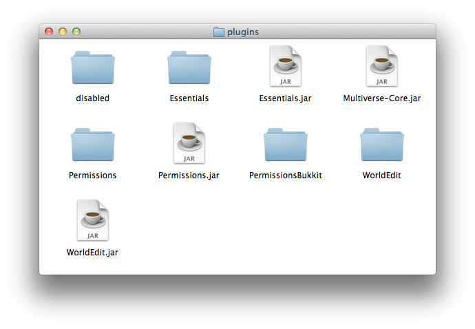

# 安装

欢迎来到 Multiverse Wiki。这份安装指南很简短，安装过程也很简单。

<h2 id="_1">前置条件</h2>
<ul>
<li>所有子模块的主版本必须相同。</li>
<li>使用任何子模块时，都必须安装其依赖 <code>multiverse-core</code>。</li>
</ul>
<h2 id="_2">可选前置条件</h2>

强烈建议安装权限插件。任何实现 SuperPerms API 的插件都可以使用。以下是截至 2025 年已知可用的权限插件：

<ul>
<li><a href="https://www.spigotmc.org/resources/luckperms-an-advanced-permissions-plugin.28140/">LuckPerms</a>（推荐）</li>
</ul>

右侧指南会介绍权限设置，也可以直接查看<a href="core-reference-permissions-list.md">权限清单</a>。

<h2 id="_3">下载链接</h2>
<ul>
<li><a href="https://modrinth.com/plugin/multiverse-core">Modrinth</a></li>
<li><a href="https://dev.bukkit.org/projects/multiverse-core">Bukkit</a></li>
<li><a href="https://hangar.papermc.io/Multiverse/Multiverse-Core">Hangar</a></li>
</ul>
<h2 id="1">步骤 1</h2>

获取 JAR 文件。
从<a href="https://modrinth.com/plugin/multiverse-core#download">发布站点</a>下载 Multiverse-Core JAR。

插件不提供 Zip 包。Multiverse-Core 和 MV 系列插件会在<strong>首次运行</strong>时创建默认配置。

<strong>*可选：</strong> 安装 <a href="https://mvplugins.org/portals/">Multiverse-Portals</a> 或 <a href="https://mvplugins.org/netherportals/">Multiverse-NetherPortals</a>！

将文件放入 plugins 文件夹，如下图所示：

<h2 id="2">步骤 2</h2>

启动服务器，安装就完成了。

