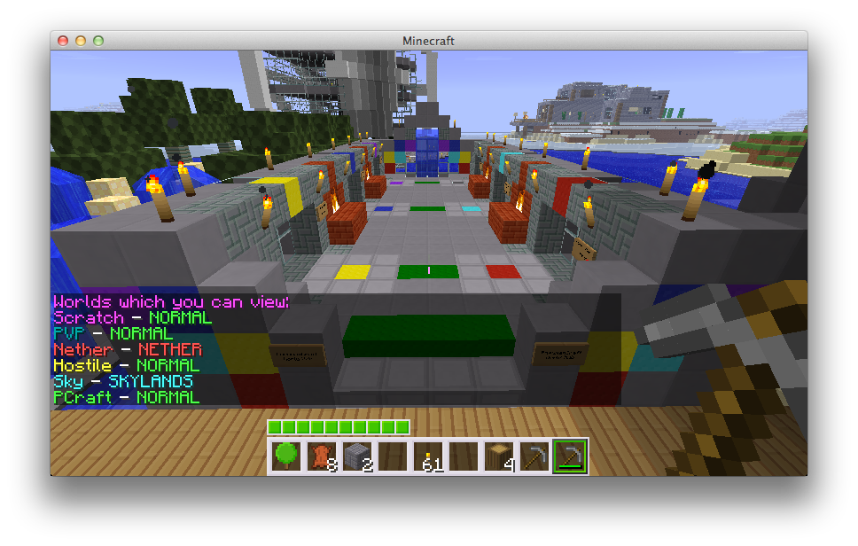

# 世界属性

以下是可以使用 <a href="core-fundamentals-commands-usage.md#Modify-Command">修改命令</a> 在游戏中设置的世界的各种属性。它们也可以设置在 <code>worlds.yml</code> 但 <strong>通常您不必编辑此文件</strong> 中。不过，如果您是高级用户，则可以。这是一个用 yaml 编写的典型插件配置文件，遵循与正常情况相同的语法。

<h2 id="index">索引</h2>
<ul>
<li><a href="#Adjust-Spawn">调整生成</a></li>
<li><a href="#Alias">别名</a></li>
<li><a href="#Allow-Advancement-Grant">允许授予进度</a></li>
<li><a href="#Allow-Flight">允许飞行</a></li>
<li><a href="#Anchor-Respawn">重生锚重生</a></li>
<li><a href="#Auto-Heal">自动治疗</a></li>
<li><a href="#Auto-Load">自动加载</a></li>
<li><a href="#Bed-Respawn">床重生</a></li>
<li><a href="#Difficulty">难度</a></li>
<li><a href="#Entity-Spawn-Config">实体生成配置</a></li>
<li><a href="#Environment">环境</a></li>
<li><a href="#Gamemode">游戏模式</a></li>
<li><a href="#Generators">生成器</a></li>
<li><a href="#Hunger">饥饿值</a></li>
<li><a href="#Keep-Spawn-in-Memory">保持出生点区块加载</a></li>
<li><a href="#Player-Limit">玩家限制</a></li>
<li><a href="#Portal-Form">门架成型</a></li>
<li><a href="#PVP">PVP</a></li>
<li><a href="#Respawn-World">重生世界</a></li>
<li><a href="#Scale">缩放</a></li>
<li><a href="#Seed">种子</a></li>
<li><a href="#Weather">天气</a></li>
<li><a href="#World-Blacklist">世界黑名单</a></li>
<li><a href="#World-Fees">世界费用</a></li>
<li><a href="#World-Visibility">世界可见性</a></li>
</ul>
<h2 id="adjust-spawn">调整生成</h2>

默认情况下，Multiverse 将修复在不良位置记录的出生点。默认情况下，Minecraft 服务器使用类似 <code>getTopBlock()</code> 方法，并将出生点的 <code>Y</code> 坐标设置在地面中间的某个位置。直接传送玩家通常也不安全，因此 Multiverse 将搜索最近的安全位置。

有时这并不理想。如果您不希望 multiverse 执行此操作，只需打开此变量即可。如果您在不安全的位置（熔岩坑上方）设置出生点，Multiverse 将自动为您禁用此变量。

如果您想在导入世界时设置此变量，只需将 <code>-n</code> 添加到 <code>/mv create</code> 或 <code>/mv import</code> 命令中即可：

<pre>/mv create spaceworld normal -g NullTerrainGenerator -n
</pre>

<strong>类型</strong>:
<code>Boolean</code>

<strong>Example:</strong>
<code>adjust-spawn: true</code>

<strong>游戏中的用法：</strong>
<code>/mv modify [world] set adjust-spawn true</code> 
<code>/mv modify [world] set adjust-spawn false</code>

<a href="#top">↑ 返回顶部 ↑</a>

<h2 id="alias">别名</h2>

世界别名允许您以不同于文件夹名称的方式命名世界。这可以让你为你的世界选择奇特的名称，同时保持文件夹的美观和整洁。如果您的别名包含空格，则必须将其用引号引起来，例如：<code>"My World"</code>。

别名属性还可以包括颜色和样式。当您的用户通过 <a href="core-fundamentals-commands-usage.md#List-Command"><code>/mv list</code></a> 或 <a href="core-fundamentals-commands-usage.md#Who-Command"><code>/mv who</code></a> 聊天时，世界将显示颜色和样式。它还可用于聊天插件中的占位符（参见 <a href="core-reference-placeholders.md">我们的占位符</a>）

<h3 id="example-set-alias-to-fern-world-green">示例：将别名设置为 <em>蕨类植物世界</em>（绿色）</h3>

<strong>游戏中的用法：</strong> 
<code>/mv modify [world] set alias "&amp;aFern World"</code>

<strong>在config:</strong>

<pre>alias: "&amp;aFern World"
</pre>

尽管没有强制执行，但强烈建议 <strong>不</strong> 对多个世界使用相同的别名。这可能会给玩家和管理员带来困惑。

如果您想用相同的名称/类别标记多个世界，请考虑使用元数据键。请参阅 <a href="core-how-to-world-meta.md">世界元数据</a> 了解更多信息。

<a href="#top">↑ 返回顶部 ↑</a>

<h2 id="allow-advancement-grant">允许授予进度</h2>

此世界属性仅适用于 PaperMC 服务器。

设置玩家的行为是否会在这个世界上带来相关的进步。这对于您不想向玩家授予进步的大厅世界非常有用。然而，这并不等于各世界独立进度。为此，请参阅 Multiverse-Inventories 可选进度共享。

<strong>类型</strong>:
<code>Boolean</code>

<strong>Example:</strong>
<code>allow-advancement-grant: true</code>

<strong>游戏中的用法：</strong>
<code>/mv modify [world] set allow-advancement-grant false</code>

<a href="#top">↑ 返回顶部 ↑</a>

<h2 id="allow-flight">允许飞行</h2>

Multiverse 具有对每个世界禁用飞行的基本支持。默认情况下，此设置为 true，这将允许飞行。设置为 false 以禁用飞行。注意：这不会影响创造模式。

<strong>类型</strong>:
<code>Boolean</code>

<strong>Example:</strong>
<code>allow-flight: true</code>

<strong>游戏中的用法：</strong>
<code>/mv modify [world] set allow-flight false</code> 
<code>/mv modify [world] set allow-flight true</code>

<a href="#top">↑ 返回顶部 ↑</a>

<h2 id="anchor-respawn">重生锚重生</h2>

如果 <code>anchor-respawn</code> 设置为 true，玩家将能够在这个世界的重生锚点重生。

<strong>类型</strong>:
<code>Boolean</code>

<strong>Example:</strong>
<code>anchor-respawn: true</code>

<strong>游戏中的用法：</strong>
<code>/mv modify [world] set anchor-respawn false</code>

<a href="#top">↑ 返回顶部 ↑</a>

<h2 id="auto-heal">自动治疗</h2>

如果你的<a href="#Difficulty">难度</a>设置为<code>peaceful</code>，默认情况下，玩家将恢复生命值。如果您不希望它们这样做，只需将此变量设置为 false 即可。此设置对 <a href="#Difficulty">难度</a> 大于 <code>peaceful</code> 或 <code>0</code> 的世界没有影响。

<strong>类型</strong>:
<code>Boolean</code>

<strong>Example:</strong>
<code>auto-heal: true</code>

<strong>游戏中的用法：</strong>
<code>/mv modify [world] set auto-heal true</code> 
<code>/mv modify [world] set auto-heal false</code>

<a href="#top">↑ 返回顶部 ↑</a>

<h2 id="auto-load">自动加载</h2>

告诉 Multiverse 在启动时自动加载这个世界。

<strong>类型</strong>:
<code>Boolean</code>

<strong>Example:</strong>
<code>auto-load: true</code>

<strong>游戏中的用法：</strong>
<code>/mv modify [world] set auto-load false</code>

<a href="#top">↑ 返回顶部 ↑</a>

<h2 id="bed-respawn">床重生</h2>

如果 <code>bed-respawn</code> 设置为 true，玩家将能够在这个世界的床上重生。

<strong>类型</strong>:
<code>Boolean</code>

<strong>Example:</strong>
<code>bed-respawn: true</code>

<strong>游戏中的用法：</strong>
<code>/mv modify [world] set bed-respawn false</code>

<a href="#top">↑ 返回顶部 ↑</a>

<h2 id="difficulty">难度</h2>

允许您设置给定世界的难度。所有可能的值为：<code>0, 1, 2, 3, peaceful, easy, normal, hard</code>。请记住，只有 4 个困难，我们只是让您使用 int 或 string 来设置它。它们始终以整数形式存储在配置中。

<strong>Type:</strong> 
<code>String</code> 或 <code>Integer</code>

<strong>Example:</strong> 
<code>difficulty: 1</code>

<strong>游戏中的用法：</strong> 
<code>/mv modify [world] set difficulty 1</code> 
<code>/mv modify [world] set difficulty easy</code> 
<code>/mv modify [world] set difficulty hard</code> 
<code>/mv modify [world] set difficulty peaceful</code>

<a href="#top">↑ 返回顶部 ↑</a>

<h2 id="entity-spawn-config">实体生成配置</h2>

Multiverse 允许您控制每个 <a href="https://jd.papermc.io/paper/26.1.2/org/bukkit/entity/SpawnCategory.html">生成类别</a> 每个世界的实体生成。有关完整命令参考，请参阅 <a href="core-fundamentals-commands-usage.md#Entity-Spawn-Config-Info-Command">实体生成配置命令</a>。

<h3 id="spawn-categories">生成类别</h3>
<table>
<thead>
<tr>
<th>类别</th>
<th>示例</th>
</tr>
</thead>
<tbody>
<tr>
<td><code>monster</code></td>
<td>僵尸、骷髅、苦力怕、女巫等</td>
</tr>
<tr>
<td><code>animal</code></td>
<td>牛、猪、鸡、乌龟、黾等</td>
</tr>
<tr>
<td><code>water_animal</code></td>
<td>鱿鱼、海豚</td>
</tr>
<tr>
<td><code>water_ambient</code></td>
<td>鳕鱼、三文鱼、热带鱼、河豚等</td>
</tr>
<tr>
<td><code>water_underground_creature</code></td>
<td>发光鱿鱼</td>
</tr>
<tr>
<td><code>ambient</code></td>
<td>蝙蝠</td>
</tr>
<tr>
<td><code>axolotl</code></td>
<td>蝾螈</td>
</tr>
<tr>
<td><code>misc</code></td>
<td>盔甲架、船、物品架等</td>
</tr>
</tbody>
</table>
<h3 id="properties">属性</h3>

每个生成类别都有以下可配置的 properties:

<h4 id="spawn">生成</h4>

是否允许该类别的实体在世界中生成。 <code>exceptions</code> 列表按实体类型反转此值。

<strong>Type:</strong> <code>boolean</code> 
<strong>Default:</strong> <code>true</code>

<h4 id="exceptions">例外情况</h4>

否定 <code>spawn</code> 值的实体类型列表。如果 <code>spawn</code> 是 <code>false</code> 并且类型在此列表中，则生成该类型 <strong>会</strong>。如果 <code>spawn</code> 是 <code>true</code> 并且类型在此列表中，则生成该类型 <strong>不会</strong>。

<strong>Type:</strong> <code>List&lt;EntityType&gt;</code>

<h4 id="tick-rate">滴答率</h4>

此类别的每次生成尝试之间有多少个刻度。

<strong>Type:</strong> <code>Integer</code> 
<strong>特价values:</strong> 
<code>@unset</code> — Multiverse 不会覆盖服务器默认值 
<code>@bukkit</code> — 使用 Bukkit 的默认值

<h4 id="spawn-limit">生成限制</h4>

世界上一次可以存在的此类实体的最大数量。

<strong>Type:</strong> <code>Integer</code> 
<strong>特价values:</strong> 
<code>@unset</code> — Multiverse 不会覆盖服务器默认值 
<code>@bukkit</code> — 使用 Bukkit 的默认值

<h3 id="yaml-config">YAML 配置</h3>

在 <code>worlds.yml</code> 中，生成设置存储在每个世界的 <code>spawning</code> 键下：

<pre>spawning:
  monster:
    spawn: true
    tick-rate: '@unset'
    spawn-limit: '@unset'
    exceptions: []
  animal:
    spawn: true
    tick-rate: '@unset'
    spawn-limit: '@unset'
    exceptions: []
</pre>

<h4 id="example-a-world-with-only-pigs">示例：只有 pigs: 的世界</h4>

<pre>spawning:
  animal:
    spawn: false
    exceptions:
    - PIG
</pre>

您应该将其读作“动物 <strong>不能</strong> 为猪生成 <strong>除了</strong>”。

<h4 id="example-a-world-with-no-creepers">示例：没有 creepers: 的世界</h4>

<pre>spawning:
  monster:
    spawn: true
    exceptions:
    - CREEPER
</pre>

您应该将其读作“怪物 <strong>可以</strong> 为苦力怕生成 <strong>除了</strong>”。

<h3 id="in-game-usage">游戏中的使用</h3>

使用<code>/mv entity-spawn-config modify [world] &lt;category&gt; &lt;action&gt; &lt;property&gt; [value]</code>：

<a href="core-fundamentals-commands-usage.md#Entity-Spawn-Config-Modify-Command"><code>/mv entity-spawn-config modify [world] monster set spawn false</code></a> — 禁用怪物生成。 
<a href="core-fundamentals-commands-usage.md#Entity-Spawn-Config-Modify-Command"><code>/mv entity-spawn-config modify [world] animal set spawn true</code></a> — 启用动物生成。 
<a href="core-fundamentals-commands-usage.md#Entity-Spawn-Config-Modify-Command"><code>/mv entity-spawn-config modify [world] monster add exceptions CREEPER</code></a> — 将 <code>CREEPER</code> 添加到怪物例外列表中。 
<a href="core-fundamentals-commands-usage.md#Entity-Spawn-Config-Modify-Command"><code>/mv entity-spawn-config modify [world] monster remove exceptions CREEPER</code></a> — 从怪物例外列表中删除 <code>CREEPER</code>。 
<a href="core-fundamentals-commands-usage.md#Entity-Spawn-Config-Modify-Command"><code>/mv entity-spawn-config modify [world] monster reset exceptions</code></a> — 清除怪物例外列表。 
<a href="core-fundamentals-commands-usage.md#Entity-Spawn-Config-Modify-Command"><code>/mv entity-spawn-config modify [world] animal set tick-rate 400</code></a> — 将动物蜱率设置为 400. 
<a href="core-fundamentals-commands-usage.md#Entity-Spawn-Config-Modify-Command"><code>/mv entity-spawn-config modify [world] axolotl set spawn-limit 10</code></a> — 每个世界限制蝾螈数量为 10 只。 
<a href="core-fundamentals-commands-usage.md#Entity-Spawn-Config-Info-Command"><code>/mv entity-spawn-config info [world]</code></a> — 显示世界的所有生成配置。

无论 <code>spawn</code> 设置如何，怪物都不会在 <a href="#Difficulty">难度</a> 设置为 <code>peaceful</code> 的世界中生成。

<a href="#top">↑ 返回顶部 ↑</a>

<h2 id="environment">环境</h2>

这个世界所处的环境类型。目前可以是 <code>NETHER</code>、<code>THE_END</code> 和 <code>NORMAL</code>。您 <strong>不应该</strong> 在配置中更改此值。

<strong>Type:</strong> 
<code>String</code>

<strong>Example:</strong> 
<code>environment: NORMAL</code>

<strong>游戏中的用法：</strong> 
<a href="core-fundamentals-commands-usage.md#Create-Command"><code>/mv create myworld normal</code></a> 
<a href="core-fundamentals-commands-usage.md#Import-Command"><code>/mv import mynether nether</code></a>

<a href="#top">↑ 返回顶部 ↑</a>

<h2 id="gamemode">游戏模式</h2>

允许您设置特定世界的模式类型。有关管理每个世界库存的更多信息，请参阅 <a href="https://mvplugins.org/inventories">Multiverse-Inventories</a>。

如果你想让某些玩家忽略世界中设置的游戏模式，有一个特殊的permission:

<pre>mv.bypass.gamemode.[*|WORLDNAME]
</pre>

此权限位于不同的根命名空间下，因为默认情况下它是关闭的。

<strong>Type:</strong> 
<code>String</code>

<strong>Example:</strong> 
<code>gamemode: SURVIVAL</code>

<strong>游戏中的用法：</strong> 
<code>/mv modify [world] set gamemode survival</code> 
<code>/mv modify [world] set gamemode creative</code>

<a href="#top">↑ 返回顶部 ↑</a>

<h2 id="generators">生成器</h2>

Multiverse 2 允许您通过 <a href="core-reference-custom-generator-plugins.md">自定义生成器插件</a> 使用自定义世界生成器。此行包含多元宇宙正确加载您的世界所需的信息。除非您知道自己在做什么，否则您 <strong>不应该</strong> 会触及此值。

该值可能存在也可能不存在。没关系。

<strong>类型</strong>: 
<code>String</code>

<strong>Example:</strong> 
<code>generator: BukkitFullOfMoon</code>

<strong>游戏中的用法：</strong> 
<a href="core-fundamentals-commands-usage.md#Create-Command"><code>/mv create moon NORMAL --generator BukkitFullOfMoon</code></a>

<a href="#top">↑ 返回顶部 ↑</a>

<h2 id="hunger">饥饿值</h2>

允许您在每个世界中启用或禁用饥饿消耗。

<strong>类型</strong>:
<code>Boolean</code>

<strong>Example:</strong>
<code>hunger: true</code>

<strong>游戏中的用法：</strong>
<code>/mv modify [world] set hunger true</code> 
<code>/mv modify [world] set hunger false</code>

<a href="#top">↑ 返回顶部 ↑</a>

<h2 id="keep-spawn-in-memory">保持出生点区块加载</h2>

关闭后，Bukkit 不会在内存中保持此世界的出生点区块加载，因此在没有玩家登录时可以减少服务器的内存占用。

此功能已在 1.21.9+ 中被 Minecraft 删除。将其设置为 <code>true</code> 对运行 1.21.9 或更高版本的服务器没有影响。

<strong>Type:</strong> 
<code>boolean</code>

<strong>Example:</strong> 
<code>keep-spawn-in-memory: true</code>

<strong>游戏中的用法：</strong> 
<code>/mv modify [world] set keep-spawn-in-memory false</code>

<a href="#top">↑ 返回顶部 ↑</a>

<h2 id="player-limit">玩家限制</h2>

Multiverse 能够设置世界中允许的最大玩家数量。默认情况下，限制设置为 <code>-1</code> 表示无限制。该设置是指定允许多少玩家。

玩家可以通过以下权限绕过此限制：
<code>mv.bypass.playerlimit.*</code> 适用于所有世界。
<code>mv.bypass.playerlimit.NAME</code> 适用于特定世界。

<strong>类型</strong>:
<code>Integer</code>

<strong>Example:</strong>
<code>player-limit: -1</code>

<strong>游戏中的用法：</strong>
<code>/mv modify [world] set player-limit 10</code> 
<code>/mv modify [world] set player-limit -1</code>

<a href="#top">↑ 返回顶部 ↑</a>

<h2 id="portal-form">传送门生成</h2>

Multiverse 允许您控制是否允许用户创建传送门。

允许传送门形成必须是 <code>NONE</code>、<code>ALL</code>、<code>NETHER</code> 或 <code>END</code>。

<strong>类型</strong>
<code>String</code>

<strong>示例</strong>:
<code>portal-form: ALL</code>

<strong>游戏中的使用</strong>:
<code>/mv modify [world] set portal-form none</code> 
<code>/mv modify [world] set portal-form nether</code>

结果是相当不言自明的。当玩家尝试创建对世界禁用的传送门时，他们将收到一条消息，通知他们这是不允许的。

<a href="#top">↑ 返回顶部 ↑</a>

<h2 id="pvp">PVP</h2>

玩家在这个世界上是否可以互相伤害。如果设置为 <code>true</code>，则可以。

<strong>Type:</strong> 
<code>boolean</code>

<strong>Example:</strong> 
<code>pvp: true</code>

<strong>游戏中的用法：</strong> 
<code>/mv modify [world] set pvp false</code>

<a href="#top">↑ 返回顶部 ↑</a>

<h2 id="respawn-world">重生世界</h2>

当这个世界发生重生事件时，你将重生到的世界。这个值可以和这个世界一样。

重生事件包括：
- 死在世界上
- 击败末影龙后使用末日中的出口传送门（这算作重生事件，因此在末地世界中设置 <code>respawn-world</code> 可以控制玩家击败末影龙后着陆的位置）

<strong>Type:</strong> 
<code>String</code>

<strong>Example:</strong>

<pre>respawn-world: "hellplanet"
</pre>

<strong>NOTE:</strong> 如果您看到 <code>temprespawn</code> 值，则可以将其删除。它在迁移器的早期版本中得到了延续。

<strong>游戏中的用法：</strong> 
<code>/mv modify &lt;death world&gt; set respawn-world &lt;respawn-world&gt;</code> 
<code>/mv modify survival set respawn-world hub</code> — 在生存中死亡时在中心重生 
<code>/mv modify world_the_end set respawn-world world</code> — 击败末影龙后将玩家送回主世界

<a href="#top">↑ 返回顶部 ↑</a>

<h2 id="scale">缩放</h2>

使用 Multiverse-NetherPortals 时的世界缩放。设置此值对除 Multiverse-NetherPortals 之外的任何内容都没有影响。请参阅 <a href="https://mvplugins.org/netherportals/fundamentals/basic-usage">Multiverse-NetherPortals 文档</a> 了解其工作原理。

<strong>Type:</strong> 
<code>double</code>

<strong>NOTE:</strong> 如果您看到 <code>scaling</code> 值，则可以将其删除。它在迁移器的早期版本中被保留，现在的值是 <code>scale</code>。

<strong>游戏中的用法：</strong> 
<code>/mv modify [world] set scale 1.2</code>

<a href="#top">↑ 返回顶部 ↑</a>

<h2 id="seed">种子</h2>

这个世界的种子。除非您知道这样做的后果，否则请勿更改（<strong>WILL</strong> 会导致区块错误！）。

<strong>Type:</strong> 
<code>String</code>

<strong>Example:</strong> 
<code>seed: 'gargamel'</code>

<strong>游戏中的用法：</strong> 
<strong>该命令不能在游戏中使用。你无法改变生成世界的种子。</strong>

<a href="#top">↑ 返回顶部 ↑</a>

<h2 id="weather">天气</h2>

如果该值为真，则世界将发生天气事件，如果为假，则不会。如果你想关闭当前的风暴，只需输入<code>/mv modify [world] set allow-weather false</code>，等待天气消退，然后输入<code>/mv modify [world] set allow-weather true</code>。

<strong>Type:</strong> 
<code>boolean</code>

<strong>Example:</strong> 
<code>allow-weather: true</code>

<strong>游戏中的用法：</strong> 
<code>/mv modify [world] set allow-weather false</code>

<a href="#top">↑ 返回顶部 ↑</a>

<h2 id="world-blacklist">世界黑名单</h2>

世界黑名单允许您指定 <strong>不能去</strong> 从指定世界进入的世界。例如，如果您将 <code>world_gold</code> 添加到 <code>world</code> 的 <code>worldblacklist</code>，则玩家可以从 <code>world</code> 传送到 <code>world_gold</code>，但不能返回。

<strong>Type:</strong> 
<code>List&lt;String&gt;</code>

<strong>Example:</strong>

<pre>worldblacklist:
- world_fish
- world_dog
</pre>

<strong>游戏中的用法：</strong> 
<code>/mv modify [world] add world-blacklist &lt;world_to_block&gt;</code> - 将世界添加到黑名单 
<code>/mv modify [world] remove world-blacklist &lt;world_to_block&gt;</code> - 从黑名单中删除世界

<a href="#top">↑ 返回顶部 ↑</a>

<h2 id="world-fees">世界费用</h2>

您可以向用户收取进入各个世界的费用。最酷的部分是您不必使用经济插件！您可以简单地使用Minecraft物品！

<h3 id="enabled">启用</h3>

该世界的入场费是否有效。

<strong>Type:</strong> 
<code>boolean</code>

<strong>Example:</strong> 
<code>entry-fee.enabled: false</code>

<h3 id="amount-vs-currency">金额与货币</h3>

<code>amount</code> 字段是您要向人员收费的 <strong>多少</strong>。这可以是整数或双精度数。 （1 或 1.75）

<code>currency</code> 字段是您要向人员收费的 <strong>什么</strong>。这是材质名称（e.g.<code>DIRT</code>），如果您想使用经济插件中的虚拟货币，则为 <code>@vault-economy</code>。

<h3 id="example-charging-5-dirt-to-enter-a-world">示例：充入 5 个泥土即可进入世界</h3>

<pre>entry-fee:
  enabled: true
  amount: 5
  currency: DIRT
</pre>

<h3 id="example-charging-1375-to-enter-a-world">示例：收费 13.75 美元进入一个世界</h3>

<strong>NOTE:</strong> 您必须安装有效的经济插件（例如，<a href="https://essentialsx.net/">EssentialsX</a>）以及<a href="https://www.spigotmc.org/resources/vault.34315/">Vault</a>才能使用经济货币（<code>@vault-economy</code>）。

<pre>entry-fee:
  enabled: true
  amount: 13.75
  currency: '@vault-economy'
</pre>

<strong>游戏中的用法：</strong> 
<code>/mv modify [world] set entryfee-enabled true</code> - 启用世界入场费 
<code>/mv modify [world] set entryfee-currency DIRT</code> - 将物品货币设置为泥土 
<code>/mv modify [world] set entryfee-currency @vault-economy</code> - 将货币设置为 Vault 经济货币 
<code>/mv modify [world] set entryfee-amount 5</code> - 需要 5 个已配置货币

<a href="#top">↑ 返回顶部 ↑</a>

<h2 id="world-visibility">世界可见性</h2>

此属性允许您拥有一个存在但不显示在列表中的世界。当用户从这个世界聊天时，如果<code>worldnameprefix</code>设置为<code>true</code>并且隐藏，他们的聊天将显示没有世界前缀。

<strong>Type:</strong> 
<code>Boolean</code>

<strong>Example:</strong> 
<code>hidden: false</code>

<strong>游戏中的用法：</strong> 
<code>/mv modify [world] set hidden true</code>

<a href="#top">↑ 返回顶部 ↑</a>

