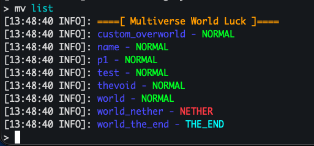

# 自定义语言消息

Multiverse 模块支持自定义玩家通过语言文件在游戏中看到的消息。您可以使用它来覆盖现有消息、重新命名命令输出、调整措辞以适合您的服务器，或添加尚不存在的全新语言翻译。

<h2 id="creating-the-locales-folder">创建语言文件夹</h2>

在服务器的 <code>plugins/Multiverse-Core/</code> 文件夹中，创建一个名为 <code>locales</code> 的文件夹：

<pre>plugins/
└── Multiverse-Core/
    └── locales/        ← create this folder
</pre>

<h2 id="getting-the-original-locale-file">获取原始语言文件</h2>

英语语言文件是所有消息键的基本参考。从 Multiverse-Core GitHub repository: 下载或复制

<a href="https://github.com/Multiverse/Multiverse-Core/blob/main/src/main/resources/multiverse-core_en.properties">multiverse-core_en.properties</a>

将文件放入您刚刚创建的 <code>locales</code> 文件夹中。文件名决定了它适用的语言，例如：

<table>
<thead>
<tr>
<th>文件名</th>
<th>语言</th>
</tr>
</thead>
<tbody>
<tr>
<td><code>multiverse-core_en.properties</code></td>
<td>英语</td>
</tr>
<tr>
<td><code>multiverse-core_es.properties</code></td>
<td>西班牙语</td>
</tr>
<tr>
<td><code>multiverse-core_zh.properties</code></td>
<td>中文</td>
</tr>
<tr>
<td><code>multiverse-core_ru.properties</code></td>
<td>俄语</td>
</tr>
</tbody>
</table>

对于现有语言，您只需包含要覆盖的键。对于文件中不存在的任何键，Multiverse 将回退到内置默认值。

要添加不可用的语言，请使用相应的 <a href="https://en.wikipedia.org/wiki/List_of_ISO_639_language_codes">ISO 639-1 语言代码</a>（法语为 e.g.<code>multiverse-core_fr.properties</code>）创建新文件。

分享你的翻译！

如果您创建了新的语言文件，请考虑在 <a href="https://github.com/Multiverse/Multiverse-Core">Multiverse-Core GitHub 存储库</a> 上打开拉取请求，以便其他人可以从您的工作中受益！

<h2 id="editing-the-locale-file">编辑语言文件</h2>

在任何文本编辑器中打开该文件。每行都遵循 format:

<pre>message.key=The message text here
</pre>

颜色代码使用 <code>&amp;</code> 前缀（e.g。<code>&amp;a</code> 表示绿色，<code>&amp;c</code> 表示红色）。 <code>{curly braces}</code> 中包含的占位符在运行时填充，应保持原样。

<h3 id="example-changing-the-world-list-header">示例：更改世界列表标题</h3>

默认世界列表头定义为by:

<pre>mv-core.list.header=&amp;6====[ Multiverse World List ]====
</pre>

要将其更改为其他内容，请将此行添加到您的语言文件中，其中包含您首选的 text:

<pre>mv-core.list.header=&amp;6====[ Multiverse World Luck ]====
</pre>

重新启动后（见下文），<code>/mv list</code> 输出将显示您的自定义标题而不是默认标题。

<h2 id="other-multiverse-modules">其他Multiverse模块</h2>

相同的过程适用于这些模块。在该模块的插件文件夹中创建 <code>locales</code> 文件夹并使用其匹配的文件名。

<table>
<thead>
<tr>
<th>模块</th>
<th>示例路径</th>
<th>原始语言文件</th>
</tr>
</thead>
<tbody>
<tr>
<td>Multiverse-Inventories</td>
<td><code>plugins/Multiverse-Inventories/locales/multiverse-inventories_en.properties</code></td>
<td><a href="https://github.com/Multiverse/Multiverse-Inventories/blob/main/src/main/resources/multiverse-inventories_en.properties">查看源码</a></td>
</tr>
<tr>
<td>Multiverse-NetherPortals</td>
<td><code>plugins/Multiverse-NetherPortals/locales/multiverse-netherportals_en.properties</code></td>
<td><a href="https://github.com/Multiverse/Multiverse-NetherPortals/blob/main/src/main/resources/multiverse-netherportals_en.properties">查看源码</a></td>
</tr>
<tr>
<td>Multiverse-Portals</td>
<td><code>plugins/Multiverse-Portals/locales/multiverse-portals_en.properties</code></td>
<td><a href="https://github.com/Multiverse/Multiverse-Portals/blob/main/src/main/resources/multiverse-portals_en.properties">查看源码</a></td>
</tr>
</tbody>
</table>

Multiverse-Portals 还允许您为单个传送门的成功或权限拒绝消息选择语言键。有关示例，请参见 <a href="https://mvplugins.org/portals/how-to/configure-portal-messages/#Using-a-locale-key">配置传送门消息</a>。

<h2 id="acf-command-messages">ACF 命令消息</h2>

Multiverse 使用 <a href="https://github.com/aikar/commands">Aikar 的命令框架 (ACF)</a> 进行命令处理，ACF 有自己的一组消息（例如无效参数错误和权限不足的通知）。也可以通过将 <a href="https://github.com/aikar/commands/tree/master/languages">ACF 语言文件夹</a> 中的语言文件放入 <code>locales</code> 文件夹中来覆盖这些设置。

该文件应遵循相同的命名约定 (e.g.<code>acf-core_en.properties</code>)。检查 ACF 存储库以获取确切的文件名和可用键。

<h2 id="applying-your-changes">应用您的更改</h2>

语言更改需要 <strong>完全服务器重启</strong> 才能生效。 <code>/mv reload</code> 还不够。

