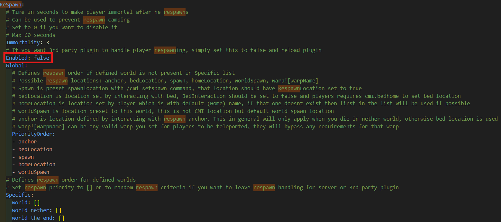

# 常见问题

<h2 id="is-multiverse-compatible-with-datapacks">Multiverse 与数据包兼容吗？</h2>

简短的回答 - 你可以像普通版本一样安装，但这里有更深入的解释。数据包是一个普通功能，只能添加到默认世界的数据包文件夹中。如果数据包加载其他世界，Multiverse 5 应该在启动时自动导入它，并且大多数应该可以正常工作。不过，还有很多caveats:

<ol>
<li>没有每个世界的数据包支持。您无法在默认世界之外安装数据包。</li>
<li>由数据包本身决定它对你的世界做什么。如果您正在制作自己的数据包或愿意修改数据包，您可以手动编辑数据包操作以定位您想要的维度。 Multiverse 创建的世界应该使用命名空间键 <code>minecraft:&lt;worldname&gt;</code> 来定位。</li>
<li>安装后删除worldgen数据包可能会导致<strong>加载时会破坏和崩溃的世界</strong>，并且Multiverse无法修复它。因此，请在安装此类数据包之前做好备份。</li>
<li>Worlds created with multiverse may or may not be affected by the datapack. This is completely dependent on the how the datapack itself is made.</li>
</ol>

我们建议尝试找到与您要使用的数据包具有相似功能的插件。 If you really need to use datapack, please make backups and test it functionality before installing to your production server.

<h2 id="i-want-a-certain-commandplugin-to-apply-to-only-some-worlds-how-do-i-do-that">I want a certain command/plugin to apply to only some worlds, how do I do that?</h2>

这完全取决于每个插件。 Multiverse命令本身都支持针对每个世界。但是，Multiverse 无法控制其他插件的工作方式。 If those commands/plugins does not work as expected, please report the issue to the plugin's author and not us.普通命令也可能没有办法针对特定的世界，并且除了找到一个插件来实现其普通命令的替代命令之外，也没有办法添加对它的支持。

<h2 id="support-for-slime-worlds">支持史莱姆世界吗？</h2>

在 5.2 中，进行了一些更改以提高与其他世界格式（例如 Slime 世界管理器）的兼容性，但存在一些限制。这些更改已经通过 <a href="https://infernalsuite.com">高级粘液纸</a> 及其 Slime World 插件进行了专门测试。但是，它应该与其他类似的 slime 服务器和插件一起使用，只要它们正确实现 Bukkit API 即可。

支持运营：
- 使用 <code>/mv import</code> 将现有的已加载史莱姆世界添加到多元宇宙。
- 使用 <code>/mv remove</code> 从多元宇宙的世界列表中删除粘液世界。使用 <code>--no-unload-bukkit-world</code> 来保持史莱姆世界在服务器上的加载。之后您可以使用相关的 SlimeWorldManager 命令来处理世界。
- 使用<code>/mv unload</code>卸载史莱姆世界。在 SlimeWorldManager 中使用等效命令也可以。
- 所有世界属性都应该像普通的基于原版的世界一样工作。

由于 Slime worlds 使用完全不同的格式和 API，因此不支持以下内容：
- 请勿使用 <code>/mv create</code> 制作史莱姆世界。请改用 SlimeWorldManager 中的等效命令。之后使用 <code>/mv import</code> 添加到多元宇宙。
- 不要使用 <code>/mv load</code> 加载史莱姆世界。请改用 SlimeWorldManager 中的等效命令。 Multiverse会自动检测服务器正在加载世界。
- 不要使用 <code>/mv delete</code> 从磁盘删除史莱姆世界。请改用 SlimeWorldManager 中的等效命令。之后您可以使用 <code>/mv remove</code> 将世界从多元宇宙的世界列表中删除。
- 请勿在史莱姆世界中使用 <code>/mv clone</code> 和 <code>/mv regen</code>。

<h2 id="does-multiverse-work-on-hybrid-servers-such-as-mohist">Multiverse 是否可以在 Mohist 等混合服务器上工作？</h2>

它可能有效，但未经测试或支持。根据您在服务器上安装的模组，预计会出现错误和随机问题。有些模组可能会完全破坏Multiverse。我们不会调查这些混合服务器引起的问题。 If you think the issue you face is unrelated to the use of hybrid servers, please reproduce the issue with Paper or Spigot before reporting it to us.

<h2 id="player-respawning-in-the-wrong-worldlocation">玩家在错误的世界/位置重生！</h2>

如果您希望 Multiverse 处理玩家重生，请确保使用 <code>/mv modify &lt;death-world&gt; set respawn-world &lt;world&gt;</code> 将重生世界设置为正确的世界。还要检查 config.yml 文件中的三个配置选项 <code>default-respawn-in-overworld</code>、<code>default-respawn-within-same-world</code> 和 <code>enforce-respawn-at-world-spawn</code>，默认情况下应已设置为 <code>true</code>。

请注意，重生也是 <strong>影响退出结束</strong>。 Minecraft 考虑将末地退出作为重生而不是普通的传送门传送，因此如果您想更改末地的退出位置，您可以将重生世界设置为与末地世界链接的主世界。

如果您在 Multiverse 中配置了重生世界，但它仍然无法正常工作，则可能是由 <strong>其他插件</strong> 修改了玩家重生行为引起的。 Multiverse 无法控制其他插件的工作方式，我们也没有办法修复它。您可以尝试通过删除插件并测试重生行为来查找导致问题的插件。找到该插件后，请将问题报告给该插件的作者而不是我们。

干扰 Multiverse 的最常见插件是 <strong>CMI</strong> 和 <strong>EssentialsX</strong>。如果您正在使用这些插件中的任何一个，请检查它们的配置并确保禁用任何与重生相关的功能。

<h3 id="disabling-cmi-respawn-handling">禁用 CMI 重生处理</h3>

禁用 CMI 中的重生模块。为此，请进入 CMI 主配置并向下滚动，直到看到 <code>ReSpawn</code> 部分。截至 2026 年 3 月 2 日，该位置位于第 612 行左右。将 <code>Enabled</code> 选项更改为 <code>false</code> 并重新启动服务器。

