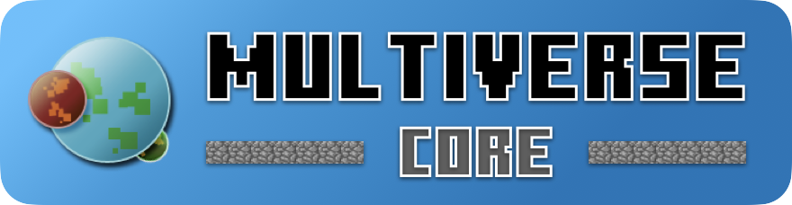

# Multiverse-Core 官方 Wiki

Multiverse是志愿者在空闲时间开发的。如果您喜欢我们的工作，请考虑在 <a class="text-white font-bold underline" href="https://github.com/sponsors/Multiverse" target="_blank">Github 赞助商</a> 或 <a class="text-white font-bold underline" href="https://opencollective.com/multiverse-plugins" target="_blank">开放集体</a> 上支持我们。

<h2 id="basics">基础知识</h2>
<ul>
<li>从头开始 <a href="core-fundamentals-installation.md">安装Multiverse-Core</a> 或从 Multiverse 4 开始 <a href="mv5-welcome-upgrading.md">如何升级</a>！</li>
<li>如果您之前从未使用过 Multiverse，则应该查看 <a href="core-fundamentals-basic-usage.md">Multiverse 基础教程</a>。</li>
<li>了解如何使用 <a href="core-fundamentals-permissions-setup.md">Multiverse 有权限</a></li>
<li>发现错误？通过 <a href="https://discord.gg/NZtfKky">不和谐</a> 联系我们或打开 <a href="https://github.com/Multiverse/Multiverse-Core/issues/new">GitHub 上的问题</a>。</li>
</ul>
<h2 id="intermediate">中级</h2>
<ul>
<li>使用子插件添加更多功能：<a href="https://mvplugins.org/inventories/">库存</a>、<a href="https://mvplugins.org/portals/">传送门网站</a>、<a href="https://mvplugins.org/netherportals/">下界传送门</a>、<a href="https://mvplugins.org/signportals/">标志传送门</a></li>
<li>用<a href="core-fundamentals-world-properties.md">世界地产</a>定制您的世界</li>
<li>使用 <a href="core-reference-custom-generator-plugins.md">自定义生成器插件</a> 生成一些很棒的新地形</li>
</ul>
<h2 id="advanced">高级</h2>
<ul>
<li>完整的<a href="core-fundamentals-commands-usage.md">命令参考</a></li>
<li>简单的<a href="core-reference-permissions-list.md">权限大列表</a></li>
<li>您可以传送到的各种 <a href="core-reference-destinations.md">目的地</a></li>
<li><a href="core-how-to-setup-entry-fee.md">向用户收费|货币</a> 进入世界的金钱或物品</li>
</ul>
<h2 id="developers">开发商</h2>
<ul>
<li>开发商？刚刚受到激励？我们有 <a href="https://mvplugins.org/core/developers/developer-api-starter">开发者-API-启动器</a> 来帮助您开始将 Multiverse 集成到您自己的插件中！</li>
</ul>

