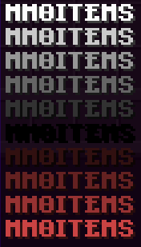

# 常见问题 {#🪲-frequent-issues}

每当你觉得有问题时，请使用MythicLib/MMOItems/MMOCore到self-diagnose的常见问题列表。

有时，考虑到票证数量和工作人员的可用性，Discord服务器的支持速度相当慢。在使用Discord票证报告错误之前，请确保你的问题不是以下问题之一。如果你可以按照以下说明自行修复问题，那么你既可以赢得时间（你在等待答案时会浪费时间），也可以让员工获得时间来修复更复杂的错误。

特定于 MMO 插件之一的问题用括号标记，例如`Cannot cast abilities (MMOItems)`。

请务必检查完整服务器日志中的插件错误日志，因为超过一半的问题都与它们相关的日志有关。下面的列表列出了错误日志中出现的常见问题。

## 保留MythicLibup-to-date {#keep-mythiclib-up-to-date}

请记住，MythicLib是运行MMOItems/MMOCore所必需的，而且它也是一个插件。MMOItems可能是由前面的MythicLib启动问题引起的。首先始终确保这不是MythicLib的错误。

## 过时的插件 {#outdated-plugins}

指示`NoClassDefFoundError`或`NoSuchMethodError`的错误日志表明插件找不到职业或其编译方法。

```
Could not load [...] in folder 'plugins' org.bukkit.plugin.InvalidPluginException: java.lang.NoClassDefFoundError: ...
```

90%当时，这些错误是由于 MMO 插件之一或MythicLib的过时版本造成的。下载所有 MMO 插件的最新版本/开发版本，然后重试。

有时，这些错误是由于外部插件的兼容性问题造成的，例如，如果外部开发人员更改了其插件API中的某些内容。

## 插件加载顺序问题 {#plugin-loading-order-issue}

当 MMO 插件在服务器启动时未按特定的预定义顺序加载时，可能会出现严重的插件兼容性问题。有时确实会发生循环依赖关系（A -> B -> C -> A），迫使Bukkit或Spigot忽略软依赖关系。 **最常见的问题是MythicMobs在所有 MMO 插件之后加载，这是不应该发生的。所需的加载顺序如下：**

`MythicMobs > MythicLib > MMOCore > MMOItems > MMOInventory`

MythicLib的最新版本包含一个检查循环依赖关系的脚本。如果你遇到加载顺序问题，请检查MythicLib的启动日志，因为它们很可能会显示如下所示的消息：

```
Found a dependency cycle! Please make sure that the plugins involved load with no errors.
```

如果你收到这样的消息，你可以卸载循环中的插件之一来打破它，或者尝试使用以下修复手动更正加载顺序。你还可以联系所涉及插件的开发人员，因为不幸的是，需要他们来修复该依赖循环。

例如，如果你意识到MythicLib在MythicMobs之前加载，一种可能的解决方法是打开MythicLib.jar 文件并编辑其`plugin.yml`内部文件：通过将MythicMobs设为硬依赖项，你将强制Bukkit在之前启用MythicMobsMythicLib。

上一页`plugin.yml`:

```yml
# ....
softdepend: [ WorldGuard,Residence,Factions,MythicMobs,PlaceholderAPI ]
# ....
```

已修复`plugin.yml`：

```yml
depend: [MythicMobs]
softdepend: [ WorldGuard,Residence,Factions,PlaceholderAPI ]
```

如果你正在运行Paper或1.19.2上的Paper分支，你也可以尝试使用此服务器启动参数

```bash
-Dpaper.useLegacyPluginLoading=true
```

## 依赖性问题，阻止 ML/MI/MC 启动 {#dependency-issue-preventing-ml-mi-mc-from-starting}

MMOItems、MMOCore和 MMOInv 假设它们的依赖项加载没有问题。如果任何 MMO 插件依赖项加​​载失败，MMO 插件很可能也会被禁用。请务必在 MMO 插件错误之前检查启动日志是否有错误，以确保这不是依赖项问题。

例如，如果MythicMobs加载失败（由于用户端的配置问题或插件错误），MythicLib可能无法正常运行并引发启动错误。

## `java.sql.SQLException: Column 'times_claimed' not found` {#java-sql-sqlexception-column-times-claimed-not-found}

由于MMOCore1.9中的更改，你的MMOCore数据库已过期。你可以更新到MMOCore>1.9.5或手动注册缺失的列。不过，更新MySQL数据表相当简单，你只需添加一个名为`times_claimed`的新字符串列（使用`LONGTEXT`数据类型）：

```sql
ALTER TABLE mmocore_playerdata ADD COLUMN times_claimed LONGTEXT;
```

## 无法破坏任何方块（MMOCore） {#cannot-break-any-block-mmocore}

请仔细阅读以下[wiki页面](../mmocore/features/mining.md)，因为你可能尚未配置你的工具权限集。

## 生命条粘在10心上 {#health-bar-is-stuck-to-10-hearts}

生命条使用10心（相当于20HP），无论你当前拥有多少最大生命值。实施该选项是为了允许服务器所有者在不遮挡玩家屏幕的情况下利用大量的生命值。你可以在主MythicLib配置文件中禁用此选项。自MythicLib1.3.4起，此选项现在默认切换为**关闭**，以减少潜在的混乱。

## `Cannot invoke "io.lumine.mythic.core.skills.SkillExecutor.getSkill(String)" because "skillManager" is null` {#cannot-invoke-io-lumine-mythic-core-skills-skillexecutor-getskill-string-because-skillmanager-is-null}

当MythicMobs在 MMO 插件之后加载时，有时会出现此问题。请参阅上面的问题“*插件加载顺序问题*”。

## 颜色代码不起作用 {#color-codes-not-working}

MMOItems目前正在转换为 MiniMessage 格式。如果你对这些有任何问题，请在问题跟踪器中报告。由于 ML1.5，MMO 插件对你可以使用的颜色代码相当宽松。

这是一个转换表，指示什么标签对应什么颜色代码

|颜色代码|标签 |别名 |  |颜色代码|标签 |别名 |
| --- | --- | --- | --- | --- | --- | --- |
| `&0` | `<black>` | `<#000000>` |  | `&a` | `<green>` | `<#55FF55>` |
| `&1` | `<dark_blue>` | `<#0000AA>` |  | `&b` | `<aqua>` | `<#55FFFF>` |
| `&2` | `<dark_green>` | `<#00AA00>` |  | `&c` | `<red>` | `<#FF5555>` |
| `&3` | `<dark_aqua>` | `<#00AAAA>` |  | `&d` | `<light_purple>` | `<#FF55FF>` |
| `&4` | `<dark_red>` | `<#AA0000>` |  | `&e` | `<yellow>` | `<#FFFF55>` |
| `&5` | `<dark_purple>` | `<#AA00AA>` |  | `&f` | `<white>` | `<#FFFFFF>` |
| `&6` | `<gold>` | `<#FFAA00>` |  | `&k` | `<obfuscated>` | `<obf>` |
| `&7` | `<gray>` | `<#AAAAAA>` |  | `&l` | `<bold>` | `<b>` |
| `&8` | `<dark_gray>` | `<#555555>` |  | `&m` | `<strikethrough>` | `<st>` |
| `&9` | `<blue>` | `<#5555FF>` |  | `&n` | `<underlined>` | `<u>` |
| `&o` | `<italic>` | `<i>` |  | `&r` | `<reset>` | `<r>` |
| Line break | `<newline>` | `\n` |  | Rainbow | `<rainbow>` | None |

你还可以使用`<color:#FFFFFF>`或`<color:black>`作为颜色，而`§`字符而不是`&`仍然受Bukkit原生支持。

要创建 **水平** 颜色渐变：`<gradient:[color1]:[color...]:[phase]>......</gradient>`其中`[color]`是十六进制颜色或简单地类似于`green`。要创建**垂直**颜色渐变：`<transition:[color1]:[color2]:[phase]>......</transition>`



|颜色代码示例 |图片|
| --- | --- |
| `<gradient:#FBEB19:#FD8C30><bold>MMOITEMS</gradient>` |  |
| `<color:#FF0000><bold>MMOITEMS or <#FF0000><bold>MMOITEMS` |  |
| `<transition:white:black:red:0.0><bold>MMOITEMS</transition>` `<transition:white:black:red:0.1><bold>MMOITEMS</transition>` `<transition:white:black:red:0.2><bold>MMOITEMS</transition>` `<transition:white:black:red:0.3><bold>MMOITEMS</transition>` `<transition:white:black:red:0.4><bold>MMOITEMS</transition>` `<transition:white:black:red:0.5><bold>MMOITEMS</transition>` `<transition:white:black:red:0.6><bold>MMOITEMS</transition>` `<transition:white:black:red:0.7><bold>MMOITEMS</transition>` `<transition:white:black:red:0.8><bold>MMOITEMS</transition>` `<transition:white:black:red:0.9><bold>MMOITEMS</transition>` `<transition:white:black:red:1.0><bold>MMOITEMS</transition>` |  |

## FactionsBridge 未加载的问题 {#issue-with-factionsbridge-not-loading}

`java.lang.NoClassDefFoundError: cc/javajobs/factionsbridge/FactionsBridge`

你很可能安装了 Factions 插件。你需要安装 [FactionsBridge](https://www.spigotmc.org/resources/factionsbridge.89716/)，这是使用任何 Factions 插件时的硬依赖项（它类似于Vault，但针对派系）。MythicLib对大多数派系插件具有原生支持：你无法对同一派系内的玩家造成技能伤害。

## AureliumSkills 中的魔力不适用于物品(MMOItems) {#mana-from-aureliumskills-not-working-on-items-mmoitems}

有时 AureliumSkills 集成会因MMOItems失败。你可以使用`/mi debug info`来诊断此问题，它将向0显示大多数字段（等级和魔力），即使 AureliumSkills 动作栏另有说明。

重新加载服务器时有时会发生这种情况，在这种情况下，简单的重新登录即可解决玩家端的问题。只需确保完全重新启动服务器而不是使用`/reload`，这通常会导致插件弄乱。

## 将服务器从1.20.4更新到1.20.5+ {#updating-your-server-from-1-20-4-to-1-20-5}

Minecraft1.20.5更改NBT标签在物品中的存储方式。虽然原版Minecraft确保转换放置在玩家和胸部物品栏内部的物品，但存储在non-vanilla/外部数据库（MMOProfiles、MMOInventory...）中的物品不会自动转换转换。

如果你要将服务器从 <1.20.4更新到以上任何版本，则必须将MMOProfiles/MMOInventory数据库中存储的物品转换为不依赖于服务器版本的格式，升级服务器，然后将物品转换回来。幸运的是，MMOLib 有一个工具可以自动完成此操作。该工具包含一个命令，并且需要安装 NBTAPI。

1. 从这里下载 [NBTAPI](https://www.spigotmc.org/resources/nbt-api.7939/)并将其安装在你的服务器上。
2. 关闭你的服务器并**备份你的MMOProfiles/MMOInventory用户数据**。
3. 在执行以下步骤时，以 **1.20.4或更低版本**启动服务器，并**确保没有玩家登录**。
   1. 从服务器控制台运行命令`mmoprofiles convert-item-nbts`和`mmoinventory convert-item-nbts`并等待完成。你的物品现在采用version-safe数据格式。
   2. 关闭你的服务器。你现在可以安全升级到1.20.5+
   3. 启动更新的服务器，从服务器控制台运行以下命令：`mmoprofiles convert-item-nbts from`和`mmoinventory convert-item-nbts from`（注意第二个“from”参数）并等待完成。
4. 你现在可以从服务器卸载 NBTAPI。玩家现在可以再次安全登录。

你可以在运行第一个命令批处理后慢慢来，只需确保在使用命令后和升级服务器版本之前没有玩家登录即可。否则，同时登录的玩家将遭受物品NBT损坏。

---

原文：[🪲 Frequent Issues](https://docs.phoenixdevt.fr/mythiclib/faq) · 原文归档：2026-10-19
