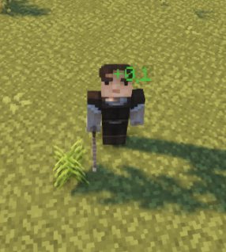

# 伤害显示 {#️-damage-indicators}

你可以在配置文件`indicators.yml`中编辑损坏和再生指示器。MythicLib可以使用各种流行的全息图插件来显示目标实体周围的再生/攻击指示器。

MythicLib可以使用各种全息图插件来显示这些指标。请参阅[此 wiki 页面](compatibility.md#hologram-plugins)以获取MythicLib支持的全息图插件列表。

## 基本配置 {#basic-config}

<details markdown="1">

<summary>默认配置</summary>

```yml
damage_indicators:

  # Enable/disable damage indicators alltogether
  enabled: true

  # Under 0.1 damage, no indicator will show
  min_damage: 0.1

  # Use format: 'ᜌ{icon} &f{value}ᜌ' along with the resource pack
  # provided in the wiki in order to remove the gray background
  format: '{icon} &f{value}'
  decimal_format: '0.#'

  custom_font:
    enabled: false
    normal:
      '0': 'ᜀ'
      '1': 'ᜁ'
      '2': 'ᜂ'
      '3': 'ᜃ'
      '4': 'ᜄ'
      '5': 'ᜅ'
      '6': 'ᜆ'
      '7': 'ᜇ'
      '8': 'ᜈ'
      '9': 'ᜉ'
      'dot': 'ᜊ'
      'inter': 'ᜍ'
    crit:
      '0': 'ᜐ'
      '1': 'ᜑ'
      '2': 'ᜒ'
      '3': 'ᜓ'
      '4': '᜔'
      '5': '᜕'
      '6': '᜖'
      '7': '᜗'
      '8': '᜘'
      '9': '᜙'
      'dot': 'ᜋ'
      'inter': 'ᜍ'

  # single => one indicator only
  # packet => one indicator per damage packet (!!)
  # type   => one indicator per damage type
  group_by: packet
  damage_type_splits: [weapon, skill]
  damage_type_icon_join: '' # Join by space character

  icon:
    weapon:
      normal: '&c🗡'
      crit: '&c&l🗡'
    skill:
      normal: '&6☄'
      crit: '&6&l☄'
    projectile:
      normal: '&a➶'
      crit: '&a&l➶'
    physical:
      normal: '&4✘'
      crit: '&4&l✘'
    magic:
      normal: '&9✩'
      crit: '&9&l✩'

  split_holograms: true
  holograms_join: ' ' # Split by space character

  move: true
  radial_velocity: 1
  gravity: 1
  initial_upward_velocity: 1
  y_offset: 0.1
  entity_height_percent: 0.75
  r_offset: 0.5
  entity_width_percent: 0.75
  tick_period: 3
  lifespan: 20
```

</details>

你可以使用`format`选项编辑指标格式。`icon`部分允许你配置与每种损坏类型相对应的图标。

### 物理选项 {#physics-options}

当增加`radial_velocity`时，全息图会飞得更远（如果你使用的全息图插件支持移动全息图 - 有些不支持 -）。增加`gravity`选项将使你的全息飞得更快到地面。反之，增加`initial_upward_velocity`会让你的全息飞得更高。  如果你想将平面 Y 偏移应用到显示伤害显示的位置，则可以使用`y_offset`。最后但并非最不重要的一点是，例如，将`entity_height_percent`设置为`.75`将使全息显示在目标实体高度的75%处（然后与平面 Y 坐标偏移叠加），并将其设置为100%将使其显示在实体边界框的顶部。


当关闭`move`时，全息图将是静态的，不会从其初始位置移动。

### 全息图 {#holograms}

当切换`split_holograms`时，每个图标将显示在自己的全息图中，而不是所有图标都显示在同一个全息图中。当设置为`false`时，你可以使用`holograms_join`配置选项配置图标的连接方式。例如，如果将其设置为逗号后跟空格`" "`，则显示武器和技能伤害的指示器将显示武器图标，然后是逗号和空格，然后是技能图标。看起来像这样：`🗡, ☄`（后面是指示器损坏值）。

## 使用自定义字体 {#using-a-custom-font}

通过切换`custom_fonts.enabled`配置选项来启用自定义字体。  然后，MythicLib将用你在配置中指定的字符替换任何数字字符（0-9）。你还可以配置 ML 将用作小数点分隔符 (`dot`) 的字符以及将放置在所有其他字符之间的字符。

使用自定义纹理，你可以使用资源包让伤害显示具有完全自定义的角色。这是一个[资源包](https://www.dropbox.com/s/yih3hsdq6o6eak0/Font.zip?dl=1)，可与默认的MythicLib配置配合使用，你可以检查该资源包以了解如何在 ML 指标中使用自定义字体。

## `groupby` {#groupby}

参数`group_by`允许你选择如何将损坏数据包分组在一起以形成指示器。有以下三个可用选项：

- `single`：将实体的所有损坏数据包分组到一个指示器中
- `packet`：为每个损坏数据包创建一个指示器，其中每个指示器显示数据包的总损坏及其损坏类型列表（每种损坏类型一个图标）。 **这是大多数人默认期望的选项。**
- `type`：你选择显示的伤害类型。使用此选项，你需要在`damage_type_splits`配置选项中指定要分割的损坏类型。对于指定的每种损坏类型，将创建一个指示器，显示该类型的总损坏。如果损坏包中不存在损坏类型，则不会为其创建任何指示符。

如果单个全息图包含多个损坏类型图标，你可以使用`damage_type_icon_join`配置选项配置图标的连接方式。例如，如果将其设置为逗号后跟空格`" "`，则显示武器和技能伤害的指示器将显示武器图标，然后是空格，然后是技能图标。看起来像这样：`🗡 ☄`（后面是指示器损坏值）。

### 示例 {#example}

假设玩家刚刚击中了一个具有100攻击力伤害武器（*物理，武器*伤害）的生物。on-hit技能触发，造成30*技能，魔法*伤害。最后，物品上存在的元素属性会造成额外的20*Fire-Weapon* 伤害。

|模式|结果指标|评论 |
| --- | --- | --- |
| `single` | `🗡☄✘ 150` | 单一指标 |
| `packet` | `🗡✘ 100`、`☄✩ 30`、`🔥🗡 20` | 每包一个 |
| `type` | `🗡 120`、`☄ 30` | 每个指定的损坏类型一个 |

## 再生/治疗指示器 {#regen-heal-indicators}

他们与伤害显示共享大部分选项。当通过药水、自然再生、技能恢复生命值时会出现这些。你还可以按照与伤害显示相同的语法将自定义字体应用于再生指示器。

<details markdown="1">

<summary>默认配置</summary>

```yml
regen_indicators:

  # Enable/disable damage indicators alltogether
  enabled: false

  # Under 0.1 health regen, no indicator will show
  min_regen: 0.1

  # Use format: 'ᜌ{icon} &f{value}ᜌ' along with the resource pack
  # provided in the wiki in order to remove the gray background
  format: '&a+{value}'
  decimal_format: '0.#'

  custom_font:
    enabled: false
    '0': 'ᜀ'
    '1': 'ᜁ'
    '2': 'ᜂ'
    '3': 'ᜃ'
    '4': 'ᜄ'
    '5': 'ᜅ'
    '6': 'ᜆ'
    '7': 'ᜇ'
    '8': 'ᜈ'
    '9': 'ᜉ'
    'dot': 'ᜊ'
    'inter': 'ᜍ'

  move: true
  radial_velocity: 1
  gravity: 1
  initial_upward_velocity: 1
  y_offset: 0.1
  entity_height_percent: 0.75
  r_offset: 0.5
  entity_radius_percent: 0.75
  tick_period: 3
  lifespan: 20
```

</details>



---

原文：[‼️ Damage Indicators](https://docs.phoenixdevt.fr/mythiclib/features/damage-indicators) · 原文归档：2026-10-19
