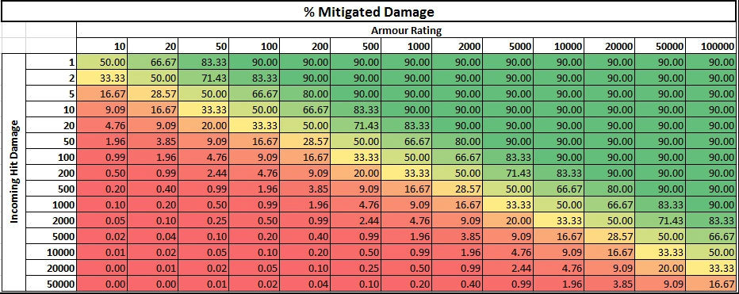

# 伤害 {#💔-damage}

MMOItems和MMOCore具有相同的伤害系统。任何攻击，从近战剑击到MMOCore能力，都有一组特定的伤害类型，可以是以下任何一种：

- **物理**、**魔法**或**徒手**伤害
- **射弹**伤害
- **武器** 或 **技能** 损坏
- **on-hit** 伤害（on-hit伤害不会触发on-hit效果）
- **点**或随着时间的推移而损坏
- **小兵**伤害

**e.g：** 弓造成weapon-physical-projectile伤害。冰晶法术造成projectile-magic-skill伤害。

## 属性造成的伤害增加 {#stats-increasing-damage-dealt}

攻击伤害可以增加几个属性，包括物理/魔法/射弹/武器/技能伤害，但也可以增加其他伤害属性，包括**PvE/PvP/不死伤害**，这取决于你正在攻击的实体。

从 MythicLib 1.3 开始，这些增伤属性采用线性相加，不再逐项相乘。例如，+50% 技能伤害和 +50% 魔法伤害，对魔法技能的总增伤为 `50% + 50% = 100%`，而不是 `150% * 150% - 100% = 125%`。如果再叠加 PvE 伤害或亡灵伤害等多项属性，这 25% 的差距还会进一步放大。

## 属性减少传入伤害 {#stats-reducing-incoming-damage}

这类属性包括 `Magic Damage Reduction` 和 `Damage Reduction`。与增伤属性不同，减伤属性采用乘法叠加。将 *10% Dmg Red* 和 *10% Fall Dmg Red* 组合时，摔落减伤**不是** `10% + 10% = 20%`，而是 `100% - 90% * 90% = 19%`。玩家属性越高，这 1% 的差距越明显。

这种计算使得这些属性在变大时减少操作，并确保伤害永远不会达到0并始终保持正值。简而言之，当考虑damage-increasing属性或伤害减少属性时，MythicLib总是考虑对攻击者来说最糟糕的情况。

## 防御 {#defense}

防御是玩家属性，你可以在MMOItems和MMOCore中使用。引入它是为了绕过30护甲点原版限制，该限制可防止用户拥有较高的护甲值。防御公式可以在主MythicLib插件配置中编辑。

```yml
# Defines how defense behaves. The formula should return the
# final amount of damage dealt, given the following inputs:
# - damage dealt #damage#
# - current player defense #defense#
#
# The default formula is inspired from Path of Exile, you can
# learn more about it on their wiki: https://pathofexile.fandom.com/wiki/Armour
#
# natural   <-> non-elemental damage
# elemental <-> fire/water/.. damage
defense-application:
  natural: '#damage# - #defense#'
  elemental: '#damage# * (1 - (#defense# / (5 * #damage# + #defense#)))'
```

下面的表格显示了在给定元素防御量和初始攻击点的情况下，使用流放之路中使用的默认元素防御公式所造成的伤害。 

此公式已在MythicLib1.4中更改，如果你想使用前一个公式，请在此处。它的缺点是不考虑传入的伤害量，使得调整高等级和低等级的公式变得更加困难。

```yml
defense-application: '#damage# * (1 - (#defense# / (#defense# + 100)))'
```

公式解释器支持最重要的数学函数。例如，你可以使用`sqrt(16)`（返回4），`pow(2, 3)`将返回8，`atan2`，`min(10, 5)`将返回5等。如果你不确定支持哪些方法，请尝试一下。

## 暴击 {#critical-strikes}

武器和技能可以造成暴击，增加造成的伤害。有关暴击的更多信息，请参阅 [On-Hit效果](on-hit-effects.md)页面。

## 伤害减免 {#damage-mitigation}

有关伤害减免的更多信息，请参阅[伤害减免](mitigation-types.md)页面。

## 伤害显示 {#damage-indicators}

关于伤害显示的更多信息请参考【本页](damage-indicators.md)】。

## MythicMobs兼容性 {#mythicmobs-compatibility}

你可以让MythicMobs中的小怪和技能造成标有MythicLib伤害类型的伤害。这样，玩家属性（例如*魔法伤害减免*或*火焰防御*）将适用于MythicMobs造成的伤害。

要让MythicMobs技能处理 MMO 伤害类型的伤害，请使用 [mmodamage 机制](../skills/custom/mythic.md#dealing-damage)。无论技能施法者是玩家还是生物，该机制都有效。

要让MythicMobs通过近战攻击造成MMO-typed伤害，请使用`setmmodamagesplits`机制。以下生物在每次近战攻击时造成10Magic-Projectile伤害：

```yml
ZombieWarrior:
  Type: ZOMBIE
  Damage: 10
  Skills:
    - 'setmmodamagesplits{splits=MAGIC,PROJECTILE} @self ~onSpawn'
```

> **信息**
>
> 上面的生物在生成时会施放`setmmodamagesplits`。但是，你可以随时使用此机制！你可以在特定的技能等期间替换生物的伤害分割mid-fight等。例如，你可以让 Boss 在第一阶段造成物理伤害，然后在第二阶段切换为魔法伤害。

在以下示例中，三分之一的伤害作为物理/武器造成，而其余三分之二作为Skill-Magic伤害造成。

```yml
ZombieWarrior:
  Type: ZOMBIE
  Damage: 10
  Skills:
    - 'setmmodamagesplits{splits=[PHYSICAL,WEAPON]:1,[SKILL,MAGIC]:2} @self ~onSpawn'
```

`splits`的格式为`[TYPE1,TYPE2,...]:amount1,[TYPE3,TYPE4,...]:amount2`，其中每个分割以逗号分隔。金额是可选的，默认为1。

## 更改技能的伤害类型 {#change-damage-types-of-skills}

技能造成伤害的伤害类型可以改变。欲了解更多信息，请参阅[此wiki页面](../skills/builtin.md#edit-damage-types-of-built-in-skills)。

---

原文：[💔 Damage](https://docs.phoenixdevt.fr/mythiclib/features/damage) · 原文归档：2026-10-19
