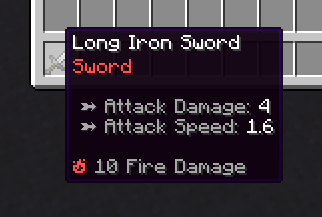
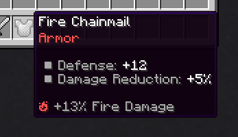
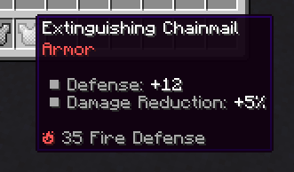
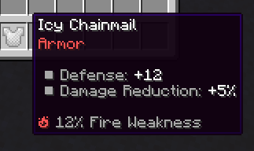
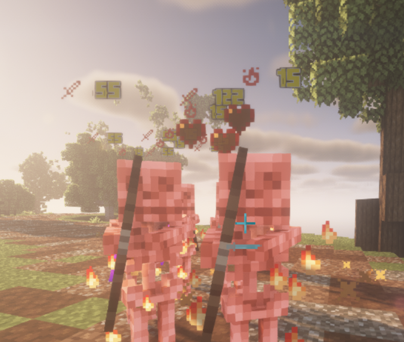

# 元素 {#🌱-elements}

元件是RPG服务器的重要组成部分。使用MythicLib自定义元素，你可以创建具有完全可配置攻击效果的元素攻击。你还可以设置元素暴击，这是在造成元素伤害时有一定几率触发的攻击。MythicLib1.3.4中引入了自定义元素

你要编辑的配置文件是`/MythicLib/elements.yml`

## 元素攻击 {#elemental-attacks}

技能可用于使用以下MythicMobs机制来处理**元素伤害**，你可以将`FIRE`替换为任何元素标识符。

```
mmodamage{amount="10";types=PHYSICAL,WEAPON;element=FIRE}
```

执行武器（近战或远程）攻击时也会触发元素攻击。

## 伤害计算 {#damage-calculation}

### 即将到来的伤害 {#incoming-damage}

有两种不同的属性用于增加玩家的元素伤害。你可以提供**固定数量**的元素伤害，例如物品。以下物品击中时会造成额外的10伤害。对应的属性为`<ELEMENT_NAME>_DAMAGE`，例如`FIRE_DAMAGE`。



你也可以使用`<ELEMENT_NAME>_DAMAGE_PERCENT`，这会增加你的元素伤害一定的系数。例如，佩戴以下物品将使你的火焰伤害增加13%。由于它是伤害倍增器，因此如果你没有物品造成基础/固定伤害，你将不会造成任何火焰伤害。



### 防御 {#defense}

元素防御减少传入的元素伤害。属性`<ELEMENT_NAME>_DEFENSE`提供平坦防御，而`<ELEMENT_NAME>_DEFENSE_PERCENT`提供 X% 额外元素防御点。



### 弱点 {#weakness}

元素弱点会增加特定因素所受到的元素伤害。例如，10%火焰弱点将增加10%的火焰伤害。对应的玩家属性是`<ELEMENT_NAME>_WEAKNESS`。



### 最终公式 {#final-formula}

以下是总结了前面所有解释的公式。最后一个公式使用默认的MythicLib防御公式。

```
Effective Damage  = <Flat damage> * (1 + <Extra damage>) * (1 + <Opponent weakness>)
Effective Defense = <Flat opponent defense> * (1 + <Extra opponent defense>)
Damage Mitigation = <Defense> / (<Defense> + 5 * <Damage>)
```

## 元素配置示例 {#element-config-example}

```yml
FIRE:
    
    # Main translation MMOCore and MMOItems will use
    name: Fire
    
    icon: BLAZE_POWDER # Purely cosmetic, used in the MMOItems item editor
    lore-icon: '🔥' # Used in the MMOItems item lore
    color: '&c' # Used in the MMOItems item lore
    
    # What gets executed when a normal elemental is performed
    regular-attack:
        mythiclib-skill-id: fire_elemental_attack
    
    # What gets executed when a elemental critical strike is performed
    # This one is optional. If not specified, no crits can occur
    crit-strike:
        mythiclib-skill-id: fire_critical_strike
```

每个元素都有一个配置部分，你可以自由添加、编辑和删除任何配置部分。完成编辑后，你可以使用`/ml reload`它将新配置重新加载到MythicLib中。然后点击`/mi reload`或`/mmocore reload`将更改传播到MMOItems和MMOCore。

`name`、`icon`、`lore-icon`和`color`选项都是装饰性的。最重要的是`regular-attack`，它是攻击者在执行元素攻击时施放的技能，以及`crit-strike`，这是在执行元素暴击时施放的技能。默认情况下，MythicLib使用自定义脚本来处理这些攻击技能但你可以使用其他插件，例如MythicMobs或Fabled。

### 使用其他技能插件 {#using-other-skill-plugins}

如果你想使用MythicMobs技能，只需将`mythiclib-skill-id`更改为`mythicmobs-skill-id`（并指示正确的 MM技能标识符）。如果你使用Fabled，也可以使用`fabled-skill-id`。这是相同的配置部分，但有一个小的配置键更改：

```yml
FIRE:
    name: Fire
    icon: BLAZE_POWDER
    lore-icon: '🔥'
    color: '&c'
    regular-attack:
        mythicmobs-skill-id: fire_elemental_attack
    crit-strike:
        mythicmobs-skill-id: fire_critical_strike
```

## 元素攻击效果 {#elemental-attack-effects}

MythicLib为每个元素提供了预配置的on-hit攻击效果，尽管你绝对可以根据自己的喜好进行调整。

默认情况下，基本on-hit攻击效果是使用MythicLib脚本实现的，这些脚本可以在`MythicLib/script/elemental_attacks.yml`中找到。这些on-hit效果取决于所应用的元素。

|元素|暴击效果|
| --- | --- |
| 火 | 让目标实体着火（持续时间随攻击力伤害而变化） |
| 冰 | 定身目标实体（持续时间随攻击力伤害而变化） |
| 风 | Area-of-effect击退 |
| 地球 | Area-of-effectknock-up |
| 雷霆 | 对附近实体造成20%的初始攻击力伤害 |
| 水 | Area-of-effect慢（持续时间随攻击力伤害而变化） |

## 伤害显示 {#damage-indicators}

伤害实体时会显示造成的元素伤害。在 [此 wiki 页面](damage.md#damage-indicators)上了解有关伤害显示的更多信息。在下面的屏幕截图中，可以看到`15 Fire Damage`处理生物的两个全息图，以及on-hit攻击效果的火焰粒子。



---

原文：[🌱 Elements](https://docs.phoenixdevt.fr/mythiclib/features/elements) · 原文归档：2026-10-19
