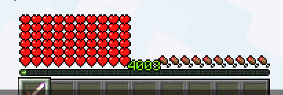

# 配置选项 {#🗒️-config-options}

## 去除损坏颗粒 {#removing-damage-particles}

一些服务器使用非常高的伤害值，这可能会在客户端召唤太多的伤害粒子。这可能会导致 FPS 下降并严重降低用户体验。为了解决这个问题，我们在MythicLib中集成了一个伤害粒子上限，它可以让你控制显示的伤害粒子数量。前往MythicLib`config.yml`文件：

```yml
damage-particles-cap:
  max-per-tick: 10
  enabled: false
```

通过切换`enabled`选项来启用此选项，并输入`max-per-tick`选项所需的值。这对应于**一个实体在一个刻内发射的粒子的最大数量**。

## 生命值秤 {#health-scale}

生命值缩放是RPG的一项小功能，它使玩家生命条始终显示相同数量的心（同时仍具有额外的最大生命值）。当你的生命值缩放至40（默认值）时，玩家生命值栏将始终显示2行（`2 * 20`）红心。

禁用生命值秤时：

启用生命值秤后：

你可以在 **MythicLib** 主配置文件中配置生命值缩放功能。这是非常不言自明的：

```yml
# Allows to scale health up/down to a specific amount
# so extra max health does not fill up the screen.
health-scale:
    enabled: true
    scale: 40
```

## 原版伤害修正 {#vanilla-damage-modifiers}

更改对特定伤害源造成的伤害量。当需要平衡原版伤害源时，此工具会派上用场。你可以对任何可能的损坏源使用任何数学公式。可用的损坏源可以在 [spigot docs](https://hub.spigotmc.org/javadocs/spigot/org/bukkit/event/entity/EntityDamageEvent.DamageCause.html)中找到。

使用`{event_damage}`将返回初始事件伤害。

```yml
vanilla-damage-modifiers:
  enabled: false
  source:
    VOID: '%mythiclib_stat_max_health% * .05' # Deals 5% of player's max health
    FIRE: '{event_damage} * 2' # Multiplies by 2 fire damage
    WITHER: '%mythiclib_stat_max_health% * .05'
    LAVA: '%mythiclib_stat_max_health% * .2'
    DROWNING: '%mythiclib_stat_max_health% * .1'
```

---

原文：[🗒️ Config Options](https://docs.phoenixdevt.fr/mythiclib/general/config) · 原文归档：2026-10-19
