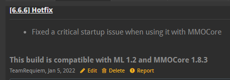

# 反馈问题 {#🐜-reporting-a-bug}

由于插件用户数量庞大，花一些时间正确起草问题单比以往任何时候都更加重要。即使你的配置/开发经验有限，以下大多数说明最多也只会花费你几分钟的时间，并且可能会为你和支持与开发团队节省几个小时的时间。

> **警告**
>
> 请勿使用Gitlab票证来请求支持。你的票证将被关闭，并且你将被要求加入 [Discord](https://phoenixdevt.fr/discord)服务器以获得社区和工作人员帮助。

## 使用up-to-date插件构建 {#use-up-to-date-plugin-builds}

除非工作人员特别告诉你暂时降级到较低的插件版本，否则请始终确保你使用的是MythicLib、MMOItems、MMOCore** 和 **MythicMobs可用的最新版本。MythicLib是任何 MMO 插件的硬依赖项，也需要保留up-to-date。由于插件代码依赖性和频繁的代码更新，你可能必须同时更新所有 MMO 插件。这些插件要求**始终**在插件更改日志中指出。

使用开发版本（可在官方网站上找到）时，请记住，最新的开发版本和 spigot 版本之间可能需要数周/数月的工作时间。因此，**当对任何 MMO 插件使用开发版本时，你必须同时对所有插件使用开发版本**。更多信息[此处](faq.md#keep-mythiclib-up-to-date)。

## 在 [常见问题](faq.md)wiki 页面] 中查找你的问题 {#look-for-your-issue-in-the-frequent-issues-wiki-page}

由于你的特定服务器或插件配置而存在错误，你可以自行修复。这不仅可以节省你在Discord服务器上等待答复的时间，而且也可以节省我们的一些时间。

## 在 [问题跟踪器](https://gitlab.com/phoenix-dvpmt/mythiclib/-/issues)] 中查找类似问题 {#look-for-similar-issues-in-the-issue-tracker}

所有已关闭的问题票证均已存档，但你仍然可以访问它们。查找其他用户已经解决的类似问题，你可能会在那里找到你的解决方案。如果你要报告现有问题，请查找现有的未处理票证并提供更多信息，以减少重复。否则，请开一张新票！

## 阅读你的控制台错误日志 {#read-your-console-error-logs}

这可能听起来很愚蠢，但如果每个人都阅读插件错误日志，*使用up-to-date插件构建*部分将几乎毫无用处，因为每次任何插件发生启动错误时，Bukkit都会在控制台中显示`[..] [Server thread/ERROR]: Error occurred while enabling ... (Is it up to date?)`。

虽然大多数情况下错误日志是你无法读取的99%堆栈跟踪，但开发人员留下的错误消息可能会帮助你自行解决问题。

每次看到插件错误堆栈跟踪时，你应该做的事情是使用 CTRL+F 并查找始终以`Error occurred while enabling ...`开头的 **插件启动错误日志**。如果你看到任何这些启动错误，则几乎可以保证该插件将无法正常运行，因为它无法启用，给定你的服务器和插件配置。如果你在*常见问题* wiki 页面中没有看到这些启动问题，则应优先报告这些问题。

## 如何报告错误 {#how-to-report-a-bug}

如果所有这些都没有帮助你可以在Gitlab上打开问题单，或者在我们的Discord服务器上与我们交谈，因为这绝对可能是插件错误。报告问题时，请尝试提供尽可能多的信息：

- 简要描述你的问题
- 找到一种（简单）方法来重现你的问题并提供步骤
- Pastebin 相关服务器日志（具体启动问题或完整日志，如果你不确定）
- 提供使用的 MMO/Mythic 插件版本（“所有最新的 spigot 版本”或“所有最新的开发版本”就足够了）
- 提供任何相关的插件配置文件（MMOItems物品配置、MMOCore职业配置、ML/MI/MM技能配置等）

你可以做些什么来让我们的生活更轻松：

- 提供视频或截图；在重现或描述复杂问题时，这些肯定会受到赞赏。
- 在新的服务器设置上尝试该插件。这将消除由于插件或服务器配置而导致的大多数问题。
- **不要**只是说“...不起作用”，因为此时90%还不够。指定你尝试使其正常工作的所有内容，并提供相关配置或日志。
- 不要提供90%与你正在处理的问题无关的巨大配置文件。找到**最简单**的配置设置，它可以有效地隔离有缺陷的功能
- 不要使用屏幕截图来提供控制台日志

|MMOItems|MMOCore|MMOProfiles|MMOInventory|MythicLib|
| --- | --- | --- | --- | --- |
| [问题跟踪器](https://gitlab.com/phoenix-dvpmt/mmoitems/-/issues) | [问题跟踪器](https://gitlab.com/phoenix-dvpmt/mmocore/-/issues) | [问题跟踪器](https://gitlab.com/phoenix-dvpmt/mmoprofiles/-/issues) | [问题跟踪器](https://gitlab.com/phoenix-dvpmt/mmoinventory/-/issues) | [问题跟踪器](https://gitlab.com/phoenix-dvpmt/mythiclib/-/issues) |

## 请求新功能 {#requesting-a-new-feature}

当请求新的插件功能时，你应该尝试并尽可能遵循之前的指南。诚然，大多数时候，如果足够清晰，简单的描述就足够了（例如，如果你要求新的 PAPI占位符或任何非常简单的东西），但对于更复杂的功能，最好提供尽可能多的信息：

- 快速给出一些背景信息
- 突出显示插件缺少什么（为什么需要更改/添加某些内容）
- 提供解决方案（提出尽可能多的想法并准确解释）
- 尝试并解释它有多么有用（这将使开发人员更有可能快速实现它）

同样，图像、视频或简单的方案可以帮助你解释你到底想要添加什么。

确保尚未使用搜索栏建议你的功能！这也将减少欺骗票。

---

原文：[🐜 Reporting a bug](https://docs.phoenixdevt.fr/mythiclib/report) · 原文归档：2026-10-19
