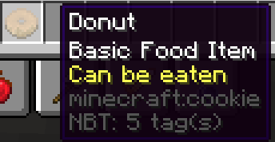
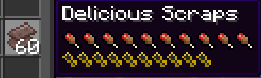

# 食物 {#foods}

## 甜甜圈 {#the-donut}

- 一个曲奇物品示例，使用资源包、[Mythic Crucible](https://git.lumine.io/mythiccraft/mythiccrucible) 和 [CustomModelData](https://mcmodels.net/how-to-tutorials/resource-pack-tutorials/what-is-custommodeldata-2/) 将外观改为甜甜圈。食用后会短暂给予饱和药水效果，并恢复少量饱和度。

关于 "eatmeal" 技能的使用方式，请查看[这里](https://git.lumine.io/mythiccraft/MythicMobs/-/wikis/Consumable-Skills#eat-food-skill)。

```yaml
donut:
  Id: COOKIE
  Display: 'Donut'
  Model: 1
  Lore:
  - '&fBasic Food Item'
  - '&eCan be eaten'
  Skills:
  - skill{s=eatmeal} ~onConsume
```



## 下界合金糖果 {#netherite-candy}

一个使用 [food](../items/items.md#food) 和 [consumable](../items/items.md#consumable) 物品组件，将通常无法食用的物品设为可食用的示例。使用 Mythic Mobs 免费版。

```yaml
NetheriteCandy:
  Material: NETHERITE_SCRAP
  Display: 'Delicious Scraps'
  Consumable:
    ConsumeSeconds: 0.5
    HasParticles: true
    Animation: EAT
  Food:
    Nutrition: 20
    Saturation: 20
    CanAlwaysEat: true
```


