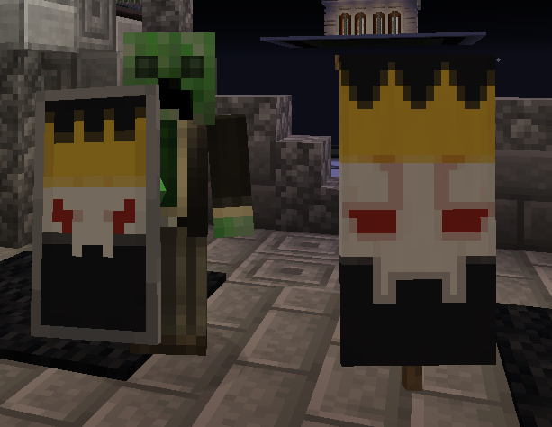

# 旗帜图案层 {#banner-layers}



要在 MythicMobs 中制作复杂的旗帜物品，可以使用以下语法。MythicMobs 不会硬性限制旗帜图案层数，因此可以突破 Minecraft 原版最多 6 层的限制。不过，超过 6 层可能导致异常行为或卡顿。

旗帜图案层也适用于盾牌。

## 语法 {#syntax}

```yml
Banner:
  Id: <banner/shield>
  #For Banners, the base color is set by the item ID
  BannerLayers:
  - <color> <pattern>
  - <color> <pattern>
```

## 图案 {#patterns}

可用[图案](https://hub.spigotmc.org/javadocs/spigot/org/bukkit/block/banner/PatternType.html)的列表见 Spigot Javadocs。

## 示例 {#examples}

```yml
SkeletonKingBannerShield:
  Id: shield
  Display: <dark_red>Skeleton King's Banner</dark_red>
  BannerLayers:
  - RED BASE
  - WHITE CURLY_BORDER
  - WHITE STRIPE_CENTER
  - BLACK STRIPE_BOTTOM
  - WHITE CREEPER
  - YELLOW STRIPE_TOP
  - BLACK TRIANGLES_TOP
```

```yml
SkeletonKingBanner:
  Id: orange_banner
  Display: <dark_red>Skeleton King's Banner</dark_red>
  BannerLayers:
  - RED BASE
  - WHITE CURLY_BORDER
  - WHITE STRIPE_CENTER
  - BLACK STRIPE_BOTTOM
  - WHITE CREEPER
  - YELLOW STRIPE_TOP
  - BLACK TRIANGLES_TOP
```
