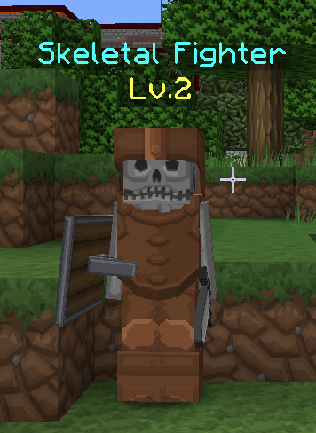

# 伪装 {#disguises}

### 生物伪装 {#mob-disguises}

**生物伪装依赖 [LibsDisguises](https://www.spigotmc.org/resources/libs-disguises.81/) 插件。必须同时具备这两个插件，伪装才会生效。[LibsDisguises 的最新文档见这里](https://www.spigotmc.org/wiki/lib-s-disguises/)**

大多数功能不需要 LibsDisguises 的高级版，因为 LibraryAddict 是个很友善的人。

### 技术细节说完了……那么，什么是伪装？ {#now-that-the-technical-mumbo-jumbo-is-over-what-is-a-disguise}

伪装可以让生物看起来像另一种生物、方块，甚至物品！它能为生物带来变化，实现原本无法做到的效果，例如创建一只看起来像僵尸的蜘蛛，也就是一只能爬墙的僵尸！有许多可实现的效果。

Spigot 文档中列出的任何实体类型都应该能够正常使用。
<https://hub.spigotmc.org/javadocs/bukkit/org/bukkit/entity/EntityType.html>

## 如何设置伪装 {#how-to-set-up-disguises}

在较新的 MythicMobs 版本中，可以完全通过行内配置设置伪装，所用的**伪装字符串**语法与游戏内 `/disguise` 命令相同。

例如，我们想让骷髅发光、旋转并着火，在游戏中会使用命令 `/disguise SKELETON setGlowing setSpinning setBurning`。可以将这条命令的内容写到生物的伪装选项旁，如下例所示：

```yml
SLSkelF:
  Type: ZOMBIE
  Equipment:
  - IRON_SWORD HAND
  - SHIELD OFFHAND
  - LEATHER_HELMET HEAD
  - LEATHER_CHESTPLATE CHEST
  - LEATHER_LEGGINGS LEGS
  - LEATHER_BOOTS FEET
  Display: '&BSkeletal Fighter\n&ELv.<mob.level>'
  Disguise: SKELETON setGlowing setSpinning setBurning
```

## 伪装选项 {#disguise-options}

使用 `/dhelp <disguisetype>` 可以查看额外的伪装选项，使用 `/dhelp` 还可以查看类型的更多信息。示例：

```yml
#Invisible powered Creeper
Disguise: creeper setPowered true setInvisible true

#Brown horse with white spots and gold armor
Disguise: horse setColor brown setStyle white_dots setHorseArmor 418

#Upside-down player disguise with Notch's skin
Disguise: player Dinnerbone setSkin Notch
```

## 保存伪装 {#saving-disguises}

1. 下载要用于伪装的 skin.png 文件，放到 server/plugins/libsdisguises/skins 文件夹中。
2. 使用命令 `/savedisguise RumiIsAwesome player <inherit> setSkin RumiExMachina.png setDynamicName`，将皮肤保存为伪装。
3. 使用 `Disguise: RumiIsAwesome`，将它应用到你的 MM 生物上。

### 详细步骤 {#detailed-steps}

1. `RumiIsAwesome` 是伪装的名称。
2. `player` 表示这是玩家伪装。
3. `<inherit>` 表示从 `Display:` 获取名称，而不是在这里另行填写。
4. `setSkin RumiExMachina.png` 表示将伪装皮肤设为 skins 文件夹中的 .png 文件。因此，如果 skins 文件夹中有一张名为 Goblin.png 的皮肤，就使用 setSkin Goblin.png。
5. `setDynamicName` 用于允许伪装名称频繁变化，适合需要在名称中显示实体生命值的情况。

较复杂的示例：

```yml
SneakyDisguisingMob:
  Type: wither_skeleton
  Display: 'meh'
  CustomKillMessages:
  - '<target.name> was sneaked upon! (to death)'
  Health: 128
  Disguise: player Steve setSkin meeeh.png setBurning true setSneaking true setSprinting true setModifyBoundingBox false setDynamicName true
```

#### 名称标签 {#nameplates}

名称显示功能可以扩展玩家伪装生物的名称，突破通常的 16 字符限制。
使用时只需安装 Holograms，并省略伪装中的 “Player” 字段（仍然需要皮肤！）。
如果不指定 player 字段，就会改用 Display 字段，通过自定义名称显示。
此外，生物名称还可以通过换行标记（\n）分成多行。

```yml
Monkey:
  Type: skeleton
  Display: "this display name is too \n long for players normally"
  Disguise: player Steve setSkin Kurdie.png
```

此功能需要 LibsDisguises 和 Holograms 插件：<https://www.spigotmc.org/resources/holograms.4924/>

如果你有 LibsDisguises 高级版，可以使用 `setDynamicName` 选项设置多行伪装名称。



#### 示例 {#examples}

伪装使用示例：

```yml
ExampleMob:
  Type: skeleton
  Disguise: player libraryaddict setCustomName "&8Not Darkitect" setSkin Darkitect.png
```

```yml
ExampleMob2:
  Type: skeleton
  Health: 20
  Disguise: player Ashijin setSkin Notch.png
```

```yml
ExampleMob3:
  MobType: skeleton
  Health: 20
  Disguise: pig
```

```yml
ExampleMob4:
  MobType: skeleton
  Health: 20
  Disguise: FALLING_BLOCK STONE
```
