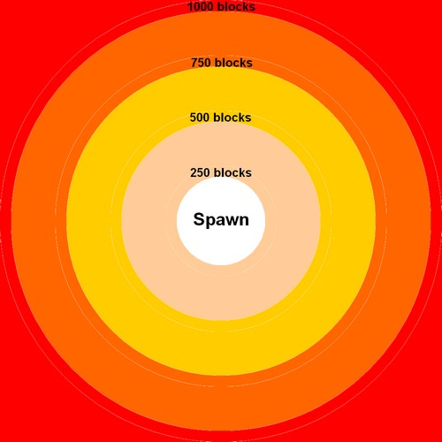

# 等级

生物等级功能可以为生物设置等级，并实现多种相关效果。

例如，你可以让生物的伤害和生命值随着等级的提高而增加，或者你可以让它们根据其等级掉落更多物品（请参阅[掉落表选项](../drops/droptables.md#droptable-options)中的*BonusLevelItems*）。

在更复杂的配置中，还能按等级完全更换掉落物、使用不同技能，甚至通过刷怪点和随机生成设置，按等级改变生成地点或生成方式。

生物等级也会受到世界缩放（见下文）、[随机刷怪点](../random-spawns.md)或[SetLevel机制](../skills/mechanics/setlevel.md)的影响。

```yaml
Zombie:
  Type: zombie
  Health: 100
  Damage: 10
  Display: '&5Zombie Lvl - <caster.level>'
  Options:
    MovementSpeed: 0.3
  Drops:
  - myDroptable
  LevelModifiers:
    Health: 5
    Damage: 0.5
```

# Level {#level}

设置生物的默认等级，放在生物定义的最外层。可以使用固定数值，也可以使用 `minTOmax` 格式的范围；使用范围时，每次生成都会在两端数值之间随机选取一个整数，包含两端。也支持 `3-7` 这样的连字符写法。

```yaml
SkeletonKing:
  Type: skeleton
  Level: 5
```

```yaml
SkeletonPack:
  Type: skeleton
  Level: 3to7
```

生成时没有指定等级，就会使用此值，例如通过刷怪点、`/mm mobs spawn`、图腾或 mobbullet 生成。自行指定等级的生成来源会覆盖它，包括[召唤](../skills/mechanics/summon.md)机制（默认使用施法者等级）和[设置等级](../skills/mechanics/setlevel.md)机制。未设置时默认为 1，最终生成等级也始终不低于 1。无效值会记录配置错误，并回退为 1。

键 `MobLevel` 和 `Options.Level` 被接受为 `Level` 的别名。

# LevelModifiers {#levelmodifiers}

这些选项放在 LevelModifiers 下，按每级给定的数值增加对应属性，增加量叠加在基础属性之上。

如果你没有在生物配置中为受影响的属性指定基值，则等级修正可能不起作用。

```yaml
  LevelModifiers:
    Health: [number]
    Damage: [number]
    KnockbackResistance: [number]
    Power: [number]
    Armor: [number]
    MovementSpeed: [number]
```

# 世界等级缩放 {#world-scaling}

生物等级（对于随机生成的生物）可以由插件通过指定位于`/MythicMobs/config/config-mobs.yml`中的世界缩放设置来自动设置。设置很简单。默认情况下，config-mobs.yml 中用于缩放的部分应如下所示：

```yaml
  MobLeveling:
    # Used to scale a mob's attributes as they level up
    ScalingEquations:
      Health: V * ((1.05)^(L-1))
      Damage: V * ((1.05)^(L-1))
      Scale: V
    # Alternate legacy method of scaling mobs attributes
    DefaultLevelModifiers:
      Health: 0.1
      Armor: 0
      Damage: 0
      KnockbackResistance: 0
      Power: 0
    # Per-world scaling options
    WorldScaling:
      Default:
        Enabled: true
        ScaleVanillaMobs: true
        PerBlocksFromSpawn: 250
      world2:
        Enabled: true
        PerBlocksFromSpawn: 250
      world2_nether:
        Enabled: false
        PerBlocksFromSpawn: 100
```

上面的示例显示了具有不同缩放级别的不同世界。以“world2”为例，随机生成的生物的级别将如下所示：

- 白色区域为等级 0，距离出生点 0-249 格。
- 浅褐色区域为等级 1，距离 250-499 格。
- 黄色区域为等级 2，距离 500-749 格。
- 橙色区域为等级 3，距离 750-999 格。
- 红色区域为等级 4，距离 1000-1249 格。
- Etc.



这些选项将自动应用于使用MythicMobs 的[随机生成](../random-spawns.md)召唤到游戏中的所有生物。你可以在 randomspawn 配置上使用 **UseWorldScaling: [ true / false ]** 选项来控制生物是否应该受到世界缩放的影响。

> 请注意，世界缩放选项永远不会影响[原版覆盖](../vanilla-overrides.md)，除非该世界的`ScaleVanillaMobs`选项设置为`true`。
